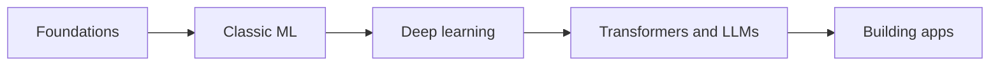

## What this track is

AI engineering means building software where part of the behaviour comes from a **model** (a function whose rules were learned from data, not written by hand) instead of an `if` statement.

You will work through five stages:

- **Foundations**: Python, NumPy (the array library), just enough linear algebra, calculus and probability.
- **Machine learning**: regression, classification, evaluation, overfitting, classic models.
- **Deep learning**: neural networks, backpropagation, training, PyTorch.
- **Transformers and LLMs**: attention, tokenization, training, sampling. An **LLM** (large language model) is a neural network trained to predict the next piece of text.
- **Building AI apps**: APIs, RAG, agents, evals, fine-tuning, serving, safety.



## Where the time really goes

Most people picture the work as designing clever models. Most teams spend it elsewhere.

| Activity | Typical share of effort | What it looks like |
|---|---|---|
| Data: collecting, cleaning, labelling | Largest | Fixing missing values, duplicates, wrong labels |
| Evaluation | Large | Test sets, metrics, comparing versions, finding failure cases |
| Plumbing | Large | APIs, retries, caching, latency, cost, monitoring |
| Model choice and prompting | Smaller than expected | Picking a model, writing prompts, tuning |
| Training a model from scratch | Rare | Only a few labs do this at scale |

:::truth
The share of effort is a rule of thumb, not a measurement. The direction is reliable: a better dataset and a better test set usually beat a cleverer model. A demo that works once is not a product.
:::

```quiz
q: A teammate says the new prompt "feels better". What is the most useful next step?
options:
  - Ship it, since the demo looked good
  - Run both prompts on the same fixed set of test cases and compare scores
  - Switch to a bigger model
  - Ask the model whether the new prompt is better
answer: 1
why: "Impressions are noisy and biased toward the last example you saw. A fixed test set makes the comparison repeatable, and it is the habit this whole track keeps coming back to."
```

## The smallest useful habit: an eval

An **eval** (evaluation) is a fixed list of inputs with the answers you expect, plus a score. It is the unit test of AI work.

```predict
lang: python
prompt: A keyword rule is scored on four labelled messages. What is printed?
code: |
  cases = [
      ("refund please", "refund"),
      ("where is my parcel", "tracking"),
      ("money back now", "refund"),
      ("hello", "other"),
  ]

  def classify(text):
      return "refund" if "refund" in text else "other"

  hits = sum(classify(t) == label for t, label in cases)
  print(hits / len(cases))
output: 0.5
why: "Only 'refund please' and 'hello' match. The rule misses 'parcel' and 'money back', so 2 of 4 are right. You only know this because the cases exist."
```

The same loop works when the classifier is an LLM. Only the function changes.

```python
def call_llm(prompt: str) -> str:
    """Placeholder: send `prompt` to any LLM provider and return its text reply."""
    raise NotImplementedError

def classify_with_llm(text: str) -> str:
    reply = call_llm(f"Label as refund, tracking or other. Message: {text}\nLabel:")
    return reply.strip().lower()
```

`call_llm` is deliberately not tied to a vendor. Real SDKs differ, and the lessons in the last stage show how to wrap one safely.

```order
prompt: Arrange the core eval loop.
lang: python
code: |
  cases = load_cases()
  scores = []
  for case in cases:
      reply = call_llm(case["prompt"])
      scores.append(grade(reply, case["expect"]))
  print(sum(scores) / len(scores))
distractors:
  - "    print(scores[0])"
why: "Load the cases, call the model once per case, grade each reply, then report one aggregate number after the loop. Printing a single score tells you almost nothing."
```

## How to use these lessons

- **Do the blocks.** Predicting an output before running it teaches more than reading the answer.
- **Run the code.** Snippets are small and deterministic. Those that need PyTorch or scikit-learn say so.
- **Keep notes.** Every lesson ends with a short summary you can copy. Writing it in your own words is what makes it stick.
- **Expect to be slow at first.** Math notation feels hostile for the first few weeks. That is normal and it passes with practice.

:::tip
You do not need a GPU or a paid account for the first three stages. A laptop and Python are enough.
:::

## What you will not get

- A shortcut. There is real math, and it takes repetition.
- Every detail. These lessons give you the map. Papers and official documentation give you the territory, and tools change every few months while the fundamentals do not.
- Guarantees. Models are probabilistic, so "mostly right" is the normal state and your job is to measure how mostly.

```cards
- q: What is a model, in one sentence?
  a: A function whose rules were learned from data instead of written by hand.
- q: What is an eval?
  a: A fixed set of inputs with expected answers plus a score, used to compare versions of a system objectively.
- q: Where does most real AI engineering time go?
  a: Data quality, evaluation and plumbing, far more than designing or training models.
- q: What does LLM stand for?
  a: Large language model, a neural network trained to predict the next piece of text.
```

## Notes

:::notes
- A model is a function learned from data; AI engineering is building software around one.
- Most effort goes to data, evaluation and plumbing, not model design.
- An eval is a fixed set of cases plus a score. Build one before you change anything.
- Compare versions on the same cases, never on impressions.
- Track path: foundations, classic ML, deep learning, transformers and LLMs, building apps.
- Tools change quickly; linear algebra, probability, optimisation and evaluation stay useful.
- "Mostly right" is the normal state of a model; measure how mostly.
:::
