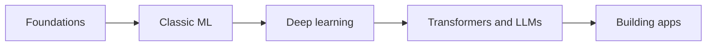

## What this track is

AI engineering means building software where part of the behaviour comes from a **model** instead of an `if` statement. A model is a function whose rules were learned from data, not written by hand.

You will work through five stages:

- **Foundations**: Python, NumPy (the array library), and just enough linear algebra, calculus and probability.
- **Machine learning**: regression, classification, evaluation, overfitting, classic models.
- **Deep learning**: neural networks, backpropagation, training, PyTorch (a deep learning library).
- **Transformers and LLMs**: attention, tokenization, training, sampling. An **LLM** (large language model) is a neural network trained to predict the next piece of text.
- **Building AI apps**: APIs, RAG, agents, evals, fine-tuning, serving, safety.



## Where the time goes

Most people picture an AI engineer tuning a giant neural network. Most working AI engineers spend their days elsewhere.

| Activity | Rough share of effort | What it looks like |
|---|---|---|
| Data | Large | Collecting, cleaning, labelling, finding the cases the model gets wrong |
| Evaluation | Large | Writing test sets, choosing metrics, comparing versions |
| Plumbing | Large | APIs, queues, caching, latency, cost, monitoring |
| Modelling | Small | Choosing a model, prompting, fine-tuning |

:::truth
Training a large model from scratch needs data and compute budgets that almost no team has. Most jobs are about using, evaluating and wrapping existing models well. The work is real engineering, just less cinematic than the headlines.
:::

```quiz
q: A team's chatbot "feels better" after a prompt change. What should they do before shipping it?
options:
  - Ship it, because the demo looked good
  - Run both versions on the same fixed set of test questions and compare scores
  - Ask the model whether the new prompt is better
answer: 1
why: A feeling from a few demos is not evidence. A fixed test set (an eval) lets you compare versions on identical inputs and catch regressions.
```

## The loop you will repeat

Every project in this track follows the same loop:

1. **Define** the input, the output and what "wrong" means.
2. **Build** a dumb baseline first (a rule, an average, a single prompt).
3. **Measure** it on data the model has not seen.
4. **Improve** the biggest source of errors, then measure again.

Skipping step 3 is the most common mistake. A change that cannot be measured is a guess.

```order
prompt: Arrange a minimal evaluation loop.
lang: python
code: |
  cases = load_test_cases()
  results = []
  for case in cases:
      answer = call_llm(case["prompt"])
      results.append(answer == case["expected"])
  print(sum(results) / len(results))
distractors:
  - "  results.append(call_llm(case) is not None)"
why: Load fixed cases, run the system on each, record pass or fail, then report one number you can compare across versions.
```

## A tiny eval, runnable now

`call_llm` below is a placeholder. Throughout this track it stands for "your provider's client call"; you swap in a real one later.

```python
def call_llm(prompt: str) -> str:
    """Placeholder: replace with your provider's client call."""
    return "Paris" if "France" in prompt else "unknown"

cases = [
    {"prompt": "Capital of France?", "expected": "Paris"},
    {"prompt": "Capital of Japan?", "expected": "Tokyo"},
]
passed = sum(call_llm(c["prompt"]).strip() == c["expected"] for c in cases)
print(f"{passed}/{len(cases)} passed")
```
```output
1/2 passed
```

The score is 1 of 2, and now you know exactly which case fails. That is the whole idea of an eval: a number you can track.

## How to use these lessons

- Read a section, then answer the block under it before moving on. Guessing wrong teaches more than reading the answer.
- Run every code sample yourself and change one number to see what moves.
- Finish the cards at the end of each lesson. They join your review deck, which brings the facts back after a few days, when you would otherwise forget them.
- Write your own notes. The `Notes` box at the end is a starting point, not a substitute.

## What you need before starting

- Comfortable Python: functions, lists, dictionaries, loops.
- High-school algebra. Everything else is taught here, in small pieces.
- Patience. Models are statistical, so the same code can give different results when data changes.

```predict
lang: python
code: |
  scores = [0.9, 0.7, 0.8]
  print(round(sum(scores) / len(scores), 1))
output: "0.8"
why: The mean of 0.9, 0.7 and 0.8 is 2.4 / 3 = 0.8. Averaging scores over a test set is the simplest eval metric.
```

:::warn
Fluent output is not correct output. A language model can produce a confident, well-formed, wrong answer. Never treat polish as a sign of accuracy.
:::

## Review cards

```cards
- q: What is a model?
  a: A function whose rules were learned from data instead of written by hand.
- q: Where does most AI engineering effort go?
  a: Data quality, evaluation and plumbing (APIs, latency, cost, monitoring), more than training models.
- q: What is a baseline?
  a: A deliberately simple solution (a rule, an average) that any real model must beat to be worth using.
- q: Why keep a fixed test set?
  a: So different versions are compared on identical inputs and regressions become visible.
- q: What does "eval" mean?
  a: A repeatable test that turns model behaviour into a number you can track.
```

## Notes

:::notes
- A model is a function learned from data; AI engineering is software around such functions.
- Most effort goes to data, evaluation and plumbing, not training huge models.
- Loop: define the task, build a dumb baseline, measure on unseen data, fix the biggest errors, measure again.
- An eval is a fixed set of cases plus a scoring rule that gives one comparable number.
- Fluent output is not correct output; measure before you trust.
- Track map: foundations, classic ML, deep learning, transformers and LLMs, building apps.
- `call_llm(...)` in these lessons is a placeholder for your provider's client call.
:::
