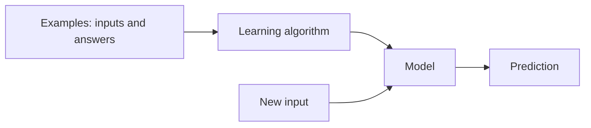

## Rules versus learning

Traditional programming: you write the rules, the program applies them to data and gives answers.

Machine learning (ML): you give **examples** (data plus the answers), and an algorithm finds the rules. The result is a **model**, a function you can apply to new data.



ML helps when the rules are too many or too fuzzy to write by hand, such as recognising spam or predicting a price. It is a poor choice when a few clear rules work; a plain `if` statement is cheaper and easier to explain.

## Kinds of learning

| Kind | What you give it | Typical output | Example |
|---|---|---|---|
| Supervised | Inputs and correct answers (**labels**) | Predict the label for new input | Price from house features |
| Unsupervised | Inputs only | Structure: groups, patterns | Grouping customers |
| Reinforcement | An environment with rewards | A policy for choosing actions | A game-playing agent |

Supervised learning splits into two:

- **Regression**: the answer is a number (a price, a duration).
- **Classification**: the answer is a category (spam or not, which digit).

Most of this stage is supervised learning. An **LLM** (large language model) is trained with a close cousin called self-supervised learning: the text itself supplies the labels, because the answer for each position is simply the next word.

```quiz
q: You want to predict whether a loan will be repaid (yes or no) from applicant data. What is this task?
options:
  - Regression, because there are numbers in the data
  - Classification, because the answer is a category
  - Unsupervised learning, because the data is messy
answer: 1
why: The type of task depends on the answer you want, not on the input. A yes or no answer is a category, so it is classification. It is supervised because past loans come with known outcomes.
```

## Features, labels, parameters

- A **feature** is one input measurement: area, number of rooms, word count.
- The **label** is the answer you want to predict: the price.
- A row of features is an example. A table of examples is a **dataset**: a matrix `X` of shape `(n_examples, n_features)` and a vector `y` of `n_examples` labels.
- **Parameters** (also called weights) are the numbers inside the model that learning adjusts.
- **Hyperparameters** are settings you choose before training, such as a learning rate (step size).

Training means searching for parameters that make predictions close to the labels. "Close" is measured by a **loss function**, a number that is low when predictions are good. Gradient descent, from the math lesson, is the usual search method.

## Train, validate, test

A model can memorise its training data and still fail on new data. So you never judge it on the data it learned from.

- **Training set** (about 60 to 80%): used to fit parameters.
- **Validation set**: used to choose hyperparameters and compare model versions.
- **Test set**: touched once, at the end, to estimate real-world performance.

```order
prompt: Arrange a basic train and test split with a fixed seed.
lang: python
code: |
  rng = np.random.default_rng(0)
  idx = rng.permutation(len(X))
  cut = int(0.8 * len(X))
  train, test = idx[:cut], idx[cut:]
  model.fit(X[train], y[train])
why: Shuffle indices with a seeded generator, cut at 80 percent, then fit only on the training indices so the test rows stay unseen.
```

:::warn
**Data leakage** is when information from the test set sneaks into training: duplicate rows on both sides, a feature computed from the label, or shuffling time-series data so the model sees the future. Leakage produces great scores and useless models.
:::

## Always start with a baseline

A **baseline** is the simplest sensible predictor: the average label for regression, the most common class for classification. Any model must beat it to be worth keeping.

```python
import numpy as np
rng = np.random.default_rng(0)
x = rng.uniform(0, 10, size=50)
y = 3 * x + 2 + rng.normal(0, 1, size=50)

baseline = np.mean((y - y.mean()) ** 2)       # always predict the mean
w, b = np.polyfit(x, y, 1)                     # fit a straight line
mse = np.mean((y - (w * x + b)) ** 2)
print(round(w, 2), round(b, 2))
print(round(baseline, 1), round(mse, 2))
```
```output
3.05 1.76
80.1 0.99
```

The data was made with slope 3 and intercept 2, and the fit recovers about that. **MSE** (mean squared error, the average of squared mistakes) drops from 80.1 to 0.99. That drop is the evidence the model learned something.

```predict
lang: python
code: |
  import numpy as np
  y = np.array([2.0, 4.0, 6.0])
  print(np.mean((y - y.mean()) ** 2))
output: "2.6666666666666665"
why: The mean is 4. Squared errors are 4, 0 and 4, whose average is 8 / 3 = 2.666... This is the error of the always-predict-the-mean baseline.
```

## Unsupervised in one picture

With no labels, an algorithm can still find structure. K-means picks k group centres and alternates two steps: assign each point to its nearest centre, then move each centre to the mean of its points.

```viz
algo: kmeans
input:
  k: 3
  points: 30
  seed: 7
```

:::truth
Real projects spend most of their time getting labelled data of good quality. A modest model on clean, correct labels usually beats a clever model on noisy ones.
:::

```cards
- q: What is machine learning in one sentence?
  a: Finding a function from examples (inputs and answers) instead of writing the rules by hand.
- q: Regression versus classification?
  a: Regression predicts a number; classification predicts a category.
- q: What are features and labels?
  a: Features are the input measurements for an example; the label is the answer to predict.
- q: Why keep a test set?
  a: To estimate performance on data the model has never seen, since training data scores are over-optimistic.
- q: What is data leakage?
  a: Information from outside the training data (such as test rows or the label itself) influencing training, giving unrealistically good scores.
- q: Why build a baseline first?
  a: It sets the minimum a real model must beat and exposes problems early.
```

## Notes

:::notes
- ML learns rules from examples; use it when rules are too fuzzy or numerous to write.
- Supervised (labels), unsupervised (no labels), reinforcement (rewards).
- Regression predicts numbers; classification predicts categories.
- Dataset: X with shape (examples, features) and y with one label per example.
- Training fits parameters to minimise a loss; hyperparameters are chosen beforehand.
- Split into train, validation and test; the test set is used once at the end.
- Data leakage gives great scores and useless models; check for duplicates and future information.
- Always compare with a simple baseline such as the mean or the majority class.
:::
