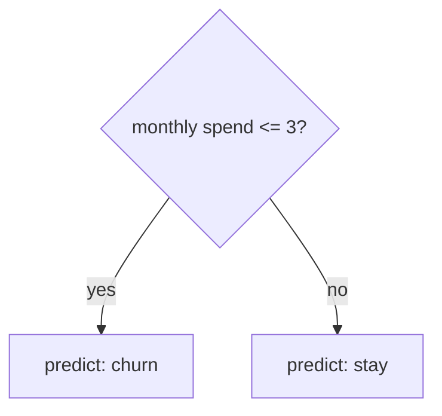

## Intuition: twenty questions

A **decision tree** is a flowchart of yes/no questions about the input. Each internal node asks one question about one feature ("is spend <= 3?"). Each leaf gives an answer.



Why people like trees:

- You can read them. A tree is easy to explain to a non-technical person.
- No feature scaling needed: a threshold works the same on rupees and on years.
- They handle mixed feature types and capture **interactions** (a rule that only applies when two things are true together) without you designing them.

## How a tree picks a question

The tree is built greedily, from the top. At every node it tries each feature and each threshold, and keeps the split that makes the two groups most **pure** (mostly one class).

- **Gini impurity** measures mixing: $G = 1 - \sum_k p_k^2$, where $p_k$ is the fraction of class $k$ in the group.
- A group that is all one class has $G = 0$. A 50/50 two-class group has $G = 0.5$.
- A split is scored by the size-weighted average impurity of its two children. Lower is better.

```python
import numpy as np

# Tiny dataset: [age, monthly_spend_in_thousands] -> 1 = churned, 0 = stayed
X = np.array([[22, 1], [25, 2], [30, 8], [35, 9], [40, 2], [45, 3], [50, 9], [55, 8]], dtype=float)
y = np.array([1, 1, 0, 0, 1, 1, 0, 0])

def gini(labels):
    if len(labels) == 0:
        return 0.0
    p = np.bincount(labels, minlength=2) / len(labels)
    return 1.0 - np.sum(p ** 2)

def best_split(X, y):
    best = (None, None, gini(y))           # (feature, threshold, weighted impurity)
    for j in range(X.shape[1]):
        for t in np.unique(X[:, j])[:-1]:   # candidate thresholds: each distinct value
            left, right = y[X[:, j] <= t], y[X[:, j] > t]
            score = (len(left) * gini(left) + len(right) * gini(right)) / len(y)
            if score < best[2]:
                best = (j, t, score)
    return best

print("impurity before split:", round(gini(y), 3))
j, t, score = best_split(X, y)
print(f"best split: feature {j} <= {t}, weighted impurity {score:.3f}")
```
```output
impurity before split: 0.5
best split: feature 1 <= 3.0, weighted impurity 0.000
```

Feature 1 (spend) separates the classes perfectly, so one question is enough. Real data is never this clean, so the tree keeps splitting each child until a stopping rule applies.

```predict
lang: python
prompt: A group has 4 churned and 4 stayed customers. What is its Gini impurity?
code: |
  p = [4 / 8, 4 / 8]
  print(1 - sum(q ** 2 for q in p))
output: "0.5"
why: "1 - (0.25 + 0.25) = 0.5, the maximum for two classes. A perfectly pure group would give 0."
```

## The weakness: trees overfit

Let a tree grow until every leaf is pure and it memorises the training set, noise included. That is overfitting (see the previous lesson).

- **Controls**: limit `max_depth` (how many questions deep), require a minimum number of samples per leaf, or **prune** (cut back) branches that help little.
- Small changes in the data can produce a very different tree. This instability is called **high variance**.

:::key
One deep tree has low bias but high variance. Averaging many different trees keeps the low bias and cuts the variance. This is the whole idea behind ensembles.
:::

## Ensembles: many weak opinions

An **ensemble** combines several models into one prediction. Two main recipes.

| | Bagging / random forest | Boosting (gradient boosting) |
|---|---|---|
| How trees are built | Independently, in parallel | One after another |
| Each tree sees | A random sample of rows (and a random subset of features per split) | The whole data, weighted toward earlier mistakes |
| Tree size | Deep, overfit trees | Shallow trees (often depth 3 to 6) |
| Combine by | Average (or vote) | Add up small corrections |
| Main effect | Reduces variance | Reduces bias, then risks overfitting |
| Tuning | Forgiving | Needs care: learning rate, number of trees, depth |

- **Bagging** (bootstrap aggregating): draw rows with replacement to make a new training set for each tree. A **random forest** adds a random feature subset at each split so the trees differ more.
- **Gradient boosting**: start with a rough prediction, then fit each new small tree to the current **residuals** (what is still wrong). The **learning rate** scales how much each tree is trusted. Libraries: XGBoost, LightGBM, CatBoost.

```quiz
q: Why does averaging many trees in a random forest help?
options:
  - Each tree is more accurate than a single tree trained on all the data
  - Trees make different errors, and averaging cancels part of them
  - It lets the model use more features than the data contains
  - It guarantees no overfitting
answer: 1
why: "Individual deep trees overfit, but in different ways because they see different rows and features. Their errors partly cancel in the average. If the trees were identical, averaging would change nothing."
```

## Using them in practice

Requires scikit-learn (`pip install scikit-learn`), which is not installed in this environment.

```python
# Requires scikit-learn
from sklearn.datasets import make_classification
from sklearn.ensemble import GradientBoostingClassifier, RandomForestClassifier
from sklearn.model_selection import train_test_split

X, y = make_classification(n_samples=500, n_features=10, random_state=0)
X_tr, X_te, y_tr, y_te = train_test_split(X, y, test_size=0.25, random_state=0)

forest = RandomForestClassifier(n_estimators=200, random_state=0).fit(X_tr, y_tr)
boost = GradientBoostingClassifier(learning_rate=0.1, max_depth=3, random_state=0).fit(X_tr, y_tr)

print("forest:", forest.score(X_te, y_te))
print("boosting:", boost.score(X_te, y_te))
print(forest.feature_importances_.round(2))   # how much each feature reduced impurity
```

- Start with a random forest: few settings, hard to ruin.
- Move to gradient boosting when you need the last few percent and can tune.
- Always compare against a simple baseline such as logistic regression.

:::warn
`feature_importances_` can mislead. Features with many distinct values get inflated scores, and correlated features split the credit between them. Treat it as a hint, not an explanation.
:::

:::truth
For **tabular data** (rows and columns, like a spreadsheet), tree ensembles are often as good as or better than neural networks, and far cheaper to train. Neural networks win on images, text and audio. Trees also cannot extrapolate: they never predict outside the range of targets seen in training.
:::

```blanks
prompt: Complete the description of bagging.
lang: python
code: |
  for tree in range(n_trees):
      idx = rng.choice(n, size=n, replace=[[True]])
      model = fit_tree(X[idx], y[idx])
      models.append(model)
  prediction = [[mean|average]]([m.predict(x) for m in models])
why: Bagging draws a bootstrap sample (rows picked with replacement) for each tree, then averages the predictions.
```

```cards
- q: What does a decision tree do at each node?
  a: It picks one feature and threshold that splits the data into the purest groups, usually by lowest weighted Gini impurity.
- q: Gini impurity of a pure group and of a 50/50 two-class group?
  a: 0 and 0.5.
- q: Why do single deep trees overfit?
  a: They can keep splitting until every training point is memorised, so they have high variance and change a lot with small data changes.
- q: Random forest versus gradient boosting in one line each?
  a: Forest averages many independent deep trees to cut variance. Boosting adds shallow trees one by one, each fixing the previous residuals.
- q: When do trees beat neural networks?
  a: On tabular data of moderate size, where they train fast and need little tuning.
```

## Notes

:::notes
- A decision tree is a flowchart of threshold questions; leaves hold predictions.
- Each split minimises weighted Gini impurity $1 - \sum p_k^2$ (0 = pure, 0.5 = worst for two classes).
- Deep trees overfit and are unstable; limit depth, leaf size, or prune.
- Random forest: many deep trees on bootstrap samples and random feature subsets, averaged. Cuts variance.
- Gradient boosting: shallow trees added in sequence, each fitting the current residuals, scaled by a learning rate.
- Forests are easy defaults; boosting is stronger but needs tuning.
- Feature importances are hints, not explanations. Trees cannot extrapolate beyond the training range.
:::
