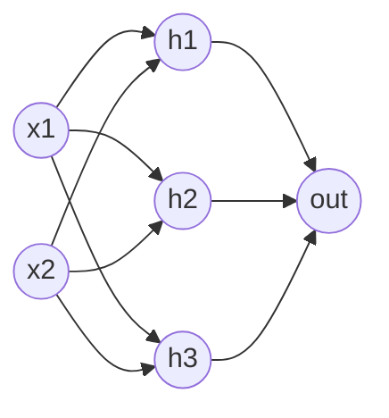

## One neuron

A **neuron** in a neural network is a tiny function:

$$ y = f(w_1 x_1 + w_2 x_2 + \dots + b) = f(\mathbf{w} \cdot \mathbf{x} + b) $$

- $x$ are the **inputs** (numbers from the data or from the previous layer).
- $w$ are the **weights**: how much each input matters. $b$ is the **bias**: a constant shift.
- $f$ is the **activation function**: a fixed nonlinear function applied to the weighted sum.

If $f$ is the sigmoid, this is exactly logistic regression. A neuron is the same idea you have already seen. The new part is connecting many of them.

Change the inputs, weights, bias and activation below. Notice how the output reacts to each.

```viz
algo: neuron
input:
  inputs: [1, 0.5]
  weights: [0.8, -0.4]
  bias: 0.1
  activation: sigmoid
```

## Activation functions

| Name | Formula | Range | Notes |
|---|---|---|---|
| Sigmoid | $1 / (1 + e^{-z})$ | 0 to 1 | Probabilities; flat at both ends, so learning slows |
| Tanh | $(e^z - e^{-z})/(e^z + e^{-z})$ | -1 to 1 | Centred on zero; also flat at the ends |
| ReLU | $\max(0, z)$ | 0 to infinity | Default for hidden layers; cheap, does not flatten for positive $z$ |

**ReLU** stands for rectified linear unit. It outputs zero for negative inputs and passes positive inputs through unchanged.

:::key
Without a nonlinear activation, stacking layers gains nothing. Two linear layers collapse into one linear layer, because a linear function of a linear function is still linear. The nonlinearity is what lets depth add power.
:::

## Layers and networks

A **layer** is many neurons reading the same inputs. Stack layers so each reads the previous layer's outputs:

- **Input layer**: your features, no computation.
- **Hidden layers**: the learned intermediate representations.
- **Output layer**: the prediction. One unit with sigmoid for yes/no, several units with softmax for classes, one linear unit for a number.

This is called an **MLP** (multi-layer perceptron) or a fully connected network: every unit connects to every unit in the next layer.



In matrix form a whole layer is one line: `h = f(x @ W + b)`. If a layer has $n_{in}$ inputs and $n_{out}$ units, `W` has shape $(n_{in}, n_{out})$ and `b` has $n_{out}$ numbers. Parameters per layer: $n_{in} \cdot n_{out} + n_{out}$.

```quiz
q: How many learnable parameters does a network with layer sizes 2 -> 3 -> 1 have (counting biases)?
options:
  - "6"
  - "9"
  - "13"
  - "16"
answer: 2
why: "First layer: 2*3 weights + 3 biases = 9. Second layer: 3*1 weights + 1 bias = 4. Total 13."
```

## Why depth: the XOR example

**XOR** ("exclusive or") outputs 1 when exactly one of two inputs is 1. Plot the four points and you will find no single straight line separates the 1s from the 0s, so a single neuron cannot learn it. One hidden layer fixes this.

```python
import numpy as np

# XOR: output 1 only when exactly one input is 1. No single line separates it.
X = np.array([[0, 0], [0, 1], [1, 0], [1, 1]], dtype=float)

relu = lambda z: np.maximum(0, z)

W1 = np.array([[1.0, 1.0],
               [1.0, 1.0]])     # both hidden units add the two inputs
b1 = np.array([0.0, -1.0])      # second unit only wakes up when both inputs are 1
W2 = np.array([[1.0], [-2.0]])  # output = h1 - 2*h2
b2 = np.array([0.0])

H = relu(X @ W1 + b1)           # hidden layer: shape (4, 2)
out = H @ W2 + b2               # output layer: shape (4, 1)
print("hidden:\n", H)
print("output:", out.ravel())
```
```output
hidden:
 [[0. 0.]
 [1. 0.]
 [1. 0.]
 [2. 1.]]
output: [0. 1. 1. 0.]
```

I picked these weights by hand. In practice, training finds them. The first hidden unit counts how many inputs are on; the second fires only when both are. Subtracting twice the second from the first turns the count 2 into 0, which is XOR.

```predict
lang: python
prompt: What does a ReLU layer output for these pre-activation values?
code: |
  import numpy as np
  z = np.array([-2.0, 0.0, 1.5])
  print(np.maximum(0, z))
output: "[0.  0.  1.5]"
why: "Negative and zero values become 0, positive values pass through. NumPy prints the floats with a width that gives two spaces between the zeros and 1.5."
```

## What can a network represent?

The **universal approximation theorem** says a network with one hidden layer, enough units and a nonlinear activation can approximate any reasonable continuous function. In practice:

- It says a good network exists. It does not say training will find it or that it needs few units.
- Deeper networks usually represent complex functions with far fewer units than a very wide shallow one.
- More parameters raise the risk of overfitting, so the regularization ideas from the previous stage still apply.

:::truth
Neural networks are not magic. On small tabular datasets, a tree ensemble or logistic regression is often as accurate and much easier to debug. Networks pay off with lots of data and unstructured inputs such as images, audio and text.
:::

```blanks
prompt: Complete the forward pass of a two-layer network.
lang: python
code: |
  def forward(x, W1, b1, W2, b2):
      h = np.maximum(0, x @ W1 + [[b1]])
      return h @ [[W2]] + b2
why: Each layer computes inputs times weights plus bias. The hidden layer applies ReLU; the output layer here is linear.
```

```cards
- q: What does a single neuron compute?
  a: "An activation function applied to a weighted sum of inputs plus a bias: $f(\\mathbf{w} \\cdot \\mathbf{x} + b)$."
- q: Why do we need nonlinear activations?
  a: Without them, any stack of layers collapses into a single linear function, so depth adds no power.
- q: What is ReLU?
  a: "$\\max(0, z)$. It outputs 0 for negative inputs and passes positive inputs through. It is the default hidden activation."
- q: How many parameters does a layer with n_in inputs and n_out units have?
  a: n_in * n_out weights plus n_out biases.
- q: What does the universal approximation theorem guarantee?
  a: That a wide enough one-hidden-layer network can approximate any continuous function. It does not promise that training will find it.
```

## Notes

:::notes
- Neuron: $f(\mathbf{w} \cdot \mathbf{x} + b)$. With sigmoid this is logistic regression.
- Layer: `h = f(x @ W + b)`. Parameters per layer: $n_{in} n_{out} + n_{out}$.
- Without nonlinear activations, stacked layers collapse to one linear map.
- ReLU ($\max(0, z)$) is the default hidden activation; sigmoid for yes/no outputs, softmax for classes.
- XOR needs a hidden layer because no single line separates it.
- One wide hidden layer can approximate any continuous function, but training may not find it.
- Networks need data and care; trees or linear models are often better on small tabular data.
:::
