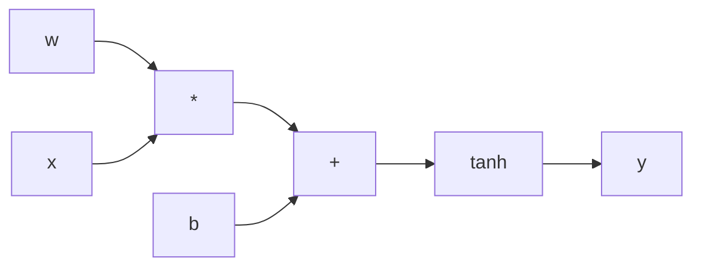

## The question backprop answers

Training means nudging every weight to lower the loss (the number measuring how wrong the network is). To nudge a weight correctly you need its **gradient**: how much the loss changes if that weight changes a little. A network can have millions of weights, so we need a cheap way to get all the gradients.

**Backpropagation** (backprop) is that way. It is not a learning algorithm by itself. It computes gradients. A separate step, gradient descent, uses them.

:::key
Backprop is the chain rule from calculus, applied efficiently. One forward pass computes the loss, one backward pass computes the gradient of every weight at about the same cost as the forward pass.
:::

## The chain rule in one example

If $y$ depends on $u$, and $u$ depends on $x$, then:

$$ \frac{dy}{dx} = \frac{dy}{du} \cdot \frac{du}{dx} $$

Take $y = (2x + 1)^2$. Let $u = 2x + 1$, so $y = u^2$.

- $dy/du = 2u$ and $du/dx = 2$.
- So $dy/dx = 2u \cdot 2 = 4(2x + 1)$. At $x = 1$ that is 12.

Each step only needs its **local derivative**: how its own output changes with its own input. The chain rule multiplies them together.

```quiz
q: Let y = (3x)^2 with u = 3x and y = u^2. What is dy/dx at x = 1?
options:
  - "6"
  - "9"
  - "18"
  - "36"
answer: 2
why: "dy/du = 2u = 6 at x = 1 (u = 3), and du/dx = 3. Multiply: 6 * 3 = 18. Check directly: y = 9x^2, so dy/dx = 18x = 18."
```

## The computation graph

Write the computation as a graph where each node is one simple operation (add, multiply, tanh). For the neuron $y = \tanh(w x + b)$:



- **Forward pass**: compute values left to right and remember them.
- **Backward pass**: start with $dy/dy = 1$ at the output and walk right to left. At each node, multiply the gradient arriving from the right by the node's local derivative, and hand the result to its inputs.

Local derivatives of the three operations used here:

| Operation | Local derivatives |
|---|---|
| $a + b$ | $1$ for both inputs |
| $a \cdot b$ | $b$ for $a$, and $a$ for $b$ |
| $\tanh(a)$ | $1 - \tanh^2(a)$ |

If a value feeds into several later nodes, the gradients from each path are **added**. That is why the code below uses `+=`.

## A scalar autograd engine

Autograd means "automatic gradients": the library records operations and derives the backward pass for you. Here is a minimal version for single numbers, about 40 lines. PyTorch does the same with tensors (arrays of numbers).

```python
import math

class Value:
    """A number that remembers how it was computed, so it can send gradients back."""
    def __init__(self, data, parents=()):
        self.data = data
        self.grad = 0.0
        self._parents = parents
        self._backward = lambda: None

    def __add__(self, other):
        other = other if isinstance(other, Value) else Value(other)
        out = Value(self.data + other.data, (self, other))
        def _backward():
            self.grad += out.grad          # d(a+b)/da = 1
            other.grad += out.grad
        out._backward = _backward
        return out

    def __mul__(self, other):
        other = other if isinstance(other, Value) else Value(other)
        out = Value(self.data * other.data, (self, other))
        def _backward():
            self.grad += other.data * out.grad   # d(a*b)/da = b
            other.grad += self.data * out.grad
        out._backward = _backward
        return out

    def tanh(self):
        t = math.tanh(self.data)
        out = Value(t, (self,))
        def _backward():
            self.grad += (1 - t * t) * out.grad  # d tanh(x)/dx = 1 - tanh^2
        out._backward = _backward
        return out

    def backward(self):
        order, seen = [], set()
        def visit(v):                     # topological order: parents before children
            if v not in seen:
                seen.add(v)
                for p in v._parents:
                    visit(p)
                order.append(v)
        visit(self)
        self.grad = 1.0
        for v in reversed(order):
            v._backward()

# y = tanh(w*x + b)
x, w, b = Value(2.0), Value(-0.5), Value(0.3)
y = (w * x + b).tanh()
y.backward()
print(f"y = {y.data:.4f}")
print(f"dy/dw = {w.grad:.4f}  dy/dx = {x.grad:.4f}  dy/db = {b.grad:.4f}")

# check against a numerical estimate for w
def f(w_):
    return math.tanh(w_ * 2.0 + 0.3)
eps = 1e-6
print(f"numeric dy/dw = {(f(-0.5 + eps) - f(-0.5 - eps)) / (2 * eps):.4f}")
```
```output
y = -0.6044
dy/dw = 1.2695  dy/dx = -0.3174  dy/db = 0.6347
numeric dy/dw = 1.2695
```

By hand: $wx + b = -0.7$, $\tanh(-0.7) = -0.6044$, and the local derivative $1 - 0.6044^2 = 0.6347$. That is $dy/db$ directly. Then $dy/dw = x \cdot 0.6347 = 1.2695$ and $dy/dx = w \cdot 0.6347 = -0.3174$.

The last lines are a **gradient check**: nudge $w$ up and down by a tiny `eps` and measure the slope. Writing this check is the standard way to catch backward-pass bugs.

```predict
lang: python
prompt: Using the Value class above, what is a.grad?
code: |
  a = Value(3.0)
  y = a * a
  y.backward()
  print(a.grad)
output: "6.0"
why: "Both inputs of the multiply are the same node, so a.grad accumulates two contributions: a.data + a.data = 6. This matches d(a^2)/da = 2a."
```

:::warn
Gradients accumulate. If you run `backward()` twice, or reuse a graph in a training loop, the `grad` fields keep adding. Real training loops reset gradients to zero before every backward pass. PyTorch's `optimizer.zero_grad()` does exactly that.
:::

## Putting gradients to work

Once every weight has a gradient, one training step is:

```python
# w.data -= learning_rate * w.grad   for every weight
```

The sign matters: the gradient points toward higher loss, so you step the opposite way. This is the gradient descent from the earlier lesson, now applied to every weight in the network at once.

```order
prompt: Arrange one training step for a network.
lang: python
code: |
  loss = compute_loss(model(x), target)
  zero_all_grads(params)
  loss.backward()
  for p in params:
      p.data -= lr * p.grad
distractors:
  - "      p.data += lr * p.grad"
why: Run the forward pass to get the loss, clear old gradients, run backward to fill new ones, then step each parameter against its gradient. Adding the gradient would climb the loss.
```

## What goes wrong

- **Vanishing gradients**: multiplying many numbers below 1 (for example the tanh derivative, at most 1, usually less) shrinks the signal toward zero in early layers, so they barely learn. ReLU and good initialisation reduce this. The next lesson returns to it.
- **Exploding gradients**: multiplying many numbers above 1 blows the gradient up.
- **Non-differentiable steps** (such as rounding or argmax) give no gradient and cannot sit inside the part of the graph you train.

:::truth
You will almost never write backprop by hand. Frameworks do it. Learn it anyway: when a loss turns to `nan` or a layer stops learning, the cause is in the gradients, and you can only debug what you understand.
:::

```blanks
prompt: Fill in the local gradient rules for the multiply node out = a * b.
lang: python
code: |
  def _backward():
      a.grad += [[b.data]] * out.grad
      b.grad += [[a.data]] * out.grad
why: The derivative of a*b with respect to a is b, and with respect to b is a, each multiplied by the gradient arriving from the output.
```

```cards
- q: What does backpropagation compute?
  a: The gradient of the loss with respect to every weight, by applying the chain rule backwards through the computation graph.
- q: Why are gradients from several paths added?
  a: If a value is used by several later operations, the loss depends on it through each path, and the total effect is the sum of the contributions.
- q: Local derivatives of a + b and a * b?
  a: For a + b, 1 for each input. For a * b, b for a and a for b.
- q: Which way do you step with a gradient?
  a: Against it. The gradient points toward higher loss, so subtract learning_rate times gradient.
- q: Why reset gradients each step?
  a: Backward accumulates into the grad fields, so old gradients would pollute the new ones.
```

## Notes

:::notes
- Backprop computes gradients; gradient descent uses them. They are separate steps.
- Chain rule: multiply local derivatives along the path from the loss to the weight.
- Forward pass stores values; backward pass starts at 1 at the loss and moves in reverse order.
- Add: gradient passes through. Multiply: gradient is multiplied by the other input. tanh: by $1 - \tanh^2$.
- When a value is used in several places, its gradients add (`+=`).
- Zero gradients before each backward pass; update with $w \leftarrow w - \text{lr} \cdot \text{grad}$.
- Check gradients against a numerical estimate when writing custom operations.
- Vanishing and exploding gradients come from long products of small or large factors.
:::
