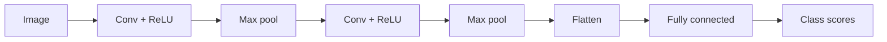

## Why not just an MLP on pixels?

A grayscale 28x28 image has 784 pixel values. Flatten it and feed a fully connected layer of 128 units: 784 x 128 = 100,352 weights, for a tiny image. A 224x224 color photo has 150,528 values, so the first layer alone would need hundreds of millions of weights.

It also ignores structure:

- **Locality**: nearby pixels belong together (an edge, a corner); far-apart pixels matter less.
- **Translation**: a cat is a cat whether it is in the top-left or the centre. A fully connected layer must relearn the cat at every position.

A **CNN** (convolutional neural network) builds both facts into the architecture.

## The convolution operation

A **filter** (or **kernel**) is a small grid of weights, for example 3x3. To convolve:

1. Place the kernel over a patch of the image.
2. Multiply each kernel weight by the pixel beneath it and add everything up. That gives one output number.
3. Slide the kernel to the next position and repeat.

The result is a **feature map**: a grid showing where in the image the pattern the kernel looks for appears. The same 9 weights are reused at every position, which is called **weight sharing**.

Step through a kernel that responds to a vertical edge (dark on the left, bright on the right) on a 6x6 image whose right half is bright.

```steps
title: Sliding a vertical-edge kernel across the top three rows
view: grid
frames:
  - grid:
      - [0, 0, 0, 1, 1, 1]
      - [0, 0, 0, 1, 1, 1]
      - [0, 0, 0, 1, 1, 1]
    highlight: {"0,0": active, "0,1": active, "0,2": active, "1,0": active, "1,1": active, "1,2": active, "2,0": active, "2,1": active, "2,2": active}
    note: Kernel at columns 0-2. The patch is all zeros, so the weighted sum is 0. No edge here.
  - grid:
      - [0, 0, 0, 1, 1, 1]
      - [0, 0, 0, 1, 1, 1]
      - [0, 0, 0, 1, 1, 1]
    highlight: {"0,1": active, "0,2": active, "0,3": active, "1,1": active, "1,2": active, "1,3": active, "2,1": active, "2,2": active, "2,3": active}
    note: Columns 1-3. Left column of the patch is 0, right column is 1. Each row gives -0 + 1 = 1, so the sum over 3 rows is 3. An edge.
  - grid:
      - [0, 0, 0, 1, 1, 1]
      - [0, 0, 0, 1, 1, 1]
      - [0, 0, 0, 1, 1, 1]
    highlight: {"0,3": active, "0,4": active, "0,5": active, "1,3": active, "1,4": active, "1,5": active, "2,3": active, "2,4": active, "2,5": active}
    note: Columns 3-5. The patch is all ones, so left and right columns cancel (-1 + 1 per row). The response is 0. No change inside a flat region.
```

The kernel here is a hand-written edge detector. In a CNN the kernel values are weights that **training learns**, so the network discovers its own useful detectors.

```python
import numpy as np

# 6x6 image: dark left half (0), bright right half (1) -> one vertical edge
img = np.zeros((6, 6))
img[:, 3:] = 1.0

# a 3x3 kernel that responds to "dark on the left, bright on the right"
kernel = np.array([[-1, 0, 1],
                   [-1, 0, 1],
                   [-1, 0, 1]], dtype=float)

def conv2d(img, k, stride=1):
    kh, kw = k.shape
    oh = (img.shape[0] - kh) // stride + 1
    ow = (img.shape[1] - kw) // stride + 1
    out = np.zeros((oh, ow))
    for i in range(oh):
        for j in range(ow):
            patch = img[i * stride:i * stride + kh, j * stride:j * stride + kw]
            out[i, j] = np.sum(patch * k)       # slide, multiply, add
    return out

out = conv2d(img, kernel)
print(out)
print("output shape:", out.shape)
print("stride 2 shape:", conv2d(img, kernel, stride=2).shape)
```
```output
[[0. 3. 3. 0.]
 [0. 3. 3. 0.]
 [0. 3. 3. 0.]
 [0. 3. 3. 0.]]
output shape: (4, 4)
stride 2 shape: (2, 2)
```

The response is 3 only in the two columns next to the edge. Strictly, most libraries compute this "slide, multiply, add" without flipping the kernel, which is technically cross-correlation, but everyone calls it convolution.

## Shape arithmetic

Four settings control the output size:

- **Kernel size** $k$: the width of the filter (3 is the common choice).
- **Stride** $s$: how many pixels the filter moves each time. Stride 2 halves the output size.
- **Padding** $p$: zeros added around the border. Padding of 1 with a 3x3 kernel keeps the size unchanged ("same" padding).
- **Channels**: color images have 3 channels (red, green, blue). A filter spans all input channels and produces one output channel. A layer with 32 filters produces 32 feature maps.

$$ n_{out} = \left\lfloor \frac{n_{in} + 2p - k}{s} \right\rfloor + 1 $$

Check with the code: $n=6$, $k=3$, $s=1$, $p=0$ gives $4$. With $s=2$: $\lfloor 3/2 \rfloor + 1 = 2$.

```estimate
q: A convolution layer has 3 input channels, 32 filters of size 3x3, and one bias per filter. How many learnable parameters does it have?
answer: 896
unit: parameters
tolerance: 0.05
hint: Each filter has 3 x 3 x 3 weights (kernel area times input channels), plus one bias.
solution: "Each filter: 3*3*3 = 27 weights + 1 bias = 28. Times 32 filters = 896. The count does not depend on the image size, which is the point of weight sharing."
```

## Pooling and the full architecture

**Pooling** shrinks each feature map. **Max pooling** with a 2x2 window and stride 2 keeps the largest value in each 2x2 block, halving height and width. It keeps the strongest response and makes the network less sensitive to small shifts.

A typical CNN repeats a block, then ends with a classifier:



- Early layers learn simple things: edges, colors, textures.
- Middle layers combine them into parts: corners, eyes, wheels.
- Later layers respond to whole objects.
- Going deeper, the maps get smaller while the number of channels grows.

Requires PyTorch (not installed here); this is the shape of a small network for 28x28 grayscale digits.

```python
# Requires PyTorch
from torch import nn

model = nn.Sequential(
    nn.Conv2d(1, 16, kernel_size=3, padding=1), nn.ReLU(), nn.MaxPool2d(2),   # 28x28 -> 14x14
    nn.Conv2d(16, 32, kernel_size=3, padding=1), nn.ReLU(), nn.MaxPool2d(2),  # 14x14 -> 7x7
    nn.Flatten(),                                                              # 32*7*7 = 1568
    nn.Linear(1568, 10),                                                       # 10 digit classes
)
```

```quiz
q: An input is 28x28. After a 3x3 convolution with padding 1 and stride 1, then a 2x2 max pool with stride 2, what is the height and width?
options:
  - 26 x 26
  - 28 x 28
  - 14 x 14
  - 13 x 13
answer: 2
why: "Padding 1 with a 3x3 kernel keeps 28 (floor((28 + 2 - 3) / 1) + 1 = 28). The max pool halves it to 14."
```

```quiz
q: Which property lets a CNN spot the same pattern anywhere in the image?
options:
  - Every pixel has its own weights
  - The same filter weights are reused at every position
  - Pooling copies the pattern to all positions
  - It stores the image in memory
answer: 1
why: "Weight sharing means one detector slides over the whole image. This also makes the parameter count independent of image size."
```

## Practical notes

- **Data augmentation** (random flips, crops, small rotations, color jitter) multiplies your effective data and is the cheapest regularizer for images.
- **Transfer learning**: start from a network pretrained on a large dataset (such as ImageNet, a collection of over a million labelled photos) and fine tune it on your small dataset. This beats training from scratch for most projects.
- **ResNets** add shortcut connections, `output = input + block(input)`, so very deep networks (tens to hundreds of layers) train without vanishing gradients.
- CNNs are no longer the only choice for vision: transformers now match or beat them on large datasets. But CNN ideas (local features, hierarchy) remain everywhere.

:::truth
A CNN assumes that nearby pixels matter and that patterns repeat across positions. That helps for images and audio spectrograms and hurts when the assumption is false, for example on a table of unrelated features. A CNN also does not understand scale or rotation unless it sees examples with them.
:::

```cards
- q: What is a convolution filter?
  a: A small grid of learnable weights that slides over the input, computing a weighted sum at each position to make a feature map.
- q: What is weight sharing and why does it matter?
  a: The same filter is reused at every position. It cuts the parameter count and detects a pattern wherever it appears.
- q: Output size formula for a convolution?
  a: "$\\lfloor (n + 2p - k) / s \\rfloor + 1$ for input size n, padding p, kernel k, stride s."
- q: What does max pooling do?
  a: It keeps the maximum in each window, for example 2x2, shrinking the map and adding tolerance to small shifts.
- q: What do early and late CNN layers detect?
  a: Early layers find edges and textures. Later layers combine them into parts and whole objects.
```

## Notes

:::notes
- Fully connected layers on pixels need too many weights and ignore locality.
- A convolution slides a small kernel over the input; each position gives weighted sum, producing a feature map.
- Weight sharing: the same kernel everywhere, so parameters do not grow with image size.
- Output size: $\lfloor (n + 2p - k)/s \rfloor + 1$. Parameters per conv layer: $k \cdot k \cdot C_{in} \cdot C_{out} + C_{out}$.
- Max pooling halves the map and adds shift tolerance.
- Typical pattern: [conv, ReLU, pool] repeated, then flatten and a fully connected classifier.
- Use augmentation and transfer learning; ResNet shortcuts enable very deep networks.
:::
