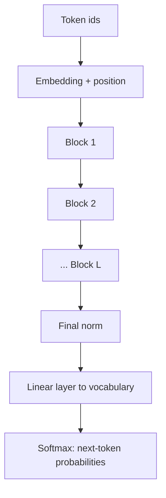

## The big picture

A **transformer** is a neural network built from one repeated unit, the **block**. Stack 12, 32 or 96 identical-shaped blocks and you have most of today's language models.

The path of a piece of text:

1. Split into **tokens** (pieces of text; see the tokenization lesson) and look up each token's vector in an **embedding table**.
2. Add information about each token's **position**.
3. Pass the vectors through $L$ blocks.
4. Turn the last vectors into scores over the vocabulary, one score per possible next token.



## Inside one block

Each block does two jobs, with a safety net around each.

| Part | Job | Mixes information across... |
|---|---|---|
| Self-attention | Let tokens read from other tokens | tokens |
| MLP (multi-layer perceptron, a small two-layer neural network) | Transform each token's vector on its own | features, per token |
| Residual connection | Add the input back to the output | keeps the original signal |
| Layer norm | Rescale each vector to mean 0, variance 1 | keeps numbers stable |

The block, in the common "pre-norm" form:

$$ x \leftarrow x + \text{Attention}(\text{LN}(x)) \qquad x \leftarrow x + \text{MLP}(\text{LN}(x)) $$

:::key
Attention moves information between tokens. The MLP processes each token separately. Residual connections let each block make a small edit rather than rebuild the vector from scratch.
:::

### Why residual connections

- They give gradients a direct path back through dozens of layers, which makes deep stacks trainable.
- Each block only needs to learn a correction, not a whole new representation.

### Why layer norm

**Layer normalisation** subtracts a vector's mean and divides by its standard deviation. Without it, values can drift or explode as they pass through many layers. Many recent models use a simpler variant called RMSNorm, which skips the mean subtraction.

```quiz
q: What does the MLP in a transformer block do that attention does not?
options:
  - It lets tokens exchange information with each other
  - It transforms each token's vector independently, without looking at other tokens
  - It creates the positional information
  - It converts vectors back into words
answer: 1
why: "Attention is the only place where positions interact. The MLP runs the same small network on every position separately and is where much of the model's stored knowledge is thought to live."
```

## Position information

Attention treats its input as a set: shuffle the tokens and the scores for each pair are unchanged. "dog bites man" and "man bites dog" would look alike. So position must be injected.

- **Learned positions**: a table with one vector per position (GPT-2 style). Fixed maximum length.
- **Sinusoidal**: fixed sine and cosine patterns (original paper).
- **Rotary (RoPE)**: rotates the query and key vectors by an angle that depends on position, so scores depend on relative distance. Common in recent open models.

## Code

A single decoder block with two heads, in NumPy. Weights are random, so this shows the plumbing, not intelligence.

```python
import numpy as np

def layer_norm(x, eps=1e-5):
    mu = x.mean(axis=-1, keepdims=True)
    var = x.var(axis=-1, keepdims=True)
    return (x - mu) / np.sqrt(var + eps)

def softmax(x):
    e = np.exp(x - x.max(axis=-1, keepdims=True))
    return e / e.sum(axis=-1, keepdims=True)

def attn_head(x, Wq, Wk, Wv):
    q, k, v = x @ Wq, x @ Wk, x @ Wv
    s = q @ k.T / np.sqrt(q.shape[-1])
    s = np.where(np.triu(np.ones_like(s, dtype=bool), 1), -np.inf, s)
    return softmax(s) @ v

def block(x, p):
    h = layer_norm(x)
    heads = [attn_head(h, *w) for w in p["heads"]]
    x = x + np.concatenate(heads, axis=-1) @ p["Wo"]     # residual 1
    h = layer_norm(x)
    x = x + np.maximum(0, h @ p["W1"]) @ p["W2"]         # residual 2 (ReLU MLP)
    return x

rng = np.random.default_rng(0)
d, n_heads, T = 8, 2, 5
dh = d // n_heads
p = {
    "heads": [tuple(rng.normal(size=(d, dh)) * 0.3 for _ in range(3)) for _ in range(n_heads)],
    "Wo": rng.normal(size=(d, d)) * 0.3,
    "W1": rng.normal(size=(d, 4 * d)) * 0.3,
    "W2": rng.normal(size=(4 * d, d)) * 0.3,
}
x = rng.normal(size=(T, d))
y = block(x, p)
print(x.shape, "->", y.shape)
print(round(float(np.abs(y - x).mean()), 3))
# causal check: changing the last token must not change earlier outputs
x2 = x.copy(); x2[-1] += 1.0
print(np.allclose(block(x2, p)[:-1], y[:-1]))
```
```output
(5, 8) -> (5, 8)
0.816
True
```

Two things to notice: the output has the same shape as the input, which is why blocks stack freely, and the last check confirms causality: earlier tokens never see later ones.

```order
prompt: Arrange the steps of one pre-norm transformer block.
lang: python
code: |
  h = layer_norm(x)
  x = x + attention(h)
  h = layer_norm(x)
  x = x + mlp(h)
  return x
distractors:
  - "x = attention(x) * mlp(x)"
why: Normalise, attend, add back; normalise, MLP, add back. Each sub-layer is wrapped in a residual addition, and there is no multiplication of the two paths.
```

## Counting parameters

A **parameter** is one learned number. Per block, with model width $d$:

- Attention: four $d \times d$ matrices (Q, K, V and output), about $4d^2$.
- MLP: two matrices, $d \times 4d$ and $4d \times d$, about $8d^2$.
- Total: roughly $12 d^2$ per block, ignoring small terms.

```predict
lang: python
code: |
  d, L = 768, 12
  per_block = 12 * d * d
  print(per_block * L // 1_000_000)
output: "84"
why: 12 * 768 * 768 = 7,077,888 per block; times 12 blocks is 84,934,656, which is 84 million after integer division by a million. GPT-2 small has about 124 million parameters in total because the embedding table (50,257 tokens by 768) adds roughly 39 million more.
```

```estimate
q: A model has width d = 4096 and 32 blocks. Using about 12 d^2 parameters per block, roughly how many parameters are in the blocks?
answer: 6400000000
unit: parameters
tolerance: 0.3
hint: 4096 squared is about 16.8 million.
solution: "12 × 16.8 million ≈ 201 million per block; × 32 ≈ 6.4 billion. Add the embedding tables and you land near the '7B' class of models."
```

## Encoder, decoder, or both

| Type | Attention | Typical use | Examples |
|---|---|---|---|
| Encoder-only | Every token sees every token | Classification, embeddings | BERT |
| Decoder-only | Causal: only earlier tokens | Text generation, chat | GPT family, Llama |
| Encoder-decoder | Encoder reads input; decoder writes output, attending to it | Translation, summarising | T5 |

Most chat models are decoder-only: one stack, trained to predict the next token.

:::truth
The architecture is not the whole story. Since 2017 the block has changed in details (norm placement, RoPE, gated MLPs, grouped-query attention) but not in shape. Most of the gap between models comes from data, scale and training recipe rather than a different design.
:::

```cards
- q: What are the two sub-layers in a transformer block?
  a: Self-attention (mixes information across tokens) and an MLP (transforms each token separately), each with a residual connection and normalisation.
- q: Why do transformers need positional information?
  a: Attention alone ignores order; shuffling tokens leaves pairwise scores unchanged.
- q: What does a residual connection do?
  a: Adds a layer's input to its output, giving gradients a direct path and letting the layer learn a small correction.
- q: Roughly how many parameters does one block have?
  a: "About $12 d^2$ for model width $d$: $4d^2$ in attention and $8d^2$ in the MLP."
- q: What is a decoder-only model?
  a: A transformer with causal attention that predicts the next token; the basis of GPT-style chat models.
```

## Notes

:::notes
- A transformer is an embedding layer, L repeated blocks, and a final linear layer to vocabulary scores.
- Block = norm, attention, add input back; norm, MLP, add input back (pre-norm form).
- Attention mixes across tokens; the MLP works on each token alone.
- Residual connections keep gradients flowing and let blocks make small edits.
- Layer norm (or RMSNorm) keeps activations at a stable scale.
- Position must be added explicitly: learned, sinusoidal or rotary (RoPE).
- Parameters per block are about 12 d^2; embeddings add vocab_size times d.
- Decoder-only (causal) models power chat LLMs; encoder-only suits embeddings and classification.
:::
