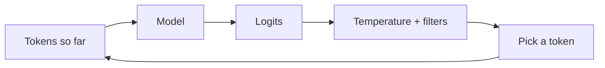

## From scores to words

At each step the model outputs one score per vocabulary token. These raw scores are called **logits**. **Softmax** converts them to probabilities that are positive and sum to 1. Then something has to choose one token. That choice is **decoding**.

Text generation is a loop:

1. Feed the tokens so far into the model.
2. Get probabilities for the next token.
3. Pick one token (the step this lesson is about).
4. Append it, and repeat until an end-of-text token or a length limit.



This is **autoregressive** generation: each output becomes part of the next input. It also explains why generation is slow: tokens come one at a time.

## Greedy decoding

**Greedy decoding** always takes the highest-probability token.

- Deterministic (same input, same output, apart from hardware noise).
- Tends to be repetitive and can loop.
- Good for tasks with one right answer, such as extraction or classification.

It is not the best overall sequence either: a locally best word can lead into a dead end. **Beam search** keeps several candidate sequences at once to reduce that; it suits translation more than open-ended chat and is rarely used in chat APIs.

## Temperature

**Temperature** $T$ divides the logits before softmax:

$$ p_i = \frac{e^{z_i / T}}{\sum_j e^{z_j / T}} $$

| Temperature | Effect |
|---|---|
| Near 0 | Almost always the top token; same as greedy |
| 1 | The model's own distribution |
| Above 1 | Flatter: unlikely tokens get more chances, text becomes erratic |

Drag the logits and temperature to see the shape change. The ranking never changes, only the sharpness.

```viz
algo: softmax
input:
  logits: [3, 2.5, 1, 0, -1]
  labels: ["cat", "dog", "fox", "car", "sky"]
  temperature: 1
```

```predict
lang: python
code: |
  import numpy as np
  z = np.array([2.0, 0.0])
  for T in (1.0, 0.5):
      p = np.exp(z / T); p /= p.sum()
      print(round(float(p[0]), 2))
output: |
  0.88
  0.98
why: With T = 1 the top probability is e^2 / (e^2 + 1) = 0.88. Halving the temperature doubles the logit gap to 4, which gives e^4 / (e^4 + 1) = 0.98. Lower temperature sharpens.
```

## Truncation: top-k and top-p

Even at moderate temperature, thousands of absurd tokens each hold a tiny probability, and together they add up. Truncation cuts that tail before sampling.

- **Top-k**: keep only the $k$ most likely tokens.
- **Top-p** (nucleus sampling): keep the smallest set of tokens whose probabilities add up to at least $p$. The set size adapts: small when the model is sure, large when it is unsure.
- After cutting, probabilities of survivors are renormalised to sum to 1, then one is drawn at random.

```quiz
q: The model is nearly certain about the next token (top probability 0.97). What does top-p = 0.9 do?
options:
  - Keeps about 90 tokens
  - Keeps only that one token, because it alone already reaches 0.9
  - Forces the model to pick the second most likely token
  - Raises the temperature
answer: 1
why: "Top-p keeps the smallest set whose probabilities sum to at least p. One token with 0.97 already passes 0.9, so the set has size 1. When the model is unsure, the set grows. That adaptivity is the point."
```

## Code

```python
import numpy as np

def softmax(z):
    e = np.exp(z - z.max())
    return e / e.sum()

def sample(logits, temperature=1.0, top_k=None, top_p=None, rng=None):
    if temperature == 0:
        return int(np.argmax(logits))              # greedy
    probs = softmax(np.asarray(logits) / temperature)
    order = np.argsort(-probs)                     # most likely first
    if top_k is not None:
        order = order[:top_k]
    if top_p is not None:
        cum = np.cumsum(probs[order])
        order = order[: int(np.searchsorted(cum, top_p) + 1)]   # smallest set reaching top_p
    keep = probs[order] / probs[order].sum()       # renormalise the survivors
    return int(rng.choice(order, p=keep))

words = ["cat", "dog", "fox", "car", "sky"]
logits = [3.0, 2.5, 1.0, 0.0, -1.0]
print(np.round(softmax(np.array(logits)), 3))
print(np.round(softmax(np.array(logits) / 0.5), 3))
print(np.round(softmax(np.array(logits) / 2.0), 3))

rng = np.random.default_rng(0)
draws = [words[sample(logits, 1.0, top_p=0.9, rng=rng)] for _ in range(1000)]
print({w: draws.count(w) for w in words})
```
```output
[0.552 0.335 0.075 0.028 0.01 ]
[0.72  0.265 0.013 0.002 0.   ]
[0.399 0.311 0.147 0.089 0.054]
{'cat': 546, 'dog': 376, 'fox': 78, 'car': 0, 'sky': 0}
```

Read the results:

- Line 2 (T = 0.5) is sharper than line 1; line 3 (T = 2) is flatter.
- With top-p 0.9, cumulative probability runs 0.55, 0.89, 0.96, so the set is cat, dog and fox. "car" and "sky" are never drawn, however many samples you take.

```order
prompt: Arrange the sampling pipeline for one token.
lang: python
code: |
  probs = softmax(logits / temperature)
  order = np.argsort(-probs)
  order = order[:top_k]
  keep = probs[order] / probs[order].sum()
  token = rng.choice(order, p=keep)
distractors:
  - "token = np.argmax(keep) + temperature"
why: Scale by temperature, rank, truncate, renormalise the survivors, then draw. Renormalising is needed because truncation removes probability mass.
```

## Other controls

- **Repetition and frequency penalties**: lower the logits of tokens already used, to reduce loops. They can also hurt tasks that need repeated words, like code.
- **Stop sequences**: end generation when a given string appears.
- **Max tokens**: a hard cap on output length.
- **Logprobs**: some APIs return the log-probabilities of chosen tokens. Useful for spotting low-confidence answers.
- **Seeds**: some providers accept a seed, but results are not guaranteed identical across runs or model versions.

## Choosing settings

| Task | Starting point |
|---|---|
| Extraction, classification, SQL, tool arguments | Temperature 0 (or very low) |
| Summaries, Q&A over documents | Low, 0 to 0.3 |
| Brainstorming, naming, creative writing | 0.7 to 1.0, top-p around 0.9 |

:::tip
Change one knob at a time. Most providers advise adjusting either temperature or top-p, not both.
:::

:::truth
Temperature 0 does not make a model correct, and it is not always perfectly repeatable: batching and floating-point effects on GPUs can flip near-ties. It makes outputs more consistent, not more truthful. Verify outputs with checks, not with settings.
:::

```cards
- q: What are logits?
  a: The raw per-token scores a model outputs before softmax turns them into probabilities.
- q: What does temperature do?
  a: Divides logits before softmax. Low T sharpens toward the top token, high T flattens the distribution.
- q: Top-k versus top-p?
  a: Top-k keeps a fixed number of top tokens; top-p keeps the smallest set whose probabilities sum to at least p, so its size adapts.
- q: What is greedy decoding?
  a: Always picking the highest-probability token. Deterministic but can be repetitive.
- q: Does temperature 0 guarantee a correct answer?
  a: No. It makes output more consistent, not more accurate, and may still vary slightly across runs.
```

## Notes

:::notes
- Generation is a loop: model gives logits, softmax gives probabilities, pick a token, append, repeat.
- Greedy always takes the top token; deterministic but repetitive.
- Temperature divides logits: low T sharpens, high T flattens; ranking is unchanged.
- Top-k keeps k tokens; top-p keeps the smallest set with cumulative probability at least p. Renormalise after cutting.
- Use temperature near 0 for extraction and structured output; moderate values for creative work.
- Tweak one sampling control at a time.
- Temperature 0 improves consistency, not truthfulness.
:::
