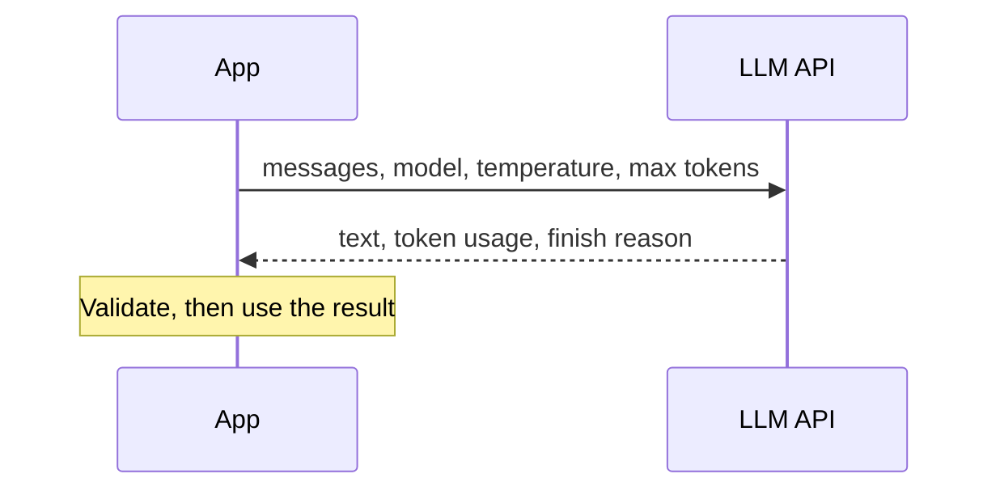

## What an LLM API call is

A hosted model is an HTTP service. You send a request with messages and settings; you get back text and usage numbers. Providers differ in names and extras, but the shape is the same.



| Request field | Meaning |
|---|---|
| model | Which model to run; price and quality differ |
| messages | System, user and assistant turns (see the prompting lesson) |
| temperature | Randomness of sampling |
| max tokens | Hard limit on output length |
| stop sequences | Strings that end generation |
| tools / schema | Optional: tool definitions or an output format (provider specific) |

| Response field | Why you care |
|---|---|
| text | The answer, as a string |
| usage | Input and output **token** counts, which set the bill |
| finish reason | Stopped naturally, hit max tokens (output may be cut off), or other |

:::warn
Check the finish reason. If the output hit the token limit, your JSON may be cut mid-object and will not parse.
:::

## A provider-agnostic wrapper

This course uses a placeholder `call_llm`. You fill in the body with your provider's official SDK or plain HTTP. Keeping one thin function means switching providers touches one place, and tests can swap in a fake.

```python
def call_llm(messages: list[dict], temperature: float = 0.0) -> str:
    """Placeholder for your provider's chat call. Returns the model's text."""
    raise NotImplementedError
```

Practical rules:

- Keep API keys in environment variables or a secrets manager. Never commit them.
- Set a **timeout** on every call. A hung request holds a worker forever.
- Log token usage per request. Cost surprises come from long prompts and long outputs.
- Treat all output as untrusted input to your program.

## Failures and retries

Calls fail for ordinary reasons: rate limits (HTTP status 429, "too many requests"), server errors (5xx), network timeouts. Retry these, but not blindly.

- **Exponential backoff**: wait 0.5 s, 1 s, 2 s, 4 s between tries.
- **Jitter**: add a small random delay so many clients do not retry at the same instant.
- Do not retry client errors such as 400 (bad request) or 401 (bad key); they will fail again.
- Cap the number of tries, then surface the error.

```python
import random
import time

class TransientError(Exception):
    """Rate limit (HTTP 429), server error (5xx) or timeout."""

def with_retries(fn, max_tries: int = 5, base: float = 0.5):
    for attempt in range(max_tries):
        try:
            return fn()
        except TransientError:
            if attempt == max_tries - 1:
                raise                                   # out of tries: let the caller decide
            time.sleep(base * 2 ** attempt + random.random() * 0.1)   # exponential backoff + jitter

# Offline demo: fails twice, then succeeds
calls = {"n": 0}
def flaky():
    calls["n"] += 1
    if calls["n"] < 3:
        raise TransientError()
    return "ok"

print(with_retries(flaky, base=0.0), calls["n"])
print([0.5 * 2 ** a for a in range(4)])
```
```output
ok 3
[0.5, 1.0, 2.0, 4.0]
```

```predict
lang: python
code: |
  base = 1.0
  print([base * 2 ** a for a in range(4)])
output: "[1.0, 2.0, 4.0, 8.0]"
why: The delay doubles on each attempt. With base 1.0 the waits are 1, 2, 4 and 8 seconds, before adding jitter.
```

## Structured output

A program needs data, not prose. If you ask for "a label and a confidence", the model might reply "Sure! The label is refund." Your code cannot use that.

Three levels of control, from weakest to strongest:

| Method | What it gives | Limit |
|---|---|---|
| Ask in the prompt ("return only JSON like...") | Usually valid JSON | Occasionally adds text or breaks format |
| JSON mode (a provider switch, where offered) | Syntactically valid JSON | Does not enforce your fields or values |
| Schema-constrained output (where offered) | Output that follows a JSON Schema | Still does not make the content correct |

**JSON** (JavaScript Object Notation) is a text format of objects, lists, strings and numbers. A **schema** describes the allowed shape: which fields exist and what types they hold. Exact feature names and guarantees vary by provider, so read your provider's documentation.

:::key
Whatever the provider guarantees, validate in your own code. A valid shape does not mean a correct value: `{"label": "refund"}` can be perfectly formed and still wrong.
:::

## Code: extract, validate, retry

```python
import json

def call_llm(messages: list[dict], temperature: float = 0.0) -> str:
    """Placeholder for your provider's chat call. Returns the model's text."""
    raise NotImplementedError

SCHEMA_HINT = '{"label": "refund" | "tracking" | "other", "confidence": number between 0 and 1}'
ALLOWED = {"refund", "tracking", "other"}

def validate(obj) -> dict:
    if not isinstance(obj, dict):
        raise ValueError("not an object")
    if obj.get("label") not in ALLOWED:
        raise ValueError("bad label")
    c = obj.get("confidence")
    if isinstance(c, bool) or not isinstance(c, (int, float)) or not 0 <= c <= 1:
        raise ValueError("bad confidence")
    return {"label": obj["label"], "confidence": float(c)}

def extract(text: str, max_tries: int = 3) -> dict:
    messages = [
        {"role": "system", "content": f"Return only JSON matching: {SCHEMA_HINT}"},
        {"role": "user", "content": text},
    ]
    for attempt in range(max_tries):
        raw = call_llm(messages)
        try:
            return validate(json.loads(raw))
        except (json.JSONDecodeError, ValueError) as err:
            # show the model its own mistake and ask again
            messages += [
                {"role": "assistant", "content": raw},
                {"role": "user", "content": f"Invalid: {err}. Return only valid JSON."},
            ]
    raise RuntimeError("model never produced valid output")

# Offline demo: fake model that is wrong once, then right
replies = iter(['Sure! {"label": "refund"}', '{"label": "refund", "confidence": 0.9}'])
call_llm = lambda messages, temperature=0.0: next(replies)
print(extract("charged twice"))
```
```output
{'label': 'refund', 'confidence': 0.9}
```

What to notice:

- The first fake reply has extra text and a missing field, so parsing fails and the loop retries with the error message included.
- `validate` checks the label against a fixed set and the confidence against a range. It also rejects `True`, which Python treats as a number.
- After `max_tries` the code fails loudly instead of passing bad data on.

```order
prompt: Arrange the extract-and-validate loop.
lang: python
code: |
  for attempt in range(max_tries):
      raw = call_llm(messages)
      try:
          return validate(json.loads(raw))
      except (json.JSONDecodeError, ValueError) as err:
          messages += [feedback_message(raw, err)]
  raise RuntimeError("no valid output")
distractors:
  - "      return json.loads(raw)"
why: Parsing and validation sit inside the try block so any failure triggers a retry with feedback. Returning the parsed value without validation would let bad data through.
```

```quiz
q: 'Your API has a JSON mode that guarantees syntactically valid JSON. The model returns {"label": "refunds", "confidence": 1.4}. What happens?'
options:
  - JSON mode rejects it automatically
  - It parses fine, so your own validation must catch the wrong label and the out-of-range confidence
  - The API retries until the values are correct
  - It is fine because the JSON is valid
answer: 1
why: "JSON mode only guarantees that the text parses. Field names, allowed values and ranges are your responsibility unless you also use schema-constrained output, and even then you should check business rules."
```

## Tool calling in one paragraph

Many APIs let you describe functions (name, purpose, parameter schema) alongside the messages. The model can then reply, instead of text, with a request such as "call `get_order_status` with `order_id = 42`". Your code runs the function and sends the result back as a message. The model never runs anything itself; your program decides whether to execute the request. Agents, a later lesson, are built on this loop.

## Cost and latency

- Providers charge separately for input and output tokens, and output is usually priced higher.
- Latency grows with output length, because tokens are produced one at a time.
- **Streaming** returns tokens as they are generated, which makes interfaces feel faster without making the total faster.
- Shorter prompts, smaller models for simple tasks, caching repeated prompts, and a `max tokens` cap are the main levers.

```estimate
q: A feature makes 100,000 requests a day, each with 800 input tokens and 200 output tokens. Assume made-up prices of $0.50 per million input tokens and $1.50 per million output tokens. Daily cost in dollars?
answer: 70
unit: USD per day
tolerance: 0.1
hint: Work out total input tokens and total output tokens per day separately.
solution: "Input: 100,000 × 800 = 80 million tokens × $0.50 = $40. Output: 100,000 × 200 = 20 million tokens × $1.50 = $30. Total $70 per day. These prices are invented for the exercise; use your provider's current price list."
```

:::truth
The call itself is the easy part, often ten lines. The work is in what surrounds it: validation, retries, timeouts, logging, cost limits and tests. Models and prices change often, so keep the provider behind one function and keep your test set with you.
:::

```cards
- q: What do you read from an LLM API response besides the text?
  a: Token usage (which sets cost) and the finish reason (to detect output cut off by the length limit).
- q: Which errors should you retry?
  a: Transient ones such as rate limits (429), server errors (5xx) and timeouts, with exponential backoff and jitter. Not 400 or 401.
- q: Difference between JSON mode and schema-constrained output?
  a: JSON mode guarantees parseable JSON only; schema-constrained output also follows your field names and types. Neither guarantees correct values.
- q: Why validate even when the provider enforces a schema?
  a: A correctly shaped value can still be wrong or violate business rules; the program must check.
- q: What does tool calling mean?
  a: The model replies with a request to call a described function and your code decides whether to run it and returns the result.
```

## Notes

:::notes
- An LLM API takes messages and settings and returns text, token usage and a finish reason.
- Hide the provider behind one function, call_llm(messages) -> str, so it is easy to swap and to fake in tests.
- Always set timeouts; retry 429 and 5xx with exponential backoff and jitter; do not retry 400 or 401.
- Check the finish reason: hitting the token limit can truncate JSON.
- Structured output ladder: prompt for JSON, JSON mode, schema-constrained output. Validate in code at every level.
- On validation failure, retry with the error message fed back, with a cap on tries.
- Tool calling: the model asks for a function call, your code decides whether to run it.
- Cost = input tokens x input price + output tokens x output price; log usage per request.
:::
