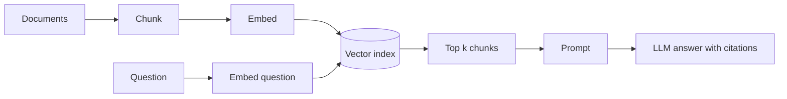

## Why retrieval

A model only knows what was in its training data, which has a cutoff date and never included your private documents. Asking it about your refund policy gets a confident guess.

**RAG** (Retrieval-Augmented Generation) fixes this by searching your documents at question time and pasting the best matches into the prompt. The model then answers from text it can see.

| Approach | Good for | Weak at |
|---|---|---|
| RAG | Facts that change, private data, citing sources | Needs a search system you must maintain |
| Fine-tuning (next lessons) | Style, format, narrow skills | Poor at adding facts; stale after training |
| Long context (paste everything) | Small corpora, one-off tasks | Cost and latency grow with every call |

:::key
RAG changes what the model can see, not what it knows. Most RAG failures are retrieval failures: the right page never reached the prompt.
:::

## The pipeline



- **Chunk**: split documents into passages, because a whole manual will not fit in a prompt and one vector per manual is too blurry to match.
- **Embed**: turn each chunk into a vector, a list of numbers where similar meanings sit close together (see the embeddings lesson).
- **Retrieve**: embed the question the same way and take the **top k** nearest chunks.
- **Generate**: put those chunks in the prompt and tell the model to answer only from them.

```order
prompt: Arrange the RAG steps for one question.
lang: python
code: |
  chunks = split(document)
  vectors = embed(chunks)
  q = embed(question)
  top = nearest(vectors, q, k=3)
  prompt = build_prompt(question, top)
  answer = call_llm(prompt)
distractors:
  - "answer = call_llm(question)   # model answers from memory"
why: Index first (chunk, embed), then at question time embed the question, search, build the prompt from the hits and only then call the model.
```

## Chunking

| Choice | Too small | Too large |
|---|---|---|
| Chunk size | Loses context ("it" has no referent) | Vector blurs several topics; wastes prompt space |
| Overlap | None: a sentence can be cut in half | Duplicates fill the top k |

Typical starting points are a few hundred tokens with 10 to 20 percent overlap, then adjust by measuring. Splitting on headings and paragraphs usually beats splitting at a fixed character count.

```blanks
prompt: Each chunk starts a fixed number of words after the previous one. Complete the step.
lang: python
code: |
  step = size - [[overlap]]
  chunks = [words[i:i + size] for i in range(0, len(words), step)]
why: Consecutive chunks share `overlap` words, so the start of each chunk moves forward by size minus overlap.
```

## A tiny working retriever

This uses word counts as a stand-in for a real embedding model. It runs with NumPy only. Unit-length vectors make the dot product equal to **cosine similarity** (the angle between vectors; 1 means same direction, 0 means unrelated).

```python
import re
import numpy as np

docs = {
    "refunds": "Refunds are issued to the original payment method within 5 business days. Cash orders are refunded as wallet credit.",
    "shipping": "Standard shipping takes 3 to 5 days. Express shipping takes 1 to 2 days and costs extra.",
    "returns": "You can return an item within 30 days if it is unused. Start a return from the orders page.",
}

def chunk(text: str, size: int = 12, overlap: int = 4) -> list[str]:
    words = text.split()
    step = size - overlap
    return [" ".join(words[i:i + size]) for i in range(0, max(len(words) - overlap, 1), step)]

chunks = [(name, c) for name, t in docs.items() for c in chunk(t)]
print(len(chunks), "chunks")

def tokens(s: str) -> list[str]:
    return re.findall(r"[a-z0-9]+", s.lower())

vocab = sorted({w for _, c in chunks for w in tokens(c)})
index = {w: i for i, w in enumerate(vocab)}

def embed(s: str) -> np.ndarray:
    v = np.zeros(len(vocab))
    for w in tokens(s):
        if w in index:
            v[index[w]] += 1
    n = np.linalg.norm(v)
    return v / n if n else v

E = np.stack([embed(c) for _, c in chunks])     # shape (n_chunks, vocab)

def retrieve(query: str, k: int = 2):
    scores = E @ embed(query)                   # cosine, vectors are unit length
    top = np.argsort(-scores)[:k]
    return [(chunks[i][0], round(float(scores[i]), 2)) for i in top]

print(retrieve("how long do refunds take", k=1))
print(retrieve("return an unused item", k=1))
print(retrieve("parcel delivery speed", k=1))
```
```output
6 chunks
[('refunds', 0.29)]
[('returns', 0.58)]
[('refunds', 0.0)]
```

The last query shares no words with any chunk, so every score is 0.0 and the "winner" is arbitrary. Word counts match spelling, not meaning. A real embedding model would link "parcel delivery" to "shipping".

```viz
algo: cosine
input:
  a: [3, 1]
  b: [1, 2]
```

Drag the vectors to see why retrieval ranks by angle: two vectors pointing the same way score 1 regardless of length.

## Generation and the prompt

```python
def call_llm(messages: list[dict], temperature: float = 0.0) -> str:
    """Placeholder for your provider's chat call."""
    raise NotImplementedError

def answer(question: str, hits: list[str]) -> str:
    sources = "\n".join(f"[{i + 1}] {h}" for i, h in enumerate(hits))
    system = ("Answer using only the sources below and cite them as [n]. "
              "If the sources do not contain the answer, say you do not know.")
    user = f"Sources:\n{sources}\n\nQuestion: {question}"
    return call_llm([{"role": "system", "content": system}, {"role": "user", "content": user}])
```

- The "say you do not know" rule gives the model a safe exit; without it, it fills gaps from memory.
- Citations let a human check the claim against the source.

## Making retrieval better

- **Hybrid search**: combine vector search (matches meaning) with keyword search such as **BM25** (Best Match 25, a classic word-frequency ranking). Keywords win on exact IDs, error codes and names.
- **Reranking**: fetch 20 to 50 candidates cheaply, then reorder them with a **cross-encoder**, a slower model that reads the question and a chunk together.
- **Metadata filters**: restrict by product, date or access rights before searching.
- **Query rewriting**: let a model turn a chatty follow-up into a standalone search query.

```quiz
q: A user asks "what is error E4012?" and the vector search returns pages about errors in general. What is the most direct fix?
options:
  - Increase the model temperature
  - Add keyword search (hybrid) so the exact code E4012 matches
  - Use a larger chunk size so more text fits in the prompt
answer: 1
why: Embeddings capture meaning and blur rare exact tokens. Keyword matching finds the literal code, which is why hybrid search is common.
```

## How RAG fails

| Symptom | Likely cause | Check |
|---|---|---|
| Wrong or invented answer | Right chunk not retrieved | Print the retrieved chunks |
| Right chunk retrieved, still wrong | Answer split across chunks, or model ignores context | Read the prompt as the model sees it |
| Outdated answer | Index not refreshed | Re-embed on document change |
| Strange instructions in the output | Documents contain text that tells the model what to do | See the safety lesson |

:::truth
A demo with five documents works almost by itself. The real work starts at thousands of messy documents: cleaning PDFs and tables, deciding chunk rules, and measuring recall. Budget more time for the data than for the model call.
:::

Measure retrieval separately from generation. **Recall at k** is the share of questions whose correct chunk appears in the top k. If recall is low, no prompt will rescue the answer.

```predict
lang: python
code: |
  import numpy as np
  a = np.array([1.0, 0.0])
  b = np.array([0.6, 0.8])
  print(float(a @ b))
output: "0.6"
why: Both vectors have length 1, so the dot product is the cosine similarity. Here that is 1 times 0.6 plus 0 times 0.8.
```

```cards
- q: What does RAG change about a language model?
  a: What it can see in the prompt at question time, not what it learned in training.
- q: What are the four stages of a RAG pipeline?
  a: Chunk and embed documents (offline), then retrieve the top k chunks and generate an answer from them (per question).
- q: Why add keyword search to vector search?
  a: Embeddings blur rare exact tokens such as IDs and error codes; keyword matching finds them literally.
- q: What is recall at k?
  a: The share of questions whose correct chunk is among the top k retrieved. It measures retrieval alone.
- q: What does a reranker do?
  a: Reorders a few dozen candidates by reading the question and each chunk together; slower but more accurate than vector distance.
```

## Notes

:::notes
- RAG = search your documents at question time, paste the best chunks into the prompt, answer from them.
- Pipeline: chunk -> embed -> index (offline); embed question -> top k -> prompt -> LLM (online).
- Chunk size is a trade-off: small loses context, large blurs the vector. Use overlap and split on structure.
- Cosine similarity = dot product of unit vectors; ranks by direction, not length.
- Hybrid search (vectors + BM25) handles exact tokens; a cross-encoder reranker sharpens the top results.
- Tell the model to answer only from sources, cite them, and say "I do not know" otherwise.
- Debug retrieval first: print the chunks. Measure recall at k separately from answer quality.
- Documents are untrusted input; they can carry instructions aimed at the model.
:::
