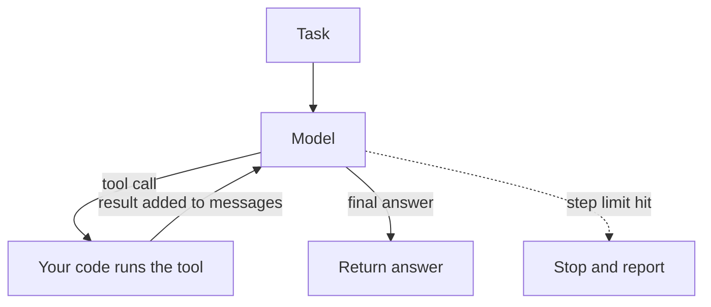
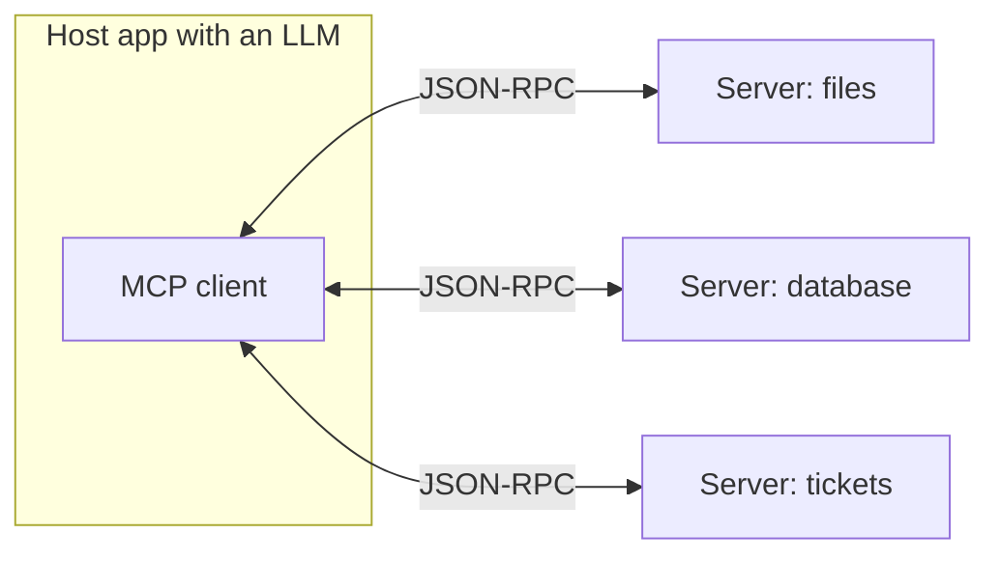

## What an agent is

A model alone can only produce text. A **tool** is a function your code exposes to the model: look up an order, search the web, run a query, send an email. An **agent** is a model that repeatedly chooses a tool, sees the result, and decides what to do next until the task is done.

The model never runs anything. It writes a request such as "call `get_order_status` with order A100". Your program runs the function and returns the result as a new message.



:::key
The agent loop is plain code: call the model, run the requested tool, append the result, repeat. Everything else (frameworks, planners) is built on this.
:::

## Describing a tool

The model picks tools from their descriptions, so a tool is a name, a plain-language description and a **JSON Schema** (a standard way to describe allowed fields and types) for its arguments. Field names differ between providers; check your provider's documentation.

```python
get_order_status_spec = {
    "name": "get_order_status",
    "description": "Look up the shipping status of one order by its ID, such as A100.",
    "parameters": {
        "type": "object",
        "properties": {"order_id": {"type": "string"}},
        "required": ["order_id"],
    },
}
```

- Write the description for a new colleague: when to use it, what it returns, what it cannot do.
- Keep the list short. Ten clear tools beat fifty overlapping ones.
- Return short, structured results; a 50,000-character dump fills the context window.

## The loop in code

This version asks the model for JSON, which keeps it provider-agnostic. Many providers also offer built-in tool calling that returns the same information in a dedicated field.

```python
import json

def get_order_status(order_id: str) -> str:
    orders = {"A100": "shipped", "A200": "processing"}
    return orders.get(order_id, "not found")

TOOLS = {"get_order_status": get_order_status}

def call_llm(messages: list[dict]) -> str:
    """Placeholder. The model must reply with JSON: {"tool": name, "args": {...}} or {"final": text}."""
    raise NotImplementedError

def run_agent(task: str, max_steps: int = 5) -> str:
    messages = [{"role": "user", "content": task}]
    for step in range(max_steps):
        reply = call_llm(messages)
        messages.append({"role": "assistant", "content": reply})
        try:
            action = json.loads(reply)
        except json.JSONDecodeError:
            messages.append({"role": "user", "content": "Reply with valid JSON only."})
            continue
        if "final" in action:
            return action["final"]
        fn = TOOLS.get(action.get("tool"))
        if fn is None:
            result = f"error: unknown tool {action.get('tool')!r}"
        else:
            try:
                result = str(fn(**action.get("args", {})))
            except Exception as err:                      # tool errors go back to the model
                result = f"error: {err}"
        print(f"step {step}: {action.get('tool')} -> {result}")
        messages.append({"role": "user", "content": f"Tool result: {result}"})
    return "stopped: step limit reached"

# Offline demo: a scripted fake model
script = iter([
    '{"tool": "get_order_status", "args": {"order_id": "A100"}}',
    '{"tool": "get_order_status", "args": {"order_id": "A200"}}',
    '{"final": "A100 has shipped. A200 is processing."}',
])
call_llm = lambda messages: next(script)
print(run_agent("Where are orders A100 and A200?"))

call_llm = lambda messages: '{"tool": "get_order_status", "args": {}}'   # model keeps calling badly
print(run_agent("Where is my order?", max_steps=2))
```
```output
step 0: get_order_status -> shipped
step 1: get_order_status -> processing
A100 has shipped. A200 is processing.
step 0: get_order_status -> error: get_order_status() missing 1 required positional argument: 'order_id'
step 1: get_order_status -> error: get_order_status() missing 1 required positional argument: 'order_id'
stopped: step limit reached
```

What to notice:

- **Step limit**: without `max_steps`, a confused model loops forever and you pay for every turn.
- **Errors go back to the model** as text, so it can correct itself. The second run shows what happens when it does not.
- **Messages only grow**: each turn resends the whole history.

```order
prompt: Arrange one turn of the agent loop.
lang: python
code: |
  reply = call_llm(messages)
  action = json.loads(reply)
  if "final" in action:
      return action["final"]
  result = TOOLS[action["tool"]](**action["args"])
  messages.append({"role": "user", "content": f"Tool result: {result}"})
distractors:
  - "  messages.clear()   # forget everything"
why: Ask the model, parse its choice, finish if it gave a final answer, otherwise run the tool and feed the result back for the next turn.
```

```estimate
q: An agent run starts with a 2,000-token prompt. Each of 8 model calls adds about 500 tokens (the previous reply plus a tool result), and every call resends the whole history. Roughly how many input tokens are billed over the 8 calls?
answer: 30000
unit: tokens
tolerance: 0.2
hint: Call i (starting at 0) sends 2000 + 500 x i tokens. Add the eight values.
solution: "Sum of 2000 + 500i for i = 0..7 = 8 x 2000 + 500 x 28 = 16,000 + 14,000 = 30,000 input tokens. Cost grows roughly with the square of the number of steps."
```

## Reliability

Each step can fail: a wrong tool, a wrong argument, a misread result. Errors multiply across steps.

```predict
lang: python
code: |
  per_step = 0.9
  print(round(per_step ** 10, 2))
output: "0.35"
why: Ten steps that are each 90 percent reliable succeed together only about 35 percent of the time (0.9 to the power 10).
```

Practical consequences:

- Prefer a **fixed workflow** (a hard-coded sequence of model calls) when you already know the steps. Use an agent only when the path depends on what is found.
- Cap steps, tokens and money per run.
- Require human confirmation for actions that cannot be undone: payments, deletions, outbound email.
- Log every tool call. When a run goes wrong, the log is the only way to see why.

:::truth
Demos of agents completing long tasks are chosen from the runs that worked. In production, expect to spend most of your effort on narrowing the task, validating tool arguments and handling the cases where the agent gets stuck.
:::

## MCP: a standard plug for tools

Without a standard, every app writes its own glue for every tool. **MCP** (Model Context Protocol) is an open protocol that fixes this: a tool author writes one **MCP server**, and any MCP-capable app can use it.



- **Host** is the app (a chat client, an IDE, your agent). It contains an **MCP client** that connects to one server per connection.
- **Server** exposes three kinds of things: **tools** (actions), **resources** (readable data such as files) and **prompts** (reusable templates).
- Messages use **JSON-RPC** (a small request and response format over JSON). The client asks the server to list its tools, then calls one by name with arguments.
- Servers run locally over standard input and output, or remotely over HTTP.

MCP standardises the plug, not the safety. A connected server can still return text that tries to steer the model, or offer a tool that deletes things.

```quiz
q: In the agent loop, who actually executes a tool such as get_order_status?
options:
  - The model, because it generated the call
  - Your application code, which reads the model's request, runs the function and returns the result
  - The provider's servers, always
answer: 1
why: The model only produces text that names a tool and arguments. The host program decides whether to run it, which is also where permission checks belong.
```

```blanks
prompt: Complete the guard that stops a runaway agent.
lang: python
code: |
  for step in range([[max_steps]]):
      reply = call_llm(messages)
      ...
  return "stopped: [[step limit]] reached"
why: A bounded loop guarantees the run ends, even if the model never produces a final answer.
```

```cards
- q: What is a tool in an LLM application?
  a: A function your code exposes, described by a name, a description and an argument schema. The model requests calls; your code executes them.
- q: What is the agent loop?
  a: Call the model, run the tool it asked for, append the result, repeat until a final answer or a step limit.
- q: Why cap the number of steps?
  a: Cost, latency and the chance of looping all grow with steps; each turn also resends the history.
- q: What is MCP?
  a: Model Context Protocol, an open standard where servers expose tools, resources and prompts that any compatible host app can use over JSON-RPC.
- q: When is a fixed workflow better than an agent?
  a: When the steps are known in advance; it is cheaper, faster and easier to test.
```

## Notes

:::notes
- Tool = function plus name, description and argument schema. The model requests; your code executes.
- Agent loop: call model -> run requested tool -> append result -> repeat; stop on final answer or step limit.
- Send tool errors back as text so the model can retry; log every call.
- History is resent each turn, so input cost grows roughly with steps squared.
- Reliability multiplies: 0.9 per step over 10 steps is about 0.35 overall.
- Use a fixed workflow when the path is known; use an agent when it depends on what is found.
- Human confirmation for irreversible actions; validate arguments before running.
- MCP: open protocol; servers expose tools, resources and prompts; hosts connect with clients over JSON-RPC.
:::
