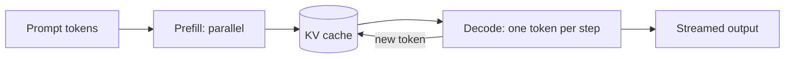

## Two numbers to track

For every request there are two costs: time and money. Both come from **tokens** (the pieces of text a model reads and writes; see the tokenization lesson).

| Metric | Meaning | Who feels it |
|---|---|---|
| TTFT | Time to first token: delay before the answer starts appearing | Every user, in chat |
| Tokens per second | Speed of the stream after it starts | Users reading as it types |
| Total latency | Request start to last token | Batch jobs, tool calls |
| Cost per request | Input tokens x input price + output tokens x output price | Your budget |

:::key
Output tokens are slower and usually more expensive than input tokens, because each one needs its own pass through the model.
:::

## Prefill and decode

Generation has two phases.

- **Prefill**: the model reads the whole prompt at once. All tokens are processed in parallel, so the GPU is busy computing. This sets TTFT.
- **Decode**: the model produces one token, appends it, and repeats. Each step must read all the model weights from memory, so speed is limited by **memory bandwidth** (how many GB per second the GPU can read), not arithmetic.



This gives a rough ceiling: tokens per second is at most bandwidth divided by model size in GB.

```estimate
q: A 7-billion-parameter model is stored in 16-bit numbers (2 bytes each). The GPU reads memory at about 2,000 GB/s. What is the rough ceiling on decode speed for one request?
answer: 140
unit: tokens/s
tolerance: 0.3
hint: Model size = 7 x 2 = 14 GB. Each new token reads all of it once.
solution: "2000 GB/s / 14 GB = about 143 tokens per second. Real systems reach less because of overheads, but the ceiling explains why smaller or lower-precision models are faster."
```

## The KV cache

Attention needs the **key** and **value** vectors of every earlier token. Recomputing them each step would be wasteful, so the server stores them in the **KV cache** and appends one entry per new token.

Size per token = 2 (key and value) x layers x KV heads x head size x bytes per number.

```estimate
q: A model has 32 layers, 32 KV heads of size 128, and stores the cache in 16-bit numbers. A server holds 16 conversations of 4,096 tokens each. How much memory does the KV cache need?
answer: 34
unit: GB
tolerance: 0.2
hint: Per token = 2 x 32 x 32 x 128 x 2 bytes = 0.5 MB. Then multiply by 16 x 4096 tokens.
solution: "2 x 32 x 32 x 128 x 2 = 524,288 bytes per token. 16 x 4096 = 65,536 tokens. 65,536 x 0.524 MB is about 34 GB, more than the 14 GB of weights."
```

The cache, not the weights, often limits how many users one GPU can serve. Remedies:

- **Grouped-query attention** (GQA): several query heads share fewer KV heads, shrinking the cache. Many recent models use it.
- **Paged cache memory**: serving engines such as vLLM split the cache into blocks, like virtual memory, so little space is wasted.
- **Shorter prompts and shorter histories.**

## A calculator

```python
def weights_gb(params_b: float, bytes_per_param: float) -> float:
    return params_b * bytes_per_param                  # billions of params x bytes = GB

def kv_bytes_per_token(layers: int, kv_heads: int, head_dim: int, bytes_per: int = 2) -> int:
    return 2 * layers * kv_heads * head_dim * bytes_per    # 2 = one key + one value

def decode_tokens_per_s(model_gb: float, bandwidth_gb_s: float) -> float:
    return bandwidth_gb_s / model_gb                   # each token reads every weight once

def cost_per_day(requests: int, in_tok: int, out_tok: int, price_in: float, price_out: float) -> float:
    return requests * (in_tok * price_in + out_tok * price_out) / 1e6

# 7B model, 16-bit weights vs 4-bit weights, on a GPU with ~2000 GB/s memory bandwidth
for name, b in (("16-bit", 2), ("4-bit", 0.5)):
    gb = weights_gb(7, b)
    print(f"{name}: {gb:.1f} GB, decode ceiling {decode_tokens_per_s(gb, 2000):.0f} tok/s")

per_tok = kv_bytes_per_token(layers=32, kv_heads=32, head_dim=128)
print("KV cache per token:", per_tok // 1024, "KiB")
print("one 4096-token chat:", round(per_tok * 4096 / 1e9, 1), "GB")

# illustrative prices: $1 per million input tokens, $4 per million output tokens
print("cost per day: $", cost_per_day(50_000, 1500, 300, 1.0, 4.0))
print("with a 1000-token shorter prompt: $", cost_per_day(50_000, 500, 300, 1.0, 4.0))
```
```output
16-bit: 14.0 GB, decode ceiling 143 tok/s
4-bit: 3.5 GB, decode ceiling 571 tok/s
KV cache per token: 512 KiB
one 4096-token chat: 2.1 GB
cost per day: $ 135.0
with a 1000-token shorter prompt: $ 85.0
```

The prices are made up for the example. Look up your provider's current price list before planning.

## Levers for speed

| Lever | What it does | Cost of using it |
|---|---|---|
| **Quantization** | Store weights in 8 or 4 bits: smaller, faster decode | Small quality loss; test with your eval |
| **Batching** | Serve many requests per forward pass; **continuous batching** adds new requests as others finish | Higher throughput, slightly higher latency |
| **Streaming** | Send tokens as they are produced | Better felt latency, no real speedup |
| **Shorter outputs** | Fewer decode steps | Needs prompts that ask for brevity |
| **Smaller model** | Fewer bytes per token | Lower ability on hard cases |
| **Speculative decoding** | A small model drafts tokens, the big model checks several at once | More moving parts |

```quiz
q: Why does decoding one token at a time leave a GPU underused for a single user?
options:
  - Each step does little arithmetic but must read all the weights, so memory bandwidth is the limit
  - The GPU cannot run more than one thread
  - Tokens must be sent over the network one by one
answer: 0
why: Decode has low arithmetic per byte moved. Batching many requests reuses the same weight reads for several users, which is why it raises throughput.
```

## Levers for cost

- **Trim the prompt**: instructions, retrieved chunks and history are billed on every call.
- **Prompt caching** (where a provider offers it): a repeated prompt prefix is processed once and billed at a reduced rate. Put fixed text first and variable text last.
- **Response caching**: return a stored answer for an identical request. Matching on similar meaning is riskier, since two nearly equal questions can need different answers.
- **Route by difficulty**: send easy requests to a small model and hard ones to a large one. Check the router with an eval.
- **Cap output**: set max tokens and ask for concise answers.
- **Batch APIs**: some providers discount non-urgent jobs processed within hours.

```estimate
q: A feature handles 50,000 requests a day, each with 1,500 input tokens and 300 output tokens. Prices are 1 dollar per million input tokens and 4 dollars per million output tokens. What does it cost per day?
answer: 135
unit: dollars
tolerance: 0.1
hint: Input tokens per day = 50,000 x 1,500. Divide by one million, multiply by the price. Do the same for output.
solution: "Input: 75M tokens x $1 = $75. Output: 15M tokens x $4 = $60. Total $135 per day. Output is 17 percent of the tokens but 44 percent of the cost."
```

## Self-host or call an API

| | Hosted API | Self-hosted |
|---|---|---|
| Start-up | Minutes | Weeks: GPUs, serving engine, monitoring |
| Cost shape | Pay per token | Pay per GPU hour, used or idle |
| Best when | Traffic is small or spiky | Traffic is high and steady, or data cannot leave your network |
| You own | Prompts and evals | Everything, including uptime |

:::truth
Self-hosting looks cheaper on a spreadsheet and often is not. An idle GPU still bills, and engineers who run it are a cost too. Compare at your real utilisation, not at peak.
:::

```order
prompt: Arrange the steps for cutting the cost of a feature.
lang: python
code: |
  usage = measure_tokens_per_request(logs)
  top = find_biggest_cost(usage)
  apply_change(top)
  quality = run_eval(new_system, cases)
  if quality >= baseline:
      deploy(new_system)
distractors:
  - "deploy(new_system)   # cheaper, so ship it"
why: Measure where tokens go, change the largest item, then confirm quality did not drop before shipping.
```

```cards
- q: What are prefill and decode?
  a: Prefill reads the whole prompt in parallel (sets time to first token). Decode generates one token per step and is limited by memory bandwidth.
- q: Rough decode speed ceiling?
  a: Memory bandwidth divided by model size in GB; every token reads all the weights once.
- q: What is the KV cache?
  a: Stored key and value vectors of earlier tokens so attention does not recompute them. Size per token = 2 x layers x KV heads x head size x bytes.
- q: Name three ways to cut cost.
  a: Shorter prompts, prompt or response caching, routing easy requests to a smaller model. Also cap output length.
- q: What does continuous batching do?
  a: Adds new requests to the running batch as others finish, raising throughput.
```

## Notes

:::notes
- Cost = input tokens x input price + output tokens x output price; output is slower and usually pricier.
- Prefill is parallel and sets time to first token; decode is one token per step and memory-bandwidth bound.
- Decode ceiling about bandwidth / model GB (7B at 16-bit is 14 GB; at 2,000 GB/s about 140 tok/s).
- KV cache per token = 2 x layers x KV heads x head size x bytes; it often limits concurrent users.
- Speed levers: quantization, batching, GQA, shorter outputs, smaller models, speculative decoding.
- Cost levers: trim prompts, cache prefixes and responses, route by difficulty, cap output tokens.
- Always re-run your eval after a cost change.
- Self-hosting pays only at high, steady utilisation or when data must stay in-house.
:::
