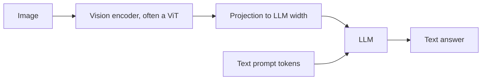

## What multimodal means

A **modality** is a type of data: text, image, audio, video. A **multimodal** model reads or writes more than one. The practical question is how to feed non-text data into a transformer, which only consumes a sequence of vectors.

The recipe repeats across modalities: cut the input into pieces, turn each piece into a vector, and treat the vectors like tokens.

| Piece | How it becomes a token |
|---|---|
| Text | Subword, looked up in an embedding table |
| Image | A square **patch** of pixels, flattened and projected |
| Audio | A short slice of a spectrogram (a picture of frequencies over time) |
| Video | Patches from several frames |

## ViT: an image as a sequence

**ViT** (Vision Transformer) skips convolutions (the sliding filters from the CNN lesson) and applies a plain transformer to image patches.

1. Cut the image into non-overlapping patches, for example 16 x 16 pixels.
2. Flatten each patch to a vector of $16 \times 16 \times 3 = 768$ numbers (3 colour channels).
3. Multiply by a learned matrix to get a vector of the model's width.
4. Add a learned **position embedding** so the model knows where each patch sat.
5. Prepend a special `[CLS]` token whose final vector summarises the image.
6. Run the usual transformer layers.

```python
import numpy as np

rng = np.random.default_rng(0)
H = W = 32; P = 8; C = 3                       # image size, patch size, channels
img = rng.integers(0, 256, size=(H, W, C)).astype(float)

# cut into non-overlapping P x P patches and flatten each one
patches = img.reshape(H // P, P, W // P, P, C).transpose(0, 2, 1, 3, 4).reshape(-1, P * P * C)
print("patches:", patches.shape)
print("patch 0 is the top-left block:", np.array_equal(patches[0], img[:P, :P].reshape(-1)))
print("patch 1 is the block to its right:", np.array_equal(patches[1], img[:P, P:2 * P].reshape(-1)))

d = 64                                         # model width
proj = rng.normal(size=(P * P * C, d)) * 0.02  # learned linear projection in a real model
tokens = patches @ proj
cls = np.zeros((1, d))                         # learned [CLS] token in a real model
pos = rng.normal(size=(len(tokens) + 1, d)) * 0.02   # learned position embeddings
seq = np.vstack([cls, tokens]) + pos
print("transformer input:", seq.shape)
```
```output
patches: (16, 192)
patch 0 is the top-left block: True
patch 1 is the block to its right: True
transformer input: (17, 64)
```

A 32 x 32 image with 8 x 8 patches gives 16 patches of 192 numbers each, plus one `[CLS]` token: 17 vectors. The transformer then sees a sentence of 17 "words".

```predict
lang: python
code: |
  side, patch = 224, 16
  print((side // patch) ** 2)
output: "196"
why: 224 / 16 = 14 patches along each side, and 14 x 14 = 196 patches. A ViT adds one CLS token on top, giving 197 vectors.
```

```estimate
q: A vision-language model cuts a 448 x 448 image into 14 x 14 pixel patches and feeds one token per patch to the language model. How many image tokens is that?
answer: 1024
unit: tokens
tolerance: 0.1
hint: 448 / 14 patches along one side. Square it.
solution: "448 / 14 = 32 per side, and 32 x 32 = 1,024 image tokens. That is roughly a page or two of text, billed and attended to on every call."
```

:::key
Resolution costs tokens. Doubling an image's width and height quadruples the patches, and self-attention cost grows with the square of the sequence length, so it grows roughly 16 times.
:::

## CLIP: pictures and captions in one space

**CLIP** (Contrastive Language-Image Pre-training) trains two encoders together, one for images and one for text, on hundreds of millions of image and caption pairs from the web.

- Each encoder outputs a vector. Both vectors are normalised to length 1.
- In a batch of $N$ pairs, compute the $N \times N$ table of cosine similarities.
- Training pushes the **diagonal** (matching image and caption) up and everything else down. This is **contrastive learning**.
- The loss is cross-entropy over rows and over columns, with similarities divided by a **temperature** $T$ (CLIP learns it; it starts near 0.07), which sharpens the softmax.

```python
import numpy as np

rng = np.random.default_rng(0)
N, dim = 4, 8
base = rng.normal(size=(N, dim))                       # 4 concepts
img = base + 0.3 * rng.normal(size=(N, dim))           # image embeddings
txt = base + 0.3 * rng.normal(size=(N, dim))           # matching caption embeddings

def unit(x):
    return x / np.linalg.norm(x, axis=1, keepdims=True)

sim = unit(img) @ unit(txt).T                          # cosine, N x N
print(np.round(sim, 2))
print("best caption per image:", sim.argmax(axis=1))

def cross_entropy(logits):                             # correct class for row i is column i
    z = logits - logits.max(axis=1, keepdims=True)
    logp = z - np.log(np.exp(z).sum(axis=1, keepdims=True))
    return float(-np.mean(np.diag(logp)))

T = 0.07                                               # temperature
loss = (cross_entropy(sim / T) + cross_entropy(sim.T / T)) / 2
print("contrastive loss:", round(loss, 4))
shuffled = sim[:, [1, 0, 3, 2]]                        # break the pairing
print("loss with wrong pairs:", round((cross_entropy(shuffled / T) + cross_entropy(shuffled.T / T)) / 2, 3))
```
```output
[[ 0.91 -0.06  0.29 -0.37]
 [-0.09  0.92  0.34  0.19]
 [-0.08  0.19  0.87  0.11]
 [-0.53  0.26 -0.38  0.86]]
best caption per image: [0 1 2 3]
contrastive loss: 0.0002
loss with wrong pairs: 14.168
```

The embeddings here are built to match, so the loss is almost zero. Real training starts with random encoders and drives the loss down by changing their weights.

### Zero-shot classification

After training, CLIP classifies images without any labelled examples of your classes:

1. Write a text prompt per class, such as "a photo of a dog" and "a photo of a receipt".
2. Embed the prompts with the text encoder, and the image with the image encoder.
3. Pick the class whose text vector has the highest cosine similarity to the image vector.

```order
prompt: Arrange zero-shot image classification with CLIP.
lang: python
code: |
  prompts = [f"a photo of a {c}" for c in classes]
  text_vecs = unit(text_encoder(prompts))
  image_vec = unit(image_encoder(image))
  scores = text_vecs @ image_vec
  label = classes[int(scores.argmax())]
distractors:
  - "label = classes[int(scores.argmin())]"
why: Build one text prompt per class, embed both sides, score by cosine similarity and take the highest, since high similarity means the caption fits the image.
```

:::note
CLIP gives a shared embedding space, so it also powers image search by text: embed the query, then use the vector search from the earlier lesson over image vectors.
:::

## Vision-language models

A **VLM** (vision-language model) answers questions about images. A common design connects three parts:



- The vision encoder turns the image into patch vectors.
- A small **projector** maps them to the same width as the LLM's token embeddings.
- The LLM reads image tokens and text tokens as one sequence and writes the answer as usual.
- Designs vary. Some models train all parts jointly from scratch; some freeze the encoder and train only the projector first. Hosted APIs hide these details.

## Using them well

- **Good at**: describing scenes, reading printed text and simple charts, extracting fields from screenshots and forms, answering questions about a diagram.
- **Weaker at**: counting many small objects, precise positions, tiny or rotated text, fine detail in large images, and subtle differences between similar images.
- **They can hallucinate**: a fluent description may include objects that are not there. Evaluate on your own images (see the evals lesson).
- **Cost**: each image adds hundreds to thousands of tokens. Resize or crop to what the task needs.
- **Untrusted pixels**: text inside an image can carry instructions, which is injection through a new channel (see the safety lesson). Photos of people also raise privacy questions, so check your data rules.

:::truth
A model that describes a picture well in a demo can still fail on your messy phone photos, scanned receipts or screenshots at odd sizes. Test on a few dozen real samples before you promise anything.
:::

```quiz
q: You double both the width and height of an input image while keeping the patch size fixed. What happens to the number of patches?
options:
  - It doubles
  - It quadruples
  - It stays the same because patch size is fixed
answer: 1
why: Patches along each side double, and the count is the product of both sides, so it grows 2 x 2 = 4 times. Attention cost grows even faster.
```

```cards
- q: How does ViT turn an image into tokens?
  a: Cut into fixed-size patches, flatten each, project linearly, add position embeddings and a CLS token, then run a transformer.
- q: How many patches does a 224 x 224 image have at patch size 16?
  a: 14 x 14 = 196 (197 vectors with the CLS token).
- q: What does CLIP train?
  a: An image encoder and a text encoder so matching image and caption vectors have high cosine similarity and mismatched pairs low (contrastive learning).
- q: How does CLIP do zero-shot classification?
  a: Embed a text prompt per class and the image, then choose the class with the highest cosine similarity.
- q: What are the parts of a typical vision-language model?
  a: A vision encoder, a projector into the LLM's embedding width, and the LLM that reads image and text tokens together.
```

## Notes

:::notes
- Multimodal recipe: cut input into pieces, embed each piece, feed the vectors to a transformer like tokens.
- ViT: split into patches (224 / 16 gives 14 x 14 = 196), flatten, linear projection, position embeddings, CLS token.
- Patch count grows with the square of image side; attention cost grows with the square of the patch count.
- CLIP: image and text encoders trained contrastively; diagonal of the N x N similarity table is pushed up.
- Zero-shot: embed "a photo of a {class}" prompts and pick the highest cosine similarity.
- VLM = vision encoder + projector + LLM reading image and text tokens together.
- Weak spots: counting, exact positions, small text, hallucinated details; images cost many tokens.
- Text inside images can carry injected instructions.
:::
