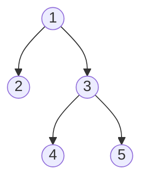

## The problem

A **tree** is a connected graph with no cycles: `n` vertices and `n - 1` edges. Pick any vertex as the **root** and every other vertex gets a **parent** (the neighbour toward the root) and possibly **children**. The **subtree** of `v` is `v` and everything below it.

Subtrees overlap in a very clean way: the subtree of `v` is made of `v` plus the subtrees of its children, with no sharing between siblings. That is the structure DP wants, so most tree problems become: "compute `dp[v]` from `dp[child]` for every child".



## The idea: DP over children

Brute force: for each vertex, walk its whole subtree again. That is $O(n^2)$ on a path-shaped tree.

Instead, finish children first, then the parent. Use a recursive DFS, or the safer order below.

:::tip
Recursion that goes 10^5 or 2*10^5 deep can crash. Instead, do a BFS from the root, record the visiting order, and process vertices in **reverse BFS order**. Every child then comes before its parent, with no recursion.
:::

### Example: maximum independent set

Each vertex has a weight. Choose vertices so that no two chosen vertices are adjacent (an **independent set**), maximising total weight. For the tree above with weights `3, 2, 4, 5, 1`, choosing vertices 1, 4 and 5 gives 9.

- **State:** `d1[v]` = best total in the subtree of `v` when `v` is chosen. `d0[v]` = best when `v` is not chosen.
- **Transition:** `d1[v] = w[v] + sum of d0[c]` over children `c`. `d0[v] = sum of max(d0[c], d1[c])`.
- **Base case:** a leaf has `d1 = w`, `d0 = 0` (the sums are empty).
- **Answer:** `max(d0[root], d1[root])`.

```cpp
#include <bits/stdc++.h>
using namespace std;

int main() {
    int n;
    scanf("%d", &n);
    vector<long long> w(n), d0(n, 0), d1(n);
    for (auto &x : w) scanf("%lld", &x);
    vector<vector<int>> g(n);
    for (int i = 0; i < n - 1; i++) {
        int u, v;
        scanf("%d %d", &u, &v);
        u--; v--;
        g[u].push_back(v);
        g[v].push_back(u);
    }
    vector<int> order = {0}, par(n, -1);
    for (size_t i = 0; i < order.size(); i++)
        for (int c : g[order[i]])
            if (c != par[order[i]]) { par[c] = order[i]; order.push_back(c); }
    for (int i = 0; i < n; i++) d1[i] = w[i];
    for (int i = n - 1; i > 0; i--) {          // children before parents
        int v = order[i], p = par[v];
        d0[p] += max(d0[v], d1[v]);
        d1[p] += d0[v];
    }
    printf("%lld\n", max(d0[0], d1[0]));
}
```
```java
import java.io.*;
import java.util.*;

public class Main {
    public static void main(String[] args) throws IOException {
        StreamTokenizer in = new StreamTokenizer(new BufferedReader(new InputStreamReader(System.in)));
        in.nextToken();
        int n = (int) in.nval;
        long[] w = new long[n], d0 = new long[n], d1 = new long[n];
        for (int i = 0; i < n; i++) { in.nextToken(); w[i] = (long) in.nval; }
        List<List<Integer>> g = new ArrayList<>();
        for (int i = 0; i < n; i++) g.add(new ArrayList<>());
        for (int i = 0; i < n - 1; i++) {
            in.nextToken(); int u = (int) in.nval - 1;
            in.nextToken(); int v = (int) in.nval - 1;
            g.get(u).add(v);
            g.get(v).add(u);
        }
        int[] order = new int[n], par = new int[n];
        Arrays.fill(par, -1);
        int tail = 1;
        for (int i = 0; i < tail; i++)
            for (int c : g.get(order[i]))
                if (c != par[order[i]]) { par[c] = order[i]; order[tail++] = c; }
        for (int i = 0; i < n; i++) d1[i] = w[i];
        for (int i = n - 1; i > 0; i--) {
            int v = order[i], p = par[v];
            d0[p] += Math.max(d0[v], d1[v]);
            d1[p] += d0[v];
        }
        System.out.println(Math.max(d0[0], d1[0]));
    }
}
```
```input
5
3 2 4 5 1
1 2
1 3
3 4
3 5
```
```output
9
```

```blanks
prompt: Complete the two sums for vertex v while visiting its children c.
lang: cpp
code: |
  for (int c : children) {
      notTaken += max(d0[c], d1[c]);
      taken += [[d0]][c];
  }
  d1[v] = [[w]][v] + taken;
why: If v is chosen, its children cannot be, so each contributes d0. If v is not chosen, each child may be chosen or not. The chosen case also earns the weight of v itself.
```

## Rerooting

Now a harder question: for **every** vertex `r`, what is the sum of distances from `r` to all other vertices? Running the DP once per root costs $O(n^2)$.

**Rerooting** computes the answer for one root, then moves the root to each neighbour in $O(1)$, reusing the work. Two passes:

1. **Down pass** (children to parent): for the fixed root, `sz[v]` = subtree size, and `ans[root]` = sum of depths.
2. **Up pass** (parent to children): derive `ans[c]` from `ans[p]`.

Moving the root from `p` to its child `c`:

- The `sz[c]` vertices in the subtree of `c` get 1 closer.
- The other `n - sz[c]` vertices get 1 farther.

So:

$$ans[c] = ans[p] - sz[c] + (n - sz[c])$$

```steps
title: Rerooting on the example tree (edges 1-2, 1-3, 3-4, 3-5)
view: array
frames:
  - arr: [6, 0, 0, 0, 0]
    pointers: {root: 0}
    vars: {sz1: 5, depths: "1+1+2+2"}
    note: Root at vertex 1. The sum of depths is 6, so ans[1] = 6.
  - arr: [6, 9, 0, 0, 0]
    pointers: {v: 1}
    highlight: {1: active}
    vars: {formula: "6 - 1 + (5 - 1)"}
    note: Vertex 2 has subtree size 1. ans[2] = 6 - 1 + 4 = 9.
  - arr: [6, 9, 5, 0, 0]
    pointers: {v: 2}
    highlight: {2: active}
    vars: {formula: "6 - 3 + (5 - 3)"}
    note: Vertex 3 has subtree size 3. ans[3] = 6 - 3 + 2 = 5.
  - arr: [6, 9, 5, 8, 0]
    pointers: {v: 3}
    highlight: {3: active, 2: compare}
    vars: {formula: "5 - 1 + (5 - 1)"}
    note: Vertex 4 hangs under vertex 3. ans[4] = ans[3] - 1 + 4 = 8.
  - arr: [6, 9, 5, 8, 8]
    pointers: {v: 4}
    highlight: {4: active, 2: compare}
    note: Vertex 5 is symmetric to vertex 4, so ans[5] = 8. Every root is done.
```

```cpp
#include <bits/stdc++.h>
using namespace std;

int main() {
    int n;
    scanf("%d", &n);
    vector<vector<int>> g(n);
    for (int i = 0; i < n - 1; i++) {
        int u, v;
        scanf("%d %d", &u, &v);
        u--; v--;
        g[u].push_back(v);
        g[v].push_back(u);
    }
    vector<int> order = {0}, par(n, -1);
    for (size_t i = 0; i < order.size(); i++)
        for (int c : g[order[i]])
            if (c != par[order[i]]) { par[c] = order[i]; order.push_back(c); }
    vector<long long> sz(n, 1), down(n, 0), ans(n, 0);
    for (int i = n - 1; i > 0; i--) {             // down pass
        int v = order[i], p = par[v];
        sz[p] += sz[v];
        down[p] += down[v] + sz[v];
    }
    ans[0] = down[0];
    for (int i = 1; i < n; i++) {                  // up pass
        int v = order[i];
        ans[v] = ans[par[v]] - sz[v] + (n - sz[v]);
    }
    for (int i = 0; i < n; i++) printf("%lld%c", ans[i], i + 1 < n ? ' ' : '\n');
}
```
```java
import java.io.*;
import java.util.*;

public class Main {
    public static void main(String[] args) throws IOException {
        StreamTokenizer in = new StreamTokenizer(new BufferedReader(new InputStreamReader(System.in)));
        in.nextToken();
        int n = (int) in.nval;
        List<List<Integer>> g = new ArrayList<>();
        for (int i = 0; i < n; i++) g.add(new ArrayList<>());
        for (int i = 0; i < n - 1; i++) {
            in.nextToken(); int u = (int) in.nval - 1;
            in.nextToken(); int v = (int) in.nval - 1;
            g.get(u).add(v);
            g.get(v).add(u);
        }
        int[] order = new int[n], par = new int[n];
        Arrays.fill(par, -1);
        int tail = 1;
        for (int i = 0; i < tail; i++)
            for (int c : g.get(order[i]))
                if (c != par[order[i]]) { par[c] = order[i]; order[tail++] = c; }
        long[] sz = new long[n], down = new long[n], ans = new long[n];
        Arrays.fill(sz, 1);
        for (int i = n - 1; i > 0; i--) {
            int v = order[i], p = par[v];
            sz[p] += sz[v];
            down[p] += down[v] + sz[v];
        }
        ans[0] = down[0];
        for (int i = 1; i < n; i++) {
            int v = order[i];
            ans[v] = ans[par[v]] - sz[v] + (n - sz[v]);
        }
        StringBuilder sb = new StringBuilder();
        for (int i = 0; i < n; i++) sb.append(ans[i]).append(i + 1 < n ? " " : "\n");
        System.out.print(sb);
    }
}
```
```input
5
1 2
1 3
3 4
3 5
```
```output
6 9 5 8 8
```

```predict
lang: cpp
code: |
  // Path 1-2-3-4 rooted at 1. ans[1] = 1 + 2 + 3 = 6.
  // Vertex 2 has subtree size 3.
  int n = 4, ansParent = 6, sz = 3;
  cout << ansParent - sz + (n - sz);
prompt: What is the sum of distances from vertex 2?
output: "4"
why: Vertex 2 has distances 1, 1 and 2 to vertices 1, 3 and 4, which sum to 4. The formula agrees. Three vertices got closer, one got farther.
```

:::key
Rerooting recipe. Down pass: compute what each subtree contributes. Up pass: for each child, combine the parent's full answer with that child's own contribution removed, then add what the rest of the tree contributes. Sums can be subtracted. For maximum or minimum, subtraction is not possible, so keep the top two child values per vertex, or prefix and suffix arrays over the children.
:::

## Complexity

- Down pass: each vertex is processed once, $O(n)$.
- Rerooting adds one more $O(n)$ pass, giving $O(n)$ total.
- Memory: $O(n)$ for the tree and the arrays.

:::truth
Rerooting is the hardest idea in this lesson and usually appears from about 1700 on. Expect to write the formula on paper first: what does moving the root across one edge change, and for which vertices?
:::

## Pitfalls

- **Deep recursion.** A path with 2*10^5 vertices overflows the default stack in Java and sometimes in C++. Use the BFS-order approach.
- **Forgetting the parent check.** Without `c != par[v]` the DFS walks back to the parent.
- **Counting the root twice** when merging child results.
- **Overflow.** Sums of distances reach about $n^2/2$; use 64-bit integers.
- **Mixing up `n - sz[c]`.** It is the number of vertices outside the subtree of `c`.
- **Max and min rerooting.** You cannot subtract a maximum. Keep the best and second-best child.

```quiz
q: In the independent-set DP, why does d1[v] add d0[c] and not max(d0[c], d1[c])?
options:
  - Because d0 is always larger
  - Because choosing v forbids choosing any child of v
  - Because children are processed after the parent
answer: 1
why: Two adjacent vertices cannot both be chosen. If v is chosen, each child must be in the not-chosen state.
```

```quiz
q: When rerooting the sum of distances from p to its child c, how many vertices get farther from the new root?
options:
  - sz[c]
  - n - sz[c]
  - n - 1
answer: 1
why: The vertices outside the subtree of c are now one edge farther. The sz[c] vertices inside get one edge closer.
```

```cards
- q: What is the usual tree DP order?
  a: Children before parents. Use recursion, or reverse BFS order for deep trees.
- q: State and answer of the independent-set tree DP?
  a: d1[v] and d0[v] are the best totals in the subtree of v with v chosen and not chosen. The answer is max(d0[root], d1[root]).
- q: What does rerooting compute?
  a: The answer for every possible root in O(n), by moving the root across edges and updating from the parent's answer.
- q: Rerooting formula for the sum of distances?
  a: ans[c] = ans[p] - sz[c] + (n - sz[c]).
- q: Why can you not reroot a maximum by subtraction?
  a: A maximum cannot be undone. Keep the top two values among the children, or prefix and suffix arrays.
```

## Notes

:::notes
- Root the tree; the subtree of `v` is `v` plus its children's subtrees, with no overlap.
- Tree DP: `dp[v]` from `dp[child]`; process children first.
- For big trees avoid recursion: BFS order, then process in reverse.
- Independent set: `d1[v] = w[v] + sum d0[c]`, `d0[v] = sum max(d0[c], d1[c])`.
- Rerooting = down pass for one root, up pass to move the root across each edge.
- Sum of distances: `ans[c] = ans[p] - sz[c] + (n - sz[c])`.
- For max or min, keep the top two child values per vertex instead of subtracting.
- Total time stays $O(n)$; use 64-bit integers for sums.
:::
