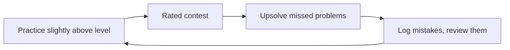

## The problem

You want to reach **Candidate Master** (CM), Codeforces rating 1900 and above. Codeforces rank names by rating:

| Rating | Rank |
|---|---|
| below 1200 | Newbie |
| 1200 to 1399 | Pupil |
| 1400 to 1599 | Specialist |
| 1600 to 1899 | Expert |
| 1900 to 2099 | Candidate Master |

Your **rating** is recalculated after every rated contest from your place compared with the place the system expected for your current rating. It changes only in contests. Solving problems in practice makes you stronger but does not move the number by itself.

## Brute force first

These are the plans most people try first, and why they stall.

- **Read and watch only.** Understanding an editorial feels like progress. Solving a new problem on your own is a different skill, and it only grows when you try.
- **Solve only problems you can already solve.** Comfortable, and the rating does not move.
- **Read the editorial after ten minutes.** The struggle is where the learning happens. You also never practise the moment of being stuck, which every contest contains.
- **Chase one tag for weeks.** You learn the tag but not the skill of recognising which tool a fresh problem needs.

## The idea: a loop



Every part of the loop has a job. Skipping one breaks the others.

### 1. Practice at +100 to +300

- Take your current rating and pick problems rated **100 to 300 above it**. At 1400 that means roughly 1500 to 1700.
- Too easy teaches little. Too hard gives frustration without progress.
- Set a time box (say 45 to 60 minutes) per problem. If you have no idea at the end, read **one hint** or the key idea only, then finish the code yourself.
- A problem you solved after a hint is not finished. Solve it again from scratch in a few days.

### 2. Volume

- There is no magic number. Consistency beats bursts: a steady habit over months beats a heroic week.
- The arithmetic adds up faster than it feels:

```estimate
q: You solve 2 problems a day, 5 days a week, for 50 weeks. How many problems is that in a year?
answer: 500
unit: problems
tolerance: 0.1
hint: 2 problems times 5 days gives problems per week; multiply by the number of weeks.
solution: "2 x 5 = 10 problems a week, and 10 x 50 = 500 problems. A few hundred problems over a year is a realistic pace for many people, not an extraordinary one."
```

### 3. Contests

- Rating moves only in **rated rounds**. Enter them regularly, even when you feel unready.
- A **virtual contest** replays an old round under real time and rules. It does not change your rating, and it is good for practising time management between rated rounds. Pick rounds of your own division.

### 4. Upsolving

**Upsolving** means solving the problems you could not solve during the contest, right after it.

1. Retry the problem alone for a time box.
2. Take one hint. Retry.
3. Read the editorial. Close it. Write the solution from memory.
4. Add one line to your mistake log: what idea was missing, or what bug cost you time.
5. Revisit that problem in about a week.

Most improvement comes from steps 3 to 5, not from the contest itself.

```quiz
q: Your rating is 1500. You want a practice problem that maximises growth. Which rating is the best target?
options:
  - 800 to 1000, to build speed
  - 1600 to 1800
  - 2400 and above, to learn advanced topics early
answer: 1
why: Aim 100 to 300 above your level. Problems far below teach little, problems far above rarely get solved even with hints, and an unsolved problem teaches only if you can follow the solution afterwards.
```

## Time management in a round

These are heuristics, not laws. Adjust them to your own style.

- Read problems in order and solve the easy ones first. Check the standings: a problem with many solves is likely easier than its position suggests.
- Set a rough limit per problem (for example 25 to 30 minutes). If you are stuck, move on and return later with a fresh head.
- Wrong submissions cost points and time. Before submitting, run the samples, the smallest case ($n = 1$), the largest case for speed, and a case that overflows `int`.
- Do not hunt for a perfect solution on the last problem if an earlier unsolved one is nearer to done.
- Read the statement twice. Many lost points come from a misread constraint, not from missing knowledge.

## Stress testing

When a solution fails and you cannot see why, compare it with a slow but obviously correct **brute force** on thousands of random small inputs. The first input where they differ is a small, readable counterexample.

You need three programs: `sol` (your solution), `brute` (slow and simple), and `gen` (prints a random test from a seed).

```cpp
#include <bits/stdc++.h>
using namespace std;

int main(int argc, char* argv[]) {
    int seed = argc > 1 ? atoi(argv[1]) : 1;
    mt19937 rng(seed);                       // same seed, same test: failures are reproducible
    int n = rng() % 8 + 1;                   // tiny sizes make failures easy to read
    printf("%d\n", n);
    for (int i = 0; i < n; i++) printf("%d%c", (int)(rng() % 11) - 5, i + 1 < n ? ' ' : '\n');
}
```

```bash
g++ -O2 -o sol sol.cpp && g++ -O2 -o brute brute.cpp && g++ -O2 -o gen gen.cpp
for i in $(seq 1 1000); do
    ./gen $i > in.txt
    ./sol < in.txt > out1.txt
    ./brute < in.txt > out2.txt
    if ! cmp -s out1.txt out2.txt; then
        echo "Difference on seed $i"
        cat in.txt
        break
    fi
done
```

Example: for "maximum subarray sum" a solution that starts its running best at 0 passes every sample, then fails on an array like `-4 -3` where the right answer is `-3`. The loop above finds such a case within seconds.

```blanks
prompt: Complete the stress-test loop (bash).
lang: bash
code: |
  for i in $(seq 1 1000); do
      ./gen [[$i]] > in.txt
      ./sol < in.txt > out1.txt
      ./brute < in.txt > out2.txt
      if ! [[cmp]] -s out1.txt out2.txt; then
          echo "Difference on seed $i"
          break
      fi
  done
why: The loop variable is the seed, so each iteration builds a different test and any failure can be replayed. cmp compares the two outputs byte by byte and returns non-zero when they differ.
```

:::tip
Keep the brute force boring. It should be short enough that you are certain it is right, even if it is $O(2^n)$ or $O(n^3)$.
:::

## Plateaus

A **plateau** is a stretch where the rating does not rise. Weeks or months are normal.

- Look at your last 10 contests and ask where points were lost. Pick one answer:
  - Easy problems took too long or had bugs: train **implementation speed** on 800 to 1200 problems.
  - You solved A and B but never found C: train **ideas** on problems rated 100 to 300 above your level.
  - You find ideas but lack tools for D and E: study the **topic lessons** of the next stage.
- Judge progress over many contests, not one. Single rounds are noisy.
- Do not change your whole plan after one bad round. Change one thing and observe for a month.
- Rest is part of training. A short break often helps more than a hard push.

```quiz
q: Your rating has not changed over your last 10 contests. What is the most useful first step?
options:
  - Switch to a different training website
  - Find where you lose points in those 10 contests and train that specific weakness
  - Stop entering rated contests until you feel ready
answer: 1
why: A plateau has a cause that shows up in your contest history, such as slow implementation, missing ideas or missing topics. Naming it lets you train it. Switching resources or stopping contests removes the feedback you need.
```

## A sample week

This is an example only. Change the numbers to fit your time.

| Day | Activity |
|---|---|
| Mon, Tue | 2 practice problems at +100 to +300 each day, time-boxed |
| Wed | Upsolve and write the mistake log |
| Thu | 1 to 2 practice problems; review old log entries |
| Fri or Sat | Rated round, or a virtual contest |
| Sun | Upsolve the round; re-solve one earlier problem from scratch |

And a mistake log that you actually reread:

| Date | Problem | What went wrong | Lesson |
|---|---|---|---|
| any | any | Overflowed `int` in a sum | Use `long long` when sums can pass $2 \cdot 10^9$ |

:::truth
There is no shortcut and no trick that replaces practice. Reaching 1900 usually takes one to three years of steady work, and some people take longer. If your progress feels slow, compare yourself with your own rating from six months ago, not with other people.
:::

## Pitfalls

- **Copying code from editorials.** You read the idea, then you type it from memory. Copying skips the part that teaches.
- **Counting problems instead of learning from them.** Ten problems with a log beat thirty without one.
- **Practising only your favourite topic.** The rating is limited by your weakest common topic, not your strongest one.

## Notes

:::notes
- Rating moves only in rated contests. Practice makes you stronger, contests turn that into rating.
- Practise 100 to 300 above your current rating. Time-box each problem, then take one hint, then the editorial.
- Re-solve hint-assisted problems from scratch a few days later.
- Give rated contests regularly. Use virtual contests to practise time management between rounds.
- Upsolve every contest: retry, hint, editorial, rewrite from memory, log one lesson, revisit in a week.
- In a round: easy problems first, time-box each, check standings, test samples plus n = 1, max size and overflow before submitting.
- Stress test: gen (seeded) + brute + sol in a loop; the first differing input is a small counterexample.
- Plateau: find where points are lost in the last 10 contests and train that. Change one thing at a time.
- No shortcut. One to three years of steady work is typical; compare with your own past.
:::

```cards
- q: What time box and what help should you use on a practice problem you cannot solve?
  a: Try for a fixed time (about 45 to 60 minutes), then read one hint or the key idea only, and finish the code yourself. Re-solve it from scratch a few days later.
- q: How far above your rating should practice problems be?
  a: About 100 to 300 above. Easier problems teach little, much harder ones are rarely solved.
- q: What is upsolving?
  a: Solving the contest problems you could not solve during the round, right after it, then logging what idea or bug was missing.
- q: What three programs does a stress test need?
  a: A solution, a slow but obviously correct brute force, and a seeded random generator, run in a loop until their outputs differ.
- q: What should you check before submitting in a contest?
  a: The samples, the smallest case (n = 1), the largest case for speed, and any case that could overflow int.
- q: What should you do on a rating plateau?
  a: Review your last 10 contests, find where points were lost (speed, ideas or topics), train that, and change one thing at a time.
```
