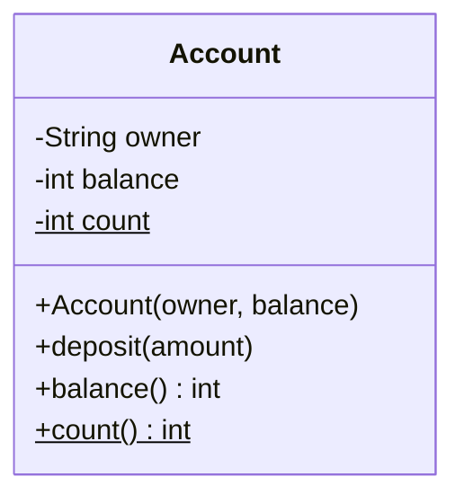

## Class versus object

A **class** is a blueprint: it lists what data something holds and what it can do. An **object** (also called an *instance*) is one thing built from that blueprint, with its own copy of the data.

- **Field** (data member): a variable that belongs to an object, such as `balance`.
- **Method** (member function in C++): a function that works on an object's fields.
- **Constructor**: special method that runs when the object is created and sets it up.
- **`this`**: the object a method is currently running on.



In UML (a standard diagram notation, covered later), `-` means private, `+` means public and `$` means static.

## Instance versus static

| | Instance member | Static member |
|---|---|---|
| Belongs to | One object | The class itself |
| Copies | One per object | Exactly one |
| Example | `balance` | `count` (how many accounts exist) |
| Reached with | `account.deposit(5)` | `Account.count()` / `Account::count()` |

```quiz
q: A class has `static int count` and `int balance`. Three objects are created. How many copies of each exist?
options:
  - 3 copies of `count`, 3 of `balance`
  - 1 copy of `count`, 3 of `balance`
  - 1 copy of `count`, 1 of `balance`
  - 3 copies of `count`, 1 of `balance`
answer: 1
why: A static field belongs to the class, so there is one shared copy. Every object has its own instance field.
```

## What `b = a` means

This is the biggest day-one difference between the two languages.

- **Java**: a variable of class type holds a *reference* (an address). `Account b = a;` makes `b` point to the **same** object. To get a second object you must build one.
- **C++**: a variable of class type *is* the object. `Account b = a;` makes a **copy**. To share one object you need a reference (`Account&`) or a pointer.

```predict
lang: java
prompt: What does this print?
code: |
  Account x = new Account("Asha", 10);
  Account y = x;
  y.deposit(5);
  System.out.println(x.balance());
output: "15"
why: "`y = x` copies the reference, not the object. Both names point at one Account, so the deposit is visible through `x`."
```

```predict
lang: cpp
prompt: Same code shape in C++. What does this print?
code: |
  Account x("Asha", 10);
  Account y = x;
  y.deposit(5);
  std::cout << x.balance();
output: "10"
why: "`Account y = x;` calls the copy constructor, so `y` is a separate object. The deposit changed only `y`."
```

:::warn
Passing an object to a function behaves the same way. Java passes the reference by value, so the callee can change your object. C++ passes a copy unless the parameter is `Account&` or `const Account&`. Forgetting the `&` in C++ is a common silent slowdown.
:::

## Code

The demo shows a constructor, a static counter, an alias and a real copy. The two programs print the same lines even though their mechanics differ.

```java
class Account {
    private static int count = 0;
    private final String owner;
    private int balance;

    Account(String owner, int balance) {
        this.owner = owner;
        this.balance = balance;
        count++;
    }

    Account copy() { return new Account(owner, balance); }
    void deposit(int amount) { balance += amount; }
    int balance() { return balance; }
    String owner() { return owner; }
    static int count() { return count; }
}

public class Main {
    public static void main(String[] args) {
        Account a = new Account("Asha", 100);
        Account other = new Account("Ravi", 20);
        System.out.println("accounts created: " + Account.count());

        Account alias = a;          // same object
        Account copy = a.copy();    // new object
        alias.deposit(50);
        System.out.println("a sees: " + a.balance());
        System.out.println("copy sees: " + copy.balance());
        System.out.println(other.owner() + " has " + other.balance());
    }
}
```
```cpp
#include <iostream>
#include <string>
#include <utility>

class Account {
public:
    Account(std::string owner, int balance) : owner_(std::move(owner)), balance_(balance) {
        ++count_;
    }

    void deposit(int amount) { balance_ += amount; }
    int balance() const { return balance_; }
    const std::string& owner() const { return owner_; }
    static int count() { return count_; }

private:
    inline static int count_ = 0;
    std::string owner_;
    int balance_;
};

int main() {
    Account a("Asha", 100);
    Account other("Ravi", 20);
    std::cout << "accounts created: " << Account::count() << "\n";

    Account& alias = a;     // same object
    Account copy = a;       // new object (copy constructor)
    alias.deposit(50);
    std::cout << "a sees: " << a.balance() << "\n";
    std::cout << "copy sees: " << copy.balance() << "\n";
    std::cout << other.owner() << " has " << other.balance() << "\n";
}
```
```output
accounts created: 2
a sees: 150
copy sees: 100
Ravi has 20
```

Notes on the C++ version:

- `: owner_(...), balance_(...)` is the **member initializer list**. It builds fields directly instead of default-building then assigning.
- `const` after a method means "this method does not change the object".
- `inline static` (C++17) lets you define the static field inside the class.
- `std::move(owner)` hands the string's contents over instead of copying them.

## Constructor details

```blanks
prompt: Complete the Java constructor so the field is set from the parameter.
lang: java
code: |
  class Point {
      private final int x;
      Point(int x) {
          [[this]].x = x;
      }
  }
why: The parameter `x` hides the field `x` inside the constructor. `this.x` names the field.
```

- If you write no constructor, both languages give you a default one with no parameters. Writing any constructor removes that default in Java and in C++.
- A **destructor** is C++ only. It runs when an object goes out of scope, which is how C++ releases resources (RAII, "resource acquisition is initialization"). Java has a garbage collector instead and no reliable destructor.
- Mark fields `final` (Java) or `const` (C++) when they must never change after construction.

```cards
- q: What is the difference between a class and an object?
  a: A class is the blueprint (fields and methods). An object is one instance built from it, with its own field values.
- q: What does a static member belong to?
  a: The class itself, not any object. There is one shared copy.
- q: In Java, what does `Account b = a;` do?
  a: Copies the reference. `a` and `b` point at the same object.
- q: In C++, what does `Account b = a;` do?
  a: Copies the object using the copy constructor. `a` and `b` are independent.
- q: What is a member initializer list in C++?
  a: "The `: field_(value)` part of a constructor that builds fields directly before the body runs."
```

## Notes

:::notes
- Class = blueprint. Object = one instance with its own field values.
- Fields hold data, methods act on it, the constructor sets the object up, `this` is the current object.
- Static members exist once per class; instance members once per object.
- Java class-type variables are references: `b = a` shares one object. Use `copy()` or a constructor for a duplicate.
- C++ class-type variables are objects: `b = a` copies. Use `Account&` to share.
- Pass `const T&` in C++ to avoid copying; Java always passes the reference by value.
- C++ has destructors and RAII; Java relies on garbage collection.
- Mark things `final` / `const` when they should not change after construction.
:::
