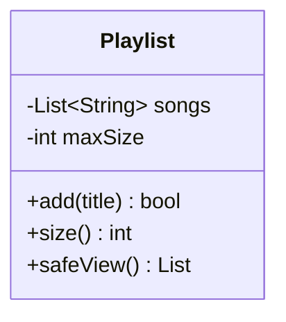

## The problem it solves

If every field is public, any code anywhere can put an object into a state it was never meant to have: a negative balance, a playlist over its limit, a date of 31 February.

- **Encapsulation**: bundle data with the methods that use it, and make the data private. The only way in is through methods that check the rules.
- **Invariant**: a rule that must always hold for an object, such as "balance is never negative". The class is responsible for keeping its own invariants true.
- **Abstraction**: show callers a small, stable set of operations (the "what") and hide how they work (the "how").

The two are related but different. Encapsulation is about *protecting state*. Abstraction is about *simplifying the view*.



## Access control

| Level | Java | C++ |
|---|---|---|
| Anyone | `public` | `public:` |
| Class and subclasses | `protected` (also same package) | `protected:` |
| Class only | `private` | `private:` |
| Same package only | default (no keyword) | no equivalent |
| Special friends | none | `friend` grants access to chosen functions or classes |

- Java defaults to package-private; C++ `class` defaults to private, but `struct` defaults to public.
- Start with `private` for every field and open up only what a caller needs.

```quiz
q: A `Wallet` has `public int balance` and a `withdraw` method that refuses to overdraw. What is wrong?
options:
  - Nothing, because `withdraw` checks the rule
  - Any code can write `wallet.balance = -500` and skip the check
  - The method should be static
  - Fields must be `protected`, never `public`
answer: 1
why: The rule lives in `withdraw`, but a public field lets callers bypass it. Make the field private so the method is the only way in.
```

## A leak you will not see coming

Making a field private is not enough if a getter hands out the internal object itself. The caller then holds a live handle to your private data.

```java
List<String> leaky() { return songs; }                       // caller can clear it
List<String> safeView() { return new ArrayList<>(songs); }   // caller gets a copy
```

In C++ the same mistake is returning a non-const reference (`std::vector<std::string>&`). Return a copy, or a `const` reference when copying is too costly and callers only read.

:::tip
Java also offers `List.copyOf(songs)` or `Collections.unmodifiableList(songs)`. Those throw if the caller tries to modify them, which fails loudly instead of silently changing a copy. The demo below uses a plain copy so both languages behave identically.
:::

## Code

`add` is the only way to put a song in. It protects three rules: no blank title, no duplicates, no more than the limit.

```java
import java.util.*;

class Playlist {
    private final List<String> songs = new ArrayList<>();
    private final int maxSize;

    Playlist(int maxSize) { this.maxSize = maxSize; }

    boolean add(String title) {
        if (title == null || title.isBlank()) return false;
        if (songs.contains(title) || songs.size() >= maxSize) return false;
        songs.add(title);
        return true;
    }

    int size() { return songs.size(); }
    List<String> safeView() { return new ArrayList<>(songs); }
    List<String> leaky() { return songs; }
}

public class Main {
    static void tryAdd(Playlist p, String title) {
        System.out.println("add " + title + ": " + p.add(title));
    }

    public static void main(String[] args) {
        Playlist p = new Playlist(3);
        tryAdd(p, "Intro");
        tryAdd(p, "Intro");
        tryAdd(p, "");
        tryAdd(p, "Verse");
        tryAdd(p, "Outro");
        tryAdd(p, "Bridge");
        System.out.println("size: " + p.size());

        p.safeView().clear();
        System.out.println("after clearing the copy: " + p.size());
        p.leaky().clear();
        System.out.println("after clearing the leaked list: " + p.size());
    }
}
```
```cpp
#include <algorithm>
#include <cstddef>
#include <iostream>
#include <string>
#include <vector>

class Playlist {
public:
    explicit Playlist(std::size_t maxSize) : maxSize_(maxSize) {}

    bool add(const std::string& title) {
        if (title.empty()) return false;
        bool duplicate = std::find(songs_.begin(), songs_.end(), title) != songs_.end();
        if (duplicate || songs_.size() >= maxSize_) return false;
        songs_.push_back(title);
        return true;
    }

    std::size_t size() const { return songs_.size(); }
    std::vector<std::string> safeView() const { return songs_; }
    std::vector<std::string>& leaky() { return songs_; }

private:
    std::vector<std::string> songs_;
    std::size_t maxSize_;
};

void tryAdd(Playlist& p, const std::string& title) {
    std::cout << "add " << title << ": " << std::boolalpha << p.add(title) << "\n";
}

int main() {
    Playlist p(3);
    tryAdd(p, "Intro");
    tryAdd(p, "Intro");
    tryAdd(p, "");
    tryAdd(p, "Verse");
    tryAdd(p, "Outro");
    tryAdd(p, "Bridge");
    std::cout << "size: " << p.size() << "\n";

    p.safeView().clear();
    std::cout << "after clearing the copy: " << p.size() << "\n";
    p.leaky().clear();
    std::cout << "after clearing the leaked list: " << p.size() << "\n";
}
```
```output
add Intro: true
add Intro: false
add : false
add Verse: true
add Outro: true
add Bridge: false
size: 3
after clearing the copy: 3
after clearing the leaked list: 0
```

The last line is the lesson: the invariant "at most 3 songs" was protected by `add`, but `leaky()` let a caller empty the list without going through any rule.

```order
prompt: Arrange `add` so that every rule is checked before the list changes.
lang: java
code: |
  boolean add(String title) {
      if (title == null || title.isBlank()) return false;
      if (songs.contains(title) || songs.size() >= maxSize) return false;
      songs.add(title);
      return true;
  }
distractors:
  - "    songs.add(title);   // before the checks"
why: Validate first, change state last. If the add came before the checks, a rejected title would already be in the list.
```

## Abstraction in practice

Abstraction means a caller thinks in operations, not mechanics.

- A caller of `notifier.send(message)` does not know whether it uses email, SMS or a push service.
- A `Playlist` could switch from an `ArrayList` to a linked list tomorrow. Callers that only use `add` and `size` never notice.
- The more internals you expose, the more callers depend on them, and the harder every later change becomes.

```blanks
prompt: Make this class protect its balance.
lang: java
code: |
  class Wallet {
      [[private]] int balance;
      boolean withdraw(int amount) {
          if (amount > balance) return false;
          balance -= amount;
          return true;
      }
  }
why: With a private field, the only route to the balance is through methods that enforce the rules.
```

:::truth
Auto-generated getters and setters for every field are not encapsulation. A class with `getX`/`setX` for everything is just a public struct with extra typing. Expose behaviour (`withdraw`, `add`), not raw fields.
:::

```cards
- q: What is an invariant?
  a: A rule that must always be true for an object, such as "balance is never negative". The class enforces it.
- q: Encapsulation versus abstraction in one line each?
  a: Encapsulation protects state behind methods. Abstraction exposes a small "what" and hides the "how".
- q: Why can a getter break encapsulation?
  a: If it returns the internal mutable object, the caller can change private data without going through your rules.
- q: Default access of a C++ `class` versus `struct`?
  a: "`class` members are private by default; `struct` members are public by default."
- q: Fix for a getter that leaks an internal list?
  a: Return a copy or an unmodifiable view (Java), or a copy or const reference (C++).
```

## Notes

:::notes
- Encapsulation: private data plus public methods that enforce the rules.
- Invariant: a condition that must always hold; the class alone guards it.
- Abstraction: expose what an object does, hide how it does it.
- Default to `private`; widen access only when a caller needs it.
- A getter that returns an internal mutable collection leaks the state. Return a copy or a read-only view.
- Getters and setters on every field are not real encapsulation. Offer behaviour, not raw access.
- Java has package-private access; C++ has `friend`. Neither language has the other's feature.
:::
