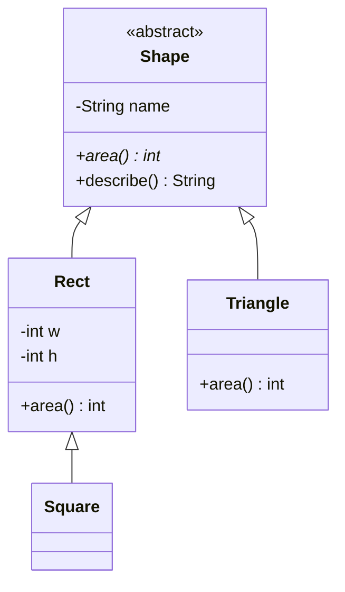

## Inheritance

**Inheritance** lets a class (the *subclass*, *derived class* or *child*) take the fields and methods of another (the *superclass*, *base class* or *parent*) and add or change things. It models an **is-a** relationship: a Square is a Shape.



- **Overriding**: a subclass supplies its own version of a parent's method (same name and parameters).
- **Overloading**: several methods with the same name but different parameters in one class. This is not polymorphism; the compiler picks one by looking at argument types.

| | Java | C++ |
|---|---|---|
| Extend a class | `class B extends A` | `class B : public A` |
| Methods overridable by default | Yes (unless `final`) | No, must be marked `virtual` |
| Mark an override | `@Override` (annotation) | `override` (keyword) |
| Abstract method | `abstract int area();` | `virtual int area() const = 0;` |
| Multiple parents | Interfaces only | Allowed for any class |

## Polymorphism and dynamic dispatch

**Polymorphism** means "many forms": code written against the parent type works with any child. The key mechanism is **dynamic dispatch**: when you call a method through a parent-typed variable, the program picks the version that belongs to the object's *actual* type, at run time.

- **Static type**: the type written in the code (`Shape`).
- **Dynamic type**: the type of the object actually there (`Square`).
- Dynamic dispatch looks at the dynamic type. In C++ this happens only for `virtual` methods, called through a pointer or reference. C++ implements it with a **vtable** (a per-class table of function pointers).

```quiz
q: In Java, `Shape s = new Square(5);` then `s.area()`. Which `area` runs?
options:
  - Shape's, because the variable is declared as Shape
  - The one inherited from Rect, because Square does not override it
  - It does not compile, because Shape.area is abstract
  - Whichever was written first in the file
answer: 1
why: Dispatch follows the object (a Square), and Square has no `area` of its own, so the nearest inherited version, Rect's, runs. The declared type only decides which methods you may call.
```

## Code

`Shape.describe()` is written once in the parent and calls `area()`. Each child plugs in its own `area()`, and `describe()` uses the right one without knowing which child it has.

```java
import java.util.*;

abstract class Shape {
    private final String name;
    Shape(String name) { this.name = name; }
    abstract int area();
    String describe() { return name + " area=" + area(); }
}

class Rect extends Shape {
    private final int w, h;
    Rect(int w, int h) { this("rect", w, h); }
    protected Rect(String name, int w, int h) {
        super(name);
        this.w = w;
        this.h = h;
    }
    @Override int area() { return w * h; }
}

class Square extends Rect {
    Square(int side) { super("square", side, side); }
}

class Triangle extends Shape {
    private final int base, height;
    Triangle(int base, int height) {
        super("triangle");
        this.base = base;
        this.height = height;
    }
    @Override int area() { return base * height / 2; }
}

public class Main {
    public static void main(String[] args) {
        List<Shape> shapes = List.of(new Rect(3, 4), new Square(5), new Triangle(6, 3));
        int total = 0;
        for (Shape s : shapes) {
            System.out.println(s.describe());
            total += s.area();
        }
        System.out.println("total=" + total);
    }
}
```
```cpp
#include <iostream>
#include <memory>
#include <string>
#include <utility>
#include <vector>

class Shape {
public:
    explicit Shape(std::string name) : name_(std::move(name)) {}
    virtual ~Shape() = default;
    virtual int area() const = 0;
    std::string describe() const { return name_ + " area=" + std::to_string(area()); }
private:
    std::string name_;
};

class Rect : public Shape {
public:
    Rect(int w, int h) : Rect("rect", w, h) {}
    int area() const override { return w_ * h_; }
protected:
    Rect(std::string name, int w, int h) : Shape(std::move(name)), w_(w), h_(h) {}
private:
    int w_, h_;
};

class Square : public Rect {
public:
    explicit Square(int side) : Rect("square", side, side) {}
};

class Triangle : public Shape {
public:
    Triangle(int base, int height) : Shape("triangle"), base_(base), height_(height) {}
    int area() const override { return base_ * height_ / 2; }
private:
    int base_, height_;
};

int main() {
    std::vector<std::unique_ptr<Shape>> shapes;
    shapes.push_back(std::make_unique<Rect>(3, 4));
    shapes.push_back(std::make_unique<Square>(5));
    shapes.push_back(std::make_unique<Triangle>(6, 3));

    int total = 0;
    for (const auto& s : shapes) {
        std::cout << s->describe() << "\n";
        total += s->area();
    }
    std::cout << "total=" << total << "\n";
}
```
```output
rect area=12
square area=25
triangle area=9
total=46
```

Things to notice:

- The loop never mentions Rect, Square or Triangle. Adding a Circle means writing one new class; the loop stays the same.
- `describe()` in the parent calls the child's `area()`. That works in Java automatically and in C++ because `area()` is `virtual`.
- C++ needs the `virtual` destructor so that deleting through a `Shape` pointer runs the child's destructor too. Without it, deleting a child via a parent pointer is undefined behaviour.
- The vector holds `unique_ptr<Shape>`, not `Shape`. That brings us to slicing.

## Slicing (C++ only)

Storing a child *by value* in a parent-typed variable copies only the parent part. The child's extra data and overrides are cut off, which is **object slicing**.

```predict
lang: cpp
prompt: What does this print?
code: |
  struct Animal {
      virtual std::string sound() const { return "..."; }
  };
  struct Dog : Animal {
      std::string sound() const override { return "woof"; }
  };

  Dog d;
  Animal copy = d;      // by value
  Animal& ref = d;      // by reference
  std::cout << copy.sound() << " " << ref.sound();
output: ... woof
why: "`Animal copy = d` builds a real Animal from the Animal part of `d`, so it has no Dog behaviour left. The reference still points at the Dog, so dynamic dispatch works."
```

- Java never slices, because variables hold references.
- In C++, hold polymorphic objects through pointers or references: `unique_ptr<Shape>`, `Shape&`.
- A parent that is meant to be used polymorphically can delete its copy operations to make slicing a compile error.

:::warn
Do not call an overridable method from a constructor. In Java it runs the child's override before the child's fields are set. In C++ it runs the parent's version, not the child's. Both surprise people.
:::

```blanks
prompt: Complete the C++ declarations so Circle overrides area and Shape can be deleted safely through a pointer.
lang: cpp
code: |
  class Shape {
  public:
      virtual [[~Shape()]] = default;
      virtual int area() const = 0;
  };
  class Circle : public Shape {
  public:
      int area() const [[override]] { return 3 * r_ * r_; }
  private:
      int r_ = 2;
  };
why: A virtual destructor makes deletion through a base pointer correct. `override` asks the compiler to check that the signature really matches a virtual method in the parent.
```

## When inheritance is a poor fit

- If the honest sentence is "B uses A" rather than "B is an A", do not inherit.
- A deep chain of subclasses is hard to read and change. A change in the parent ripples to every child.
- Next lessons give the usual alternatives: interfaces and composition.

```cards
- q: What is dynamic dispatch?
  a: Choosing which method to run based on the object's actual type at run time, not the variable's declared type.
- q: When does C++ use dynamic dispatch?
  a: Only for `virtual` methods called through a pointer or reference.
- q: Overriding versus overloading?
  a: Overriding replaces a parent's method in a subclass. Overloading is several methods with the same name and different parameters, chosen at compile time.
- q: What is object slicing?
  a: Copying a derived object into a base-type variable by value, which discards the derived part and its overrides.
- q: Why does a polymorphic C++ base class need a virtual destructor?
  a: So that deleting a child through a base pointer runs the child's destructor. Otherwise behaviour is undefined.
```

## Notes

:::notes
- Inheritance models is-a: the child gets the parent's members and may add or override.
- Polymorphism: code written against the parent works with every child.
- Dynamic dispatch picks the method from the object's actual type at run time.
- Java overrides by default (`@Override` for safety). C++ needs `virtual` on the parent and `override` on the child.
- Overloading is chosen at compile time by argument types; it is not polymorphism.
- Slicing (C++): copying a child into a parent variable by value loses the child part. Use pointers or references.
- A polymorphic C++ base class needs a virtual destructor.
- Do not call overridable methods in constructors.
:::
