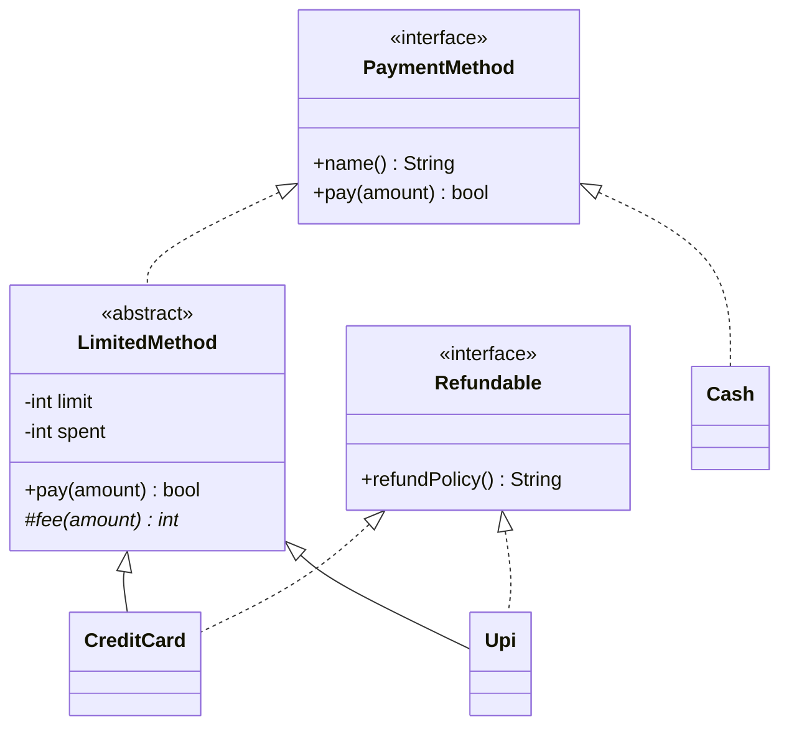

## Two tools for one job

Both let you write code against an *idea* ("something you can pay with") instead of a concrete class.

- **Interface**: a contract. It lists method signatures and says nothing about how they work. Any class that signs the contract can be used wherever the interface is expected.
- **Abstract class**: a half-finished class. It can hold fields and finished methods, plus some **abstract** methods (declared but not written) that subclasses must fill in. You cannot create an object of it directly.

| | Interface | Abstract class |
|---|---|---|
| Holds fields (state) | No instance fields | Yes |
| Holds finished methods | Only `default` / `static` ones in Java | Yes |
| A class can use how many | Many | One parent only (Java) |
| Best for | A capability or role ("can be paid with") | Shared code for a family of related classes |
| In C++ | A class with only pure virtual methods | A class with some pure virtual methods |

C++ has no `interface` keyword. A **pure virtual** method (`virtual void f() = 0;`) has no body in the base, and a class with at least one is abstract. An "interface" in C++ is simply an abstract class with nothing but pure virtual methods and a virtual destructor.

```quiz
questions:
  - q: You need ten unrelated classes (Invoice, Report, Image) to all be printable. Which fits better?
    options:
      - An abstract class `Printable` that all ten extend
      - An interface `Printable` that all ten implement
    answer: 1
    why: The classes are unrelated and Java allows only one parent class. An interface adds a capability without forcing a shared ancestor.
  - q: Five kinds of report share the same loading and formatting code and differ only in one calculation. Which fits better?
    options:
      - An interface with five copies of the shared code
      - An abstract class holding the shared code and one abstract method for the calculation
    answer: 1
    why: An abstract class can hold the shared code once. The interface would force each implementation to repeat it.
```

## Structure



- Dotted arrow with a hollow head: "implements". Solid arrow: "extends".
- `LimitedMethod` is the abstract class. It owns the shared rule (stay under a limit) and leaves `fee` to its children. This pattern, a fixed skeleton with one replaceable step, is called the **template method**.
- `Cash` skips the abstract class: it has no limit, so it implements the interface directly.

## Code

The checkout code only knows `PaymentMethod`. It asks each method for a refund policy only if the method also has the `Refundable` capability.

```java
import java.util.*;

interface PaymentMethod {
    String name();
    boolean pay(int amount);
}

interface Refundable {
    default String refundPolicy() { return "no refunds"; }
}

abstract class LimitedMethod implements PaymentMethod {
    private final int limit;
    private int spent = 0;

    LimitedMethod(int limit) { this.limit = limit; }

    protected abstract int fee(int amount);

    @Override
    public boolean pay(int amount) {
        int total = amount + fee(amount);
        if (amount <= 0 || spent + total > limit) return false;
        spent += total;
        return true;
    }
}

class CreditCard extends LimitedMethod implements Refundable {
    CreditCard(int limit) { super(limit); }
    @Override public String name() { return "card"; }
    @Override protected int fee(int amount) { return amount * 2 / 100; }
    @Override public String refundPolicy() { return "7 days"; }
}

class Upi extends LimitedMethod implements Refundable {
    Upi(int limit) { super(limit); }
    @Override public String name() { return "upi"; }
    @Override protected int fee(int amount) { return 0; }
}

class Cash implements PaymentMethod {
    @Override public String name() { return "cash"; }
    @Override public boolean pay(int amount) { return true; }
}

public class Main {
    static void attempt(PaymentMethod m, int amount) {
        System.out.println(m.name() + " pay " + amount + ": " + (m.pay(amount) ? "ok" : "declined"));
    }

    public static void main(String[] args) {
        PaymentMethod card = new CreditCard(1000);
        PaymentMethod upi = new Upi(1000);
        PaymentMethod cash = new Cash();

        attempt(card, 500);
        attempt(card, 500);
        attempt(upi, 500);
        attempt(upi, 500);
        attempt(upi, 1);
        attempt(cash, 5000);

        for (PaymentMethod m : List.of(card, upi, cash)) {
            if (m instanceof Refundable r) {
                System.out.println(m.name() + " refund: " + r.refundPolicy());
            }
        }
    }
}
```
```cpp
#include <iostream>
#include <memory>
#include <string>
#include <vector>

class PaymentMethod {
public:
    virtual ~PaymentMethod() = default;
    virtual std::string name() const = 0;
    virtual bool pay(int amount) = 0;
};

class Refundable {
public:
    virtual ~Refundable() = default;
    virtual std::string refundPolicy() const { return "no refunds"; }
};

class LimitedMethod : public PaymentMethod {
public:
    explicit LimitedMethod(int limit) : limit_(limit) {}

    bool pay(int amount) override {
        int total = amount + fee(amount);
        if (amount <= 0 || spent_ + total > limit_) return false;
        spent_ += total;
        return true;
    }

protected:
    virtual int fee(int amount) const = 0;

private:
    int limit_;
    int spent_ = 0;
};

class CreditCard : public LimitedMethod, public Refundable {
public:
    explicit CreditCard(int limit) : LimitedMethod(limit) {}
    std::string name() const override { return "card"; }
    std::string refundPolicy() const override { return "7 days"; }
protected:
    int fee(int amount) const override { return amount * 2 / 100; }
};

class Upi : public LimitedMethod, public Refundable {
public:
    explicit Upi(int limit) : LimitedMethod(limit) {}
    std::string name() const override { return "upi"; }
protected:
    int fee(int) const override { return 0; }
};

class Cash : public PaymentMethod {
public:
    std::string name() const override { return "cash"; }
    bool pay(int) override { return true; }
};

void attempt(PaymentMethod& m, int amount) {
    std::cout << m.name() << " pay " << amount << ": " << (m.pay(amount) ? "ok" : "declined") << "\n";
}

int main() {
    std::vector<std::unique_ptr<PaymentMethod>> methods;
    methods.push_back(std::make_unique<CreditCard>(1000));
    methods.push_back(std::make_unique<Upi>(1000));
    methods.push_back(std::make_unique<Cash>());

    attempt(*methods[0], 500);
    attempt(*methods[0], 500);
    attempt(*methods[1], 500);
    attempt(*methods[1], 500);
    attempt(*methods[1], 1);
    attempt(*methods[2], 5000);

    for (const auto& m : methods) {
        if (auto* r = dynamic_cast<Refundable*>(m.get())) {
            std::cout << m->name() << " refund: " << r->refundPolicy() << "\n";
        }
    }
}
```
```output
card pay 500: ok
card pay 500: declined
upi pay 500: ok
upi pay 500: ok
upi pay 1: declined
cash pay 5000: ok
card refund: 7 days
upi refund: no refunds
```

Why the numbers work: a 500 card payment costs 500 + 10 fee = 510, so a second one would reach 1020, over the limit of 1000. UPI has no fee, so two payments of 500 hit exactly 1000, which is allowed, and the third (1) does not fit.

- `dynamic_cast` asks "is this object also a Refundable?" at run time. It returns `nullptr` if not. Java's `instanceof` does the same job.
- The C++ `Refundable` has a normal `virtual` method with a body, which is the closest C++ gets to a Java `default` method.
- `CreditCard` inherits from two C++ classes (multiple inheritance). That is safe here because `Refundable` carries no state.

```blanks
prompt: Complete the C++ interface.
lang: cpp
code: |
  class Notifier {
  public:
      virtual ~Notifier() = default;
      virtual void send(const std::string& msg) [[= 0]];
  };
why: "`= 0` makes the method pure virtual: no body in the base, and every concrete child must provide one. A class with a pure virtual method cannot be instantiated."
```

```predict
lang: java
prompt: What does this print?
code: |
  interface Greeter {
      default String greet() { return "hello"; }
  }
  class Polite implements Greeter {
      @Override public String greet() { return Greeter.super.greet() + " there"; }
  }
  System.out.println(new Polite().greet());
output: hello there
why: "`Greeter.super.greet()` calls the interface's default body from inside the override, then the class adds its own text."
```

## Choosing between them

- Start with an interface when you only need a role or capability.
- Add an abstract class when several implementations repeat the same code. It is a convenience layer, not a requirement.
- Prefer small interfaces with one purpose. Callers then depend on exactly what they use.

:::truth
Interviewers often ask "interface versus abstract class" as a definitions quiz. The better answer is a situation: name the roles, then name the shared code. If you cannot point at shared code, you probably want only the interface.
:::

```cards
- q: What is an interface?
  a: A contract listing method signatures with no implementation. Any class that implements it can be used where the interface is expected.
- q: What is a pure virtual method in C++?
  a: A virtual method declared with `= 0` and no body in the base. It makes the class abstract.
- q: Can you create an object of an abstract class?
  a: No. You create objects of concrete subclasses that fill in every abstract method.
- q: Why use an abstract class between an interface and its implementations?
  a: To hold code, fields and defaults that several implementations share, so it is written once.
- q: How does a Java interface method with a body work?
  a: A `default` method gives a fallback implementation that implementers may override.
```

## Notes

:::notes
- Interface: contract only. Abstract class: contract plus shared state and code.
- A Java class extends one class but may implement many interfaces.
- C++ has no `interface` keyword: use a class of pure virtual methods and a virtual destructor.
- Pure virtual (`= 0`) makes a C++ class abstract; it cannot be instantiated.
- Interface for a capability; abstract class when implementations repeat code.
- Template method: the abstract class fixes the steps, subclasses fill in one hook (`fee`).
- Check for an optional capability with `instanceof` (Java) or `dynamic_cast` (C++).
- Keep interfaces small and focused.
:::
