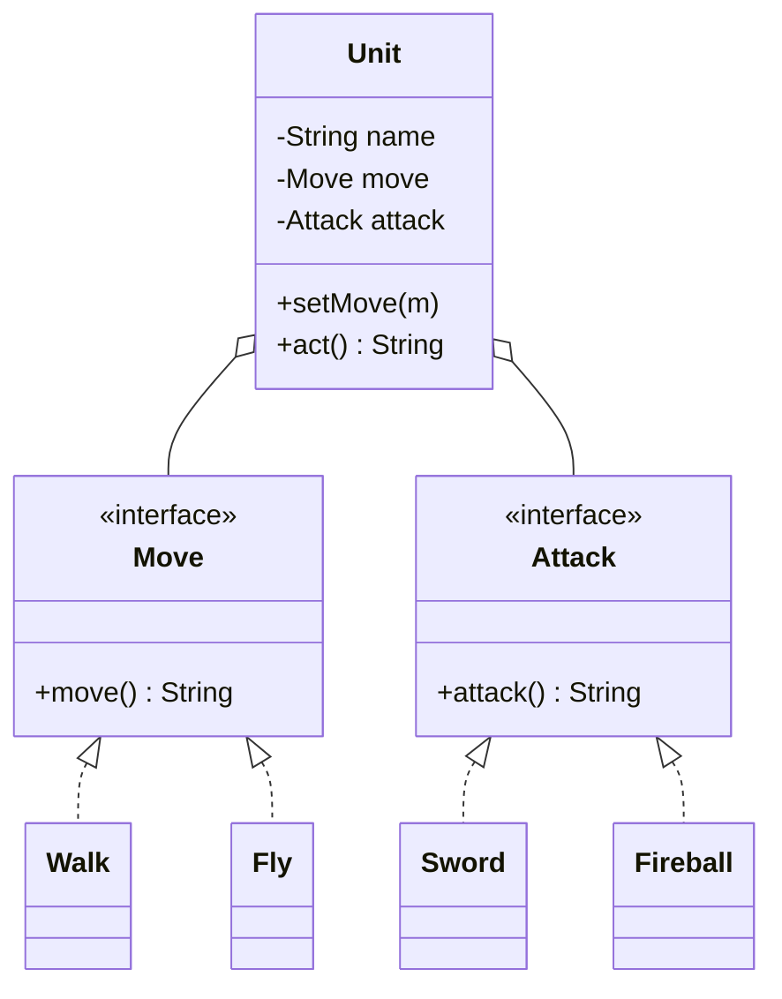

## The problem it solves

Say you have game units, and each unit moves one way (walks, flies) and attacks one way (sword, fireball). With inheritance you might write `WalkingKnight`, `FlyingKnight`, `WalkingMage`, `FlyingMage`. Add one new movement and you double the classes. This is called **class explosion**.

Two relationships can connect classes:

| | Inheritance | Composition |
|---|---|---|
| Question it answers | Is B a kind of A? | Does B have an A, or use one? |
| Link is fixed | At compile time | Can be swapped at run time |
| Coupling | Tight: child depends on parent internals | Loose: depends only on an interface |
| Reuse by | Extending | Holding a part and **delegating** (forwarding calls to it) |

The advice "favour composition over inheritance" does not say never inherit. It says: reach for a held part first.

## Structure



- `Unit` is one class. Its behaviours are plugged in as parts.
- 2 movements and 2 attacks give 4 combinations with 4 small classes plus `Unit`, not 4 subclasses.
- This idea, "a family of interchangeable behaviours behind an interface", is the **Strategy pattern**, covered later.

```quiz
q: Which relationship is better modelled with composition?
options:
  - A Dog is an Animal
  - A Car has an Engine
  - A SavingsAccount is an Account
  - A Circle is a Shape
answer: 1
why: "A car is not a kind of engine; it contains one and forwards work to it. The other three are real is-a relationships."
```

## Code

The demo builds two units, then changes the mage's movement while the program runs, which inheritance cannot do. It ends with a small delegating stack.

```java
import java.util.*;

interface Move { String move(); }
class Walk implements Move { public String move() { return "walks"; } }
class Fly implements Move { public String move() { return "flies"; } }

interface Attack { String attack(); }
class Sword implements Attack { public String attack() { return "swings sword"; } }
class Fireball implements Attack { public String attack() { return "casts fireball"; } }

class Unit {
    private final String name;
    private Move move;
    private final Attack attack;

    Unit(String name, Move move, Attack attack) {
        this.name = name;
        this.move = move;
        this.attack = attack;
    }

    void setMove(Move move) { this.move = move; }
    String act() { return name + ": " + move.move() + ", " + attack.attack(); }
}

class IntStack {
    private final List<Integer> items = new ArrayList<>();   // held, not inherited
    void push(int x) { items.add(x); }
    int pop() { return items.remove(items.size() - 1); }
    int size() { return items.size(); }
}

public class Main {
    public static void main(String[] args) {
        Unit knight = new Unit("knight", new Walk(), new Sword());
        Unit mage = new Unit("mage", new Walk(), new Fireball());
        System.out.println(knight.act());
        System.out.println(mage.act());

        mage.setMove(new Fly());
        System.out.println(mage.act());

        IntStack stack = new IntStack();
        stack.push(1);
        stack.push(2);
        stack.push(3);
        int top = stack.pop();
        System.out.println("stack pop: " + top + ", size: " + stack.size());
    }
}
```
```cpp
#include <iostream>
#include <memory>
#include <string>
#include <utility>
#include <vector>

class Move {
public:
    virtual ~Move() = default;
    virtual std::string move() const = 0;
};
class Walk : public Move { public: std::string move() const override { return "walks"; } };
class Fly : public Move { public: std::string move() const override { return "flies"; } };

class Attack {
public:
    virtual ~Attack() = default;
    virtual std::string attack() const = 0;
};
class Sword : public Attack { public: std::string attack() const override { return "swings sword"; } };
class Fireball : public Attack { public: std::string attack() const override { return "casts fireball"; } };

class Unit {
public:
    Unit(std::string name, std::unique_ptr<Move> move, std::unique_ptr<Attack> attack)
        : name_(std::move(name)), move_(std::move(move)), attack_(std::move(attack)) {}

    void setMove(std::unique_ptr<Move> move) { move_ = std::move(move); }
    std::string act() const { return name_ + ": " + move_->move() + ", " + attack_->attack(); }

private:
    std::string name_;
    std::unique_ptr<Move> move_;
    std::unique_ptr<Attack> attack_;
};

class IntStack {
public:
    void push(int x) { items_.push_back(x); }
    int pop() {
        int top = items_.back();
        items_.pop_back();
        return top;
    }
    std::size_t size() const { return items_.size(); }
private:
    std::vector<int> items_;   // held, not inherited
};

int main() {
    Unit knight("knight", std::make_unique<Walk>(), std::make_unique<Sword>());
    Unit mage("mage", std::make_unique<Walk>(), std::make_unique<Fireball>());
    std::cout << knight.act() << "\n";
    std::cout << mage.act() << "\n";

    mage.setMove(std::make_unique<Fly>());
    std::cout << mage.act() << "\n";

    IntStack stack;
    stack.push(1);
    stack.push(2);
    stack.push(3);
    int top = stack.pop();
    std::cout << "stack pop: " << top << ", size: " << stack.size() << "\n";
}
```
```output
knight: walks, swings sword
mage: walks, casts fireball
mage: flies, casts fireball
stack pop: 3, size: 2
```

Two things the demo shows:

- **Swap at run time.** `setMove` replaced a part. A subclass is fixed for the life of the object.
- **Narrow surface.** `IntStack` offers three methods. If it extended the list class instead, callers could also insert in the middle or sort, breaking the idea of a stack.

:::truth
Java's own `java.util.Stack` extends `Vector`, so it exposes methods like `insertElementAt` that a stack should not have. It is a well-known design mistake that cannot be removed for compatibility. In C++, library containers have no virtual destructor, so deriving from them and deleting through a base pointer is undefined behaviour.
:::

```order
prompt: Arrange a Unit constructor that receives its parts (this is called constructor injection).
lang: java
code: |
  Unit(String name, Move move, Attack attack) {
      this.name = name;
      this.move = move;
      this.attack = attack;
  }
distractors:
  - "        this.move = new Walk();"
why: The unit must not build its own parts. If it did, it would be tied to Walk and you could not pass in Fly or a test double.
```

## When inheritance is still right

- A true is-a relationship where every promise of the parent holds for the child (the next principles lesson, Liskov substitution, makes this precise).
- Frameworks that ask you to extend a base class (for example `Thread`, `HttpServlet` or test base classes).
- Sharing a skeleton through an abstract class when children are few and stable.

If you inherit, inherit from an abstract class or interface, not from a concrete class with state you do not control. Changes to a concrete parent can silently break children. This is the **fragile base class** problem.

```blanks
prompt: Make Unit hold its attack behaviour through the interface, not a concrete class.
lang: java
code: |
  class Unit {
      private final [[Attack]] attack;
      Unit(Attack attack) { this.attack = attack; }
      String act() { return attack.[[attack]](); }
  }
why: Depending on the interface keeps Unit open to any attack, including ones written later or fakes used in tests.
```

```cards
- q: What question separates inheritance from composition?
  a: Inheritance asks "is B a kind of A?". Composition asks "does B have or use an A?".
- q: What is delegation?
  a: A class holds another object and forwards calls to it instead of inheriting its code.
- q: Main runtime advantage of composition?
  a: Parts can be swapped while the program runs, because the link is a field, not a class hierarchy.
- q: What is class explosion?
  a: One subclass per combination of behaviours, so every new option multiplies the number of classes.
- q: What is the fragile base class problem?
  a: A change inside a concrete parent class breaks children that depended on its internals.
```

## Notes

:::notes
- Inheritance = is-a, fixed at compile time, tight coupling. Composition = has-a, swappable, loose coupling.
- Prefer holding a part behind an interface and delegating to it.
- Combinations of behaviours (move x attack) explode under inheritance and stay linear under composition.
- Inject parts through the constructor so they can be replaced and faked.
- Wrapping a library type exposes only the methods you want; extending it exposes all of them.
- Inherit only for a real is-a relationship, preferably from an interface or abstract class.
- Fragile base class: concrete parents with hidden state can break their children.
- C++ standard containers are not designed to be base classes.
:::
