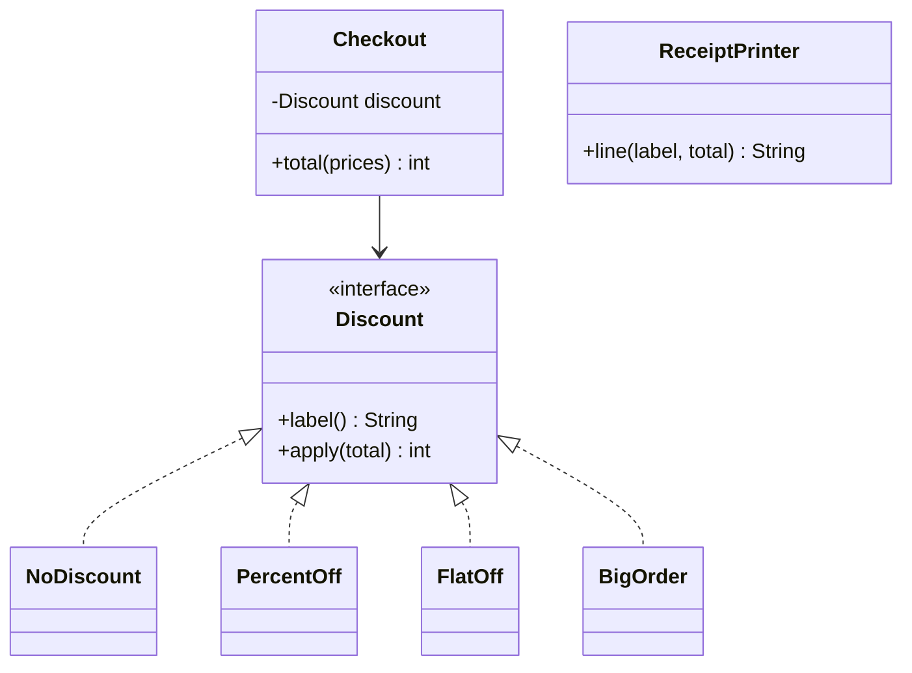

## Why principles at all

Code is read and changed far more often than it is written. SOLID is a set of five guidelines, named by Robert C. Martin, that aim at one thing: **a new requirement should cost a small, local change**.

| Letter | Principle | One-line meaning |
|---|---|---|
| S | Single Responsibility | A class has one reason to change |
| O | Open/Closed | Open to extension, closed to modification |
| L | Liskov Substitution | A child can stand in for its parent without surprises |
| I | Interface Segregation | Many small interfaces beat one fat one |
| D | Dependency Inversion | Depend on abstractions, not concrete classes |

## S: Single Responsibility

A **responsibility** is a reason to change, usually tied to one stakeholder or concern.

- Smell: a class that calculates, formats, saves and emails.
- Why it hurts: a change to the PDF layout risks breaking the tax calculation sitting in the same file.
- Fix: split by reason to change. `TaxCalculator`, `ReportFormatter`, `ReportRepository`.

:::note
"One responsibility" does not mean "one method". A class can have many methods that all serve one purpose.
:::

## O: Open/Closed

Adding a feature should mean adding code, not editing working code.

- Smell: an `if/else` or `switch` on a type, repeated wherever the type matters.
- Fix: put the varying behaviour behind an interface and add a new class per variant.

## L: Liskov Substitution

Named after Barbara Liskov. If code works with a `Parent`, it must keep working when handed any `Child`. A child may do more, but never promise less or surprise callers.

- Smell: an override that throws "not supported", ignores its input, or tightens a rule.
- The classic case: a `Square` that extends `Rectangle`. Try it.

```predict
lang: java
prompt: What does this print?
code: |
  class Rectangle {
      protected int w, h;
      void setWidth(int w) { this.w = w; }
      void setHeight(int h) { this.h = h; }
      int area() { return w * h; }
  }
  class Square extends Rectangle {
      @Override void setWidth(int w) { this.w = w; this.h = w; }
      @Override void setHeight(int h) { this.w = h; this.h = h; }
  }
  Rectangle r = new Square();
  r.setWidth(4);
  r.setHeight(5);
  System.out.println(r.area());
output: "25"
why: "A Square must keep both sides equal, so `setHeight(5)` also changed the width. Code written for rectangles expects 4 x 5 = 20. The child broke the parent's promise, so the inheritance is wrong."
```

## I: Interface Segregation

No class should be forced to implement methods it does not use.

- Smell: `interface Machine { print(); scan(); fax(); }` and a basic printer whose `scan()` throws.
- Fix: split into `Printer`, `Scanner`, `Fax`. A multifunction device implements all three.

## D: Dependency Inversion

High-level logic (the business rules) should not depend on low-level details (the database, the payment API). Both should depend on an **abstraction** (an interface).

- Smell: `new MySqlOrderRepository()` inside a service.
- Fix: the service takes an `OrderRepository` interface in its constructor. Something else decides which implementation to pass.
- Passing dependencies in this way is called **dependency injection**. Inversion is the principle; injection is one technique.

## Open/Closed and Dependency Inversion in code

`Checkout` knows only the `Discount` interface. Adding `BigOrder` at the end required no edit to `Checkout` or the printer. `ReceiptPrinter` is separate from `Checkout`, which is single responsibility at work.



```java
import java.util.*;

interface Discount {
    String label();
    int apply(int total);
}

class NoDiscount implements Discount {
    public String label() { return "none"; }
    public int apply(int total) { return total; }
}

class PercentOff implements Discount {
    private final int pct;
    PercentOff(int pct) { this.pct = pct; }
    public String label() { return pct + "% off"; }
    public int apply(int total) { return total - total * pct / 100; }
}

class FlatOff implements Discount {
    private final int amount;
    FlatOff(int amount) { this.amount = amount; }
    public String label() { return "flat " + amount; }
    public int apply(int total) { return Math.max(0, total - amount); }
}

class BigOrder implements Discount {
    public String label() { return "big order"; }
    public int apply(int total) { return total >= 500 ? total - 100 : total; }
}

class Checkout {
    private final Discount discount;
    Checkout(Discount discount) { this.discount = discount; }

    int total(List<Integer> prices) {
        int sum = 0;
        for (int p : prices) sum += p;
        return discount.apply(sum);
    }
}

class ReceiptPrinter {
    String line(String label, int total) { return label + ": " + total; }
}

public class Main {
    public static void main(String[] args) {
        List<Integer> prices = List.of(400, 600);
        List<Discount> discounts = List.of(
            new NoDiscount(), new PercentOff(10), new FlatOff(150), new BigOrder());
        ReceiptPrinter printer = new ReceiptPrinter();
        for (Discount d : discounts) {
            int total = new Checkout(d).total(prices);
            System.out.println(printer.line(d.label(), total));
        }
    }
}
```
```cpp
#include <algorithm>
#include <iostream>
#include <memory>
#include <string>
#include <vector>

class Discount {
public:
    virtual ~Discount() = default;
    virtual std::string label() const = 0;
    virtual int apply(int total) const = 0;
};

class NoDiscount : public Discount {
public:
    std::string label() const override { return "none"; }
    int apply(int total) const override { return total; }
};

class PercentOff : public Discount {
public:
    explicit PercentOff(int pct) : pct_(pct) {}
    std::string label() const override { return std::to_string(pct_) + "% off"; }
    int apply(int total) const override { return total - total * pct_ / 100; }
private:
    int pct_;
};

class FlatOff : public Discount {
public:
    explicit FlatOff(int amount) : amount_(amount) {}
    std::string label() const override { return "flat " + std::to_string(amount_); }
    int apply(int total) const override { return std::max(0, total - amount_); }
private:
    int amount_;
};

class BigOrder : public Discount {
public:
    std::string label() const override { return "big order"; }
    int apply(int total) const override { return total >= 500 ? total - 100 : total; }
};

class Checkout {
public:
    explicit Checkout(const Discount& discount) : discount_(discount) {}

    int total(const std::vector<int>& prices) const {
        int sum = 0;
        for (int p : prices) sum += p;
        return discount_.apply(sum);
    }
private:
    const Discount& discount_;
};

class ReceiptPrinter {
public:
    std::string line(const std::string& label, int total) const {
        return label + ": " + std::to_string(total);
    }
};

int main() {
    std::vector<int> prices = {400, 600};
    std::vector<std::unique_ptr<Discount>> discounts;
    discounts.push_back(std::make_unique<NoDiscount>());
    discounts.push_back(std::make_unique<PercentOff>(10));
    discounts.push_back(std::make_unique<FlatOff>(150));
    discounts.push_back(std::make_unique<BigOrder>());

    ReceiptPrinter printer;
    for (const auto& d : discounts) {
        int total = Checkout(*d).total(prices);
        std::cout << printer.line(d->label(), total) << "\n";
    }
}
```
```output
none: 1000
10% off: 900
flat 150: 850
big order: 900
```

```blanks
prompt: Apply dependency inversion so Checkout can use any discount.
lang: java
code: |
  class Checkout {
      private final [[Discount]] discount;
      Checkout([[Discount]] discount) { this.discount = discount; }
  }
why: The field and the parameter both use the interface. Using `PercentOff` there would tie Checkout to one concrete class.
```

## Which principle is broken?

```quiz
questions:
  - q: "`OrderService` has a constructor that runs `this.repo = new MySqlOrderRepository();`. Which principle is violated?"
    options:
      - Single Responsibility
      - Open/Closed
      - Liskov Substitution
      - Interface Segregation
      - Dependency Inversion
    answer: 4
    why: The high-level service builds and depends on a concrete low-level class. It should receive an `OrderRepository` interface.
  - q: "`Report` has `calculate()`, `saveToDatabase()`, `toPdf()` and `emailToManager()`. Which principle is violated?"
    options:
      - Single Responsibility
      - Open/Closed
      - Liskov Substitution
      - Interface Segregation
      - Dependency Inversion
    answer: 0
    why: Calculation, storage, formatting and delivery are four separate reasons to change.
  - q: "`BasicPrinter implements Machine` must define `scan()` and `fax()`, so it throws `UnsupportedOperationException` from both. Which principle is violated?"
    options:
      - Single Responsibility
      - Open/Closed
      - Liskov Substitution
      - Interface Segregation
      - Dependency Inversion
    answer: 3
    why: The interface forces implementers to carry methods they do not need. Splitting it into `Printer`, `Scanner` and `Fax` fixes that. (Arguably Liskov is also bent, but the root cause is the fat interface.)
  - q: "`Penguin extends Bird`, and `Bird.fly()` is overridden in `Penguin` to throw an error. Code that loops over birds and calls `fly()` crashes. Which principle is violated?"
    options:
      - Single Responsibility
      - Open/Closed
      - Liskov Substitution
      - Interface Segregation
      - Dependency Inversion
    answer: 2
    why: A Penguin cannot stand in for a Bird because it breaks what a Bird promises. Move `fly()` into a separate `Flyer` capability.
  - q: "Adding a new shipping type means editing a large `switch` in `ShippingCalculator`, and the same `switch` appears in three other classes. Which principle is violated?"
    options:
      - Single Responsibility
      - Open/Closed
      - Liskov Substitution
      - Interface Segregation
      - Dependency Inversion
    answer: 1
    why: Every new variant forces edits to working code in several places. A `ShippingMethod` interface with one class per type fixes it.
```

:::truth
SOLID is a set of guidelines, not laws. Applied mechanically they produce an interface for every class and files full of tiny one-method types. Use them when you feel the pain they address: a change that touches too many places, or code you cannot test without a database. Many interviewers care more that you can explain a trade-off than that you recite the letters.
:::

```cards
- q: Single Responsibility in one line?
  a: A class should have one reason to change.
- q: Open/Closed in one line?
  a: Add new behaviour by adding code (a new class), not by editing code that already works.
- q: What does Liskov Substitution require of a subclass?
  a: Code written for the parent keeps working for the child. The child must not break the parent's promises.
- q: Interface Segregation in one line?
  a: Prefer several small interfaces over one large one, so no class implements methods it does not use.
- q: Dependency Inversion versus dependency injection?
  a: "Inversion is the principle (depend on abstractions). Injection is a technique: pass the dependency in, usually through the constructor."
```

## Notes

:::notes
- SOLID aims for changes that are small and local.
- S: one reason to change per class. Split calculate, format, save, send.
- O: add a class instead of editing a `switch`. Variation lives behind an interface.
- L: a child must keep every promise the parent makes. `Square extends Rectangle` breaks it.
- I: several small interfaces beat one fat one. An unsupported method is the smell.
- D: depend on interfaces and receive them (injection). Do not call `new` on a low-level class inside business logic.
- Apply a principle when you feel its pain; do not add interfaces for their own sake.
:::
