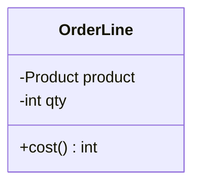
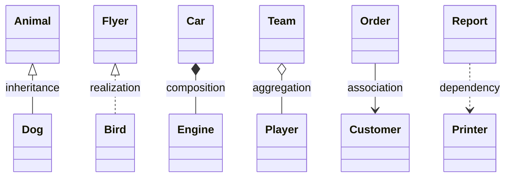
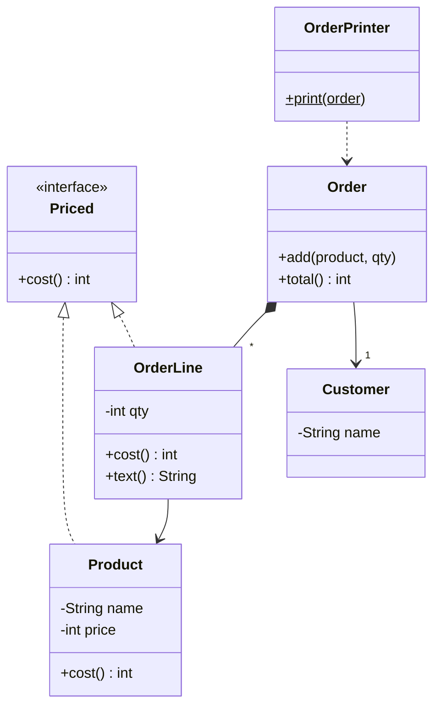

## What it is for

**UML** (Unified Modeling Language) is a standard way to draw software. A **class diagram** is the part you need for LLD: boxes for classes, lines for how they relate. Its purpose is to let two people agree on a design in a minute, before writing code.

Each class is a box with three parts: name, fields, methods.



| Marker | Meaning |
|---|---|
| `+` | public |
| `-` | private |
| `#` | protected |
| `$` after a member | static |
| `*` after a method | abstract |
| `<<interface>>`, `<<abstract>>` | stereotype: a label above the class name |

## The six relationships

These are the whole vocabulary. Each says how strongly one class is tied to another.



| Relationship | Arrow | Reads as | In code |
|---|---|---|---|
| Inheritance (generalization) | solid line, hollow triangle | Dog **is a** Animal | `extends` / `: public` |
| Realization | dashed line, hollow triangle | Bird **implements** Flyer | `implements` / pure virtual base |
| Composition | solid line, filled diamond | Car **owns** an Engine; it dies with the Car | field created and held by the owner |
| Aggregation | solid line, hollow diamond | Team **has** Players; they live on without it | field that points at objects made elsewhere |
| Association | plain line or arrow | Order **knows** a Customer | a field of that type |
| Dependency | dashed arrow | Report **uses** a Printer briefly | parameter, local variable or return type, no field |

Strongest to weakest: inheritance and composition tie tightly; association is a lasting link; dependency is a passing use.

:::truth
Aggregation and association are hard to tell apart, and many teams draw just association. Do not lose time on it in an interview. The distinction that matters is composition (owner controls the lifetime) versus a plain reference.
:::

**Multiplicity** goes near the line end: `1` exactly one, `0..1` optional, `*` many. Example: `Customer "1" --> "*" Order` reads "a customer has many orders".

```quiz
questions:
  - q: "`class Car { private Engine engine = new Engine(); }` and the engine is never used outside the car. Which relationship?"
    options:
      - Association
      - Aggregation
      - Composition
      - Dependency
      - Generalization (extends)
      - Realization (implements)
    answer: 2
    why: The Car creates and owns the Engine, so the Engine's lifetime is tied to the Car.
  - q: "`void print(Printer p)` is a method of `Report`. `Report` never stores `p`. Which relationship?"
    options:
      - Association
      - Aggregation
      - Composition
      - Dependency
      - Generalization (extends)
      - Realization (implements)
    answer: 3
    why: A parameter-only use with no field is a dependency, drawn as a dashed arrow.
  - q: "`class Team { List<Player> players; }` where players are created elsewhere and outlive the team. Which relationship?"
    options:
      - Association
      - Aggregation
      - Composition
      - Dependency
      - Generalization (extends)
      - Realization (implements)
    answer: 1
    why: The team holds players it does not own. That is aggregation (plain association is also an acceptable answer in practice).
  - q: "`class Card implements Payable`. Which relationship?"
    options:
      - Association
      - Aggregation
      - Composition
      - Dependency
      - Generalization (extends)
      - Realization (implements)
    answer: 5
    why: A class implementing an interface is realization, a dashed line with a hollow triangle.
```

## From diagram to code

Here is a small design and the program that follows from it.



Reading it:

- `Order *-- OrderLine`: an order creates and owns its lines, so `add` does `new OrderLine`.
- `OrderLine --> Product`: a line points at a shared product; products exist without any order.
- `Order --> Customer`: the order keeps a reference to a customer made elsewhere.
- `OrderPrinter ..> Order`: the printer only receives an order as a parameter, with no field.

```java
import java.util.*;

interface Priced { int cost(); }

class Product implements Priced {
    private final String name;
    private final int price;
    Product(String name, int price) { this.name = name; this.price = price; }
    String name() { return name; }
    public int cost() { return price; }
}

class OrderLine implements Priced {
    private final Product product;
    private final int qty;
    OrderLine(Product product, int qty) { this.product = product; this.qty = qty; }
    public int cost() { return product.cost() * qty; }
    String text() { return qty + " x " + product.name() + " = " + cost(); }
}

class Customer {
    private final String name;
    Customer(String name) { this.name = name; }
    String name() { return name; }
}

class Order {
    private final Customer customer;
    private final List<OrderLine> lines = new ArrayList<>();   // composition: created here

    Order(Customer customer) { this.customer = customer; }
    void add(Product product, int qty) { lines.add(new OrderLine(product, qty)); }
    Customer customer() { return customer; }
    List<OrderLine> lines() { return List.copyOf(lines); }

    int total() {
        int sum = 0;
        for (OrderLine line : lines) sum += line.cost();
        return sum;
    }
}

class OrderPrinter {
    static void print(Order order) {                           // dependency: parameter only
        System.out.println("Order for " + order.customer().name());
        for (OrderLine line : order.lines()) System.out.println(line.text());
        System.out.println("total = " + order.total());
    }
}

public class Main {
    public static void main(String[] args) {
        Product pen = new Product("Pen", 10);
        Product book = new Product("Book", 150);
        Order order = new Order(new Customer("Meera"));
        order.add(pen, 2);
        order.add(book, 1);
        OrderPrinter.print(order);
    }
}
```
```cpp
#include <iostream>
#include <string>
#include <utility>
#include <vector>

class Priced {
public:
    virtual ~Priced() = default;
    virtual int cost() const = 0;
};

class Product : public Priced {
public:
    Product(std::string name, int price) : name_(std::move(name)), price_(price) {}
    const std::string& name() const { return name_; }
    int cost() const override { return price_; }
private:
    std::string name_;
    int price_;
};

class OrderLine : public Priced {
public:
    OrderLine(const Product& product, int qty) : product_(product), qty_(qty) {}
    int cost() const override { return product_.cost() * qty_; }
    std::string text() const {
        return std::to_string(qty_) + " x " + product_.name() + " = " + std::to_string(cost());
    }
private:
    const Product& product_;
    int qty_;
};

class Customer {
public:
    explicit Customer(std::string name) : name_(std::move(name)) {}
    const std::string& name() const { return name_; }
private:
    std::string name_;
};

class Order {
public:
    explicit Order(const Customer& customer) : customer_(customer) {}
    void add(const Product& product, int qty) { lines_.emplace_back(product, qty); }   // composition
    const Customer& customer() const { return customer_; }
    const std::vector<OrderLine>& lines() const { return lines_; }

    int total() const {
        int sum = 0;
        for (const auto& line : lines_) sum += line.cost();
        return sum;
    }
private:
    const Customer& customer_;
    std::vector<OrderLine> lines_;
};

class OrderPrinter {
public:
    static void print(const Order& order) {                // dependency: parameter only
        std::cout << "Order for " << order.customer().name() << "\n";
        for (const auto& line : order.lines()) std::cout << line.text() << "\n";
        std::cout << "total = " << order.total() << "\n";
    }
};

int main() {
    Product pen("Pen", 10);
    Product book("Book", 150);
    Customer meera("Meera");
    Order order(meera);
    order.add(pen, 2);
    order.add(book, 1);
    OrderPrinter::print(order);
}
```
```output
Order for Meera
2 x Pen = 20
1 x Book = 150
total = 170
```

In C++ the difference shows in ownership: `Order` holds `OrderLine` objects by value inside a vector, so they are destroyed with the order. Product and Customer are held by reference, so the order does not own them and they must outlive it.

## Drawing it in Mermaid

```blanks
prompt: Fill in the Mermaid arrows for "a House owns its Rooms" and "a Car implements Vehicle".
lang: text
code: |
  classDiagram
    House [[*--]] Room
    Vehicle [[<|..]] Car
why: "`*--` is composition (filled diamond on the owner's side). `<|..` is realization: dashed line, hollow triangle pointing at the interface."
```

```order
prompt: Arrange a valid Mermaid class diagram where Dog extends Animal.
lang: text
code: |
  classDiagram
    class Animal {
      +eat()
    }
    class Dog
    Animal <|-- Dog
distractors:
  - "    Dog <|-- Animal"
why: The triangle points at the parent. `Animal <|-- Dog` draws the triangle at Animal's end, so Dog is the child.
```

:::tip
In a machine-coding or LLD interview, draw only classes, a few key fields and methods, and the arrows that matter. Skip getters and setters. A readable diagram in three minutes beats a complete one in fifteen.
:::

```cards
- q: What does a class diagram box contain?
  a: Three parts. The class name, its fields, and its methods, each with a visibility marker (+ - #).
- q: Composition versus aggregation?
  a: Composition means the owner controls the part's lifetime (filled diamond). Aggregation means a has-a link where the part lives independently (hollow diamond).
- q: Which arrow is a dependency?
  a: A dashed arrow. The class only uses another briefly, for example as a parameter, with no field.
- q: Which way does the inheritance triangle point?
  a: At the parent (the more general class).
- q: What does multiplicity `1` to `*` mean?
  a: One object on one side links to many on the other, for example one customer to many orders.
```

## Notes

:::notes
- A class diagram shows classes (name, fields, methods) and the relationships between them.
- Visibility: + public, - private, # protected. Stereotypes label interfaces and abstract classes.
- Six arrows: inheritance, realization, composition, aggregation, association, dependency.
- Composition means the owner creates and destroys the part. Aggregation and association are references to things that live elsewhere.
- Dependency is a dashed arrow for a passing use with no field.
- The inheritance triangle points at the parent.
- Multiplicity (`1`, `0..1`, `*`) sits on the line ends.
- In interviews, draw only key classes and arrows, and skip getters and setters.
:::
