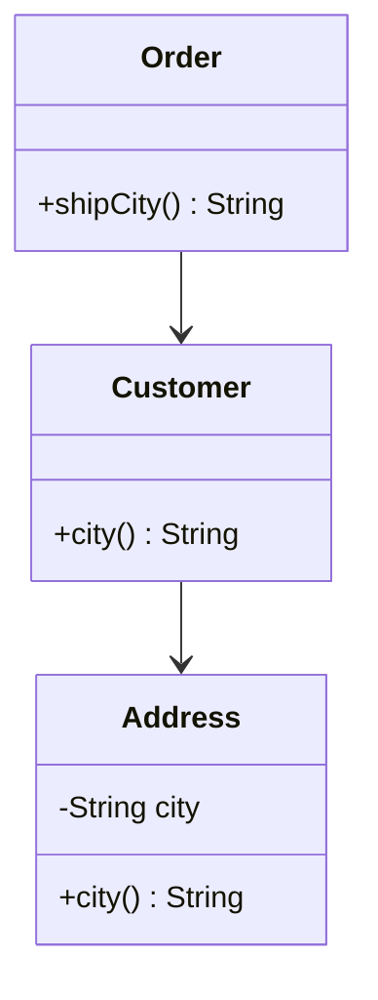

## Rules of thumb, not laws

SOLID gave you structure-level guidance. These habits work at the level of everyday code. Each one is a trade-off, and each has a way of being overdone.

| Habit | Full name | One line |
|---|---|---|
| DRY | Don't Repeat Yourself | Every piece of knowledge has one home |
| KISS | Keep It Simple | Choose the simplest design that works |
| YAGNI | You Aren't Gonna Need It | Do not build for requirements you do not have yet |
| Cohesion | | Things inside a class belong together |
| Coupling | | Classes should know as little about each other as they can |

## DRY, with a caveat

- DRY is about **knowledge**, not text. If a tax rate lives in five places, changing it means five edits and one forgotten spot.
- Fix: one named constant, one function, one class that owns the rule.
- Caveat: two blocks that look alike but change for different reasons are *coincidence*. Merging them couples unrelated features, and the shared function grows flags to serve both.
- A common compromise, the **rule of three**: tolerate duplication twice; extract on the third copy, when the real shape is clear.

```quiz
q: "`shippingLabel()` and `invoiceLine()` both format `name + \", \" + city`. Shipping rules and invoice rules are owned by different teams and change independently. What should you do?"
options:
  - Merge them into one function to satisfy DRY
  - Leave them separate; the similarity is accidental
  - Make `invoiceLine()` call `shippingLabel()`
answer: 1
why: They share text but not a reason to change. Merging would tie two teams' features together, and the first diverging requirement would add a flag parameter to the shared code.
```

## KISS and YAGNI

- **KISS**: if a plain loop works, do not build a framework. Complexity is a cost paid by every future reader.
- **YAGNI**: do not add the plugin system, the config file or the extra interface "in case". Guessed requirements are usually wrong, and the unused code still has to be maintained and tested.
- This is the counterweight to SOLID. An interface with exactly one implementation and no test fake is often premature.

:::truth
These habits conflict. Extracting an interface is "open for extension" (SOLID) and also "something you are not going to need" (YAGNI). There is no formula. A useful test: *has this actually hurt yet?* If you changed the same place three times, abstract it. If you only imagine changing it, wait.
:::

## Cohesion and coupling

- **Cohesion**: how closely the parts of one class relate to each other. High cohesion is good: every method uses the class's data for one purpose.
- **Coupling**: how much one class depends on others. Low coupling is good: you can change or test a class without touching its neighbours.

| | Low cohesion | High cohesion |
|---|---|---|
| Example | `Utils` with date parsing, file copying and tax maths | `TaxCalculator` with only tax rules |
| Symptom | Hard to name; methods use none of the same fields | Name says what it does |

| | High coupling | Low coupling |
|---|---|---|
| Example | Service creates `new MySqlRepo()` and reads its internal fields | Service receives a `Repository` interface |
| Symptom | One change breaks many classes | Changes stay local |

Aim for **high cohesion, low coupling**. SRP raises cohesion; dependency inversion lowers coupling.

## Law of Demeter and "tell, don't ask"

**Law of Demeter** ("talk only to your friends"): a method should call methods on itself, its parameters, objects it creates and its own fields, not reach through them. The warning sign is a chain of calls: `order.customer().address().city()`. The caller now depends on Order, Customer and Address.

**Tell, don't ask**: do not pull out an object's data, decide something, and push the result back. Tell the object what you want and let it decide. The rule then lives in one place.



```java
import java.util.*;

class Address {
    private final String city;
    Address(String city) { this.city = city; }
    String city() { return city; }
}

class Customer {
    private final Address address;
    Customer(Address address) { this.address = address; }
    Address address() { return address; }
    String city() { return address.city(); }        // hides the Address from callers
}

class Order {
    private final Customer customer;
    Order(Customer customer) { this.customer = customer; }
    Customer customer() { return customer; }
    String shipCity() { return customer.city(); }
}

class BadWallet {                                    // "ask" style: rules live in callers
    private int balance;
    BadWallet(int balance) { this.balance = balance; }
    int getBalance() { return balance; }
    void setBalance(int balance) { this.balance = balance; }
}

class Wallet {                                       // "tell" style: the rule lives here
    private int balance;
    Wallet(int balance) { this.balance = balance; }

    boolean pay(int price) {
        if (price > balance) return false;
        balance -= price;
        return true;
    }
    int balance() { return balance; }
}

public class Main {
    public static void main(String[] args) {
        Order order = new Order(new Customer(new Address("Pune")));
        System.out.println("city via chain: " + order.customer().address().city());
        System.out.println("city via order: " + order.shipCity());

        BadWallet bad = new BadWallet(100);
        if (bad.getBalance() >= 30) bad.setBalance(bad.getBalance() - 30);
        System.out.println("ask-style balance: " + bad.getBalance());

        Wallet wallet = new Wallet(100);
        boolean paid = wallet.pay(30);
        System.out.println("tell-style paid: " + paid + ", balance: " + wallet.balance());
        paid = wallet.pay(500);
        System.out.println("tell-style paid: " + paid + ", balance: " + wallet.balance());
    }
}
```
```cpp
#include <iostream>
#include <string>
#include <utility>

class Address {
public:
    explicit Address(std::string city) : city_(std::move(city)) {}
    const std::string& city() const { return city_; }
private:
    std::string city_;
};

class Customer {
public:
    explicit Customer(Address address) : address_(std::move(address)) {}
    const Address& address() const { return address_; }
    const std::string& city() const { return address_.city(); }    // hides the Address
private:
    Address address_;
};

class Order {
public:
    explicit Order(Customer customer) : customer_(std::move(customer)) {}
    const Customer& customer() const { return customer_; }
    const std::string& shipCity() const { return customer_.city(); }
private:
    Customer customer_;
};

class BadWallet {                                    // "ask" style: rules live in callers
public:
    explicit BadWallet(int balance) : balance_(balance) {}
    int getBalance() const { return balance_; }
    void setBalance(int balance) { balance_ = balance; }
private:
    int balance_;
};

class Wallet {                                       // "tell" style: the rule lives here
public:
    explicit Wallet(int balance) : balance_(balance) {}

    bool pay(int price) {
        if (price > balance_) return false;
        balance_ -= price;
        return true;
    }
    int balance() const { return balance_; }
private:
    int balance_;
};

int main() {
    Order order(Customer(Address("Pune")));
    std::cout << "city via chain: " << order.customer().address().city() << "\n";
    std::cout << "city via order: " << order.shipCity() << "\n";

    BadWallet bad(100);
    if (bad.getBalance() >= 30) bad.setBalance(bad.getBalance() - 30);
    std::cout << "ask-style balance: " << bad.getBalance() << "\n";

    Wallet wallet(100);
    bool paid = wallet.pay(30);
    std::cout << std::boolalpha << "tell-style paid: " << paid << ", balance: " << wallet.balance() << "\n";
    paid = wallet.pay(500);
    std::cout << "tell-style paid: " << paid << ", balance: " << wallet.balance() << "\n";
}
```
```output
city via chain: Pune
city via order: Pune
ask-style balance: 70
tell-style paid: true, balance: 70
tell-style paid: false, balance: 70
```

What the demo shows:

- With the chain, every caller knows Address exists. If Address is split into `Street` and `City`, all callers break. With `shipCity()`, only `Customer.city()` changes.
- The ask-style wallet works, but the "enough money" check sits in the caller. A second caller can forget it, or write `setBalance(-5)`. `Wallet.pay` is the only place the rule exists.

:::note
Law of Demeter does not ban every dot. Fluent builders and stream pipelines chain calls on the *same* object type, which is fine. It targets reaching through objects into their internals.
:::

```blanks
prompt: Hide the Address behind Customer.
lang: java
code: |
  class Customer {
      private final Address address;
      String city() { return address.[[city]](); }
  }
  // caller: order.[[shipCity]]()
why: "`Customer.city()` delegates to the Address, and the caller asks the order for `shipCity()`. Nobody outside Customer needs to know an Address exists."
```

```order
prompt: Arrange `pay` so the rule is checked before the balance changes.
lang: java
code: |
  boolean pay(int price) {
      if (price > balance) return false;
      balance -= price;
      return true;
  }
distractors:
  - "    balance -= price;   // before the check"
why: Check first, change state after. If the subtraction came first, a rejected payment would already have reduced the balance.
```

## Smell or fix?

```quiz
questions:
  - q: "A `Helpers` class holds `parseDate`, `copyFile`, `calcTax` and `sendEmail`. Which habit is missing?"
    options:
      - Low coupling
      - High cohesion
      - YAGNI
      - Tell, don't ask
    answer: 1
    why: Nothing in the class belongs together beyond sharing a file. Split it by purpose.
  - q: "You add a `PluginManager` and a config format for a feature that has one hard-coded behaviour today. Which habit does it break?"
    options:
      - DRY
      - YAGNI
      - Law of Demeter
      - Cohesion
    answer: 1
    why: The flexibility answers a requirement nobody has asked for yet. Add it when a second behaviour actually arrives.
  - q: "The same 18% tax constant appears in four classes. Which habit does it break?"
    options:
      - DRY
      - KISS
      - YAGNI
      - Tell, don't ask
    answer: 0
    why: One piece of knowledge lives in four places. Give it one home, so a rate change is one edit.
```

```cards
- q: What does DRY actually protect?
  a: Knowledge. Each rule or fact should live in one place. Similar-looking code with different reasons to change is not a DRY violation.
- q: What is the rule of three?
  a: Tolerate duplication twice and extract on the third copy, when the shared shape is clear.
- q: Define high cohesion and low coupling.
  a: High cohesion means a class's parts belong together. Low coupling means classes know little about each other.
- q: What is the Law of Demeter's warning sign?
  a: A call chain that reaches through objects, such as `order.customer().address().city()`.
- q: What does "tell, don't ask" mean?
  a: Tell an object what you want instead of reading its data, deciding, and writing it back. The rule then lives inside the object.
```

## Notes

:::notes
- DRY: one home for each piece of knowledge. Similar code with different reasons to change can stay separate.
- Rule of three: extract on the third duplication, not the second.
- KISS: the simplest design that works. YAGNI: do not build for imagined requirements.
- These habits can conflict; decide by whether the lack has actually hurt yet.
- Cohesion: the parts of a class belong together. Coupling: how much classes depend on each other. Aim high and low.
- Law of Demeter: avoid reaching through objects (`a.b().c().d()`). Add a delegating method.
- Tell, don't ask: put the rule inside the object that owns the data.
- Public setters on every field let the invariant be bypassed. Offer behaviour methods.
:::
