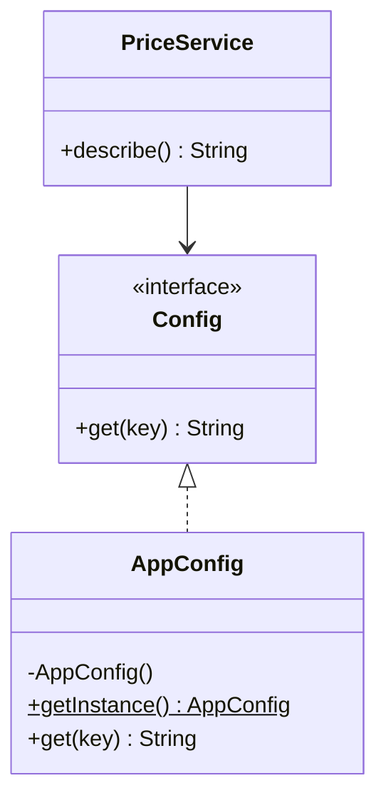

## The problem it solves

Some objects should exist once per program: a configuration holder, a connection pool, a logger.

A **Singleton** is a class that:

- Allows only one instance (the constructor is private).
- Gives everyone a way to reach it (a static `getInstance()`).

"Thread-safe" means it still creates exactly one instance when many threads call `getInstance()` at the same moment.

## Structure



Notice that `PriceService` depends on the `Config` interface, not on `AppConfig`. That small detail matters later.

## Making it thread-safe

The naive version is broken under threads:

```java
static AppConfig getInstance() {
    if (instance == null) instance = new AppConfig();   // two threads can both see null
    return instance;
}
```

Two threads can both see `null` and build two objects. Your options:

| Approach | Idea | Notes |
|---|---|---|
| Eager | `static final X INSTANCE = new X()` | Simple and safe. Built even if never used. |
| Holder idiom (Java) | Instance lives in a private nested class | The JVM initialises a class lazily and exactly once, so no locks are needed. |
| Meyers singleton (C++11) | `static X inst;` inside the function | C++11 guarantees thread-safe initialisation of function-local statics. |
| Enum (Java) | `enum Config { INSTANCE }` | Also survives serialisation and reflection tricks. |
| Double-checked locking | Check, lock, check again | Works, but `instance` must be `volatile`. Easy to get wrong. |

```quiz
q: Why must the field be `volatile` in double-checked locking?
options:
  - So the lock is released faster
  - Without it, another thread may see a non-null reference to a half-constructed object
  - So the JVM stores the field in a register
answer: 1
why: "`new X()` is allocate, construct, then assign. Without `volatile`, the assignment can become visible before construction finishes, so a second thread skips the lock and uses a broken object."
```

Put the double-checked version in order:

```order
prompt: Arrange double-checked locking (the field is `private static volatile Registry instance;`).
lang: java
code: |
  static Registry get() {
      if (instance == null) {
          synchronized (Registry.class) {
              if (instance == null) {
                  instance = new Registry();
              }
          }
      }
      return instance;
  }
distractors:
  - "        if (instance != null) {"
why: The first check skips the lock on the fast path. The second check, inside the lock, stops two waiting threads from both building an object.
```

## Code

The demo builds the singleton, shows that eight threads all get the same object, and then shows the alternative: pass the config in.

```java
import java.util.*;
import java.util.concurrent.*;

interface Config {
    String get(String key);
}

class AppConfig implements Config {
    private static int created = 0;
    private final Map<String, String> values = new HashMap<>();

    private AppConfig() {
        created++;
        values.put("env", "prod");
    }

    private static class Holder {
        static final AppConfig INSTANCE = new AppConfig();
    }

    static AppConfig getInstance() { return Holder.INSTANCE; }
    static int created() { return created; }

    public String get(String key) { return values.getOrDefault(key, "?"); }
}

class PriceService {
    private final Config config;
    PriceService(Config config) { this.config = config; }
    String describe() { return "env=" + config.get("env"); }
}

public class Main {
    public static void main(String[] args) throws Exception {
        Set<AppConfig> seen = ConcurrentHashMap.newKeySet();
        ExecutorService pool = Executors.newFixedThreadPool(8);
        for (int i = 0; i < 8; i++) {
            pool.submit(() -> seen.add(AppConfig.getInstance()));
        }
        pool.shutdown();
        pool.awaitTermination(5, TimeUnit.SECONDS);
        System.out.println("distinct instances seen by 8 threads: " + seen.size());
        System.out.println("constructor ran: " + AppConfig.created() + " time(s)");

        PriceService real = new PriceService(AppConfig.getInstance());
        PriceService fake = new PriceService(key -> "test");
        System.out.println("real: " + real.describe());
        System.out.println("fake: " + fake.describe());
    }
}
```
```cpp
#include <atomic>
#include <iostream>
#include <map>
#include <set>
#include <string>
#include <thread>
#include <vector>

class Config {
public:
    virtual ~Config() = default;
    virtual std::string get(const std::string& key) const = 0;
};

class AppConfig : public Config {
public:
    static AppConfig& instance() {
        static AppConfig inst;          // thread-safe since C++11
        return inst;
    }
    AppConfig(const AppConfig&) = delete;
    AppConfig& operator=(const AppConfig&) = delete;

    static int created() { return created_.load(); }

    std::string get(const std::string& key) const override {
        auto it = values_.find(key);
        return it == values_.end() ? "?" : it->second;
    }

private:
    AppConfig() {
        ++created_;
        values_["env"] = "prod";
    }
    inline static std::atomic<int> created_{0};
    std::map<std::string, std::string> values_;
};

class FakeConfig : public Config {
public:
    std::string get(const std::string&) const override { return "test"; }
};

class PriceService {
public:
    explicit PriceService(const Config& config) : config_(config) {}
    std::string describe() const { return "env=" + config_.get("env"); }
private:
    const Config& config_;
};

int main() {
    std::vector<const AppConfig*> slots(8, nullptr);
    std::vector<std::thread> threads;
    for (int i = 0; i < 8; ++i) {
        threads.emplace_back([&slots, i] { slots[i] = &AppConfig::instance(); });
    }
    for (auto& t : threads) t.join();
    std::set<const AppConfig*> seen(slots.begin(), slots.end());
    std::cout << "distinct instances seen by 8 threads: " << seen.size() << "\n";
    std::cout << "constructor ran: " << AppConfig::created() << " time(s)\n";

    FakeConfig fakeConfig;
    PriceService real(AppConfig::instance());
    PriceService fake(fakeConfig);
    std::cout << "real: " << real.describe() << "\n";
    std::cout << "fake: " << fake.describe() << "\n";
}
```
```output
distinct instances seen by 8 threads: 1
constructor ran: 1 time(s)
real: env=prod
fake: env=test
```

Compile the C++ with `g++ -std=c++17 -pthread`.

```blanks
prompt: Complete the holder idiom.
lang: java
code: |
  class Registry {
      private Registry() {}
      private static class Holder {
          static final Registry INSTANCE = new [[Registry]]();
      }
      static Registry get() { return Holder.[[INSTANCE]]; }
  }
why: The JVM runs Holder's static initialiser once, on first use, under its own internal lock. That gives lazy, thread-safe creation with no explicit synchronization.
```

## Why it is often an anti-pattern

A Singleton is a global variable with a nicer name. The costs:

- **Hidden dependencies.** A method that calls `AppConfig.getInstance()` does not mention it in its signature. You only learn it needs config by reading the body.
- **Hard to test.** Tests share the one instance, so state leaks between tests, and you cannot swap in a fake.
- **Tight coupling.** Every caller names the concrete class.
- **Lifetime surprises.** In C++, destruction order of statics across files is unspecified; a singleton can be used after it is destroyed.
- **Hard to scale out.** "One per program" quietly becomes "one per process", which is wrong once you run ten servers.

The demo above shows the fix. `PriceService` receives a `Config`, so the test passes a fake. The program still creates the real config once, at start-up, and hands it to whoever needs it. That is the real requirement: one instance, not global access to it. This style is called **dependency injection** (the object receives its collaborators instead of fetching them).

:::truth
Most Singletons in interview answers and real code are "one instance" requirements that a plain object created in `main` and passed down would satisfy. Interviewers often ask for the pattern and then ask what is wrong with it. Have both answers ready.
:::

```predict
lang: java
code: |
  class Counter {
      private static final Counter INSTANCE = new Counter();
      private int n = 0;
      private Counter() {}
      static Counter get() { return INSTANCE; }
      int next() { return ++n; }
  }
  // elsewhere, in two unrelated tests:
  System.out.print(Counter.get().next() + " ");
  System.out.print(Counter.get().next());
output: 1 2
why: Both calls hit the same object, so state carries over. This is exactly how a Singleton leaks state between tests that were meant to be independent.
```

## When to use it, and when not to

Use it when:

- The thing truly models one resource: a hardware device handle, a process-wide metrics registry.
- Creating a second instance would be a bug, not just a waste.

Avoid it when:

- You want it for convenience, to skip passing an argument.
- The class holds mutable state that tests or callers will change.
- You may later need one per user, per tenant or per test.

```quiz
q: Which design keeps "one instance" but still lets you test with a fake?
options:
  - A Singleton with a public static setter for tests
  - Create the object once in `main` and pass it to constructors as an interface
  - Make every field of the Singleton static
answer: 1
why: A static setter is still global state. Constructor injection keeps the dependency visible and replaceable, and one object is still created.
```

```cards
- q: What two things define a Singleton?
  a: A private constructor (one instance only) and a global access point such as getInstance().
- q: Which Java idiom gives lazy, thread-safe creation without explicit locks?
  a: The holder idiom, a private static nested class whose static field holds the instance.
- q: How does C++11 make a function-local static safe across threads?
  a: The standard guarantees the initialisation runs exactly once even if threads race to it.
- q: Name two reasons Singletons hurt testing.
  a: Shared state leaks between tests, and callers name the concrete class so a fake cannot be substituted.
- q: What replaces a Singleton when you only need one instance?
  a: Create it once at start-up and pass it in through constructors (dependency injection).
```

## Notes

:::notes
- Singleton: private constructor plus a static accessor, so the class controls its own single instance.
- A lazy `if (instance == null)` check is not thread-safe. Two threads can build two objects.
- Safe options: eager static, Java holder idiom, Java enum, C++11 function-local static.
- Double-checked locking needs `volatile` in Java, or a half-built object can leak.
- It is a global variable in disguise: hidden dependencies, shared state, hard to fake in tests.
- Prefer one instance created at start-up and injected through constructors, typed as an interface.
- Legitimate uses: one real resource per process (device handle, metrics registry).
- Interview habit: implement it correctly, then volunteer the drawbacks and the injection alternative.
:::
