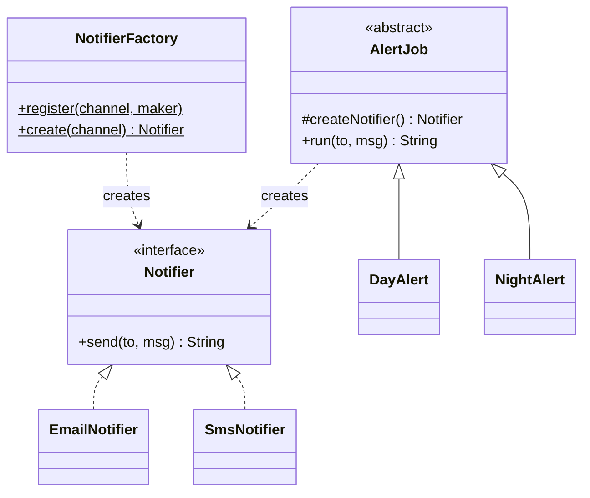

## The problem it solves

Code that says `new SmsNotifier()` is welded to that class. Sooner or later you see this:

- An `if / else` chain on a type string, copied into five places.
- Tests that cannot swap in a fake because the class is chosen inside the method.
- A new channel that forces edits in every caller.

A **factory** moves the "which class?" decision into one place. Callers ask for something by name or role and receive an object that follows an interface (a contract listing methods, with no code).

## Three things called "factory"

People use one word for three different designs. Interviewers expect you to separate them.

| Name | Idea | Use it when |
|---|---|---|
| Simple factory | One function or class with `create(type)` that returns the right object | Callers choose by name, such as from config or user input |
| Factory Method | A base class calls an abstract `createX()`; subclasses decide the class | A fixed algorithm needs one step to vary |
| Abstract Factory | One object that creates a whole family of related objects | Parts must match, such as dark-theme button plus dark-theme checkbox |

The Gang of Four (the authors of the classic 1994 patterns book) list only the last two. The simple factory is not an official pattern, but it is what you will write most often.

## Structure



Both `NotifierFactory` and `AlertJob` return a `Notifier`. Neither caller knows or cares which subclass it got.

```quiz
q: A report class has a fixed method `export()` that opens a file, writes rows and closes it. Only the file format (CSV or JSON) differs. `CsvReport` and `JsonReport` each override `createWriter()`. Which pattern is this?
options:
  - Simple factory
  - Factory Method
  - Abstract Factory
answer: 1
why: "A base class owns the algorithm and calls an abstract `createWriter()`; subclasses decide the product. That is Factory Method. A simple factory would be a separate `WriterFactory.create(type)`. Abstract Factory needs a family of several matching objects."
```

## Code

The demo has a registry-based simple factory and a Factory Method pair. A **registry** is a map from name to a "maker" function, so adding Slack later does not touch the factory.

```java
import java.util.*;
import java.util.function.Supplier;

interface Notifier {
    String send(String to, String msg);
}

class EmailNotifier implements Notifier {
    public String send(String to, String msg) { return "EMAIL to " + to + ": " + msg; }
}

class SmsNotifier implements Notifier {
    public String send(String to, String msg) { return "SMS to " + to + ": " + msg; }
}

class PushNotifier implements Notifier {
    public String send(String to, String msg) { return "PUSH to " + to + ": " + msg; }
}

class SlackNotifier implements Notifier {
    public String send(String to, String msg) { return "SLACK to " + to + ": " + msg; }
}

// Simple factory with a registry: callers ask by name, never write "new".
class NotifierFactory {
    private static final Map<String, Supplier<Notifier>> REGISTRY = new HashMap<>();

    private NotifierFactory() {}

    static void register(String channel, Supplier<Notifier> maker) {
        REGISTRY.put(channel, maker);
    }

    static Notifier create(String channel) {
        Supplier<Notifier> maker = REGISTRY.get(channel);
        if (maker == null) throw new IllegalArgumentException("Unknown channel: " + channel);
        return maker.get();
    }
}

// Factory Method: the base class has the algorithm, subclasses pick the product.
abstract class AlertJob {
    private final String label;

    AlertJob(String label) { this.label = label; }

    protected abstract Notifier createNotifier();

    String run(String to, String msg) {
        Notifier notifier = createNotifier();
        return label + " -> " + notifier.send(to, msg);
    }
}

class DayAlert extends AlertJob {
    DayAlert() { super("DayAlert"); }
    protected Notifier createNotifier() { return new PushNotifier(); }
}

class NightAlert extends AlertJob {
    NightAlert() { super("NightAlert"); }
    protected Notifier createNotifier() { return new SmsNotifier(); }
}

public class Main {
    public static void main(String[] args) {
        NotifierFactory.register("email", EmailNotifier::new);
        NotifierFactory.register("sms", SmsNotifier::new);
        NotifierFactory.register("push", PushNotifier::new);

        String[][] targets = {{"email", "ana@x.com"}, {"sms", "+91-98100"}, {"push", "device-7"}};
        for (String[] t : targets) {
            System.out.println(NotifierFactory.create(t[0]).send(t[1], "build passed"));
        }

        try {
            NotifierFactory.create("fax");
        } catch (IllegalArgumentException e) {
            System.out.println("error: " + e.getMessage());
        }

        NotifierFactory.register("slack", SlackNotifier::new);   // no edit to NotifierFactory
        System.out.println(NotifierFactory.create("slack").send("#ops", "build passed"));

        List<AlertJob> jobs = List.of(new DayAlert(), new NightAlert());
        for (AlertJob job : jobs) {
            System.out.println(job.run("oncall", "disk full"));
        }
    }
}
```
```cpp
#include <functional>
#include <iostream>
#include <map>
#include <memory>
#include <stdexcept>
#include <string>
#include <utility>
#include <vector>

class Notifier {
public:
    virtual ~Notifier() = default;
    virtual std::string send(const std::string& to, const std::string& msg) const = 0;
};

class EmailNotifier : public Notifier {
public:
    std::string send(const std::string& to, const std::string& msg) const override {
        return "EMAIL to " + to + ": " + msg;
    }
};

class SmsNotifier : public Notifier {
public:
    std::string send(const std::string& to, const std::string& msg) const override {
        return "SMS to " + to + ": " + msg;
    }
};

class PushNotifier : public Notifier {
public:
    std::string send(const std::string& to, const std::string& msg) const override {
        return "PUSH to " + to + ": " + msg;
    }
};

class SlackNotifier : public Notifier {
public:
    std::string send(const std::string& to, const std::string& msg) const override {
        return "SLACK to " + to + ": " + msg;
    }
};

template <typename T>
std::unique_ptr<Notifier> make() { return std::make_unique<T>(); }

// Simple factory with a registry: callers ask by name, never write "new".
class NotifierFactory {
public:
    using Maker = std::function<std::unique_ptr<Notifier>()>;

    static void registerChannel(const std::string& channel, Maker maker) {
        registry()[channel] = std::move(maker);
    }

    static std::unique_ptr<Notifier> create(const std::string& channel) {
        auto it = registry().find(channel);
        if (it == registry().end()) throw std::invalid_argument("Unknown channel: " + channel);
        return it->second();
    }

private:
    static std::map<std::string, Maker>& registry() {
        static std::map<std::string, Maker> r;   // built on first use
        return r;
    }
};

// Factory Method: the base class has the algorithm, subclasses pick the product.
class AlertJob {
public:
    explicit AlertJob(std::string label) : label_(std::move(label)) {}
    virtual ~AlertJob() = default;

    std::string run(const std::string& to, const std::string& msg) const {
        std::unique_ptr<Notifier> notifier = createNotifier();
        return label_ + " -> " + notifier->send(to, msg);
    }

protected:
    virtual std::unique_ptr<Notifier> createNotifier() const = 0;

private:
    std::string label_;
};

class DayAlert : public AlertJob {
public:
    DayAlert() : AlertJob("DayAlert") {}
protected:
    std::unique_ptr<Notifier> createNotifier() const override { return std::make_unique<PushNotifier>(); }
};

class NightAlert : public AlertJob {
public:
    NightAlert() : AlertJob("NightAlert") {}
protected:
    std::unique_ptr<Notifier> createNotifier() const override { return std::make_unique<SmsNotifier>(); }
};

int main() {
    NotifierFactory::registerChannel("email", make<EmailNotifier>);
    NotifierFactory::registerChannel("sms", make<SmsNotifier>);
    NotifierFactory::registerChannel("push", make<PushNotifier>);

    const std::vector<std::pair<std::string, std::string>> targets = {
        {"email", "ana@x.com"}, {"sms", "+91-98100"}, {"push", "device-7"}};
    for (const auto& t : targets) {
        std::cout << NotifierFactory::create(t.first)->send(t.second, "build passed") << "\n";
    }

    try {
        NotifierFactory::create("fax");
    } catch (const std::invalid_argument& e) {
        std::cout << "error: " << e.what() << "\n";
    }

    NotifierFactory::registerChannel("slack", make<SlackNotifier>);   // no edit to NotifierFactory
    std::cout << NotifierFactory::create("slack")->send("#ops", "build passed") << "\n";

    std::vector<std::unique_ptr<AlertJob>> jobs;
    jobs.push_back(std::make_unique<DayAlert>());
    jobs.push_back(std::make_unique<NightAlert>());
    for (const auto& job : jobs) {
        std::cout << job->run("oncall", "disk full") << "\n";
    }
    return 0;
}
```
```output
EMAIL to ana@x.com: build passed
SMS to +91-98100: build passed
PUSH to device-7: build passed
error: Unknown channel: fax
SLACK to #ops: build passed
DayAlert -> PUSH to oncall: disk full
NightAlert -> SMS to oncall: disk full
```

Points to notice:

- `create("fax")` fails loudly with a clear message. Do not return `null` and let a crash happen three calls later.
- Registering `"slack"` at the end needed no edit to `NotifierFactory`. That is the open/closed principle (open for extension, closed for modification) at work.
- C++ keeps the registry in a function-local `static`, so it exists before first use. A plain global map can be used before it is constructed.
- `AlertJob.run()` is the fixed algorithm; only the product varies.

```predict
lang: java
prompt: The registry holds "email", "sms" and "push". What does this print?
code: |
  try {
      NotifierFactory.create("Email");
  } catch (IllegalArgumentException e) {
      System.out.println(e.getMessage());
  }
output: "Unknown channel: Email"
why: Map lookup is case-sensitive, so "Email" is not the registered key "email".
```

```order
prompt: Arrange the simple factory's create method.
lang: java
code: |
  static Notifier create(String channel) {
      Supplier<Notifier> maker = REGISTRY.get(channel);
      if (maker == null) {
          throw new IllegalArgumentException("Unknown channel: " + channel);
      }
      return maker.get();
  }
distractors:
  - "    return REGISTRY.get(channel).get();"
why: Look up, check for a missing key, then build. Calling .get() on a missing entry would throw a confusing NullPointerException instead of a clear message.
```

## Abstract Factory in one picture

Use it when objects must be created in matching sets. Here is the shape, without the full program:

```java
interface UiFactory {
    Button createButton();
    Checkbox createCheckbox();
}
class DarkUi implements UiFactory { /* returns DarkButton, DarkCheckbox */ }
class LightUi implements UiFactory { /* returns LightButton, LightCheckbox */ }
```

The app receives one `UiFactory` and can never mix a dark button with a light checkbox.

```blanks
prompt: Complete the Factory Method base class.
lang: java
code: |
  abstract class AlertJob {
      protected abstract [[Notifier]] createNotifier();

      String run(String to, String msg) {
          Notifier n = [[createNotifier()|createNotifier ()]];
          return n.send(to, msg);
      }
  }
why: The base class declares the abstract creation step and calls it inside its own algorithm; subclasses fill it in.
```

## When to use, when to avoid

Use a factory when:

- The concrete class depends on runtime data such as config, a request field or a plugin name.
- Creation is more than one `new` (wiring, defaults, pooling).
- Callers must be tested with fakes.

Avoid it when:

- There is one implementation and no sign of a second. A constructor is clearer.
- The factory is just `return new X()`. You added a file and removed nothing.
- A growing `switch` hides in the factory forever. A registry (as above) or dependency injection (passing the ready-made object into the constructor) scales better.

:::truth
Most "factories" in beginner designs are speculative. In an interview, start with a constructor and introduce a factory when a second variant appears in the requirements. Interviewers prefer a design that grows over one that is pre-engineered.
:::

:::warn
A factory does not remove the dependency on concrete classes. It moves it into one file. If that file is a 200-line `switch`, you have moved the mess, not cleaned it.
:::

```cards
- q: What problem does a factory solve?
  a: It centralises the decision of which concrete class to create, so callers depend on an interface and not on `new SomeClass()`.
- q: Simple factory vs Factory Method?
  a: Simple factory is one function that picks a class by input. Factory Method is an abstract creation step in a base class that subclasses override.
- q: When do you need Abstract Factory?
  a: When several objects must be created as a matching family, such as all dark-theme widgets.
- q: Why fail loudly on an unknown type?
  a: Returning null moves the crash far from the cause. An exception with the bad value in the message is easy to debug.
- q: Name two signs you should not add a factory.
  a: Only one implementation exists, or the factory body is a single `new`.
```

## Notes

:::notes
- Factory = one place that decides which concrete class to create; callers hold the interface.
- Simple factory: `create(type)`. Factory Method: abstract `createX()` overridden by subclasses. Abstract Factory: creates a family of matching objects.
- A registry (map from name to maker) lets you add types without editing the factory.
- Fail loudly on unknown input; never return null.
- C++: keep registries in function-local statics; return `std::unique_ptr<Base>`; base needs a virtual destructor.
- Do not add a factory for a single implementation or a bare `new`.
- Dependency injection often replaces factories: build the object outside and pass it in.
:::
