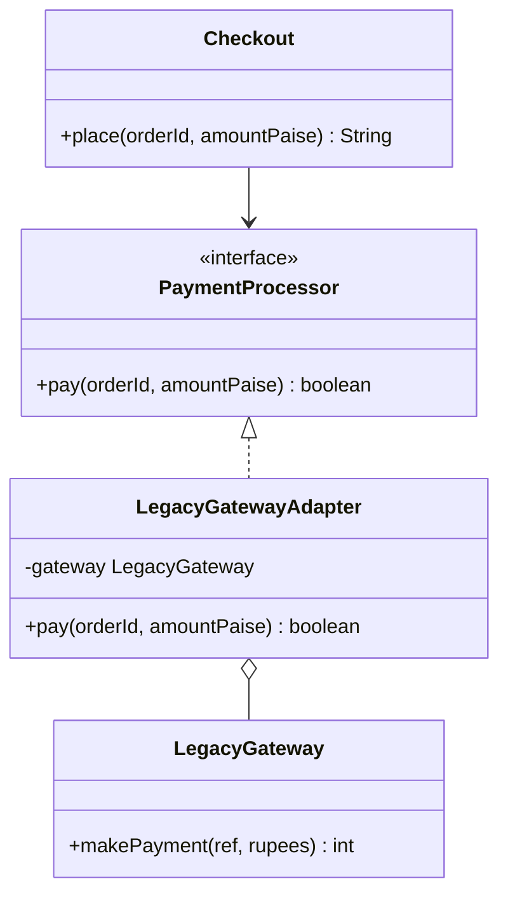

## The problem it solves

You depend on code you cannot change: a vendor SDK (software development kit), a legacy module, a library. Its methods do the right job but have the wrong shape. Your code expects `pay(orderId, amountPaise)` returning `boolean`. The vendor gives `makePayment(ref, rupees)` returning an `int` status code.

Options:

- Edit the vendor code. Impossible, or lost on the next upgrade.
- Scatter conversions (`paise / 100.0`, `code == 0`) through your code. Every caller now knows vendor details.
- Write one **adapter**: a small class that implements the interface you want and translates calls to the interface you have.

Think of a travel plug adapter. The socket and the charger stay as they are.

## Structure



Roles:

- **Target:** the interface your code wants (`PaymentProcessor`).
- **Adaptee:** the existing class with the wrong shape (`LegacyGateway`).
- **Adapter:** implements the target, holds an adaptee, translates.

## Two flavours

| Flavour | How | Notes |
|---|---|---|
| Object adapter | Adapter has the adaptee as a field (composition) | Default choice. Works in Java and C++. Can wrap subclasses of the adaptee too. |
| Class adapter | Adapter inherits from the adaptee | C++ only in practice (multiple or private inheritance). Ties you to one concrete class. |

Prefer the object adapter. This is the same advice as "composition over inheritance".

## Code

The adapter converts two things: units (paise to rupees, where 1 rupee = 100 paise) and result style (status code to `boolean`). `Checkout` never sees the vendor class.

```java
import java.util.Locale;

// What our code wants.
interface PaymentProcessor {
    boolean pay(String orderId, long amountPaise);
}

// A third-party class we cannot edit: rupees as double, status code as int.
class LegacyGateway {
    int makePayment(String ref, double rupees) {
        System.out.println(String.format(Locale.ROOT, "legacy: charge %.2f ref=%s", rupees, ref));
        return rupees <= 10000.0 ? 0 : 5;   // 0 = success, anything else = failure
    }
}

// Object adapter: wraps the legacy object and translates units and result codes.
class LegacyGatewayAdapter implements PaymentProcessor {
    private final LegacyGateway gateway;

    LegacyGatewayAdapter(LegacyGateway gateway) { this.gateway = gateway; }

    public boolean pay(String orderId, long amountPaise) {
        double rupees = amountPaise / 100.0;
        return gateway.makePayment(orderId, rupees) == 0;
    }
}

// In tests we implement the interface directly; no adapter needed.
class FakeProcessor implements PaymentProcessor {
    public boolean pay(String orderId, long amountPaise) { return true; }
}

class Checkout {
    private final PaymentProcessor processor;

    Checkout(PaymentProcessor processor) { this.processor = processor; }

    String place(String orderId, long amountPaise) {
        return orderId + (processor.pay(orderId, amountPaise) ? " paid" : " declined");
    }
}

public class Main {
    public static void main(String[] args) {
        Checkout live = new Checkout(new LegacyGatewayAdapter(new LegacyGateway()));
        System.out.println(live.place("ORD-1", 49950));
        System.out.println(live.place("ORD-2", 2500000));

        Checkout test = new Checkout(new FakeProcessor());
        System.out.println(test.place("ORD-3", 100));
    }
}
```
```cpp
#include <iomanip>
#include <iostream>
#include <memory>
#include <string>
#include <utility>

// What our code wants.
class PaymentProcessor {
public:
    virtual ~PaymentProcessor() = default;
    virtual bool pay(const std::string& orderId, long long amountPaise) = 0;
};

// A third-party class we cannot edit: rupees as double, status code as int.
class LegacyGateway {
public:
    int makePayment(const std::string& ref, double rupees) {
        std::cout << "legacy: charge " << std::fixed << std::setprecision(2) << rupees
                  << " ref=" << ref << "\n";
        return rupees <= 10000.0 ? 0 : 5;   // 0 = success, anything else = failure
    }
};

// Object adapter: wraps the legacy object and translates units and result codes.
class LegacyGatewayAdapter : public PaymentProcessor {
public:
    explicit LegacyGatewayAdapter(LegacyGateway gateway) : gateway_(std::move(gateway)) {}

    bool pay(const std::string& orderId, long long amountPaise) override {
        double rupees = static_cast<double>(amountPaise) / 100.0;
        return gateway_.makePayment(orderId, rupees) == 0;
    }

private:
    LegacyGateway gateway_;
};

// In tests we implement the interface directly; no adapter needed.
class FakeProcessor : public PaymentProcessor {
public:
    bool pay(const std::string&, long long) override { return true; }
};

class Checkout {
public:
    explicit Checkout(std::unique_ptr<PaymentProcessor> processor) : processor_(std::move(processor)) {}

    std::string place(const std::string& orderId, long long amountPaise) {
        return orderId + (processor_->pay(orderId, amountPaise) ? " paid" : " declined");
    }

private:
    std::unique_ptr<PaymentProcessor> processor_;
};

int main() {
    Checkout live(std::make_unique<LegacyGatewayAdapter>(LegacyGateway()));
    std::cout << live.place("ORD-1", 49950) << "\n";
    std::cout << live.place("ORD-2", 2500000) << "\n";

    Checkout test(std::make_unique<FakeProcessor>());
    std::cout << test.place("ORD-3", 100) << "\n";
    return 0;
}
```
```output
legacy: charge 499.50 ref=ORD-1
ORD-1 paid
legacy: charge 25000.00 ref=ORD-2
ORD-2 declined
ORD-3 paid
```

```quiz
q: Where should the paise-to-rupees conversion live?
options:
  - In Checkout, before calling pay
  - Inside LegacyGatewayAdapter
  - In LegacyGateway, by editing the vendor class
answer: 1
why: "Conversion is a detail of this vendor's API. Putting it in the adapter keeps `Checkout` vendor-free and leaves one place to fix if the vendor changes."
```

```predict
lang: java
prompt: Using the demo classes, what does this print? The legacy gateway declines amounts above 10000.00 rupees and prints a line of its own.
code: |
  Checkout live = new Checkout(new LegacyGatewayAdapter(new LegacyGateway()));
  System.out.println(live.place("ORD-9", 1000001).startsWith("ORD-9 declined"));
output: "legacy: charge 10000.01 ref=ORD-9\ntrue"
why: The legacy gateway prints its own line first. 10000.01 is above its 10000.00 limit, so it returns 5, the adapter maps non-zero to false, and Checkout appends "declined".
```

:::tip
The test fake in the demo, `FakeProcessor`, implements `PaymentProcessor` directly. A good target interface lets you swap real vendor, adapter and test double without touching `Checkout`.
:::

## Adding a second vendor

Suppose a new gateway takes a map of text fields and answers `"OK"` or `"FAIL"`. The steps are the same every time:

1. Leave `PaymentProcessor` and `Checkout` alone.
2. Write `NewGatewayAdapter implements PaymentProcessor`.
3. Build the field map from `orderId` and `amountPaise`, call the vendor, and turn `"OK"` into `true`.
4. Pick the adapter at start-up (config or a factory) and pass it to `Checkout`.

The cost of a new vendor is one class. That is the payoff of adapting once at the edge instead of everywhere inside.

:::note
Errors need a decision too. If the vendor throws its own exception type, translate it into one your code owns, so callers never import vendor classes just to catch an error.
:::

## Adapter vs its neighbours

| Pattern | Changes the interface? | Purpose |
|---|---|---|
| Adapter | Yes | Make an incompatible class usable |
| Decorator | No | Add behaviour to the same interface |
| Proxy | No | Control access to the same interface |
| Facade | Yes (simplifies) | One easy entry to a whole subsystem |

```order
prompt: Arrange the adapter's pay method.
lang: java
code: |
  public boolean pay(String orderId, long amountPaise) {
      double rupees = amountPaise / 100.0;
      int status = gateway.makePayment(orderId, rupees);
      return status == 0;
  }
distractors:
  - "    double rupees = amountPaise * 100.0;"
why: Convert units on the way in, call the adaptee, then convert the result on the way out. Paise to rupees divides by 100.
```

## When to use, when to avoid

Use an adapter when:

- You integrate a third-party library or a legacy module you cannot edit.
- You want several vendors behind one interface (each vendor gets its own adapter).
- You want to protect your code from a vendor API that may change.

Avoid it when:

- You own both sides. Change the interface directly; an adapter just adds a layer.
- The mismatch is huge (different concepts, not different shapes). That is a translation layer or anti-corruption layer, a bigger design job.
- The adapter grows business rules. It should translate, not decide.

:::truth
Adapters are common in real systems and dull to write. In interviews, the pattern is easy to name and easy to over-draw. Show the interface you want first, then the adapter, and move on.
:::

```cards
- q: What does Adapter do?
  a: It implements the interface your code expects and translates each call to an existing class with a different interface.
- q: Name the three roles.
  a: Target (wanted interface), Adaptee (existing class), Adapter (translator).
- q: Object adapter vs class adapter?
  a: Object adapter holds the adaptee as a field (composition). Class adapter inherits from it. Prefer the object adapter.
- q: What should an adapter never contain?
  a: Business rules. It only converts types, units, names and error styles.
- q: Adapter vs Facade?
  a: Adapter makes one class fit a target interface. Facade gives a simple front to many classes.
```

## Notes

:::notes
- Adapter = a wrapper that implements the interface you want and translates to the one you have.
- Roles: Target, Adaptee, Adapter. Client depends only on Target.
- Prefer object adapter (composition) over class adapter (inheritance).
- Translate units, result codes, names and exceptions in one place.
- Keep business rules out of it; test it with a fake adaptee.
- Skip it when you own both sides: just change the interface.
- Different from Decorator (same interface, new behaviour), Proxy (same interface, access control) and Facade (simplifies a subsystem).
:::
