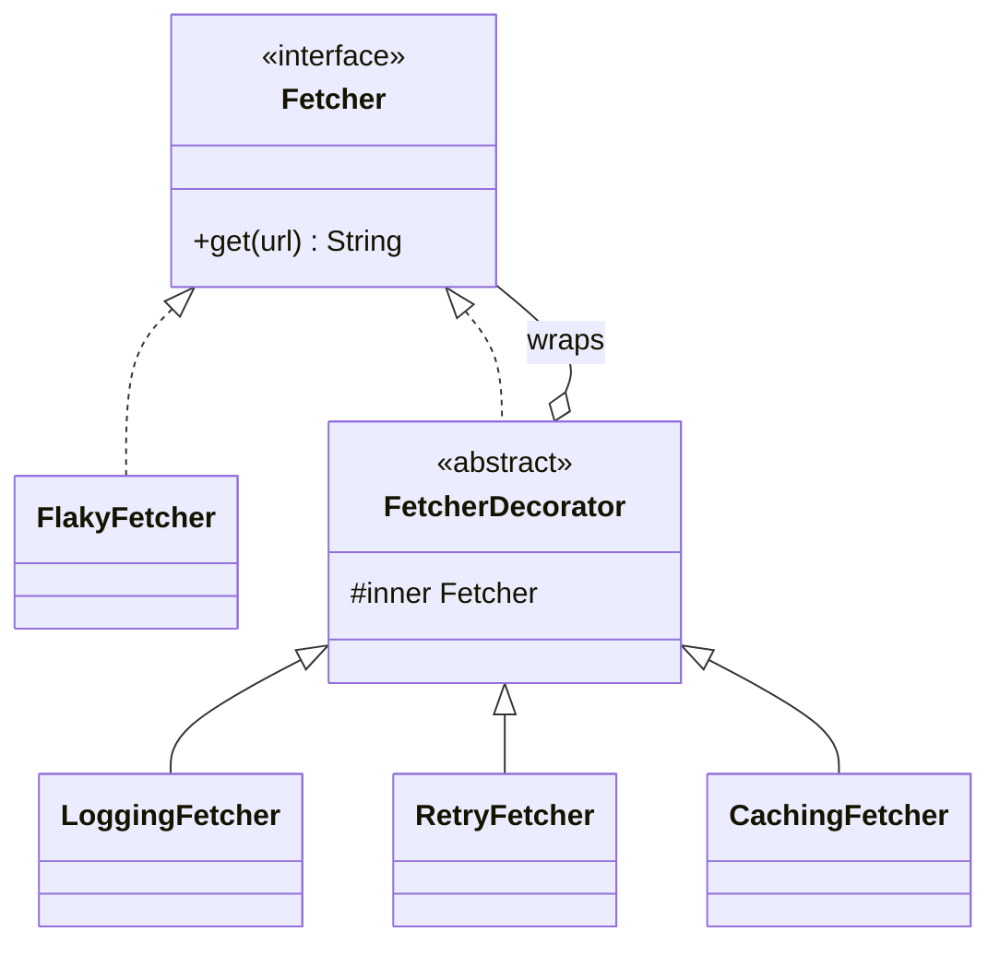

## The problem it solves

You have a `Fetcher` that downloads a URL. Now you want logging, retries and caching. Three ways to get there:

- **Edit the class** for each feature. It grows into one tangled class, and every user pays for features they do not need.
- **Subclass** per combination. Three features give 8 combinations (`LoggingRetryFetcher`, `RetryCachingFetcher`, ...). Four features give 16.
- **Decorate:** write one small class per feature, each implementing `Fetcher` and holding another `Fetcher`. Stack them in any order.

A **decorator** is a wrapper that has the same interface as the object it wraps. It forwards the call, adding behaviour before or after.

## Structure



Note the two arrows into `Fetcher`: a decorator **is a** `Fetcher` and **has a** `Fetcher`. That is what lets you wrap a wrapper.

## Code

`FlakyFetcher` fails on its first two calls, like a bad network. The decorators add behaviour around it. Read the first stack from the outside in: cache, then retry, then log, then the real fetcher.

```java
import java.util.*;

interface Fetcher {
    String get(String url);
}

// The real thing: fails on its first N calls, like a flaky network.
class FlakyFetcher implements Fetcher {
    private final int failures;
    private int calls = 0;

    FlakyFetcher(int failures) { this.failures = failures; }

    public String get(String url) {
        calls++;
        if (calls <= failures) throw new RuntimeException("timeout on call " + calls);
        return "200 " + url;
    }
}

// Base decorator: same interface, holds another Fetcher.
abstract class FetcherDecorator implements Fetcher {
    protected final Fetcher inner;

    FetcherDecorator(Fetcher inner) { this.inner = inner; }
}

class LoggingFetcher extends FetcherDecorator {
    LoggingFetcher(Fetcher inner) { super(inner); }

    public String get(String url) {
        System.out.println("log: GET " + url);
        try {
            String result = inner.get(url);
            System.out.println("log: ok " + result);
            return result;
        } catch (RuntimeException e) {
            System.out.println("log: failed (" + e.getMessage() + ")");
            throw e;
        }
    }
}

class RetryFetcher extends FetcherDecorator {
    private final int maxAttempts;

    RetryFetcher(Fetcher inner, int maxAttempts) {
        super(inner);
        this.maxAttempts = maxAttempts;
    }

    public String get(String url) {
        for (int attempt = 1; ; attempt++) {
            try {
                return inner.get(url);
            } catch (RuntimeException e) {
                if (attempt == maxAttempts) throw e;
            }
        }
    }
}

class CachingFetcher extends FetcherDecorator {
    private final Map<String, String> cache = new HashMap<>();

    CachingFetcher(Fetcher inner) { super(inner); }

    public String get(String url) {
        String hit = cache.get(url);
        if (hit != null) return hit + " (cached)";
        String result = inner.get(url);
        cache.put(url, result);
        return result;
    }
}

public class Main {
    public static void main(String[] args) {
        Fetcher a = new CachingFetcher(new RetryFetcher(new LoggingFetcher(new FlakyFetcher(2)), 3));
        System.out.println("result: " + a.get("/home"));
        System.out.println("result: " + a.get("/home"));

        System.out.println("--- logging outside retry");
        Fetcher b = new LoggingFetcher(new RetryFetcher(new FlakyFetcher(2), 3));
        System.out.println("result: " + b.get("/cart"));
    }
}
```
```cpp
#include <iostream>
#include <map>
#include <memory>
#include <stdexcept>
#include <string>
#include <utility>

class Fetcher {
public:
    virtual ~Fetcher() = default;
    virtual std::string get(const std::string& url) = 0;
};

// The real thing: fails on its first N calls, like a flaky network.
class FlakyFetcher : public Fetcher {
public:
    explicit FlakyFetcher(int failures) : failures_(failures) {}

    std::string get(const std::string& url) override {
        ++calls_;
        if (calls_ <= failures_) throw std::runtime_error("timeout on call " + std::to_string(calls_));
        return "200 " + url;
    }

private:
    int failures_;
    int calls_ = 0;
};

// Base decorator: same interface, owns another Fetcher.
class FetcherDecorator : public Fetcher {
protected:
    explicit FetcherDecorator(std::unique_ptr<Fetcher> inner) : inner_(std::move(inner)) {}
    std::unique_ptr<Fetcher> inner_;
};

class LoggingFetcher : public FetcherDecorator {
public:
    explicit LoggingFetcher(std::unique_ptr<Fetcher> inner) : FetcherDecorator(std::move(inner)) {}

    std::string get(const std::string& url) override {
        std::cout << "log: GET " << url << "\n";
        try {
            std::string result = inner_->get(url);
            std::cout << "log: ok " << result << "\n";
            return result;
        } catch (const std::runtime_error& e) {
            std::cout << "log: failed (" << e.what() << ")\n";
            throw;
        }
    }
};

class RetryFetcher : public FetcherDecorator {
public:
    RetryFetcher(std::unique_ptr<Fetcher> inner, int maxAttempts)
        : FetcherDecorator(std::move(inner)), maxAttempts_(maxAttempts) {}

    std::string get(const std::string& url) override {
        for (int attempt = 1;; ++attempt) {
            try {
                return inner_->get(url);
            } catch (const std::runtime_error&) {
                if (attempt == maxAttempts_) throw;
            }
        }
    }

private:
    int maxAttempts_;
};

class CachingFetcher : public FetcherDecorator {
public:
    explicit CachingFetcher(std::unique_ptr<Fetcher> inner) : FetcherDecorator(std::move(inner)) {}

    std::string get(const std::string& url) override {
        auto it = cache_.find(url);
        if (it != cache_.end()) return it->second + " (cached)";
        std::string result = inner_->get(url);
        cache_[url] = result;
        return result;
    }

private:
    std::map<std::string, std::string> cache_;
};

int main() {
    std::unique_ptr<Fetcher> a = std::make_unique<CachingFetcher>(
        std::make_unique<RetryFetcher>(
            std::make_unique<LoggingFetcher>(std::make_unique<FlakyFetcher>(2)), 3));
    std::string r1 = a->get("/home");   // call first, then print: << would print "result: " before the logs
    std::cout << "result: " << r1 << "\n";
    std::string r2 = a->get("/home");
    std::cout << "result: " << r2 << "\n";

    std::cout << "--- logging outside retry\n";
    std::unique_ptr<Fetcher> b = std::make_unique<LoggingFetcher>(
        std::make_unique<RetryFetcher>(std::make_unique<FlakyFetcher>(2), 3));
    std::string r3 = b->get("/cart");
    std::cout << "result: " << r3 << "\n";
    return 0;
}
```
```output
log: GET /home
log: failed (timeout on call 1)
log: GET /home
log: failed (timeout on call 2)
log: GET /home
log: ok 200 /home
result: 200 /home
result: 200 /home (cached)
--- logging outside retry
log: GET /cart
log: ok 200 /cart
result: 200 /cart
```

Things to notice:

- Same URL, second call: no log lines at all. The cache answered before the inner layers ran.
- With logging **inside** retry, you see every failed attempt. With logging **outside** retry, you see one request and its final result.
- Order is part of the design. There is no single correct order; it depends on what you want to observe.
- In C++, each decorator owns its inner object through `std::unique_ptr`, so deleting the outer layer cleans up the whole stack.

```quiz
q: You want the log to show how many times the network was really hit, including failures. Where should LoggingFetcher go?
options:
  - Outside RetryFetcher, so it wraps the whole retry loop
  - Inside RetryFetcher, directly around the real fetcher
  - Outside CachingFetcher, so it logs cache hits too
answer: 1
why: Each retry calls the layer below it. Logging directly around the real fetcher sees every attempt. Logging outside retry sees only the final outcome, and logging outside the cache includes calls that never reach the network.
```

```predict
lang: java
prompt: Using the classes above, what does this print?
code: |
  Fetcher f = new CachingFetcher(new FlakyFetcher(1));
  try { f.get("/a"); } catch (RuntimeException e) { System.out.println("first failed"); }
  System.out.println(f.get("/a"));
  System.out.println(f.get("/a"));
output: "first failed\n200 /a\n200 /a (cached)"
why: The first call fails, and the cache stores only successes. The second call reaches the real fetcher (its second call, which succeeds) and is stored. The third call is a cache hit.
```

## Decorator vs inheritance, in one table

| | Subclassing | Decorator |
|---|---|---|
| When it is decided | Compile time | Run time |
| Combining features | One class per combination | Stack small classes |
| Extra objects | None | One per layer |
| Debugging | Single class | Many layers in a stack trace |

Real code uses this widely: Java I/O (`new BufferedReader(new InputStreamReader(...))`), servlet filters, middleware chains in web frameworks.

```order
prompt: Arrange the retry decorator's get method.
lang: java
code: |
  public String get(String url) {
      for (int attempt = 1; ; attempt++) {
          try {
              return inner.get(url);
          } catch (RuntimeException e) {
              if (attempt == maxAttempts) throw e;
          }
      }
  }
distractors:
  - "                if (attempt == 1) throw e;"
why: Call the inner object; on failure either give up (last attempt) or loop again. Rethrowing on attempt 1 would never retry.
```

## When to use, when to avoid

Use a decorator when:

- Features are optional and combine in different ways.
- You want to add behaviour without touching a class you do not own.
- Each concern (log, retry, cache, auth) should be tested alone.

Avoid it when:

- There is one fixed combination. Put it in the class.
- The interface is large. Each decorator must forward every method, and that code is tedious (Java's dynamic proxies or Kotlin's `by` delegation can help).
- Callers need the concrete type. A decorator hides it, so `instanceof` checks stop working.

:::truth
Stacks of five decorators are hard to read in a stack trace, and order bugs are easy to introduce (a cache outside an auth check can leak data). Keep stacks short and build them in one place.
:::

:::warn
Decorator and Proxy have the same shape. The difference is intent: a decorator adds behaviour, a proxy controls access to the object. Be ready to say this in an interview.
:::

```cards
- q: What is a decorator?
  a: A wrapper with the same interface as the object it wraps; it forwards calls and adds behaviour before or after.
- q: Why not subclass for each feature combination?
  a: The number of classes grows as 2^n for n features, and combinations are fixed at compile time.
- q: Does the order of decorators matter?
  a: Yes. Logging inside retry sees every attempt; logging outside sees only the final result. A cache outside auth can serve data to the wrong user.
- q: Name two decorators from standard libraries.
  a: Java's BufferedReader wrapping a Reader, and middleware or filter chains in web frameworks.
- q: Decorator vs Proxy?
  a: Same shape. Decorator adds behaviour; Proxy controls access or lifecycle.
```

## Notes

:::notes
- Decorator = same interface + holds an inner object + adds behaviour around the forwarded call.
- It replaces a subclass per feature combination with small stackable classes.
- Order of wrapping changes behaviour (logging in or out of retry; cache vs auth).
- A decorator is both an `is-a` and a `has-a` of the interface.
- C++: hold the inner object in `std::unique_ptr` so one delete frees the stack.
- Avoid for a single fixed combination or for very wide interfaces.
- Decorator adds behaviour; Proxy controls access; Adapter changes the interface.
:::
