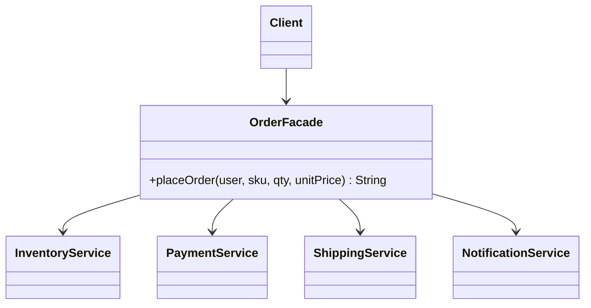

## The problem it solves

Placing an order touches four subsystems: inventory, payments, shipping and notifications. Each has its own small API. Without help, every caller (web handler, mobile API, admin tool) must:

- Know the right order of calls.
- Remember the undo step if payment fails after stock was reserved.
- Import four classes.

Callers drift. One forgets the undo and leaks stock.

A **facade** is a single class that offers a simple method for the common job and hides the subsystem choreography behind it. The word comes from architecture: the front of a building.

## Structure



The client talks to one class. The arrows from the facade to the subsystems are the only coupling to them.

## Code

The facade reserves stock, charges, undoes the reservation if charging fails, then ships and notifies. The subsystems are passed in (dependency injection, meaning the caller supplies them), so tests can use fakes.

```java
import java.util.*;

// Four subsystems, each with its own small API.
class InventoryService {
    private final Map<String, Integer> stock = new HashMap<>(Map.of("BOOK", 5, "PEN", 0));

    boolean reserve(String sku, int qty) {
        int have = stock.getOrDefault(sku, 0);
        if (have < qty) return false;
        stock.put(sku, have - qty);
        return true;
    }

    void release(String sku, int qty) { stock.merge(sku, qty, Integer::sum); }

    int left(String sku) { return stock.getOrDefault(sku, 0); }
}

class PaymentService {
    private final Map<String, Long> wallet = new HashMap<>(Map.of("ana", 1000L, "bob", 100L));

    boolean charge(String user, long amount) {
        long balance = wallet.getOrDefault(user, 0L);
        if (balance < amount) return false;
        wallet.put(user, balance - amount);
        return true;
    }
}

class ShippingService {
    private int counter = 1000;

    String ship(String sku, int qty) { return "TRK-" + (++counter); }
}

class NotificationService {
    void send(String user, String text) { System.out.println("notify: " + user + " - " + text); }
}

// The facade: one method for the common job, with the ordering and the undo step inside.
class OrderFacade {
    private final InventoryService inventory;
    private final PaymentService payments;
    private final ShippingService shipping;
    private final NotificationService notifications;

    OrderFacade(InventoryService inventory, PaymentService payments,
                ShippingService shipping, NotificationService notifications) {
        this.inventory = inventory;
        this.payments = payments;
        this.shipping = shipping;
        this.notifications = notifications;
    }

    String placeOrder(String user, String sku, int qty, long unitPrice) {
        if (!inventory.reserve(sku, qty)) return "rejected: " + sku + " out of stock";
        if (!payments.charge(user, unitPrice * qty)) {
            inventory.release(sku, qty);
            return "rejected: payment failed";
        }
        String tracking = shipping.ship(sku, qty);
        notifications.send(user, "order shipped " + tracking);
        return "placed: " + tracking;
    }
}

public class Main {
    public static void main(String[] args) {
        InventoryService inventory = new InventoryService();
        OrderFacade shop = new OrderFacade(inventory, new PaymentService(),
                new ShippingService(), new NotificationService());

        System.out.println(shop.placeOrder("ana", "BOOK", 2, 200));
        System.out.println(shop.placeOrder("bob", "BOOK", 3, 200));
        System.out.println(shop.placeOrder("ana", "PEN", 1, 10));
        System.out.println("BOOK left: " + inventory.left("BOOK"));   // subsystems stay reachable
    }
}
```
```cpp
#include <iostream>
#include <map>
#include <string>

// Four subsystems, each with its own small API.
class InventoryService {
public:
    bool reserve(const std::string& sku, int qty) {
        int have = left(sku);
        if (have < qty) return false;
        stock_[sku] = have - qty;
        return true;
    }

    void release(const std::string& sku, int qty) { stock_[sku] += qty; }

    int left(const std::string& sku) const {
        auto it = stock_.find(sku);
        return it == stock_.end() ? 0 : it->second;
    }

private:
    std::map<std::string, int> stock_{{"BOOK", 5}, {"PEN", 0}};
};

class PaymentService {
public:
    bool charge(const std::string& user, long long amount) {
        long long balance = wallet_[user];
        if (balance < amount) return false;
        wallet_[user] = balance - amount;
        return true;
    }

private:
    std::map<std::string, long long> wallet_{{"ana", 1000}, {"bob", 100}};
};

class ShippingService {
public:
    std::string ship(const std::string&, int) { return "TRK-" + std::to_string(++counter_); }

private:
    int counter_ = 1000;
};

class NotificationService {
public:
    void send(const std::string& user, const std::string& text) {
        std::cout << "notify: " << user << " - " << text << "\n";
    }
};

// The facade: one method for the common job, with the ordering and the undo step inside.
class OrderFacade {
public:
    OrderFacade(InventoryService& inventory, PaymentService& payments,
                ShippingService& shipping, NotificationService& notifications)
        : inventory_(inventory), payments_(payments), shipping_(shipping), notifications_(notifications) {}

    std::string placeOrder(const std::string& user, const std::string& sku, int qty, long long unitPrice) {
        if (!inventory_.reserve(sku, qty)) return "rejected: " + sku + " out of stock";
        if (!payments_.charge(user, unitPrice * qty)) {
            inventory_.release(sku, qty);
            return "rejected: payment failed";
        }
        std::string tracking = shipping_.ship(sku, qty);
        notifications_.send(user, "order shipped " + tracking);
        return "placed: " + tracking;
    }

private:
    InventoryService& inventory_;
    PaymentService& payments_;
    ShippingService& shipping_;
    NotificationService& notifications_;
};

int main() {
    InventoryService inventory;
    PaymentService payments;
    ShippingService shipping;
    NotificationService notifications;
    OrderFacade shop(inventory, payments, shipping, notifications);

    std::cout << shop.placeOrder("ana", "BOOK", 2, 200) << "\n";
    std::cout << shop.placeOrder("bob", "BOOK", 3, 200) << "\n";
    std::cout << shop.placeOrder("ana", "PEN", 1, 10) << "\n";
    std::cout << "BOOK left: " << inventory.left("BOOK") << "\n";   // subsystems stay reachable
    return 0;
}
```
```output
notify: ana - order shipped TRK-1001
placed: TRK-1001
rejected: payment failed
rejected: PEN out of stock
BOOK left: 3
```

Read the three outcomes:

- `ana` succeeds: stock goes from 5 to 3.
- `bob` reserves 3 books, fails to pay, and the facade releases them. Stock stays at 3.
- The `PEN` order is rejected before payment is touched.

The last line reads `inventory` directly. A facade simplifies; it does not lock the door. Power users can still use the parts.

```quiz
q: In placeOrder, why is inventory reserved before charging, and released if charging fails?
options:
  - So the customer is never charged for stock that does not exist
  - Because payment services require a prior reservation by law
  - To make the code shorter
answer: 0
why: Reserve first so you cannot take money for an item you cannot ship. The release in the failure branch is the compensating step; without it, failed payments would slowly drain inventory.
```

```predict
lang: java
prompt: Starting from fresh services (BOOK stock 5, ana has 1000, bob has 100), what does this print?
code: |
  System.out.println(shop.placeOrder("bob", "BOOK", 1, 80));
  System.out.println(shop.placeOrder("bob", "BOOK", 1, 80));
  System.out.println(inventory.left("BOOK"));
output: "notify: bob - order shipped TRK-1001\nplaced: TRK-1001\nrejected: payment failed\n4"
why: Bob can afford the first order (100 minus 80 leaves 20) but not the second. The first ships and keeps one book, so stock is 4. The second reserves, fails payment and releases, so stock stays 4. The notification subsystem prints its own line during the first order, before the result is printed.
```

## Where a facade sits

- Between layers: a controller (web handler) calls the facade, never the four services.
- Around a library: your `PdfExporter` wraps a large PDF library and exposes `export(doc)` only.
- Around legacy code: new code sees a tidy front while the old internals stay untouched.

In each case the question is the same: what is the smallest set of methods the callers really need?

## Facade vs its neighbours

| Pattern | Goal | Interface |
|---|---|---|
| Facade | Simplify many classes | New, smaller one |
| Adapter | Make one class fit | Matches an existing target |
| Mediator | Let peers talk without knowing each other | Peers keep their own |

A facade should be thin. If it grows its own rules, state and database, it has become a service class (sometimes called an application service). That is fine, but call it what it is.

```blanks
prompt: Complete the failure branch of the facade.
lang: java
code: |
  if (!payments.charge(user, unitPrice * qty)) {
      inventory.[[release]](sku, qty);
      return "rejected: payment failed";
  }
why: A compensating action undoes the earlier reservation so a failed step does not leave partial changes behind.
```

## When to use, when to avoid

Use a facade when:

- A common task needs several subsystem calls in a fixed order.
- You want a clean boundary between layers (UI calls the facade, not the parts).
- A library is large and your code uses a small slice of it. Wrap that slice.

Avoid it when:

- The subsystem has one class. You are adding a pass-through that adds nothing.
- You hide things callers need. Do not remove access to the subsystems unless you must.
- You put workflow, rules and state in it. It becomes a "god class" (one class that knows and does everything).

:::truth
Facades are easy to write and easy to abuse. They are good at hiding order and plumbing. They are bad at hiding complexity that is real: if the order flow has ten failure modes, the facade will contain ten branches. It moves the complexity into one place; it does not delete it.
:::

```cards
- q: What does a Facade do?
  a: It offers one simple interface to a set of subsystem classes and hides the order of calls and the setup behind it.
- q: Does a facade prevent access to the subsystems?
  a: No. It simplifies the common path; callers can still use the parts directly when they need to.
- q: What is a compensating action?
  a: A step that undoes an earlier step when a later one fails, such as releasing reserved stock after a failed payment.
- q: Facade vs Adapter?
  a: Facade simplifies many classes behind a new interface. Adapter makes one existing class match an interface you already have.
- q: Sign that a facade has grown too big?
  a: It holds its own business rules and state. At that point treat it as a proper service and split it.
```

## Notes

:::notes
- Facade = one simple class in front of several subsystems; callers use one method for the common job.
- It hides call order, setup and compensating (undo) steps.
- Pass the subsystems in so tests can substitute fakes.
- It simplifies; it does not forbid direct access to the parts.
- Keep it thin. Rules and state belong in the subsystems or a real service.
- Not needed for a single-class subsystem.
- Adapter changes an interface to match; Facade makes a new smaller one.
:::
