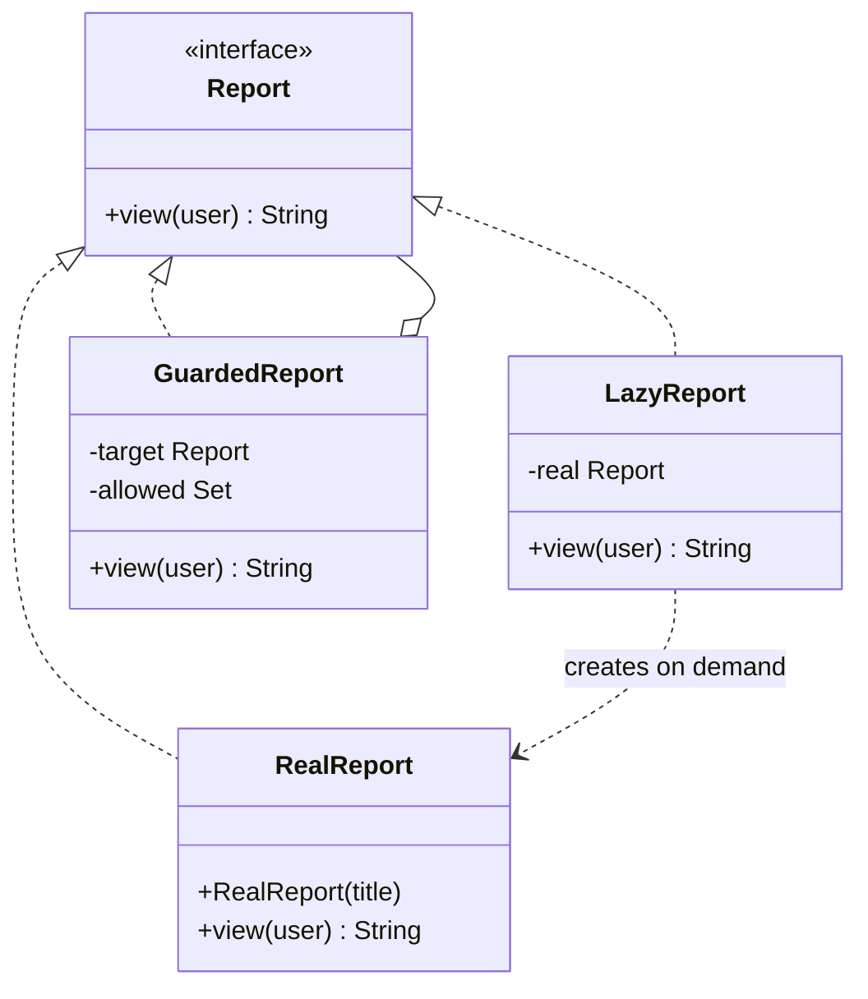

## The problem it solves

Sometimes the object a client wants is awkward to touch directly:

- It is expensive to create (a big report, an image, a database connection).
- Not everyone may use it (permissions).
- It lives in another process or machine (a remote service).

A **proxy** is a stand-in with the same interface as the real object. The client cannot tell the difference. The proxy decides whether, when and how to reach the real thing.

## The common kinds

| Kind | What the proxy does | Example |
|---|---|---|
| Virtual proxy | Creates the real object on first use | Lazy-loaded image or report |
| Protection proxy | Checks permission before forwarding | Only admins view a salary report |
| Remote proxy | Hides network calls behind a local object | gRPC or RMI stubs (generated client classes) |
| Caching proxy | Stores results of costly calls | Product lookup cache |
| Smart reference | Counts uses, logs, or manages the lifetime | `std::shared_ptr` is the idea in C++ |

This lesson codes the first two and stacks them.

## Structure



## Code

`RealReport` prints when it loads, so you can see exactly when the cost is paid. The guard sits outside the lazy proxy, so an unauthorised user never triggers the load.

```java
import java.util.Set;

interface Report {
    String view(String user);
}

// The expensive real object: loading is slow, so we want to delay it.
class RealReport implements Report {
    private final String title;

    RealReport(String title) {
        this.title = title;
        System.out.println("loading " + title + " from disk...");
    }

    public String view(String user) { return title + ": revenue up 12%"; }
}

// Virtual proxy: creates the real object on first use.
class LazyReport implements Report {
    private final String title;
    private Report real;

    LazyReport(String title) { this.title = title; }

    public String view(String user) {
        if (real == null) real = new RealReport(title);
        return real.view(user);
    }
}

// Protection proxy: checks permission before forwarding.
class GuardedReport implements Report {
    private final Report target;
    private final Set<String> allowed;

    GuardedReport(Report target, Set<String> allowed) {
        this.target = target;
        this.allowed = allowed;
    }

    public String view(String user) {
        if (!allowed.contains(user)) return "denied for " + user;
        return target.view(user);
    }
}

public class Main {
    public static void main(String[] args) {
        Report q3 = new GuardedReport(new LazyReport("Q3"), Set.of("admin", "finance"));
        System.out.println("proxies built, nothing loaded");
        System.out.println(q3.view("guest"));
        System.out.println(q3.view("admin"));
        System.out.println(q3.view("finance"));
    }
}
```
```cpp
#include <iostream>
#include <memory>
#include <set>
#include <string>
#include <utility>

class Report {
public:
    virtual ~Report() = default;
    virtual std::string view(const std::string& user) = 0;
};

// The expensive real object: loading is slow, so we want to delay it.
class RealReport : public Report {
public:
    explicit RealReport(std::string title) : title_(std::move(title)) {
        std::cout << "loading " << title_ << " from disk...\n";
    }

    std::string view(const std::string&) override { return title_ + ": revenue up 12%"; }

private:
    std::string title_;
};

// Virtual proxy: creates the real object on first use.
class LazyReport : public Report {
public:
    explicit LazyReport(std::string title) : title_(std::move(title)) {}

    std::string view(const std::string& user) override {
        if (!real_) real_ = std::make_unique<RealReport>(title_);
        return real_->view(user);
    }

private:
    std::string title_;
    std::unique_ptr<Report> real_;
};

// Protection proxy: checks permission before forwarding.
class GuardedReport : public Report {
public:
    GuardedReport(std::unique_ptr<Report> target, std::set<std::string> allowed)
        : target_(std::move(target)), allowed_(std::move(allowed)) {}

    std::string view(const std::string& user) override {
        if (allowed_.count(user) == 0) return "denied for " + user;
        return target_->view(user);
    }

private:
    std::unique_ptr<Report> target_;
    std::set<std::string> allowed_;
};

int main() {
    std::unique_ptr<Report> q3 = std::make_unique<GuardedReport>(
        std::make_unique<LazyReport>("Q3"), std::set<std::string>{"admin", "finance"});
    std::cout << "proxies built, nothing loaded\n";
    std::cout << q3->view("guest") << "\n";
    std::cout << q3->view("admin") << "\n";
    std::cout << q3->view("finance") << "\n";
    return 0;
}
```
```output
proxies built, nothing loaded
denied for guest
loading Q3 from disk...
Q3: revenue up 12%
Q3: revenue up 12%
```

Read the output in order:

- Building the proxies loads nothing.
- `guest` is denied, and still nothing is loaded. The check happens first.
- `admin` triggers the load once. `finance` reuses the loaded report.

```quiz
q: Why does the demo put GuardedReport outside LazyReport?
options:
  - It makes each call faster
  - A refused user is stopped by the cheap check and never triggers the expensive load
  - The lazy proxy cannot be wrapped by anything else
answer: 1
why: Layers act outside-in. The permission check is cheap and the load is not, so the check goes first. In the output, `guest` is denied before "loading Q3" ever prints.
```

```predict
lang: java
prompt: What does this print using the proxies above?
code: |
  Report r = new LazyReport("Q4");
  System.out.println("created");
  r.view("x");
  r.view("x");
output: "created\nloading Q4 from disk..."
why: Construction of the proxy prints nothing. The first view() creates RealReport, which prints once. The second view() reuses it.
```

## Proxy vs Decorator

The class diagrams look almost identical: both implement the interface and hold another one. The intent differs:

- **Decorator:** adds behaviour to a call (log, retry, cache). The wrapped object is usually given from outside.
- **Proxy:** controls access to the object (whether, when, where). The proxy often creates or locates the real object itself.

:::note
In practice the line blurs. A caching proxy and a caching decorator are the same code. Name it by your intent, so the next reader knows what to expect.
:::

```order
prompt: Arrange the lazy proxy's view method.
lang: java
code: |
  public String view(String user) {
      if (real == null) {
          real = new RealReport(title);
      }
      return real.view(user);
  }
distractors:
  - "        real = null;"
why: Create on first use only, then forward. Resetting to null would reload the report on every call.
```

## Pitfalls

- **Threads:** the lazy check above is not thread-safe. Two threads can both see `null` and build two reports. Use `synchronized` or a holder class (the same fix as for Singleton).
- **Identity:** `proxy == real` is false. Code that compares references or checks `instanceof` can behave differently.
- **Hidden cost:** a call that looks local may hit the network (remote proxy). Hide it too well and callers write loops with a call per iteration.
- **Frameworks:** Spring, Hibernate and mocking libraries generate proxies at run time. Stack traces then show strange class names. That is normal.

## When to use, when to avoid

Use a proxy when:

- Creation is costly and not always needed (virtual).
- Access rules should be enforced in one place (protection).
- A remote or slow resource should look like a local object.

Avoid it when:

- Creation is cheap. Laziness only adds a null check.
- Permission rules are business logic that depends on the data. Keep them in the domain, not in a wrapper that only sees a user name.
- You need a different interface. That is an Adapter.

:::truth
Most developers meet proxies through frameworks, not by writing them. In an interview, the useful skill is naming the kind (virtual, protection, remote) and stating the trade-off: you gain control and pay with indirection and a harder-to-read call path.
:::

```cards
- q: What is a proxy?
  a: A stand-in with the same interface as a real object that controls whether, when or how the real object is reached.
- q: Name three kinds of proxy.
  a: Virtual (lazy creation), protection (access check), remote (hides network calls). Caching and smart-reference proxies also exist.
- q: Proxy vs Decorator?
  a: Same shape. Decorator adds behaviour; Proxy controls access or lifecycle.
- q: Why put the permission check outside the lazy proxy?
  a: Layers run outside-in, so a cheap check first means a refused user never triggers the expensive load.
- q: What goes wrong with a lazy proxy under threads?
  a: Two threads can both see null and create two real objects unless creation is synchronized.
```

## Notes

:::notes
- Proxy = same interface as the real object, placed in front to control access.
- Kinds: virtual (lazy), protection (permissions), remote (network), caching, smart reference.
- Layers act outside-in, so put cheap checks (permissions) outside expensive steps (loading).
- Proxy controls access; Decorator adds behaviour; Adapter changes the interface.
- Lazy creation needs synchronization if shared between threads.
- Proxy identity differs from the real object; avoid `==` and `instanceof` tricks.
- Frameworks (Spring, Hibernate, mocks) generate proxies for you.
:::
