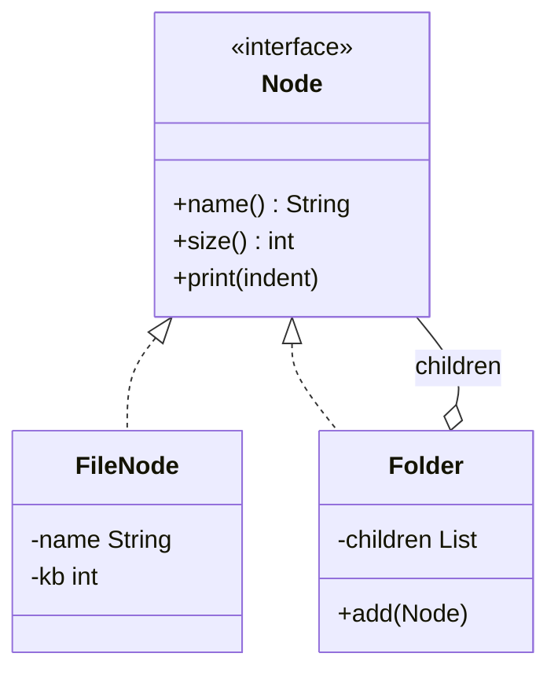

## The problem it solves

Many things in software form a tree: folders hold files and other folders, a menu holds items and sub-menus, a company holds employees and departments.

Without a pattern, every client writes this:

- "If it is a file, do X. If it is a folder, loop over its children and do X to each."
- The same `if` is repeated for size, print, delete, search.
- A new kind of node means editing every one of those places.

**Composite** fixes this with one rule: the leaf (a thing with no children) and the container (a thing that holds children) implement the **same interface**. The client calls one method. The container forwards the call to its children, which may be containers themselves.

## Structure



- `Node` is the shared interface. The client only knows this type.
- `FileNode` is the **leaf**. It does the real work.
- `Folder` is the **composite**. It holds `Node`s and forwards calls to them.
- The arrow from `Folder` back to `Node` is what makes the structure recursive.

## Code

A small file system. `size()` of a folder is the sum of its children, and each child may be a folder too. Sizes are in KB.

```java
import java.util.ArrayList;
import java.util.List;

interface Node {
    String name();
    int size();
    void print(String indent);
}

// Leaf: no children, does the real work.
class FileNode implements Node {
    private final String name;
    private final int kb;

    FileNode(String name, int kb) {
        this.name = name;
        this.kb = kb;
    }

    public String name() { return name; }
    public int size() { return kb; }
    public void print(String indent) {
        System.out.println(indent + name + " (" + kb + " KB)");
    }
}

// Composite: holds Nodes and forwards each call to them.
class Folder implements Node {
    private final String name;
    private final List<Node> children = new ArrayList<>();

    Folder(String name) { this.name = name; }

    void add(Node child) { children.add(child); }

    public String name() { return name; }

    public int size() {
        int total = 0;
        for (Node child : children) {
            total += child.size();
        }
        return total;
    }

    public void print(String indent) {
        System.out.println(indent + name + "/ (" + size() + " KB)");
        for (Node child : children) {
            child.print(indent + "  ");
        }
    }
}

public class Main {
    public static void main(String[] args) {
        Folder root = new Folder("root");
        Folder docs = new Folder("docs");
        docs.add(new FileNode("cv.pdf", 120));
        docs.add(new FileNode("notes.txt", 15));
        Folder photos = new Folder("photos");
        photos.add(new FileNode("a.jpg", 300));
        Folder trip = new Folder("trip");
        trip.add(new FileNode("b.jpg", 450));
        photos.add(trip);
        root.add(docs);
        root.add(photos);
        root.add(new FileNode("todo.txt", 5));

        root.print("");
    }
}
```
```cpp
#include <iostream>
#include <memory>
#include <string>
#include <utility>
#include <vector>

class Node {
public:
    virtual ~Node() = default;
    virtual std::string name() const = 0;
    virtual int size() const = 0;
    virtual void print(const std::string& indent) const = 0;
};

// Leaf: no children, does the real work.
class FileNode : public Node {
public:
    FileNode(std::string name, int kb) : name_(std::move(name)), kb_(kb) {}

    std::string name() const override { return name_; }
    int size() const override { return kb_; }
    void print(const std::string& indent) const override {
        std::cout << indent << name_ << " (" << kb_ << " KB)\n";
    }

private:
    std::string name_;
    int kb_;
};

// Composite: owns its children and forwards each call to them.
class Folder : public Node {
public:
    explicit Folder(std::string name) : name_(std::move(name)) {}

    void add(std::unique_ptr<Node> child) { children_.push_back(std::move(child)); }

    std::string name() const override { return name_; }

    int size() const override {
        int total = 0;
        for (const auto& child : children_) {
            total += child->size();
        }
        return total;
    }

    void print(const std::string& indent) const override {
        std::cout << indent << name_ << "/ (" << size() << " KB)\n";
        for (const auto& child : children_) {
            child->print(indent + "  ");
        }
    }

private:
    std::string name_;
    std::vector<std::unique_ptr<Node>> children_;
};

int main() {
    auto root = std::make_unique<Folder>("root");
    auto docs = std::make_unique<Folder>("docs");
    docs->add(std::make_unique<FileNode>("cv.pdf", 120));
    docs->add(std::make_unique<FileNode>("notes.txt", 15));
    auto photos = std::make_unique<Folder>("photos");
    photos->add(std::make_unique<FileNode>("a.jpg", 300));
    auto trip = std::make_unique<Folder>("trip");
    trip->add(std::make_unique<FileNode>("b.jpg", 450));
    photos->add(std::move(trip));
    root->add(std::move(docs));
    root->add(std::move(photos));
    root->add(std::make_unique<FileNode>("todo.txt", 5));

    root->print("");
    return 0;
}
```
```output
root/ (890 KB)
  docs/ (135 KB)
    cv.pdf (120 KB)
    notes.txt (15 KB)
  photos/ (750 KB)
    a.jpg (300 KB)
    trip/ (450 KB)
      b.jpg (450 KB)
  todo.txt (5 KB)
```

Notice what is missing: no `instanceof`, no `if (isFolder)`. `root.print("")` does not know or care how deep the tree goes.

```quiz
q: Why does Folder implement the same interface as FileNode?
options:
  - So a Folder can inherit the code of FileNode
  - So the client and the Folder itself can treat any child, file or folder, the same way
  - So Folder can be created without a name
answer: 1
why: The shared interface is the whole pattern. It lets a Folder call size() on a child without asking what kind of child it is, which makes the recursion work.
```

```predict
lang: java
prompt: Using the classes above, what does this print?
code: |
  Folder f = new Folder("f");
  f.add(new FileNode("a", 10));
  Folder g = new Folder("g");
  g.add(new FileNode("b", 20));
  g.add(new FileNode("c", 30));
  f.add(g);
  System.out.println(f.size());
output: "60"
why: f holds a (10) and g. g's size is 20 + 30 = 50, so f is 10 + 50 = 60. Each folder sums its children, and the sum recurses.
```

## How the recursion works

Take `root.size()`:

1. `root` loops over `docs`, `photos`, `todo.txt` and calls `size()` on each.
2. `docs` does the same with its two files and returns 135.
3. `photos` calls `a.jpg` (300) and `trip`, which calls `b.jpg` (450). It returns 750.
4. `todo.txt` is a leaf and returns 5 at once. The total is 890.

Leaves are the stopping point. Every path down the tree ends at one.

```order
prompt: Arrange the composite's size method.
lang: java
code: |
  public int size() {
      int total = 0;
      for (Node child : children) {
          total += child.size();
      }
      return total;
  }
distractors:
  - "        total = child.size();"
why: The method must add each child's size to a running total. Using = would keep only the last child's size.
```

## The design question: where does add() live?

Two choices, each with a cost:

| Choice | Gain | Cost |
|---|---|---|
| `add()` only on `Folder` (used above) | Safe: you cannot call `add` on a file | The client must know it holds a `Folder` to add to it |
| `add()` on the `Node` interface | Fully uniform: the client never needs the concrete type | A `FileNode` must refuse (throw or ignore) when asked to add |

:::note
Most code takes the safe route: keep `add()` on the container. Uniformity matters for the operations clients call in bulk, such as `size()` and `print()`.
:::

## Pitfalls

- **Cycles:** if a folder can contain itself, directly or through a shortcut, `size()` recurses forever. Prevent it at `add()` time.
- **Deep trees:** recursion uses stack space (the call stack, a limited memory region). A tree thousands of levels deep can overflow it.
- **Cost of repeated work:** here `print()` calls `size()` at every folder, so deep trees recompute sums. Cache the value only if it shows up in profiling.
- **Ownership in C++:** with `unique_ptr`, the parent owns its children and frees them. Do not store raw pointers to children and delete them yourself.

## When to use, when to avoid

Use Composite when:

- The data is a tree (part-whole hierarchy) and you want clients to ignore the difference between one and many.
- You apply the same operation at every level: total, render, search, permission check.

Avoid it when:

- The structure is flat. A plain list is simpler.
- Leaves and containers need very different operations. A forced common interface fills up with methods that half the classes cannot support.

:::truth
Composite is common, but you rarely build it from scratch: UI toolkits, the DOM (the browser's tree of page elements) and file APIs already have it. In an interview it appears in file systems, menus, org charts and expression trees. The skill being tested is spotting the tree and writing the recursion cleanly.
:::

```cards
- q: What problem does Composite solve?
  a: Clients no longer need `if leaf ... else loop children` everywhere. A leaf and a group share one interface.
- q: What are the three roles in Composite?
  a: Component (the shared interface), Leaf (no children, does the work), Composite (holds components and forwards calls).
- q: Why does a composite's method end?
  a: Every path down the tree reaches a leaf, and a leaf answers directly without recursing.
- q: Where should add() live, and what is the trade-off?
  a: On the composite only is safe but the client needs the concrete type. On the interface is uniform but leaves must refuse the call.
- q: Name a danger of recursive structures.
  a: Cycles cause infinite recursion, and very deep trees can overflow the call stack.
```

## Notes

:::notes
- Composite = leaf and container share one interface, so clients treat one and many the same.
- Roles: component (interface), leaf (does the work), composite (holds children, forwards calls).
- A container's method loops over its children and calls the same method on each. Leaves end the recursion.
- Keep add() on the container for safety; put bulk operations (size, print) on the interface.
- Watch for cycles and very deep trees.
- Typical uses: file systems, menus, org charts, UI trees, expression trees.
- In C++ the parent owns children through unique_ptr; in Java the garbage collector handles it.
:::
