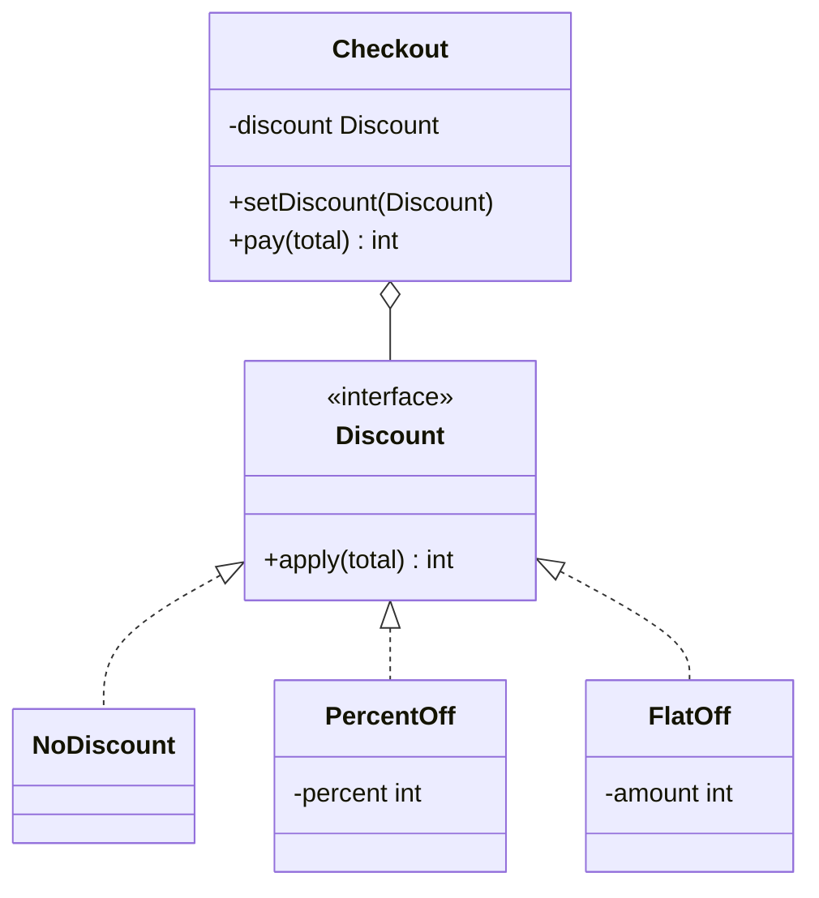

## The problem it solves

A checkout applies a discount. At first there is one rule. Then marketing adds more, and the code becomes this:

```java
if (type.equals("PERCENT")) { ... }
else if (type.equals("FLAT")) { ... }
else if (type.equals("CAPPED")) { ... }
```

Problems with that:

- Every new rule means editing the same method, and an edit can break the old rules.
- The chain is hard to test, because you must set up the `type` to reach each branch.
- The same chain gets copied into other places (reports, refunds).

**Strategy** moves each rule into its own class that implements one small interface. The checkout holds *a* strategy and calls it. Which one it holds can change while the program runs.

## Structure



- **Strategy** (`Discount`): the interface with one job.
- **Concrete strategies**: one class per algorithm.
- **Context** (`Checkout`): the class that uses a strategy. It never checks which one it has.

## Code

Amounts are whole rupees to keep the arithmetic exact. The last strategy is a lambda (a short inline function), to show that a strategy is just "a behaviour passed in".

```java
interface Discount {
    int apply(int total);
}

class NoDiscount implements Discount {
    public int apply(int total) { return total; }
}

class PercentOff implements Discount {
    private final int percent;

    PercentOff(int percent) { this.percent = percent; }

    public int apply(int total) { return total - total * percent / 100; }
}

class FlatOff implements Discount {
    private final int amount;

    FlatOff(int amount) { this.amount = amount; }

    public int apply(int total) { return Math.max(0, total - amount); }
}

// Context: uses a strategy and never asks which one it is.
class Checkout {
    private Discount discount;

    Checkout(Discount discount) { this.discount = discount; }

    void setDiscount(Discount discount) { this.discount = discount; }

    int pay(int total) { return discount.apply(total); }
}

public class Main {
    public static void main(String[] args) {
        Checkout c = new Checkout(new NoDiscount());
        System.out.println("none: " + c.pay(1000));

        c.setDiscount(new PercentOff(10));
        System.out.println("10% off: " + c.pay(1000));

        c.setDiscount(new FlatOff(150));
        System.out.println("flat 150 off: " + c.pay(1000));
        System.out.println("flat 150 off on 100: " + c.pay(100));

        // Discount has one method, so a lambda can be a strategy.
        c.setDiscount(total -> total - Math.min(total * 30 / 100, 200));
        System.out.println("capped 30%: " + c.pay(1000));
    }
}
```
```cpp
#include <algorithm>
#include <functional>
#include <iostream>
#include <memory>
#include <utility>

class Discount {
public:
    virtual ~Discount() = default;
    virtual int apply(int total) const = 0;
};

class NoDiscount : public Discount {
public:
    int apply(int total) const override { return total; }
};

class PercentOff : public Discount {
public:
    explicit PercentOff(int percent) : percent_(percent) {}
    int apply(int total) const override { return total - total * percent_ / 100; }

private:
    int percent_;
};

class FlatOff : public Discount {
public:
    explicit FlatOff(int amount) : amount_(amount) {}
    int apply(int total) const override { return std::max(0, total - amount_); }

private:
    int amount_;
};

// Wraps any callable so a lambda can act as a strategy.
class FuncDiscount : public Discount {
public:
    explicit FuncDiscount(std::function<int(int)> fn) : fn_(std::move(fn)) {}
    int apply(int total) const override { return fn_(total); }

private:
    std::function<int(int)> fn_;
};

// Context: uses a strategy and never asks which one it is.
class Checkout {
public:
    explicit Checkout(std::unique_ptr<Discount> discount) : discount_(std::move(discount)) {}

    void setDiscount(std::unique_ptr<Discount> discount) { discount_ = std::move(discount); }

    int pay(int total) const { return discount_->apply(total); }

private:
    std::unique_ptr<Discount> discount_;
};

int main() {
    Checkout c(std::make_unique<NoDiscount>());
    std::cout << "none: " << c.pay(1000) << "\n";

    c.setDiscount(std::make_unique<PercentOff>(10));
    std::cout << "10% off: " << c.pay(1000) << "\n";

    c.setDiscount(std::make_unique<FlatOff>(150));
    std::cout << "flat 150 off: " << c.pay(1000) << "\n";
    std::cout << "flat 150 off on 100: " << c.pay(100) << "\n";

    c.setDiscount(std::make_unique<FuncDiscount>(
        [](int total) { return total - std::min(total * 30 / 100, 200); }));
    std::cout << "capped 30%: " << c.pay(1000) << "\n";
    return 0;
}
```
```output
none: 1000
10% off: 900
flat 150 off: 850
flat 150 off on 100: 0
capped 30%: 800
```

Adding a new rule meant writing a new class (or lambda) and passing it in. `Checkout` was not edited. That is the **Open-Closed Principle**: open to extension, closed to modification.

```predict
lang: java
prompt: What does this print with the classes above?
code: |
  Checkout c = new Checkout(new PercentOff(50));
  c.setDiscount(new FlatOff(30));
  System.out.println(c.pay(100));
output: "70"
why: setDiscount replaces the 50 percent strategy. Only FlatOff(30) is active, so 100 - 30 = 70.
```

```blanks
prompt: Complete the context class so it delegates to whichever strategy it holds.
lang: java
code: |
  class Checkout {
      private [[Discount]] discount;

      int pay(int total) {
          return discount.[[apply]](total);
      }
  }
why: The field is typed as the interface, never as a concrete class. That is what lets any strategy be plugged in.
```

## Strategy vs if-else vs inheritance

| Approach | Adding a rule | Changing at run time | Main cost |
|---|---|---|---|
| if-else chain | Edit the shared method | Change a flag | Grows and gets tangled |
| Subclasses of `Checkout` | New subclass of the whole class | Hard; object type is fixed at creation | Rule and context are welded together |
| Strategy | New small class | `setDiscount(...)` | One interface and one class per rule |

This is the same point as "composition over inheritance": the varying part is a field you can replace, not a parent class you are stuck with.

:::note
Strategy and **State** have the same diagram. The difference is who decides. In Strategy the client picks the algorithm. In State the object switches its own behaviour as its situation changes. The next lessons make that concrete.
:::

## Choosing a strategy

The context should not contain the `if`. Choose elsewhere:

- A small **factory** maps a name or setting to a strategy.
- A **map** from key to strategy (`Map<String, Discount>`) replaces the chain with a lookup.
- A **dependency injection** (DI) framework supplies it through the constructor. DI just means "pass in what a class needs instead of creating it inside".

## Pitfalls

- **Over-splitting:** two stable cases that never change do not need an interface. A plain `if` is fine.
- **Leaky interface:** if some strategies need the customer or a coupon code, others ignore them. Pass a small context object, or give the data to the strategy's constructor.
- **Stateful strategies:** a strategy with mutable fields cannot be shared between threads or contexts. Keep them stateless where you can.
- **Too many tiny classes:** if every strategy is one line, use lambdas and keep the interface.

## When to use, when to avoid

Use Strategy when:

- There are several ways to do one job (pricing, sorting, routing, retry timing, payment method).
- New ways are expected, or the choice depends on run-time data.
- You want each way testable alone.

Avoid it when:

- There is one algorithm and no sign of a second.
- The variants differ in *what they need*, not just in how they compute. Then the common interface will be awkward.

```quiz
q: Checkout has `if (type == "PERCENT") ... else if (type == "FLAT") ...`. What is the strongest reason to switch to Strategy?
options:
  - Virtual calls are faster than if statements
  - A new rule becomes a new class, and the tested Checkout code is not edited
  - It removes the need to ever choose a rule
answer: 1
why: The gain is changeability, not speed. Choosing the rule still happens somewhere (a factory, a map, configuration), but it is moved out of Checkout.
```

:::truth
You already use Strategy daily: a comparator passed to `sort` is one. In interviews the pattern is the answer to "how would you add a new X without touching the old code" for pricing, parking fees, routing and notification channels. State the trade-off too: more types in exchange for easier change.
:::

```cards
- q: What is Strategy in one sentence?
  a: Put each interchangeable algorithm behind one interface and give the context an instance, so the algorithm can be swapped without editing the context.
- q: Name the three roles.
  a: Strategy (the interface), concrete strategies (one per algorithm), context (holds a strategy and calls it).
- q: Strategy vs State?
  a: Same shape. In Strategy the client chooses the algorithm. In State the object changes its own behaviour as its situation changes.
- q: Where does the if-else go after you adopt Strategy?
  a: Out of the context, into a factory, a lookup map or configuration that picks the strategy once.
- q: When is Strategy overkill?
  a: When there is one algorithm, or a couple of stable cases that will not change. A plain if is simpler.
```

## Notes

:::notes
- Strategy = a family of algorithms behind one interface, chosen and swapped by the caller.
- Roles: strategy interface, concrete strategies, context that holds one.
- It replaces if-else chains and supports the Open-Closed Principle: add a class, do not edit the context.
- Choose the strategy outside the context: factory, map lookup or dependency injection.
- Keep strategies stateless so they can be shared safely.
- Lambdas and std::function are strategies when the interface has one method.
- Strategy: client picks the behaviour. State: the object switches itself.
- Skip it for a single stable algorithm.
:::
