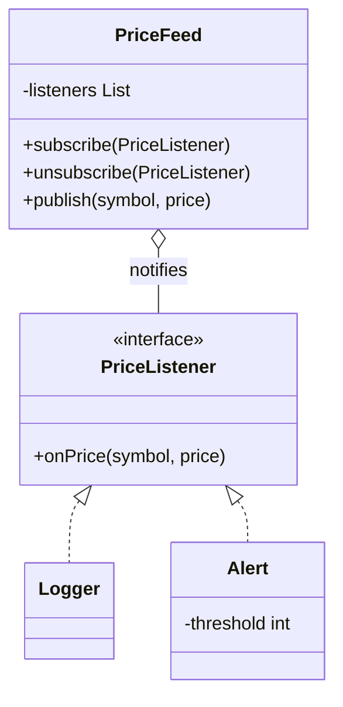

## The problem it solves

A price changes. Several things care: a log, an alert, a chart, a trading rule. The naive design makes the price class call each of them by name:

```java
void setPrice(int p) { logger.log(p); alert.check(p); chart.redraw(p); }
```

Costs of that:

- The price class must know every dependant, so adding one means editing it.
- It cannot be reused somewhere that has no chart.
- Removing a dependant at run time is awkward.

**Observer** reverses the dependency. The source (called the **subject**) keeps a list of **listeners** that implement one small interface. When something happens it walks the list and calls each one. The subject knows only the interface, never the concrete listeners.

You know this as events: button clicks, `addEventListener`, a notification bell. Message brokers such as Kafka are the same idea across machines (publish-subscribe, or pub-sub).

## Structure



- **Subject** (`PriceFeed`): holds the list, offers `subscribe` and `unsubscribe`, and notifies on change.
- **Observer** (`PriceListener`): the interface the subject calls.
- **Concrete observers** (`Logger`, `Alert`): react in their own way.

## Code

`publish` loops over a **copy** of the list. If a listener unsubscribes while being notified, the loop over the original would break (Java throws `ConcurrentModificationException`; in C++ the vector would be changed under the loop).

```java
import java.util.ArrayList;
import java.util.List;

interface PriceListener {
    void onPrice(String symbol, int price);
}

class Logger implements PriceListener {
    public void onPrice(String symbol, int price) {
        System.out.println("log: " + symbol + " " + price);
    }
}

class Alert implements PriceListener {
    private final int threshold;

    Alert(int threshold) { this.threshold = threshold; }

    public void onPrice(String symbol, int price) {
        if (price > threshold) {
            System.out.println("alert: " + symbol + " at " + price + " is above " + threshold);
        }
    }
}

// Subject: knows only the PriceListener interface.
class PriceFeed {
    private final List<PriceListener> listeners = new ArrayList<>();

    void subscribe(PriceListener l) { listeners.add(l); }

    void unsubscribe(PriceListener l) { listeners.remove(l); }

    void publish(String symbol, int price) {
        // Copy first: a listener may unsubscribe while we loop.
        for (PriceListener l : new ArrayList<>(listeners)) {
            l.onPrice(symbol, price);
        }
    }
}

public class Main {
    public static void main(String[] args) {
        PriceFeed feed = new PriceFeed();
        Logger log = new Logger();
        feed.subscribe(log);
        feed.subscribe(new Alert(105));

        feed.publish("ACME", 100);
        feed.publish("ACME", 106);

        feed.unsubscribe(log);
        feed.publish("ACME", 110);
    }
}
```
```cpp
#include <algorithm>
#include <iostream>
#include <memory>
#include <string>
#include <vector>

class PriceListener {
public:
    virtual ~PriceListener() = default;
    virtual void onPrice(const std::string& symbol, int price) = 0;
};

class Logger : public PriceListener {
public:
    void onPrice(const std::string& symbol, int price) override {
        std::cout << "log: " << symbol << " " << price << "\n";
    }
};

class Alert : public PriceListener {
public:
    explicit Alert(int threshold) : threshold_(threshold) {}

    void onPrice(const std::string& symbol, int price) override {
        if (price > threshold_) {
            std::cout << "alert: " << symbol << " at " << price << " is above " << threshold_ << "\n";
        }
    }

private:
    int threshold_;
};

// Subject: holds weak_ptr, so it never keeps a listener alive and never
// calls one that has already been destroyed.
class PriceFeed {
public:
    void subscribe(const std::shared_ptr<PriceListener>& l) { listeners_.push_back(l); }

    void unsubscribe(const std::shared_ptr<PriceListener>& l) {
        listeners_.erase(
            std::remove_if(listeners_.begin(), listeners_.end(),
                           [&](const std::weak_ptr<PriceListener>& w) { return w.lock() == l; }),
            listeners_.end());
    }

    void publish(const std::string& symbol, int price) {
        // Copy first: a listener may unsubscribe while we loop.
        auto snapshot = listeners_;
        for (const auto& w : snapshot) {
            if (auto l = w.lock()) {
                l->onPrice(symbol, price);
            }
        }
    }

private:
    std::vector<std::weak_ptr<PriceListener>> listeners_;
};

int main() {
    PriceFeed feed;
    auto log = std::make_shared<Logger>();
    auto alert = std::make_shared<Alert>(105);
    feed.subscribe(log);
    feed.subscribe(alert);

    feed.publish("ACME", 100);
    feed.publish("ACME", 106);

    feed.unsubscribe(log);
    feed.publish("ACME", 110);
    return 0;
}
```
```output
log: ACME 100
log: ACME 106
alert: ACME at 106 is above 105
alert: ACME at 110 is above 105
```

Follow the output:

- At 100 only the logger speaks. The alert stays quiet because 100 is not above 105.
- At 106 both speak, in subscription order.
- After `unsubscribe(log)`, only the alert reacts at 110.

`PriceFeed` was never edited to add the alert. Any new reaction is one more class.

```predict
lang: java
prompt: Using the classes above, what does this print?
code: |
  PriceFeed feed = new PriceFeed();
  feed.subscribe(new Alert(50));
  feed.subscribe(new Alert(10));
  feed.publish("X", 20);
output: "alert: X at 20 is above 10"
why: Alert(50) does not fire because 20 is not above 50. Alert(10) fires because 20 is above 10. Each listener decides for itself.
```

## Push or pull

How does the listener get the data?

| Style | What the subject sends | Gain | Cost |
|---|---|---|---|
| Push (used above) | The data itself: `onPrice(symbol, price)` | Simple listeners | Every listener gets the same fields, needed or not |
| Pull | Only "something changed" | Listeners read what they need | Listeners must hold a reference to the subject |

Start with push. Switch to pull when the payload grows large.

```quiz
q: Why does publish() loop over a copy of the listener list?
options:
  - Copying makes the loop run faster
  - A listener may subscribe or unsubscribe during its callback, which would modify the list being looped over
  - Listeners must be called in reverse order
answer: 1
why: Changing a list while iterating over it is unsafe. Java throws ConcurrentModificationException; in C++ the loop can skip or crash. The copy freezes the set of listeners for this one publish.
```

```order
prompt: Arrange the Java publish method.
lang: java
code: |
  void publish(String symbol, int price) {
      for (PriceListener l : new ArrayList<>(listeners)) {
          l.onPrice(symbol, price);
      }
  }
distractors:
  - "        listeners.clear();"
why: Notify every listener from the snapshot. Clearing the list would silently drop all subscriptions after the first event.
```

## Pitfalls

- **Lingering listeners:** in Java, a subject holds a strong reference to every listener. Forget `unsubscribe` and the listener is never garbage-collected (a memory leak). The C++ version above avoids this with `weak_ptr`.
- **Surprise order:** callbacks run in subscription order here. Do not let code depend on it unless the contract says so.
- **Slow listener:** one slow callback delays all the others, because `publish` is synchronous. Hand slow work to a queue or thread.
- **Exceptions:** if one listener throws, the rest may never run. Decide whether `publish` catches and continues.
- **Cascades:** a listener that changes the subject triggers another publish. Cycles of updates are hard to debug.
- **Threads:** this list is not thread-safe. Concurrency lessons later cover the fix.

## When to use, when to avoid

Use Observer when:

- One change must reach several parties, and their number can change.
- The source should not depend on its listeners (events, notifications, UI updates).

Avoid it when:

- There is exactly one dependant that will never change. A direct call is clearer.
- You need a guaranteed order or a reply from each listener. That is a workflow, not an event.

:::truth
Observer makes the code flow harder to follow: the call that causes a reaction is not visible where the change happens. That is the price of loose coupling. In interviews it appears in notifications, stock tickers, order status and "notify the waitlist". Mention unsubscribe and the copy-on-iterate detail and you are ahead of most answers.
:::

```cards
- q: What is Observer in one sentence?
  a: A subject keeps a list of listeners behind one interface and notifies them when it changes, without knowing their concrete types.
- q: Why does Observer reduce coupling?
  a: The subject depends only on the listener interface, so listeners can be added or removed without editing the subject.
- q: What is the push vs pull style?
  a: Push sends the data in the notification. Pull sends only "changed" and the listener reads what it needs from the subject.
- q: Name two common Observer bugs.
  a: Forgetting to unsubscribe (memory leak in Java) and modifying the listener list while notifying.
- q: Observer vs Strategy?
  a: Observer notifies many listeners about an event. Strategy gives the context one algorithm to call.
```

## Notes

:::notes
- Observer = subject keeps a list of listeners and calls them on change; it knows only their interface.
- Roles: subject (subscribe, unsubscribe, publish), observer interface, concrete observers.
- Iterate over a copy of the list so listeners can unsubscribe during a callback.
- Push passes data; pull passes "changed" and listeners read the subject.
- Java: always unsubscribe, or the subject keeps listeners alive. C++: weak_ptr avoids dangling and ownership problems.
- Callbacks run synchronously and in order unless you build a queue.
- Same idea across machines is pub-sub (Kafka, Redis channels).
:::
