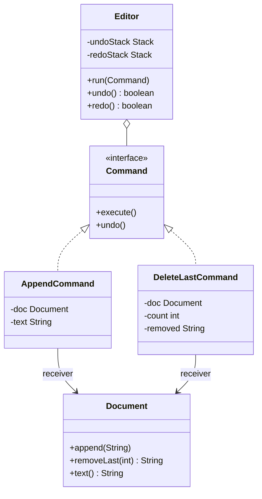

## The problem it solves

A button, a menu item and a keyboard shortcut all say "delete the last word". If each calls the document directly, three places know how to delete. Worse, once the call returns, the action is gone: nothing remembers what happened, so there is no undo.

**Command** wraps one action, with everything it needs, in an object:

- `execute()` does it.
- `undo()` reverses it.

Once an action is an object you can store it, pass it around, run it later, run it again, or throw it away. That gives you:

- **Undo and redo**: keep the objects on a stack.
- **Queues and schedulers**: run jobs later, on another thread.
- **Logs and retries**: record what ran, replay it after a crash.
- **Macros**: group several commands into one.

## Structure



- **Command**: the interface. `execute` and `undo`.
- **Receiver** (`Document`): the object that does the real work.
- **Concrete commands**: hold the receiver and the data for one action.
- **Invoker** (`Editor`): runs commands and keeps the history. It never knows what a command does.

## Undo and redo with two stacks

A **stack** is a list where you add and remove at the same end (last in, first out).

| You do | Undo stack | Redo stack |
|---|---|---|
| Run a command | push it | clear |
| Undo | pop it, call `undo()` | push it |
| Redo | push it | pop it, call `execute()` |

Running a new command clears the redo stack, because the "future" you undid no longer follows from the present. Every editor you use behaves this way.

A command must remember what it needs to reverse itself. `AppendCommand` knows the text length. `DeleteLastCommand` saves the text it removed, because that text is gone from the document otherwise.

## Code

```java
import java.util.ArrayDeque;
import java.util.Deque;

class Document {
    private final StringBuilder sb = new StringBuilder();

    void append(String s) { sb.append(s); }

    String removeLast(int n) {
        int k = Math.min(n, sb.length());
        String removed = sb.substring(sb.length() - k);
        sb.setLength(sb.length() - k);
        return removed;
    }

    String text() { return sb.toString(); }
}

interface Command {
    void execute();
    void undo();
}

class AppendCommand implements Command {
    private final Document doc;
    private final String text;

    AppendCommand(Document doc, String text) {
        this.doc = doc;
        this.text = text;
    }

    public void execute() { doc.append(text); }
    public void undo() { doc.removeLast(text.length()); }
}

class DeleteLastCommand implements Command {
    private final Document doc;
    private final int count;
    private String removed = "";

    DeleteLastCommand(Document doc, int count) {
        this.doc = doc;
        this.count = count;
    }

    public void execute() { removed = doc.removeLast(count); }
    public void undo() { doc.append(removed); }
}

// Invoker: runs commands and owns the history.
class Editor {
    private final Deque<Command> undoStack = new ArrayDeque<>();
    private final Deque<Command> redoStack = new ArrayDeque<>();

    void run(Command c) {
        c.execute();
        undoStack.push(c);
        redoStack.clear();
    }

    boolean undo() {
        if (undoStack.isEmpty()) return false;
        Command c = undoStack.pop();
        c.undo();
        redoStack.push(c);
        return true;
    }

    boolean redo() {
        if (redoStack.isEmpty()) return false;
        Command c = redoStack.pop();
        c.execute();
        undoStack.push(c);
        return true;
    }
}

public class Main {
    static void show(String label, Document d) {
        System.out.println(label + ": \"" + d.text() + "\"");
    }

    public static void main(String[] args) {
        Document doc = new Document();
        Editor ed = new Editor();

        ed.run(new AppendCommand(doc, "Hello"));
        show("append", doc);
        ed.run(new AppendCommand(doc, " world"));
        show("append", doc);
        ed.run(new DeleteLastCommand(doc, 3));
        show("delete 3", doc);

        ed.undo();
        show("undo", doc);
        ed.undo();
        show("undo", doc);
        ed.redo();
        show("redo", doc);

        ed.run(new AppendCommand(doc, "!"));
        show("append", doc);
        if (!ed.redo()) System.out.println("redo: nothing to redo");
    }
}
```
```cpp
#include <algorithm>
#include <iostream>
#include <memory>
#include <string>
#include <utility>
#include <vector>

class Document {
public:
    void append(const std::string& s) { text_ += s; }

    std::string removeLast(std::size_t n) {
        n = std::min(n, text_.size());
        std::string removed = text_.substr(text_.size() - n);
        text_.erase(text_.size() - n);
        return removed;
    }

    const std::string& text() const { return text_; }

private:
    std::string text_;
};

class Command {
public:
    virtual ~Command() = default;
    virtual void execute() = 0;
    virtual void undo() = 0;
};

class AppendCommand : public Command {
public:
    AppendCommand(Document& doc, std::string text) : doc_(doc), text_(std::move(text)) {}

    void execute() override { doc_.append(text_); }
    void undo() override { doc_.removeLast(text_.size()); }

private:
    Document& doc_;
    std::string text_;
};

class DeleteLastCommand : public Command {
public:
    DeleteLastCommand(Document& doc, std::size_t count) : doc_(doc), count_(count) {}

    void execute() override { removed_ = doc_.removeLast(count_); }
    void undo() override { doc_.append(removed_); }

private:
    Document& doc_;
    std::size_t count_;
    std::string removed_;
};

// Invoker: runs commands and owns the history.
class Editor {
public:
    void run(std::unique_ptr<Command> c) {
        c->execute();
        undoStack_.push_back(std::move(c));
        redoStack_.clear();
    }

    bool undo() {
        if (undoStack_.empty()) return false;
        auto c = std::move(undoStack_.back());
        undoStack_.pop_back();
        c->undo();
        redoStack_.push_back(std::move(c));
        return true;
    }

    bool redo() {
        if (redoStack_.empty()) return false;
        auto c = std::move(redoStack_.back());
        redoStack_.pop_back();
        c->execute();
        undoStack_.push_back(std::move(c));
        return true;
    }

private:
    std::vector<std::unique_ptr<Command>> undoStack_;
    std::vector<std::unique_ptr<Command>> redoStack_;
};

void show(const std::string& label, const Document& d) {
    std::cout << label << ": \"" << d.text() << "\"\n";
}

int main() {
    Document doc;
    Editor ed;

    ed.run(std::make_unique<AppendCommand>(doc, "Hello"));
    show("append", doc);
    ed.run(std::make_unique<AppendCommand>(doc, " world"));
    show("append", doc);
    ed.run(std::make_unique<DeleteLastCommand>(doc, 3));
    show("delete 3", doc);

    ed.undo();
    show("undo", doc);
    ed.undo();
    show("undo", doc);
    ed.redo();
    show("redo", doc);

    ed.run(std::make_unique<AppendCommand>(doc, "!"));
    show("append", doc);
    if (!ed.redo()) std::cout << "redo: nothing to redo\n";
    return 0;
}
```
```output
append: "Hello"
append: "Hello world"
delete 3: "Hello wo"
undo: "Hello world"
undo: "Hello"
redo: "Hello world"
append: "Hello world!"
redo: nothing to redo
```

Walk through it:

- The delete removed `rld`. `DeleteLastCommand` stored it, so `undo` put it back.
- The second `undo` removed " world", leaving "Hello".
- `redo` re-ran the append of " world".
- The new append of "!" cleared the redo stack, so the last `redo` has nothing to do.

```predict
lang: java
prompt: What does this print with the classes above?
code: |
  Document d = new Document();
  Editor ed = new Editor();
  ed.run(new AppendCommand(d, "ab"));
  ed.run(new AppendCommand(d, "cd"));
  ed.undo();
  ed.run(new AppendCommand(d, "X"));
  ed.redo();
  System.out.println(d.text());
output: abX
why: After the undo the text is "ab". Running Append "X" gives "abX" and clears the redo stack, so the redo does nothing.
```

```quiz
q: Why does DeleteLastCommand store the removed text in a field?
options:
  - To print it in logs
  - Undo needs the exact characters that were removed, and the document no longer has them
  - The Editor requires every command to have a String field
answer: 1
why: A command must keep whatever its undo needs. Append can undo from its own text length. Delete has to remember what it destroyed.
```

```order
prompt: Arrange the Editor's undo method.
lang: java
code: |
  boolean undo() {
      if (undoStack.isEmpty()) return false;
      Command c = undoStack.pop();
      c.undo();
      redoStack.push(c);
      return true;
  }
distractors:
  - "    redoStack.clear();"
why: Undo moves the command from one stack to the other so it can be redone. Clearing the redo stack happens only when a new command runs.
```

## Command vs snapshots

Another way to undo is to save a full copy of the document before each change (a **memento**). Compare:

| | Command (reverse each action) | Snapshot (copy whole state) |
|---|---|---|
| Memory | Small: one object per action | Large for big documents |
| Undo logic | Each command needs a correct `undo()` | None: restore the copy |
| Risk | A wrong `undo()` corrupts state slowly | Copying cost on every change |

Real editors often mix both: commands for the common path and occasional snapshots as checkpoints.

## Pitfalls

- **Wrong undo:** `undo` must reverse `execute` exactly. Test `execute` then `undo` and compare with the original.
- **Hidden dependencies:** if a command reads state that changed since it ran (such as a cursor position), undo can hit the wrong place. Store positions inside the command.
- **Non-reversible actions:** sending an email cannot be undone. Mark such commands, or make them compensating ("send a correction").
- **Unbounded history:** a long session fills memory. Cap the stack.
- **Shared receivers:** in C++ the commands hold a `Document&`. The document must outlive the history.

## When to use, when to avoid

Use Command when:

- You need undo and redo, a job queue, an audit log or macros.
- Several triggers (button, menu, shortcut, script) must run the same action.

Avoid it when:

- A plain method call is enough and nothing needs to be stored or reversed. Wrapping every call in an object only adds files.

:::truth
Command is one of the more useful patterns in practice, and also one of the easiest to write wrongly. Undo bugs hide until a rare sequence (undo, edit, redo). In an interview, say the two-stack rule out loud, and say why a new command clears the redo stack.
:::

```cards
- q: What does the Command pattern do?
  a: Turns an action into an object with execute() and undo(), so it can be stored, queued, logged, undone and redone.
- q: Roles in Command?
  a: Command (interface), concrete commands, receiver (does the work), invoker (runs commands and keeps history).
- q: How do two stacks give undo and redo?
  a: Run pushes on undo and clears redo. Undo pops from undo and pushes onto redo. Redo does the reverse.
- q: Why does a new command clear the redo stack?
  a: The undone future no longer follows from the current state, so redoing it could produce nonsense.
- q: What must a command keep for undo?
  a: Whatever it needs to reverse itself, such as the text it deleted or the old value it replaced.
```

## Notes

:::notes
- Command = an action as an object with execute() and undo().
- Roles: command interface, concrete commands, receiver (does the work), invoker (runs and records).
- Undo/redo = two stacks. Run: push to undo, clear redo. Undo: move to redo. Redo: move back.
- A command stores what its undo needs (deleted text, old value).
- Same idea powers job queues, audit logs, macros and retry.
- Snapshots (mementos) are simpler to undo but cost more memory.
- Cap the history, test execute-then-undo, and mark non-reversible actions.
:::
