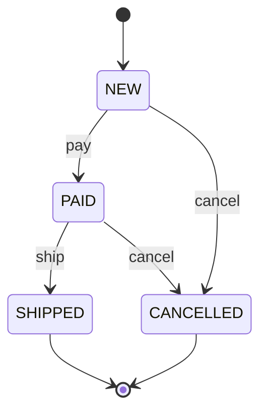
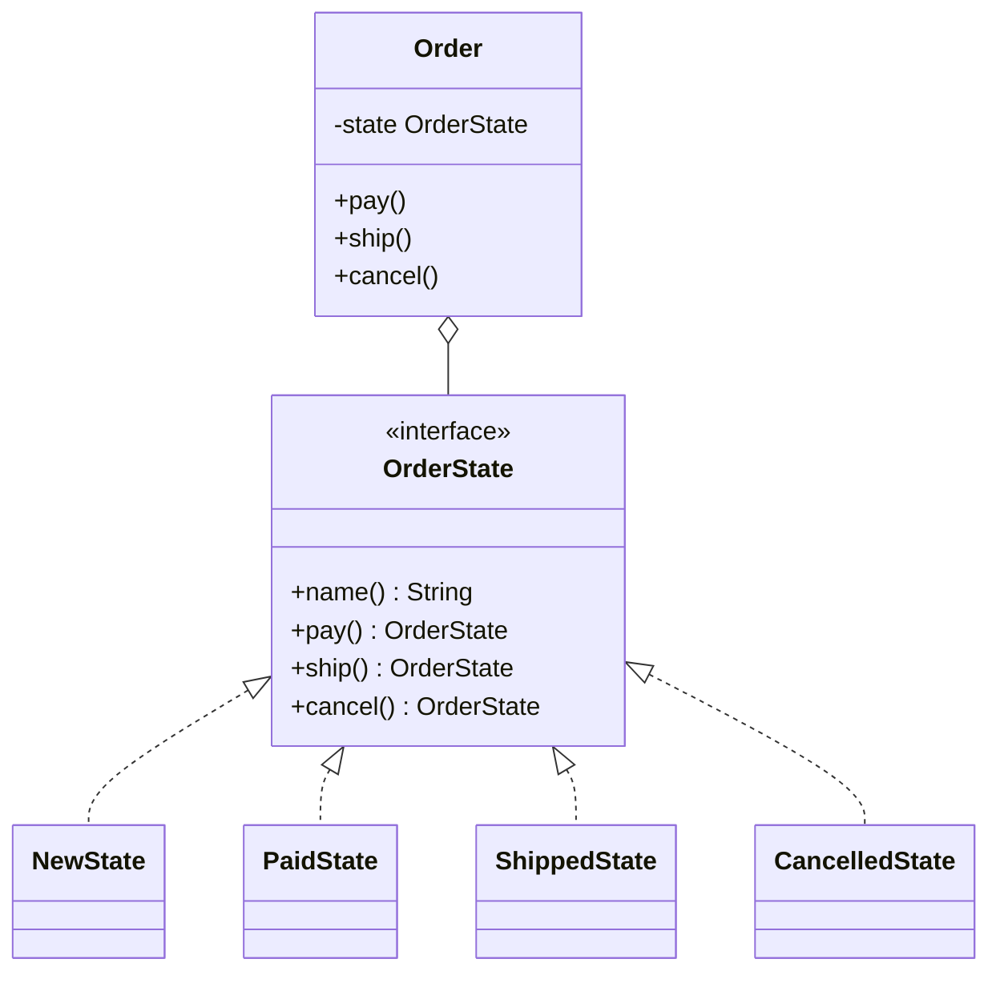

## The problem it solves

An order moves through a life: new, paid, shipped. Cancelling is allowed early and not later. The first attempt is usually flags and `if`s:

```java
void cancel() {
    if (state == NEW || state == PAID) state = CANCELLED;
    else System.out.println("cannot cancel");
}
```

That is fine for one action. Then `pay`, `ship`, `refund` and `return` each get their own chain of state checks. Add one state and you edit every method. Rules for one state are scattered across the class.

**State** gives each state its own class. The object (the **context**) holds a pointer to the current state object and forwards every action to it. Changing state means swapping the pointer. All the rules for "PAID" now sit in one class.

## Structure

The lifecycle first, then the classes.





- Each action on a state returns the **next state**, or nothing (`null` / `nullptr`) when the action is not allowed there.
- By default every action is "not allowed". A state overrides only the actions it permits. That keeps each class short.
- `Order` does no checking of its own. It asks the current state and acts on the answer.

## Code

```java
interface OrderState {
    String name();
    // Each action returns the next state, or null when it is not allowed here.
    default OrderState pay() { return null; }
    default OrderState ship() { return null; }
    default OrderState cancel() { return null; }
}

class CancelledState implements OrderState {
    public String name() { return "CANCELLED"; }
}

class ShippedState implements OrderState {
    public String name() { return "SHIPPED"; }
}

class PaidState implements OrderState {
    public String name() { return "PAID"; }
    public OrderState ship() { return new ShippedState(); }
    public OrderState cancel() { return new CancelledState(); }
}

class NewState implements OrderState {
    public String name() { return "NEW"; }
    public OrderState pay() { return new PaidState(); }
    public OrderState cancel() { return new CancelledState(); }
}

// Context: forwards every action to the current state.
class Order {
    private OrderState state = new NewState();

    void pay() { apply("pay", state.pay()); }
    void ship() { apply("ship", state.ship()); }
    void cancel() { apply("cancel", state.cancel()); }

    private void apply(String action, OrderState next) {
        if (next == null) {
            System.out.println(action + ": not allowed in " + state.name());
            return;
        }
        System.out.println(action + ": " + state.name() + " -> " + next.name());
        state = next;
    }
}

public class Main {
    public static void main(String[] args) {
        Order a = new Order();
        a.ship();
        a.pay();
        a.pay();
        a.ship();
        a.cancel();

        System.out.println("--");
        Order b = new Order();
        b.cancel();
        b.pay();
    }
}
```
```cpp
#include <iostream>
#include <memory>
#include <string>
#include <utility>

class OrderState {
public:
    virtual ~OrderState() = default;
    virtual std::string name() const = 0;
    // Each action returns the next state, or nullptr when it is not allowed here.
    virtual std::unique_ptr<OrderState> pay() const { return nullptr; }
    virtual std::unique_ptr<OrderState> ship() const { return nullptr; }
    virtual std::unique_ptr<OrderState> cancel() const { return nullptr; }
};

class CancelledState : public OrderState {
public:
    std::string name() const override { return "CANCELLED"; }
};

class ShippedState : public OrderState {
public:
    std::string name() const override { return "SHIPPED"; }
};

class PaidState : public OrderState {
public:
    std::string name() const override { return "PAID"; }
    std::unique_ptr<OrderState> ship() const override { return std::make_unique<ShippedState>(); }
    std::unique_ptr<OrderState> cancel() const override { return std::make_unique<CancelledState>(); }
};

class NewState : public OrderState {
public:
    std::string name() const override { return "NEW"; }
    std::unique_ptr<OrderState> pay() const override { return std::make_unique<PaidState>(); }
    std::unique_ptr<OrderState> cancel() const override { return std::make_unique<CancelledState>(); }
};

// Context: forwards every action to the current state.
class Order {
public:
    void pay() { apply("pay", state_->pay()); }
    void ship() { apply("ship", state_->ship()); }
    void cancel() { apply("cancel", state_->cancel()); }

private:
    void apply(const std::string& action, std::unique_ptr<OrderState> next) {
        if (!next) {
            std::cout << action << ": not allowed in " << state_->name() << "\n";
            return;
        }
        std::cout << action << ": " << state_->name() << " -> " << next->name() << "\n";
        state_ = std::move(next);
    }

    std::unique_ptr<OrderState> state_ = std::make_unique<NewState>();
};

int main() {
    Order a;
    a.ship();
    a.pay();
    a.pay();
    a.ship();
    a.cancel();

    std::cout << "--\n";
    Order b;
    b.cancel();
    b.pay();
    return 0;
}
```
```output
ship: not allowed in NEW
pay: NEW -> PAID
pay: not allowed in PAID
ship: PAID -> SHIPPED
cancel: not allowed in SHIPPED
--
cancel: NEW -> CANCELLED
pay: not allowed in CANCELLED
```

The first order follows the happy path and bumps into two illegal moves. The second shows `CANCELLED` is a dead end: no action is allowed. No `if (state == ...)` appears in `Order`.

```predict
lang: java
prompt: Using the classes above, what does this print?
code: |
  Order o = new Order();
  o.pay();
  o.cancel();
  o.ship();
output: "pay: NEW -> PAID\ncancel: PAID -> CANCELLED\nship: not allowed in CANCELLED"
why: PAID allows cancel, which leads to CANCELLED. CancelledState overrides nothing, so every action returns null and ship is refused.
```

```blanks
prompt: Complete PaidState. A paid order can ship or be cancelled.
lang: java
code: |
  class PaidState implements OrderState {
      public String name() { return "PAID"; }
      public OrderState ship() { return new [[ShippedState]](); }
      public OrderState cancel() { return new [[CancelledState]](); }
  }
why: A state returns the state that follows. Actions it does not override (pay) inherit the default and are refused.
```

## State vs Strategy

The class diagrams look alike: a context holds an interface, and implementations are swapped.

| | Strategy | State |
|---|---|---|
| Who changes it | The client, from outside | The states themselves, as actions happen |
| Do implementations know each other | No | Yes, a state names its successors |
| What varies | How one job is done | What the object does at all, depending on its stage |

## Do you need classes?

State classes pay off when each state has real behaviour. If states only differ in "which transitions are allowed", a table is shorter:

| Approach | Good for | Cost |
|---|---|---|
| `enum` + `switch` | 2 or 3 states, 1 or 2 actions | Every new action touches every branch |
| Transition table (map from state and action to next state) | Many states, data-driven rules | Behaviour per state is awkward to attach |
| State classes (this lesson) | Each state has its own logic and data | More classes |

```quiz
q: What is the main difference between State and Strategy?
options:
  - State uses interfaces and Strategy does not
  - In State the object moves itself between implementations as it runs; in Strategy the client chooses
  - Strategy objects cannot be replaced at run time
answer: 1
why: The shapes match. The intent differs. States know their successors and trigger the switch themselves; a strategy is chosen by whoever configures the context.
```

```quiz
q: Why does the interface give every action a default that returns null?
options:
  - So null checks can be avoided in Order
  - So each state overrides only what it allows, and everything else is refused automatically
  - Java requires default methods in interfaces
answer: 1
why: Refusing by default makes the legal moves explicit and short. Adding a new state means listing only its few permitted actions.
```

## Pitfalls

- **Class explosion:** ten states with six actions each is a lot of small classes. Consider a table.
- **Hidden transitions:** the lifecycle is spread over several classes. Keep the state diagram in the docs and in the code comments.
- **Shared data:** state objects that hold per-order data cannot be shared between orders. Keep data in the context, and keep states stateless so one instance can be reused.
- **Null as "not allowed":** it is compact but easy to misuse. A real project may prefer `Optional`, an exception, or an explicit result type.
- **Not thread-safe:** two threads changing the state at once can both pass the check. Lock around transitions (see the concurrency lessons).

## When to use, when to avoid

Use State when:

- Behaviour depends on a lifecycle: orders, tickets, vending machines, media players, connections.
- You see `if (state == ...)` repeated in many methods.

Avoid it when:

- There are two states and one action. A boolean and an `if` is clearer.
- The states carry no distinct behaviour. Use an enum with a transition table.

:::truth
State is the pattern behind most "design a vending machine / ATM / elevator" questions. Interviewers care less about the class names than about whether you can draw the state diagram first and list the illegal transitions. Drawing the diagram takes two minutes and prevents most bugs.
:::

```cards
- q: What does the State pattern do?
  a: Moves each state's behaviour into its own class; the context forwards actions to the current state object and swaps it on transitions.
- q: State vs Strategy?
  a: Same shape. State is switched by the object as it moves through a lifecycle; Strategy is chosen by the client.
- q: How can the interface keep each state class small?
  a: Give every action a default that refuses it, so a state overrides only the actions it permits.
- q: When is an enum plus a transition table better than state classes?
  a: When states differ only in which transitions are allowed and carry little behaviour of their own.
- q: What should you draw first when designing with State?
  a: "The state diagram: states, actions and the legal transitions between them."
```

## Notes

:::notes
- State = one class per state; the context forwards actions to the current state object.
- Each action returns the next state, or "not allowed". Defaults refuse, states override what they permit.
- Changing state = replacing the pointer. No if-chains on a state flag in the context.
- State: object switches itself. Strategy: client chooses the algorithm.
- Few states and little behaviour: use an enum and a transition table instead.
- Draw the state diagram first; list the illegal transitions.
- Keep states stateless where possible; lock transitions if threads share the object.
:::
