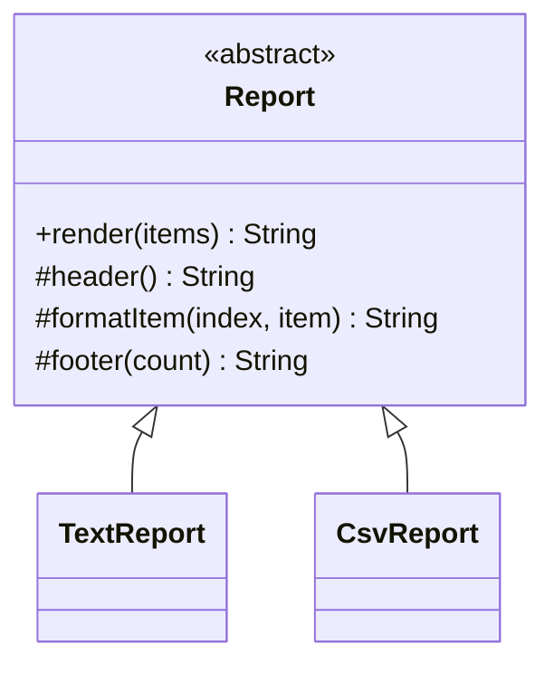

## The problem it solves

Two reports do the same job in the same order: print a header, then each item, then a footer. Only the formatting differs. If you copy the loop into both classes, every fix to the loop must be made twice. Sooner or later the copies drift apart.

**Template Method** puts the fixed order in the base class, in one method. The steps that vary are left as methods that subclasses fill in.

- The **template method** (`render`) is the skeleton. It is written once.
- **Abstract steps** must be implemented by every subclass.
- **Hooks** are optional steps with a default (often "do nothing"). A subclass overrides them only if it cares.

It is sometimes called the **Hollywood principle**: "don't call us, we'll call you". The subclass does not call the framework. The base class calls the subclass at the right moment.

## Structure



- `render` is fixed: header, then each item, then footer.
- `header` and `formatItem` are abstract. Subclasses must supply them.
- `footer` is a hook with an empty default.

## Code

In Java, `final` stops a subclass from replacing `render`. In C++ the template method is a normal non-virtual function, and the steps are `private virtual`. Subclasses may still override private virtuals; they just cannot call them. This style is called the Non-Virtual Interface (NVI).

```java
import java.util.List;

abstract class Report {
    // Template method: the order is fixed, and final keeps it that way.
    public final String render(List<String> items) {
        StringBuilder sb = new StringBuilder(header());
        for (int i = 0; i < items.size(); i++) {
            sb.append(formatItem(i, items.get(i)));
        }
        sb.append(footer(items.size()));
        return sb.toString();
    }

    protected abstract String header();

    protected abstract String formatItem(int index, String item);

    // Hook: optional, does nothing by default.
    protected String footer(int count) { return ""; }
}

class TextReport extends Report {
    protected String header() { return "== Items ==\n"; }

    protected String formatItem(int index, String item) {
        return (index + 1) + ". " + item + "\n";
    }

    @Override
    protected String footer(int count) { return "total: " + count + "\n"; }
}

class CsvReport extends Report {
    protected String header() { return "index,item\n"; }

    protected String formatItem(int index, String item) {
        return index + "," + item + "\n";
    }
}

public class Main {
    public static void main(String[] args) {
        List<String> items = List.of("apple", "pear");
        System.out.print(new TextReport().render(items));
        System.out.println("--");
        System.out.print(new CsvReport().render(items));
    }
}
```
```cpp
#include <iostream>
#include <string>
#include <vector>

class Report {
public:
    virtual ~Report() = default;

    // Template method: the order is fixed because it is not virtual.
    std::string render(const std::vector<std::string>& items) const {
        std::string out = header();
        for (std::size_t i = 0; i < items.size(); ++i) {
            out += formatItem(i, items[i]);
        }
        out += footer(items.size());
        return out;
    }

private:
    virtual std::string header() const = 0;
    virtual std::string formatItem(std::size_t index, const std::string& item) const = 0;
    // Hook: optional, does nothing by default.
    virtual std::string footer(std::size_t) const { return ""; }
};

class TextReport : public Report {
private:
    std::string header() const override { return "== Items ==\n"; }

    std::string formatItem(std::size_t index, const std::string& item) const override {
        return std::to_string(index + 1) + ". " + item + "\n";
    }

    std::string footer(std::size_t count) const override {
        return "total: " + std::to_string(count) + "\n";
    }
};

class CsvReport : public Report {
private:
    std::string header() const override { return "index,item\n"; }

    std::string formatItem(std::size_t index, const std::string& item) const override {
        return std::to_string(index) + "," + item + "\n";
    }
};

int main() {
    std::vector<std::string> items{"apple", "pear"};
    std::cout << TextReport().render(items);
    std::cout << "--\n";
    std::cout << CsvReport().render(items);
    return 0;
}
```
```output
== Items ==
1. apple
2. pear
total: 2
--
index,item
0,apple
1,pear
```

Both reports share the loop. `CsvReport` ignored the footer hook and got the empty default. `TextReport` overrode it.

```predict
lang: java
prompt: What does this print, using the Report class above?
code: |
  class Shout extends Report {
      protected String header() { return "H\n"; }
      protected String formatItem(int i, String s) { return s.toUpperCase() + "\n"; }
  }
  System.out.print(new Shout().render(List.of("a", "b")));
output: "H\nA\nB"
why: render() calls header, then formatItem for each item, then footer. Shout did not override the footer hook, so the default adds nothing.
```

```quiz
q: Why is render() declared final in Java and non-virtual in C++?
options:
  - It makes the method faster
  - A subclass must not be able to change the order of the steps, only fill in the steps
  - Abstract classes cannot have overridable methods
answer: 1
why: The base class owns the skeleton. If a subclass could replace render(), the pattern's guarantee (every report follows the same order) would be gone.
```

## Template Method vs Strategy

Both let you vary part of an algorithm. They vary it differently:

| | Template Method | Strategy |
|---|---|---|
| Mechanism | Inheritance: subclass overrides steps | Composition: pass in an object |
| Chosen | At compile time (which subclass you create) | At run time (which object you pass) |
| Granularity | Several steps in one family | One algorithm per interface |
| Main risk | Fragile base class (changing the base can break subclasses) | More objects to wire up |

Prefer Strategy when you need to swap behaviour at run time, or when you are tempted to build deep inheritance trees. Template Method is simpler when the skeleton is stable and the variants are few.

```order
prompt: Arrange the template method body in the order the report is built.
lang: java
code: |
  StringBuilder sb = new StringBuilder(header());
  for (int i = 0; i < items.size(); i++) {
      sb.append(formatItem(i, items.get(i)));
  }
  sb.append(footer(items.size()));
  return sb.toString();
distractors:
  - "sb.append(header());"
why: Header first, then items, then footer. The extra header call would write the header twice.
```

## Pitfalls

- **Calling overridable steps from a constructor:** in Java the subclass fields are not set yet. In C++ the call runs the base version, not the override. Avoid it in both.
- **Too many hooks:** each hook is a promise to subclass authors. Ten hooks make the base class hard to change.
- **Fragile base class:** changing the order inside `render` can break subclasses that assumed the old order.
- **Hidden order:** a reader of a subclass must open the base class to see when each method runs. Name the steps clearly and document the order.
- **Deep hierarchies:** three levels of overrides are a sign to switch to composition.

## When to use, when to avoid

Use Template Method when:

- Several classes share the same algorithm skeleton and differ in a few steps.
- You are writing a small framework: test runners (`setUp`, `test`, `tearDown`), servlet-style handlers, import jobs.

Avoid it when:

- The variation needs to change at run time.
- The steps are not fixed in order. Then a Strategy or a pipeline of separate objects is a better fit.

:::truth
Template Method is the quiet workhorse of frameworks, and it is easy to overuse in application code because inheritance feels convenient. If you find yourself writing a base class "to share code", ask whether a helper function or an injected object would do. In interviews, show you can name the trade-off against Strategy.
:::

```cards
- q: What is Template Method?
  a: A base-class method that fixes the order of an algorithm's steps while subclasses implement or override individual steps.
- q: Abstract step vs hook?
  a: An abstract step must be implemented by every subclass. A hook has a default (often empty) and is overridden only when needed.
- q: Why make the template method final or non-virtual?
  a: So subclasses can customise the steps but cannot change their order.
- q: Template Method vs Strategy?
  a: Template Method varies steps by inheritance, fixed when the object is created. Strategy varies an algorithm by composition and can change at run time.
- q: What is the danger of calling an overridable method in a constructor?
  a: In Java the subclass is not fully initialised yet. In C++ the call runs the base version. Either way the result surprises.
```

## Notes

:::notes
- Template Method = base class fixes the algorithm's order; subclasses fill in steps.
- Parts: template method (skeleton), abstract steps (required), hooks (optional with defaults).
- Hollywood principle: the base class calls the subclass, not the other way round.
- Java: mark the template method final. C++: keep it non-virtual and make steps private virtual (NVI).
- Uses inheritance, so the choice is made at creation. Strategy uses composition and can change at run time.
- Never call overridable steps from constructors.
- Keep hooks few; the fragile base class problem grows with them.
:::
