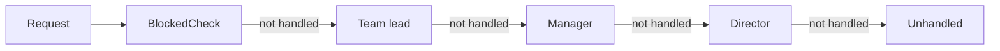
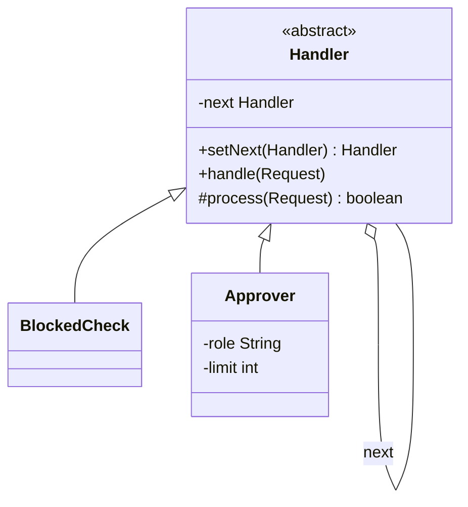

## The problem it solves

An expense claim arrives. A team lead can approve up to 1,000. A manager up to 10,000. A director up to 100,000. Some users are blocked and must be rejected first. A single method grows into this:

```java
if (blocked.contains(user)) { ... }
else if (amount <= 1000) { ... }
else if (amount <= 10000) { ... }
else if (amount <= 100000) { ... }
```

Every new rule edits the same method, and the order of the rules is buried in the order of the lines.

**Chain of Responsibility** turns each rule into a **handler** object with a link to the next one. A request enters at the head. Each handler either deals with it (and the chain stops) or passes it on.

- The sender knows only the head of the chain.
- Handlers do not know the full list, only their `next`.
- The chain can be rearranged without editing any handler.

You already use this: web **middleware** (code that runs on each HTTP request before your handler: authentication, logging, rate limits), servlet filters, and log levels all work this way.

## Structure





- `handle` is the same for all handlers: try `process`, and if it returns `false`, forward to `next`.
- `process` is the only part a subclass writes. It returns `true` when the request is dealt with.

## Code

`Approver` is one class used three times with different limits, so adding a level is data, not a new class. `BlockedCheck` shows a handler with a different job in the same chain.

```java
import java.util.Set;

record Request(String user, int amount) {}

abstract class Handler {
    private Handler next;

    // Returns the handler just linked, so calls can be chained left to right.
    Handler setNext(Handler next) {
        this.next = next;
        return next;
    }

    final void handle(Request r) {
        if (process(r)) return;
        if (next != null) {
            next.handle(r);
        } else {
            System.out.println("nobody can approve " + r.amount() + " for " + r.user());
        }
    }

    // Return true when this handler dealt with the request and the chain should stop.
    protected abstract boolean process(Request r);
}

class BlockedCheck extends Handler {
    private final Set<String> blocked;

    BlockedCheck(Set<String> blocked) { this.blocked = blocked; }

    protected boolean process(Request r) {
        if (!blocked.contains(r.user())) return false;
        System.out.println("rejected: " + r.user() + " is blocked");
        return true;
    }
}

class Approver extends Handler {
    private final String role;
    private final int limit;

    Approver(String role, int limit) {
        this.role = role;
        this.limit = limit;
    }

    protected boolean process(Request r) {
        if (r.amount() > limit) return false;
        System.out.println(role + " approves " + r.amount() + " for " + r.user());
        return true;
    }
}

public class Main {
    public static void main(String[] args) {
        Handler chain = new BlockedCheck(Set.of("mallory"));
        chain.setNext(new Approver("team lead", 1000))
             .setNext(new Approver("manager", 10000))
             .setNext(new Approver("director", 100000));

        chain.handle(new Request("asha", 500));
        chain.handle(new Request("ravi", 7000));
        chain.handle(new Request("asha", 50000));
        chain.handle(new Request("mallory", 100));
        chain.handle(new Request("ravi", 500000));
    }
}
```
```cpp
#include <iostream>
#include <memory>
#include <set>
#include <string>
#include <utility>

struct Request {
    std::string user;
    int amount;
};

class Handler {
public:
    virtual ~Handler() = default;

    // This handler owns the next one. It returns a plain pointer to the handler
    // just linked, so calls can be chained left to right.
    Handler* setNext(std::unique_ptr<Handler> next) {
        next_ = std::move(next);
        return next_.get();
    }

    void handle(const Request& r) const {
        if (process(r)) return;
        if (next_) {
            next_->handle(r);
        } else {
            std::cout << "nobody can approve " << r.amount << " for " << r.user << "\n";
        }
    }

private:
    // Return true when this handler dealt with the request and the chain should stop.
    virtual bool process(const Request& r) const = 0;

    std::unique_ptr<Handler> next_;
};

class BlockedCheck : public Handler {
public:
    explicit BlockedCheck(std::set<std::string> blocked) : blocked_(std::move(blocked)) {}

private:
    bool process(const Request& r) const override {
        if (blocked_.count(r.user) == 0) return false;
        std::cout << "rejected: " << r.user << " is blocked\n";
        return true;
    }

    std::set<std::string> blocked_;
};

class Approver : public Handler {
public:
    Approver(std::string role, int limit) : role_(std::move(role)), limit_(limit) {}

private:
    bool process(const Request& r) const override {
        if (r.amount > limit_) return false;
        std::cout << role_ << " approves " << r.amount << " for " << r.user << "\n";
        return true;
    }

    std::string role_;
    int limit_;
};

int main() {
    auto chain = std::make_unique<BlockedCheck>(std::set<std::string>{"mallory"});
    chain->setNext(std::make_unique<Approver>("team lead", 1000))
        ->setNext(std::make_unique<Approver>("manager", 10000))
        ->setNext(std::make_unique<Approver>("director", 100000));

    chain->handle({"asha", 500});
    chain->handle({"ravi", 7000});
    chain->handle({"asha", 50000});
    chain->handle({"mallory", 100});
    chain->handle({"ravi", 500000});
    return 0;
}
```
```output
team lead approves 500 for asha
manager approves 7000 for ravi
director approves 50000 for asha
rejected: mallory is blocked
nobody can approve 500000 for ravi
```

Trace the 7,000 request: `BlockedCheck` passes it on, the team lead's limit is too low and passes it on, and the manager handles it. The director never sees it.

```predict
lang: java
prompt: With the chain above, what does this print?
code: |
  chain.handle(new Request("mallory", 500000));
output: "rejected: mallory is blocked"
why: BlockedCheck is first and returns true for mallory, so the chain stops. The amount is never compared with any limit.
```

```quiz
q: What happens if BlockedCheck is moved to the end of the chain?
options:
  - Nothing, the order of handlers does not matter
  - A blocked user with a small amount is approved by the team lead before the check ever runs
  - The program fails to compile
answer: 1
why: Handlers run in chain order. A rule that must come first has to be first. This is the main design decision in a chain.
```

## Two flavours

| Flavour | Each handler | Example |
|---|---|---|
| Stop at first match | Handles the request or passes it on; the chain ends once someone handles it | Approvals, support escalation, exception handlers |
| Pipeline (all see it) | Does its own work, then always passes on | Middleware: logging, then auth, then rate limit, then the real handler |

In the pipeline flavour, `process` would do its work and return `false` so the request continues. The structure is the same.

```order
prompt: Arrange the handle method so a handler tries first and forwards only when it did not stop the request.
lang: java
code: |
  final void handle(Request r) {
      if (process(r)) return;
      if (next != null) {
          next.handle(r);
      }
  }
distractors:
  - "    next.handle(r);"
why: Try this handler, stop if it handled the request, otherwise forward if a next handler exists. Calling next unconditionally would let every handler run, and would crash at the end of the chain.
```

## Pitfalls

- **Unhandled requests:** the end of the chain must decide what happens. Here it prints a message. It could throw or return a default.
- **Order bugs:** a wrong order is silent. Test the chain as a whole, not only each handler.
- **Long chains:** every request walks the list. For hundreds of handlers, use a map lookup.
- **Hard to debug:** the flow is spread over objects. Log which handler handled the request.
- **Cycles:** linking a handler back to an earlier one loops forever.
- **Ownership in C++:** each handler owns its `next` through `unique_ptr`, so the whole chain is freed from the head. The plain pointer returned by `setNext` is only for wiring.

## When to use, when to avoid

Use it when:

- More than one object may handle a request, and which one is decided at run time.
- Rules should be added, removed or reordered without touching the sender.
- You are building a filter or middleware stack.

Avoid it when:

- One rule always handles the request. A direct call is simpler.
- You need to be certain that someone handles it. A chain gives no such guarantee unless the end of the chain does.

:::truth
Chain of Responsibility looks neat on a slide and is mostly met in practice as middleware. In an LLD interview it fits approval flows, ATM cash dispensers (the 2000, 500, 100 note handlers), logging levels and validation. The follow-up question is usually "what happens when nobody handles it?" so decide that before you are asked.
:::

```cards
- q: What is Chain of Responsibility?
  a: A request goes to the first of a linked list of handlers. Each handler deals with it or passes it on to the next.
- q: What does the sender need to know?
  a: Only the head of the chain. It does not know which handler will deal with the request.
- q: Name two flavours of the pattern.
  a: Stop-at-first-match (approvals) and pipeline (middleware where every handler acts and passes the request on).
- q: What must you decide at the end of the chain?
  a: "What happens to a request nobody handled: report it, throw, or fall back to a default."
- q: Where have you seen this pattern in real systems?
  a: Web middleware and servlet filters, logging levels, exception handler lookup, ATM note dispensers.
```

## Notes

:::notes
- Chain of Responsibility = linked handlers; a request moves along until one handles it.
- The sender knows only the head. Handlers know only their next.
- One shared handle(): try process(); if false, forward. Subclasses write only process().
- Order is part of the design: put guards like blocked-user checks first.
- Flavours: stop at first match (approvals) or pipeline (middleware).
- Decide what the end of the chain does with an unhandled request.
- Configure levels as data (one Approver class, several limits) rather than one class per level.
- Avoid it for single-rule cases; log which handler acted to keep debugging easy.
:::
