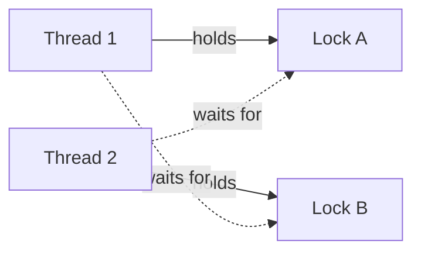

## Threads in one minute

A **process** is a running program with its own memory. A **thread** is one path of execution inside it. All threads of a process share the same memory.

Why use them:

- Use several CPU cores at once.
- Keep working while another thread waits for the network or disk.

Sharing memory is the problem. As soon as two threads touch the same variable and at least one writes, you need a rule for who goes first.

| | Java | C++17 |
|---|---|---|
| Start | `new Thread(task).start()` | `std::thread t(task);` |
| Wait for it | `t.join()` | `t.join()` (required before `t` is destroyed) |
| Compile | plain `javac` | `g++ -std=c++17 -pthread` |

## The race condition

`count++` looks like one step. It is three:

1. **Read** the current value.
2. **Add** one.
3. **Write** the result back.

A **race condition** is a bug where the result depends on how two threads interleave (timing). Step through one unlucky interleaving:

```steps
title: Two threads run counter++ on the same counter
view: array
frames:
  - arr: [0, 0, 0]
    pointers: {counter: 0, A: 1, B: 2}
    note: The counter is 0. Cells A and B are the private temporary values of threads A and B.
  - arr: [0, 0, 0]
    pointers: {counter: 0, A: 1, B: 2}
    highlight: {1: active}
    note: Thread A reads the counter (0).
  - arr: [0, 0, 0]
    pointers: {counter: 0, A: 1, B: 2}
    highlight: {2: active}
    note: Thread B also reads the counter before A has written. It sees 0 as well.
  - arr: [1, 1, 0]
    pointers: {counter: 0, A: 1, B: 2}
    highlight: {0: active, 1: active}
    note: A adds one and writes 1 back.
  - arr: [1, 1, 1]
    pointers: {counter: 0, A: 1, B: 2}
    highlight: {0: bad, 2: active}
    note: B adds one to its stale 0 and writes 1. Two increments ran, the counter says 1. One update is lost.
```

The unsafe code is short:

```java
class BrokenCounter {
    private int value;
    void increment() { value++; }   // read, add, write: three separate steps
}
```

:::warn
Do not try to "demonstrate" a race by running it and printing the result. The answer changes from run to run, and often looks correct. A race you cannot see today is still a bug.
:::

## Fix 1: a mutex

A **mutex** (mutual exclusion lock) lets one thread at a time into a block of code, called the **critical section**. Others wait outside.

- Java: `synchronized` on a method or block. Each object has one built-in lock.
- C++: `std::mutex`, locked with `std::lock_guard`. The guard unlocks when it goes out of scope, even on an exception (RAII: release resources in destructors).

## Fix 2: an atomic

An **atomic** operation happens as one indivisible step. For a single variable, `AtomicInteger` (Java) and `std::atomic<int>` (C++) use a special CPU instruction, so there is no lock to wait for.

```java
import java.util.concurrent.atomic.AtomicInteger;

class LockedCounter {
    private int value = 0;

    synchronized void increment() { value++; }

    synchronized int get() { return value; }
}

public class Main {
    public static void main(String[] args) throws InterruptedException {
        LockedCounter locked = new LockedCounter();
        AtomicInteger hits = new AtomicInteger();

        Runnable work = () -> {
            for (int i = 0; i < 100_000; i++) {
                locked.increment();
                hits.incrementAndGet();
            }
        };

        Thread a = new Thread(work);
        Thread b = new Thread(work);
        a.start();
        b.start();
        a.join();
        b.join();

        System.out.println("locked: " + locked.get());
        System.out.println("atomic: " + hits.get());
    }
}
```
```cpp
#include <atomic>
#include <iostream>
#include <mutex>
#include <thread>

class LockedCounter {
public:
    void increment() {
        std::lock_guard<std::mutex> guard(m_);
        ++value_;
    }

    int get() const {
        std::lock_guard<std::mutex> guard(m_);
        return value_;
    }

private:
    mutable std::mutex m_;
    int value_ = 0;
};

int main() {
    LockedCounter locked;
    std::atomic<int> hits{0};

    auto work = [&] {
        for (int i = 0; i < 100000; ++i) {
            locked.increment();
            ++hits;
        }
    };

    std::thread a(work);
    std::thread b(work);
    a.join();
    b.join();

    std::cout << "locked: " << locked.get() << "\n";
    std::cout << "atomic: " << hits.load() << "\n";
    return 0;
}
```
```output
locked: 200000
atomic: 200000
```

Both are exactly 200,000 on every run. Two threads times 100,000 increments, none lost.

```quiz
q: Why can value++ lose updates when two threads run it?
options:
  - The CPU is too slow to add numbers
  - It is a read, an add and a write, and another thread can read the old value between those steps
  - Java and C++ do not allow threads to share an int
answer: 1
why: Nothing makes the three steps indivisible. If both threads read before either writes, both write the same new value and one increment disappears.
```

```predict
lang: java
prompt: What does this print?
code: |
  Thread t = new Thread(() -> System.out.println("worker"));
  t.start();
  t.join();
  System.out.println("main");
output: "worker\nmain"
why: join() makes main wait until the worker thread has finished, so "worker" is always printed first. Without the join the order would not be guaranteed.
```

## Which tool when

| Tool | Protects | Cost | Limit |
|---|---|---|---|
| Mutex / `synchronized` | Any block, several variables together | Threads may block and wait | Easy to forget, easy to hold too long |
| Atomic | One variable, one operation (increment, compare-and-set) | No blocking | Cannot make a multi-step change atomic |
| `volatile` (Java) | Visibility of one variable | Small | Does **not** make `count++` safe |

**Visibility** is a second problem: without synchronisation, one thread may not see another thread's write at all (caches, compiler reordering). Locks and atomics also fix visibility.

```blanks
prompt: Complete the C++ increment so the lock is released automatically at the end of the function.
lang: cpp
code: |
  void increment() {
      std::[[lock_guard|scoped_lock]]<std::mutex> guard(m_);
      ++value_;
  }
why: A guard object locks in its constructor and unlocks in its destructor, so every exit path releases the mutex. Calling lock() and unlock() by hand leaks the lock if an exception happens in between.
```

## Deadlock

A **deadlock** is when threads wait for each other forever. The classic case needs two locks:



Transfer 3 from account A to B in one thread, and 2 from B to A in another. If thread 1 locks A then B, and thread 2 locks B then A, they can each grab one lock and wait forever.

Deadlock needs all four of these at once, so removing any one fixes it:

| Condition | Meaning | How to break it |
|---|---|---|
| Mutual exclusion | A lock has one owner | Rarely possible |
| Hold and wait | Hold one lock while asking for another | Take all locks at once |
| No preemption | Locks cannot be taken away | Try-lock with timeout, then back off |
| Circular wait | A waits for B waits for A | Always lock in the same global order |

The practical rule is the last one: **lock in a fixed order**. Java below orders by account id. C++17 offers `std::scoped_lock(m1, m2)`, which locks several mutexes with a deadlock-avoiding algorithm.

```java
class Account {
    final int id;
    int balance;

    Account(int id, int balance) {
        this.id = id;
        this.balance = balance;
    }
}

public class Main {
    // Always lock the lower id first, so opposite transfers cannot wait on each other.
    static void transfer(Account from, Account to, int amount) {
        Account first = from.id < to.id ? from : to;
        Account second = first == from ? to : from;
        synchronized (first) {
            synchronized (second) {
                from.balance -= amount;
                to.balance += amount;
            }
        }
    }

    public static void main(String[] args) throws InterruptedException {
        Account a = new Account(1, 100_000);
        Account b = new Account(2, 100_000);

        Thread t1 = new Thread(() -> {
            for (int i = 0; i < 10_000; i++) transfer(a, b, 3);
        });
        Thread t2 = new Thread(() -> {
            for (int i = 0; i < 10_000; i++) transfer(b, a, 2);
        });
        t1.start();
        t2.start();
        t1.join();
        t2.join();

        System.out.println("A=" + a.balance + " B=" + b.balance);
        System.out.println("total=" + (a.balance + b.balance));
    }
}
```
```cpp
#include <iostream>
#include <mutex>
#include <thread>

struct Account {
    explicit Account(int b) : balance(b) {}
    int balance;
    std::mutex m;
};

void transfer(Account& from, Account& to, int amount) {
    // Locks both mutexes without the risk of deadlock, whatever the argument order.
    std::scoped_lock lock(from.m, to.m);
    from.balance -= amount;
    to.balance += amount;
}

int main() {
    Account a(100000);
    Account b(100000);

    std::thread t1([&] { for (int i = 0; i < 10000; ++i) transfer(a, b, 3); });
    std::thread t2([&] { for (int i = 0; i < 10000; ++i) transfer(b, a, 2); });
    t1.join();
    t2.join();

    std::cout << "A=" << a.balance << " B=" << b.balance << "\n";
    std::cout << "total=" << a.balance + b.balance << "\n";
    return 0;
}
```
```output
A=90000 B=110000
total=200000
```

Thread 1 moves 30,000 out of A and thread 2 moves 20,000 back, so A ends at 90,000. The total never changes, which is the invariant (a fact that must always hold) a transfer must keep.

```quiz
q: Which changes remove the deadlock risk in two opposite transfers?
options:
  - Both threads lock the two accounts in the same global order, such as by id
  - Each thread sleeps a random time before locking
  - Both locks are taken together in one call such as std::scoped_lock
answer: [0, 2]
why: A fixed order removes circular wait, and locking both together removes hold-and-wait. Sleeping only makes the unlucky timing less likely. The bug is still there.
```

## Pitfalls

- **Locking too little:** every access to shared state, reads included, must use the same lock.
- **Locking too much:** a lock around slow work (network, disk) stalls all other threads.
- **Two atomics are not one atomic:** updating two atomic variables in sequence can still be seen half-done. Use a lock.
- **Check then act:** `if (balance >= x) balance -= x;` is a race even if each step is atomic. Hold the lock across both.
- **Forgotten `join`:** destroying a joinable `std::thread` calls `std::terminate`.

:::truth
Concurrency bugs are rare, timing-dependent and hard to reproduce, so testing alone does not prove safety. Safe code comes from small rules: guard shared state with one lock, keep critical sections short, lock in a fixed order. In interviews, say what each lock protects out loud.
:::

```cards
- q: What is a race condition?
  a: A bug where the result depends on how threads interleave, such as two threads running count++ and losing an update.
- q: Why is count++ not atomic?
  a: It is three steps (read, add, write), and another thread can run between them.
- q: Mutex vs atomic?
  a: A mutex guards any block of code and may block threads. An atomic makes one operation on one variable indivisible, without blocking.
- q: What are the conditions for deadlock?
  a: Mutual exclusion, hold and wait, no preemption, and circular wait. Break any one of them to prevent it.
- q: What is the standard way to avoid lock-ordering deadlock?
  a: Always acquire multiple locks in the same global order, or take them together with std::scoped_lock.
```

## Notes

:::notes
- Threads share memory; shared writable data needs a rule for who goes first.
- count++ is read, add, write. Interleaved threads lose updates (race condition).
- Mutex: one thread in the critical section. Java synchronized; C++ std::mutex with lock_guard (RAII).
- Atomic: one indivisible operation on one variable, no blocking. It cannot cover two variables.
- volatile gives visibility only; it does not make count++ safe.
- Deadlock = circular waiting. Fix with a global lock order, or lock together with std::scoped_lock.
- Check-then-act must hold the lock across the check and the act.
- Join your threads; test with deterministic totals, never with printed race results.
:::
