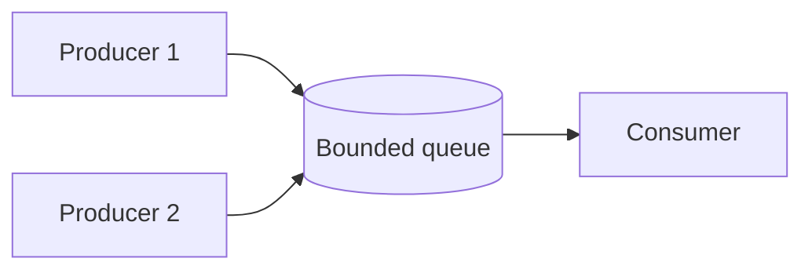

## Safe by design, not by patching

The previous lesson fixed single bugs with locks. Better is to design so that most code needs no lock at all. In order of preference:

| Strategy | Idea | Locks needed |
|---|---|---|
| Confine | Each thread owns its data (local variables, one object per thread) | None |
| Immutable | Shared data that never changes after creation | None |
| Guarded | Shared mutable data behind a lock or a thread-safe class | Yes, kept small |

A class is **thread-safe** when it behaves correctly no matter how threads call it, without extra locking by the caller. Look for the first two options before reaching for the third.

## Immutability

An **immutable** object cannot change after construction. Threads can share it freely, because nobody can write to it. There is nothing to race on.

- Java: `final` class, `final` fields, no setters. "Changing" it means returning a new object.
- C++: `const` members or no mutating methods, and the object is passed by `const&`.

```java
final class Money {
    private final long paise;

    Money(long paise) { this.paise = paise; }

    Money plus(Money other) { return new Money(paise + other.paise); }

    long paise() { return paise; }
}
```
```cpp
class Money {
public:
    explicit Money(long long paise) : paise_(paise) {}

    Money plus(const Money& other) const { return Money(paise_ + other.paise_); }

    long long paise() const { return paise_; }

private:
    const long long paise_;
};
```

```predict
lang: java
prompt: What does this print?
code: |
  Money a = new Money(100);
  Money b = a.plus(new Money(50));
  System.out.println(a.paise() + " " + b.paise());
output: 100 150
why: "plus() builds a new Money and leaves a alone. That is what makes sharing an immutable object safe: the value another thread holds never changes under it."
```

:::warn
Immutable means the whole object is unchangeable. A `final` field that points to a mutable list is not immutable. Copy the list, or expose it read-only.
:::

## Producer-consumer

Often threads must hand work to each other: a web server accepts requests (producers) and workers process them (consumers). The standard tool is a **bounded blocking queue**:

- `put` waits if the queue is **full**.
- `take` waits if the queue is **empty**.
- The bound stops fast producers from filling memory (this is called back-pressure).



"Waiting" is done with a **condition variable**: a thread sleeps until another thread signals that something it needs may have changed. Java gives every object `wait()` and `notifyAll()` inside `synchronized`. C++ has `std::condition_variable` together with a mutex.

The program below has 2 producers each sending 1 to 50, and a consumer adding everything up. The consumer stops on a **poison pill**: a special value (-1) that means "no more work". Only totals are printed, because the order the two producers interleave is not deterministic.

```java
import java.util.ArrayDeque;
import java.util.Queue;

class BoundedQueue {
    private final Queue<Integer> items = new ArrayDeque<>();
    private final int capacity;

    BoundedQueue(int capacity) { this.capacity = capacity; }

    synchronized void put(int x) throws InterruptedException {
        while (items.size() == capacity) wait();   // full: sleep until space appears
        items.add(x);
        notifyAll();                               // wake threads waiting for an item
    }

    synchronized int take() throws InterruptedException {
        while (items.isEmpty()) wait();            // empty: sleep until an item appears
        int x = items.remove();
        notifyAll();                               // wake threads waiting for space
        return x;
    }
}

public class Main {
    public static void main(String[] args) throws InterruptedException {
        BoundedQueue q = new BoundedQueue(3);
        int[] result = new int[2];                 // count and sum, written only by the consumer

        Thread consumer = new Thread(() -> {
            try {
                while (true) {
                    int x = q.take();
                    if (x < 0) break;              // poison pill
                    result[0]++;
                    result[1] += x;
                }
            } catch (InterruptedException e) {
                Thread.currentThread().interrupt();
            }
        });

        Runnable producer = () -> {
            try {
                for (int i = 1; i <= 50; i++) q.put(i);
            } catch (InterruptedException e) {
                Thread.currentThread().interrupt();
            }
        };

        Thread p1 = new Thread(producer);
        Thread p2 = new Thread(producer);
        consumer.start();
        p1.start();
        p2.start();
        p1.join();
        p2.join();
        q.put(-1);                                 // both producers are done: tell the consumer to stop
        consumer.join();

        System.out.println("consumed=" + result[0] + " sum=" + result[1]);
    }
}
```
```cpp
#include <condition_variable>
#include <iostream>
#include <mutex>
#include <queue>
#include <thread>

class BoundedQueue {
public:
    explicit BoundedQueue(std::size_t capacity) : capacity_(capacity) {}

    void put(int x) {
        std::unique_lock<std::mutex> lock(m_);
        notFull_.wait(lock, [&] { return items_.size() < capacity_; });
        items_.push(x);
        notEmpty_.notify_one();
    }

    int take() {
        std::unique_lock<std::mutex> lock(m_);
        notEmpty_.wait(lock, [&] { return !items_.empty(); });
        int x = items_.front();
        items_.pop();
        notFull_.notify_one();
        return x;
    }

private:
    std::mutex m_;
    std::condition_variable notFull_;
    std::condition_variable notEmpty_;
    std::queue<int> items_;
    std::size_t capacity_;
};

int main() {
    BoundedQueue q(3);
    int count = 0;
    int sum = 0;

    std::thread consumer([&] {
        while (true) {
            int x = q.take();
            if (x < 0) break;  // poison pill
            ++count;
            sum += x;
        }
    });

    auto produce = [&q] {
        for (int i = 1; i <= 50; ++i) q.put(i);
    };
    std::thread p1(produce);
    std::thread p2(produce);
    p1.join();
    p2.join();
    q.put(-1);  // both producers are done: tell the consumer to stop
    consumer.join();

    std::cout << "consumed=" << count << " sum=" << sum << "\n";
    return 0;
}
```
```output
consumed=100 sum=2550
```

Each producer sends 1 + 2 + ... + 50 = 1,275, so two give 2,550 over 100 items.

Two details carry the design:

- **`while`, not `if`:** a woken thread must re-check its condition. Another thread may have taken the item first, and a thread can also wake with no signal at all (a spurious wakeup). The C++ `wait(lock, predicate)` form does this loop for you.
- **`notifyAll` in Java:** one object has one wait set, holding both "waiting for space" and "waiting for an item". `notify` could wake the wrong kind. C++ uses two condition variables, so `notify_one` is enough.

```quiz
q: Why does take() use while (items.isEmpty()) wait() instead of if?
options:
  - while is faster than if
  - After waking, another thread may already have taken the item, so the condition must be checked again
  - Java forbids wait() inside an if
answer: 1
why: Waking up does not guarantee the condition holds. Two consumers can wake for one item, and spurious wakeups exist. Re-checking in a loop is the standard rule.
```

```order
prompt: Arrange the Java take() method.
lang: java
code: |
  synchronized int take() throws InterruptedException {
      while (items.isEmpty()) wait();
      int x = items.remove();
      notifyAll();
      return x;
  }
distractors:
  - "    if (items.isEmpty()) wait();"
why: Wait in a loop until an item exists, remove it, tell waiting producers there is room, then return. The if version can remove from an empty queue.
```

```blanks
prompt: Complete the C++ wait so the thread sleeps while the queue is full.
lang: cpp
code: |
  notFull_.wait(lock, [&] { return items_.size() [[<]] capacity_; });
why: "The predicate says when the thread may continue: there is room, so the size is below the capacity. wait() sleeps while the predicate is false."
```

## Thread pools

Starting a thread costs time and memory, and thousands of threads slow a machine down. A **thread pool** keeps a fixed set of worker threads and feeds them tasks from a queue (the same producer-consumer idea). You submit work and get back a **future**: a handle for a result that will exist later. Calling `get()` waits for it.

- Java: `ExecutorService` from `Executors.newFixedThreadPool(n)`. Call `shutdown()` when done or the program never exits.
- C++17: the standard library has futures (`std::async`) but no ready-made pool. Real code uses a library or builds one on a queue like the one above.

```java
import java.util.ArrayList;
import java.util.List;
import java.util.concurrent.ExecutorService;
import java.util.concurrent.Executors;
import java.util.concurrent.Future;

public class Main {
    public static void main(String[] args) throws Exception {
        ExecutorService pool = Executors.newFixedThreadPool(3);
        List<Future<Integer>> futures = new ArrayList<>();
        for (int i = 1; i <= 5; i++) {
            final int n = i;
            futures.add(pool.submit(() -> n * n));
        }

        StringBuilder out = new StringBuilder("squares:");
        for (Future<Integer> f : futures) {
            out.append(' ').append(f.get());   // waits for this task's result
        }
        pool.shutdown();
        System.out.println(out);
    }
}
```
```cpp
#include <future>
#include <iostream>
#include <vector>

int main() {
    std::vector<std::future<int>> futures;
    for (int i = 1; i <= 5; ++i) {
        futures.push_back(std::async(std::launch::async, [i] { return i * i; }));
    }

    std::cout << "squares:";
    for (auto& f : futures) {
        std::cout << " " << f.get();  // waits for this task's result
    }
    std::cout << "\n";
    return 0;
}
```
```output
squares: 1 4 9 16 25
```

The tasks may finish in any order. The output is stable because results are read from the futures in the order they were submitted.

| Pool decision | Guidance |
|---|---|
| Size for CPU work | About the number of cores |
| Size for waiting work (network, disk) | Larger, since threads spend most time idle |
| Queue | Bound it, or an overloaded system stores work until memory runs out |
| Shutdown | Always stop the pool; decide whether to finish queued tasks first |

## Pitfalls

- **Unbounded queues:** a producer faster than its consumers grows the queue without limit.
- **Lost wakeups:** changing a condition without holding the lock, or signalling before the waiter waits, can leave a thread asleep forever.
- **Poison pill with many consumers:** you need one pill per consumer.
- **Blocking inside a pool:** tasks that wait for other tasks in the same pool can use up all workers and deadlock.
- **Shared mutable results:** the demo writes `result` only in the consumer and reads it after `join()`. Reading it earlier would be a race.

:::truth
In production, prefer the library over your own queue: `BlockingQueue` and `ExecutorService` in Java, and a tested pool or task library in C++. Interviews still ask you to write the bounded buffer by hand, because it tests locks, conditions and shutdown in a few lines.
:::

```cards
- q: What are the three strategies for thread safety, in order of preference?
  a: Confine data to one thread, share only immutable data, and otherwise guard shared mutable data with a lock.
- q: Why is an immutable object safe to share?
  a: Nobody can write to it after construction, so there is nothing to race on.
- q: What does a bounded blocking queue do?
  a: put waits when the queue is full and take waits when it is empty, which limits memory use and coordinates producers and consumers.
- q: Why wait in a while loop?
  a: A woken thread must re-check its condition, because another thread may have changed it first or the wakeup may be spurious.
- q: What is a poison pill?
  a: A special item that tells a consumer there is no more work, so it can stop cleanly.
```

## Notes

:::notes
- Prefer, in order: confine data to a thread, share immutable data, guard shared mutable data.
- Immutable: final class and fields (Java), const members (C++), changes return a new object. A final reference to a mutable list is not immutable.
- Bounded blocking queue: put waits when full, take waits when empty. The bound gives back-pressure.
- Wait with a loop (or a predicate) because wakeups can be stolen or spurious.
- Java: wait and notifyAll inside synchronized. C++: condition_variable with unique_lock; two condition variables allow notify_one.
- Stop consumers with a poison pill, one per consumer.
- Thread pool = fixed workers plus a task queue; futures return results. Size by CPU or waiting work, bound the queue, always shut down.
- C++17 has std::async and futures but no standard pool.
:::
