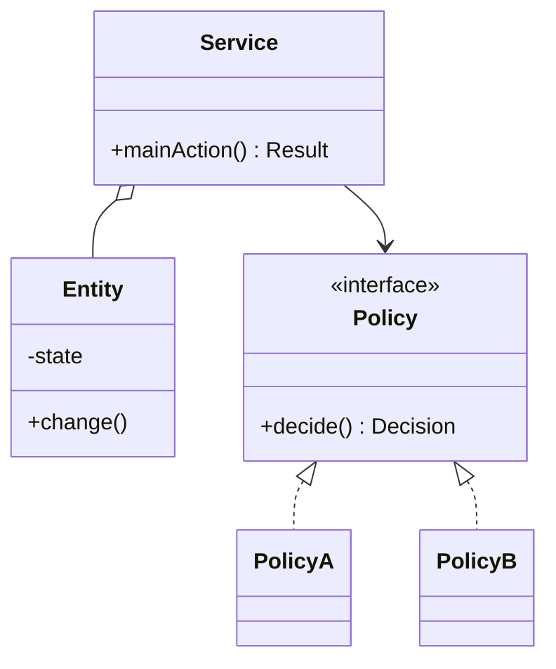

## What the round tests

An **LLD (Low-Level Design) round** asks you to design the classes of a small system and write real code for it, in 45 to 60 minutes. A **machine-coding round** is the same idea with 90 to 120 minutes, and your code must run.

Interviewers look for five signals:

| Signal | What it looks like |
|---|---|
| Requirements | You asked before building and wrote the answers down |
| Modelling | Classes match real concepts; each has one job |
| Code quality | Readable names, small methods, no copy-paste |
| Extensibility | A new rule touches one class, not ten |
| Working demo | `main` runs the main flow and prints results |

:::truth
Nobody produces a perfect design in an hour. Interviewers watch your process more than the final diagram. A calm, ordered routine beats a clever pattern that you cannot finish.
:::

## The five steps

A rough budget for a 60 minute round:

| Step | Minutes | Output |
|---|---|---|
| 1. Clarify | 5 | Written requirements and non-goals |
| 2. Entities | 5 | Nouns become classes, verbs become methods |
| 3. Design | 10 | Small class diagram and interfaces |
| 4. Code | 30 | Core flow working end to end |
| 5. Demo and extend | 10 | Sample run, then a change request |

Put the steps in order:

```order
prompt: Arrange the steps of the routine.
lang: text
code: |
  1. Ask clarifying questions and write the requirements
  2. List nouns and verbs to find entities
  3. Draw the class diagram and name the interfaces
  4. Code the happy path end to end
  5. Run a demo main with sample data
  6. Handle the interviewer's change request
distractors:
  - "0. Start typing the full implementation of the first class"
  - "7. Add every design pattern you remember"
why: Requirements come before entities, entities before the diagram, and the diagram before code. Code that runs comes before extensions, because an extension to a program that does not run proves nothing.
```

## Step 1: clarify

Ask in three buckets, and say the answers aloud so the interviewer can correct you:

- **Functional.** What can users do? Which actions matter most?
- **Scope.** What is out of scope: payments, login, a database, a user interface?
- **Constraints.** Many users at once? Must it be thread-safe? Is data kept in memory only?

For a parking lot: how many floors, which vehicle types, how is the fee computed, can two cars race for one spot? Write the final list as short bullets at the top of your page. It becomes your checklist for the demo.

```quiz
q: The prompt says "design a movie ticket system". What do you do first?
options:
  - Start with the Movie class, since it is obviously needed
  - Ask which actions matter, what is out of scope, and whether concurrent bookings must be handled
  - Draw a database schema
answer: 1
why: "Whatever you build first locks in assumptions. Two minutes of questions saves you from rebuilding after the interviewer says: seats must be locked."
```

## Step 2: nouns and verbs

Read the requirements and underline words.

| Sentence | Finding |
|---|---|
| A **driver** parks a **car** and gets a **ticket** | Nouns: Vehicle, Ticket |
| On exit the driver **pays** by the hour | Verb: `fee(minutes)`, a rule that may change |
| The lot has **floors** with **spots** | Containment: ParkingLot has Levels, Levels have Spots |

Rules of thumb:

- A noun with its own state or behaviour becomes a **class**.
- A noun that is only a value (a plate number, a price) becomes a **field**.
- A verb that can vary (fee rules, pricing, matching) becomes an **interface** with swappable implementations. This is the Strategy pattern: pick an algorithm at run time behind one interface.
- A noun with a fixed small set of values (vehicle type) becomes an **enum**.

```blanks
prompt: Classify each item from the parking lot requirements.
lang: text
code: |
  Plate number           -> [[field]]
  Fee calculation        -> [[interface|strategy]]
  Vehicle type (bike/car)-> [[enum]]
  Ticket with entry time -> [[class]]
why: A plate is just data. Fee rules change, so they sit behind an interface. A short fixed list of types is an enum. A ticket has identity and state, so it is a class.
```

## Step 3: design before code

Most LLD answers share one shape: a **service** that runs the use cases, **entities** that hold state, and **policies** behind interfaces.



Write interfaces and signatures first. A skeleton like this takes two minutes and fixes the dependencies:

```java
interface FeePolicy { long fee(long minutes); }

class ParkingLot {
    private final FeePolicy policy;
    ParkingLot(FeePolicy policy) { this.policy = policy; }
    Ticket park(Vehicle v) { /* later */ return null; }
    long leave(int ticketId, long nowMinutes) { /* later */ return 0; }
}
```
```cpp
#include <memory>
#include <utility>

class FeePolicy {
public:
    virtual ~FeePolicy() = default;
    virtual long fee(long minutes) const = 0;
};

class ParkingLot {
public:
    explicit ParkingLot(std::unique_ptr<FeePolicy> policy) : policy_(std::move(policy)) {}
    // Ticket park(const Vehicle&);  long leave(int ticketId, long nowMinutes);
private:
    std::unique_ptr<FeePolicy> policy_;
};
```

## Steps 4 and 5: code, demo, extend

- Build the **happy path** first, then error cases, then extras. A half-finished fancy design loses to a complete simple one.
- Do not write getters and setters for everything. Add only what the flow uses.
- Pass time in as a parameter, or inject a clock. A demo that depends on the wall clock cannot print the same output twice.
- Finish with a `main` that prints a short, readable trace of the flow.
- When the interviewer adds a requirement, say where it plugs in before you type: "a new fee rule is a new `FeePolicy`".

:::warn
Three common failures: twenty minutes on diagrams with no code, a pattern added because it sounds good, and a design that only works if one `if` chain is edited for every new feature.
:::

```quiz
q: The interviewer says "now add weekend pricing". Which design handles it best?
options:
  - Add `if (isWeekend)` inside the existing fee method
  - Add a new `FeePolicy` implementation and pass it in
  - Copy the whole ParkingLot class and change the fee
answer: 1
why: A new class behind an existing interface changes no tested code. This is the open/closed principle: open for extension, closed for modification.
```

```cards
- q: What are the five steps of the LLD routine?
  a: Clarify requirements, find entities, design classes and interfaces, code the core flow, then demo and extend.
- q: How do nouns and verbs map to code?
  a: Nouns with state or behaviour become classes, plain values become fields, and verbs that vary become interfaces.
- q: Why pass time into the code instead of reading the clock?
  a: A fixed time makes the demo deterministic and the logic testable.
- q: What should you do when the interviewer adds a requirement?
  a: Say which class or interface it plugs into, then make the change without editing unrelated code.
- q: What is the usual shape of an LLD answer?
  a: A service that runs use cases, entities that hold state, and policies behind interfaces.
```

## Notes

:::notes
- LLD round: 45 to 60 minutes, classes plus real code. Machine coding: longer, and the code must run.
- Routine: clarify (5), entities (5), design (10), code (30), demo and extend (10).
- Ask about functional needs, scope and constraints, and write the answers down.
- Nouns with state become classes, values become fields, small fixed sets become enums, varying verbs become interfaces.
- Write interfaces and signatures first; they fix dependencies in minutes.
- Happy path first, then errors, then extras. Inject time so the demo is repeatable.
- State where a change request plugs in before you edit anything.
- Process and clarity are judged more than pattern count.
:::
