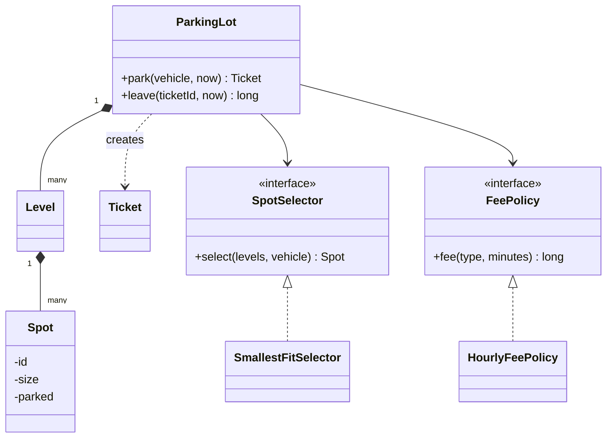

## Requirements

Ask first, then fix the scope. A reasonable set for a 45 minute round:

- The lot has several **levels**; each level has **spots** of three sizes: small, medium, large.
- Vehicles are bike, car or truck. A vehicle may use a spot of its own size or larger.
- On entry the driver gets a **ticket**. On exit the driver pays by the hour, rounded up, minimum one hour.
- If nothing fits, entry is refused.
- Several gates may call `park` and `leave` at the same time.

Out of scope: payment gateways, number-plate cameras, reservations.

## Entities

| Noun or verb | Becomes |
|---|---|
| Vehicle (plate, type) | `Vehicle` class with a `VehicleType` enum |
| Spot (id, size, occupied) | `Spot` class with a `SpotSize` enum |
| Level | `Level` holds its spots |
| Ticket (id, vehicle, spot, entry time) | `Ticket`, an immutable record |
| Fee rule | `FeePolicy` interface, because rules change |
| Which spot to pick | `SpotSelector` interface, because policies differ |
| Park, leave | Methods on `ParkingLot`, the service |



The two interfaces are the Strategy pattern: the algorithm sits behind an interface so it can be swapped without touching `ParkingLot`.

:::key
`ParkingLot` never asks "which kind of fee" or "which kind of selection". It calls the interface. That is what makes the extensions below cheap.
:::

## Code

The demo uses minutes as plain numbers instead of a clock, so the output is repeatable. `smallest fit` means: among free spots that fit, prefer the smallest size, so a bike does not waste a large spot.

```java
import java.util.*;

enum SpotSize { SMALL, MEDIUM, LARGE }

enum VehicleType {
    BIKE(SpotSize.SMALL), CAR(SpotSize.MEDIUM), TRUCK(SpotSize.LARGE);
    final SpotSize minSpot;
    VehicleType(SpotSize minSpot) { this.minSpot = minSpot; }
}

record Vehicle(String plate, VehicleType type) {}

class Spot {
    final int id, level;
    final SpotSize size;
    private Vehicle parked;
    Spot(int id, int level, SpotSize size) { this.id = id; this.level = level; this.size = size; }
    boolean isFree() { return parked == null; }
    boolean fits(Vehicle v) { return isFree() && size.ordinal() >= v.type().minSpot.ordinal(); }
    void park(Vehicle v) { parked = v; }
    void free() { parked = null; }
}

class Level {
    final int number;
    private final List<Spot> spots;
    Level(int number, List<Spot> spots) { this.number = number; this.spots = spots; }
    List<Spot> spots() { return spots; }
}

record Ticket(int id, Vehicle vehicle, Spot spot, long entryMinute) {}

interface SpotSelector { Optional<Spot> select(List<Level> levels, Vehicle v); }

class SmallestFitSelector implements SpotSelector {
    public Optional<Spot> select(List<Level> levels, Vehicle v) {
        Spot best = null;
        for (Level level : levels)
            for (Spot s : level.spots())
                if (s.fits(v) && (best == null || s.size.ordinal() < best.size.ordinal())) best = s;
        return Optional.ofNullable(best);
    }
}

interface FeePolicy { long fee(VehicleType type, long minutes); }

class HourlyFeePolicy implements FeePolicy {
    private final Map<VehicleType, Long> ratePerHour;
    HourlyFeePolicy(Map<VehicleType, Long> ratePerHour) { this.ratePerHour = ratePerHour; }
    public long fee(VehicleType type, long minutes) {
        long hours = Math.max(1, (minutes + 59) / 60);   // round up, minimum one hour
        return hours * ratePerHour.get(type);
    }
}

class ParkingLot {
    private final List<Level> levels;
    private final SpotSelector selector;
    private final FeePolicy policy;
    private final Map<Integer, Ticket> active = new HashMap<>();
    private int nextTicket = 1;

    ParkingLot(List<Level> levels, SpotSelector selector, FeePolicy policy) {
        this.levels = levels; this.selector = selector; this.policy = policy;
    }

    synchronized Optional<Ticket> park(Vehicle v, long now) {
        Optional<Spot> spot = selector.select(levels, v);
        if (spot.isEmpty()) return Optional.empty();
        spot.get().park(v);
        Ticket t = new Ticket(nextTicket++, v, spot.get(), now);
        active.put(t.id(), t);
        return Optional.of(t);
    }

    synchronized long leave(int ticketId, long now) {
        Ticket t = active.remove(ticketId);
        if (t == null) throw new IllegalArgumentException("unknown ticket " + ticketId);
        t.spot().free();
        return policy.fee(t.vehicle().type(), now - t.entryMinute());
    }

    synchronized long freeSpots() {
        return levels.stream().flatMap(l -> l.spots().stream()).filter(Spot::isFree).count();
    }
}

public class Main {
    static void arrive(ParkingLot lot, Vehicle v, long now) {
        String head = "t=" + now + " park " + v.type() + " " + v.plate() + " -> ";
        Optional<Ticket> t = lot.park(v, now);
        System.out.println(head + (t.isPresent()
            ? "ticket " + t.get().id() + ", spot " + t.get().spot().id + " (level " + t.get().spot().level + ")"
            : "lot full"));
    }

    static void depart(ParkingLot lot, int ticket, long now) {
        String head = "t=" + now + " leave ticket " + ticket + " -> ";
        try {
            System.out.println(head + "fee " + lot.leave(ticket, now));
        } catch (IllegalArgumentException e) {
            System.out.println(head + "error: " + e.getMessage());
        }
    }

    public static void main(String[] args) {
        Level l0 = new Level(0, List.of(new Spot(1, 0, SpotSize.SMALL), new Spot(2, 0, SpotSize.MEDIUM),
                                        new Spot(3, 0, SpotSize.LARGE)));
        Level l1 = new Level(1, List.of(new Spot(4, 1, SpotSize.MEDIUM), new Spot(5, 1, SpotSize.MEDIUM)));
        ParkingLot lot = new ParkingLot(List.of(l0, l1), new SmallestFitSelector(),
            new HourlyFeePolicy(Map.of(VehicleType.BIKE, 10L, VehicleType.CAR, 40L, VehicleType.TRUCK, 100L)));

        arrive(lot, new Vehicle("B1", VehicleType.BIKE), 0);
        arrive(lot, new Vehicle("C1", VehicleType.CAR), 0);
        arrive(lot, new Vehicle("C2", VehicleType.CAR), 0);
        arrive(lot, new Vehicle("C3", VehicleType.CAR), 0);
        arrive(lot, new Vehicle("C4", VehicleType.CAR), 0);
        arrive(lot, new Vehicle("T1", VehicleType.TRUCK), 0);
        depart(lot, 1, 30);
        depart(lot, 2, 130);
        arrive(lot, new Vehicle("C5", VehicleType.CAR), 150);
        depart(lot, 5, 200);
        arrive(lot, new Vehicle("T1", VehicleType.TRUCK), 210);
        depart(lot, 99, 220);
        System.out.println("free spots: " + lot.freeSpots());
    }
}
```
```cpp
#include <algorithm>
#include <iostream>
#include <map>
#include <memory>
#include <mutex>
#include <optional>
#include <stdexcept>
#include <string>
#include <utility>
#include <vector>

enum class SpotSize { Small, Medium, Large };
enum class VehicleType { Bike, Car, Truck };

SpotSize minSpot(VehicleType t) {
    switch (t) {
        case VehicleType::Bike: return SpotSize::Small;
        case VehicleType::Car: return SpotSize::Medium;
        default: return SpotSize::Large;
    }
}

std::string typeName(VehicleType t) {
    switch (t) {
        case VehicleType::Bike: return "BIKE";
        case VehicleType::Car: return "CAR";
        default: return "TRUCK";
    }
}

struct Vehicle {
    std::string plate;
    VehicleType type;
};

class Spot {
public:
    Spot(int id, int level, SpotSize size) : id_(id), level_(level), size_(size) {}
    int id() const { return id_; }
    int level() const { return level_; }
    SpotSize size() const { return size_; }
    bool isFree() const { return !parked_.has_value(); }
    bool fits(const Vehicle& v) const { return isFree() && size_ >= minSpot(v.type); }
    void park(const Vehicle& v) { parked_ = v; }
    void free() { parked_.reset(); }
private:
    int id_, level_;
    SpotSize size_;
    std::optional<Vehicle> parked_;
};

class Level {
public:
    Level(int number, std::vector<Spot> spots) : number_(number), spots_(std::move(spots)) {}
    std::vector<Spot>& spots() { return spots_; }
private:
    int number_;
    std::vector<Spot> spots_;
};

struct Ticket {
    int id;
    Vehicle vehicle;
    Spot* spot;
    long entryMinute;
};

class SpotSelector {
public:
    virtual ~SpotSelector() = default;
    virtual Spot* select(std::vector<Level>& levels, const Vehicle& v) const = 0;
};

class SmallestFitSelector : public SpotSelector {
public:
    Spot* select(std::vector<Level>& levels, const Vehicle& v) const override {
        Spot* best = nullptr;
        for (auto& level : levels)
            for (auto& s : level.spots())
                if (s.fits(v) && (best == nullptr || s.size() < best->size())) best = &s;
        return best;
    }
};

class FeePolicy {
public:
    virtual ~FeePolicy() = default;
    virtual long fee(VehicleType type, long minutes) const = 0;
};

class HourlyFeePolicy : public FeePolicy {
public:
    explicit HourlyFeePolicy(std::map<VehicleType, long> rate) : rate_(std::move(rate)) {}
    long fee(VehicleType type, long minutes) const override {
        long hours = std::max(1L, (minutes + 59) / 60);   // round up, minimum one hour
        return hours * rate_.at(type);
    }
private:
    std::map<VehicleType, long> rate_;
};

class ParkingLot {
public:
    ParkingLot(std::vector<Level> levels, std::unique_ptr<SpotSelector> selector,
               std::unique_ptr<FeePolicy> policy)
        : levels_(std::move(levels)), selector_(std::move(selector)), policy_(std::move(policy)) {}

    std::optional<Ticket> park(const Vehicle& v, long now) {
        std::lock_guard<std::mutex> lock(mu_);
        Spot* spot = selector_->select(levels_, v);
        if (spot == nullptr) return std::nullopt;
        spot->park(v);
        Ticket t{nextTicket_++, v, spot, now};
        active_.emplace(t.id, t);
        return t;
    }

    long leave(int ticketId, long now) {
        std::lock_guard<std::mutex> lock(mu_);
        auto it = active_.find(ticketId);
        if (it == active_.end()) throw std::invalid_argument("unknown ticket " + std::to_string(ticketId));
        Ticket t = it->second;
        active_.erase(it);
        t.spot->free();
        return policy_->fee(t.vehicle.type, now - t.entryMinute);
    }

    long freeSpots() {
        std::lock_guard<std::mutex> lock(mu_);
        long n = 0;
        for (auto& level : levels_)
            for (auto& s : level.spots()) n += s.isFree() ? 1 : 0;
        return n;
    }

private:
    std::vector<Level> levels_;
    std::unique_ptr<SpotSelector> selector_;
    std::unique_ptr<FeePolicy> policy_;
    std::map<int, Ticket> active_;
    int nextTicket_ = 1;
    std::mutex mu_;
};

void arrive(ParkingLot& lot, const Vehicle& v, long now) {
    std::cout << "t=" << now << " park " << typeName(v.type) << " " << v.plate << " -> ";
    auto t = lot.park(v, now);
    if (t) std::cout << "ticket " << t->id << ", spot " << t->spot->id() << " (level " << t->spot->level() << ")\n";
    else std::cout << "lot full\n";
}

void depart(ParkingLot& lot, int ticket, long now) {
    std::cout << "t=" << now << " leave ticket " << ticket << " -> ";
    try {
        long fee = lot.leave(ticket, now);
        std::cout << "fee " << fee << "\n";
    } catch (const std::invalid_argument& e) {
        std::cout << "error: " << e.what() << "\n";
    }
}

int main() {
    std::vector<Level> levels;
    levels.emplace_back(0, std::vector<Spot>{Spot(1, 0, SpotSize::Small), Spot(2, 0, SpotSize::Medium),
                                             Spot(3, 0, SpotSize::Large)});
    levels.emplace_back(1, std::vector<Spot>{Spot(4, 1, SpotSize::Medium), Spot(5, 1, SpotSize::Medium)});
    ParkingLot lot(std::move(levels), std::make_unique<SmallestFitSelector>(),
        std::make_unique<HourlyFeePolicy>(std::map<VehicleType, long>{
            {VehicleType::Bike, 10}, {VehicleType::Car, 40}, {VehicleType::Truck, 100}}));

    arrive(lot, {"B1", VehicleType::Bike}, 0);
    arrive(lot, {"C1", VehicleType::Car}, 0);
    arrive(lot, {"C2", VehicleType::Car}, 0);
    arrive(lot, {"C3", VehicleType::Car}, 0);
    arrive(lot, {"C4", VehicleType::Car}, 0);
    arrive(lot, {"T1", VehicleType::Truck}, 0);
    depart(lot, 1, 30);
    depart(lot, 2, 130);
    arrive(lot, {"C5", VehicleType::Car}, 150);
    depart(lot, 5, 200);
    arrive(lot, {"T1", VehicleType::Truck}, 210);
    depart(lot, 99, 220);
    std::cout << "free spots: " << lot.freeSpots() << "\n";
}
```
```output
t=0 park BIKE B1 -> ticket 1, spot 1 (level 0)
t=0 park CAR C1 -> ticket 2, spot 2 (level 0)
t=0 park CAR C2 -> ticket 3, spot 4 (level 1)
t=0 park CAR C3 -> ticket 4, spot 5 (level 1)
t=0 park CAR C4 -> ticket 5, spot 3 (level 0)
t=0 park TRUCK T1 -> lot full
t=30 leave ticket 1 -> fee 10
t=130 leave ticket 2 -> fee 120
t=150 park CAR C5 -> ticket 6, spot 2 (level 0)
t=200 leave ticket 5 -> fee 160
t=210 park TRUCK T1 -> ticket 7, spot 3 (level 0)
t=220 leave ticket 99 -> error: unknown ticket 99
free spots: 1
```

Compile the C++ with `g++ -std=c++17 -pthread`.

Check the fee rule in your head:

```predict
lang: java
code: |
  long a = 61, b = 0;
  System.out.println(Math.max(1, (a + 59) / 60) + " " + Math.max(1, (b + 59) / 60));
output: 2 1
why: "(61 + 59) / 60 is 2, so 61 minutes is two hours. For 0 minutes the division gives 0, and the minimum of one hour lifts it to 1."
```

Put the core of `park` in order:

```order
prompt: Arrange the body of park().
lang: java
code: |
  synchronized Optional<Ticket> park(Vehicle v, long now) {
      Optional<Spot> spot = selector.select(levels, v);
      if (spot.isEmpty()) return Optional.empty();
      spot.get().park(v);
      Ticket t = new Ticket(nextTicket++, v, spot.get(), now);
      active.put(t.id(), t);
      return Optional.of(t);
  }
distractors:
  - "    spot.get().free();"
why: Choose a spot, stop if none, mark it taken, then issue and record the ticket. The whole method is `synchronized`, so choosing and marking happen as one step.
```

:::warn
Without the lock, two gates can both see spot 2 free and both park a car in it. Choosing a spot and marking it taken must be one atomic step. A single lock on the lot is correct and simple; per-level locks are a later optimisation.
:::

## Design decisions

- **Why a record for `Ticket`.** A ticket never changes after it is issued, so immutable data removes a class of bugs.
- **Why `Level` is so thin.** It only groups spots today. Keep it, because per-level locks, floor displays and "level closed for cleaning" all attach there later.
- **Why the selector sees all levels.** Smallest fit across the whole lot needs a global view. A per-level choice would fill level 0 with large spots first.
- **Why time is a number.** The service never reads a clock, so the demo and any unit test give the same answer every run.
- **Why `Optional` or `std::optional` for a full lot.** Refusal is a normal result, not an error. An exception is kept for a truly invalid input, such as an unknown ticket.

## Extensibility

| Change request | What changes |
|---|---|
| Weekend pricing | New `FeePolicy`; nothing else |
| Nearest-to-entrance rule | New `SpotSelector`; nothing else |
| EV charging spots | Add a charger flag on `Spot` and a new selector that prefers charging spots for EVs |
| Display board | Observer: `ParkingLot` notifies listeners after park and leave |
| New vehicle type | One enum entry with its minimum spot size, plus a rate |

```quiz
q: The lot needs a rule "bikes park free for the first 15 minutes". Where should it go?
options:
  - An `if (type == BIKE)` branch inside `ParkingLot.leave`
  - A new `FeePolicy` implementation, possibly wrapping `HourlyFeePolicy`
  - A new field on every `Ticket`
answer: 1
why: "Fee rules are the part that varies, so they belong behind `FeePolicy`. `ParkingLot.leave` stays unchanged."
```

## Interview tips

- State the two strategies out loud: "fees and spot choice will change, so I put them behind interfaces".
- Draw the diagram before code; keep it under ten boxes.
- Show the concurrency decision: one lock, with the reason, and the finer option as a follow-up.
- Use `long` for money in the smallest unit. Avoid floating point for fees.

:::truth
This design keeps tickets and spots in memory. A real lot needs persistence and recovery after a restart; say so, and do not build it unless asked.
:::

```cards
- q: Why use a SpotSelector interface?
  a: Spot choice is a rule that changes (smallest fit, nearest entrance). The interface lets you add a rule without editing ParkingLot.
- q: How is the hourly fee rounded?
  a: Up to the next full hour with a one hour minimum, computed as max(1, (minutes + 59) / 60) in integer arithmetic.
- q: Why must park() be atomic?
  a: Two gates could both pick the same free spot. Selecting and marking the spot must happen under one lock.
- q: Which pattern adds a live display board?
  a: Observer. ParkingLot notifies listeners after park and leave.
- q: Why is Ticket a record or plain struct?
  a: It never changes after it is issued, so immutable data is simpler and safer.
```

## Notes

:::notes
- Entities: Vehicle, Spot, Level, Ticket, ParkingLot. Enums for sizes and vehicle types.
- Varying rules go behind interfaces: FeePolicy and SpotSelector (Strategy pattern).
- Smallest-fit allocation keeps large spots free for large vehicles.
- Fee = max(1, ceil(minutes / 60)) times the hourly rate; use integers for money.
- park and leave are synchronized so two gates cannot take the same spot.
- Pass time in as a number to keep the demo deterministic.
- Weekend pricing, new selection rules and display boards plug in without editing ParkingLot.
- Say what is out of scope: payments, persistence, reservations.
:::
