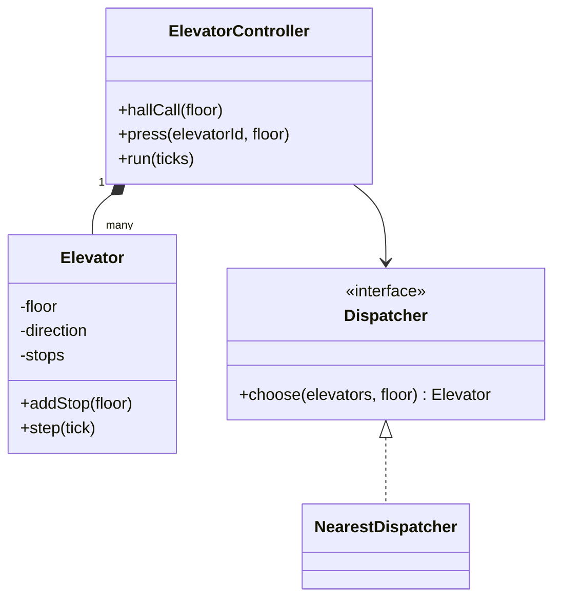
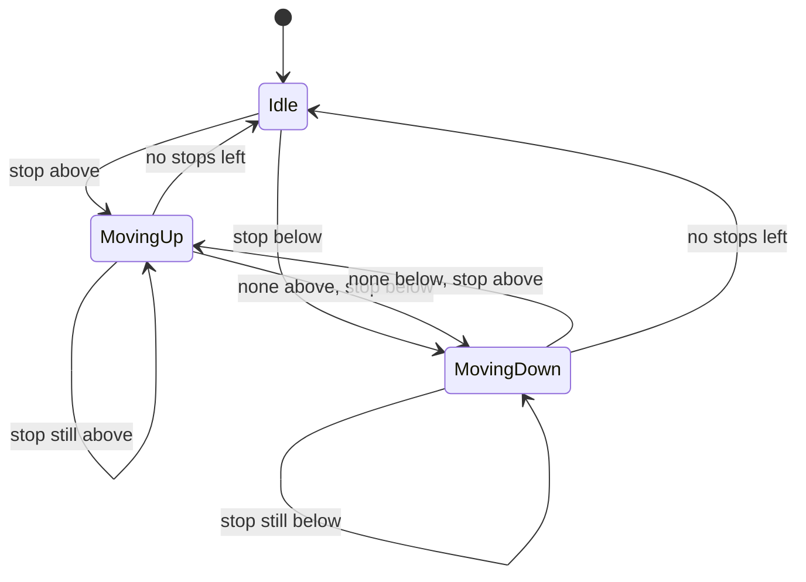

## Requirements

Clarify, then fix the scope:

- A building has `N` floors and `M` elevators.
- **Hall call**: a person on a floor presses a button. The system assigns one elevator.
- **Car call** (inside the elevator): a passenger selects a destination floor.
- Each elevator moves one floor per tick and opens its doors at each requested stop.
- Idle elevators wait where they are.

Out of scope: door sensors, weight, emergency stop, express modes. We simulate time in discrete ticks so the demo is repeatable.

## Entities

| Concept | Becomes |
|---|---|
| Elevator (floor, direction, pending stops) | `Elevator` class |
| Up, down, idle | `Direction` enum |
| Which elevator takes a call | `Dispatcher` interface, with `NearestDispatcher` |
| Receives calls, advances time | `ElevatorController` |



## The movement rule

Each elevator keeps its pending stops in a **sorted set**. The rule is a **sweep**, also called the SCAN or "elevator" algorithm: keep going in the current direction while there are stops ahead, then reverse. Passing a stop in your direction costs nothing, and nobody waits forever.



A sorted set answers "next stop above me" and "next stop below me" directly:

```predict
lang: java
code: |
  TreeSet<Integer> stops = new TreeSet<>(List.of(2, 5, 9));
  int floor = 5;
  System.out.println(stops.higher(floor) + " " + stops.lower(floor) + " " + stops.ceiling(floor));
output: 9 2 5
why: higher is the smallest element strictly above 5, lower is the largest strictly below 5, and ceiling is the smallest element at or above 5, which is 5 itself.
```

```quiz
q: Why store pending stops in a sorted set instead of a queue ordered by arrival?
options:
  - A queue cannot hold integers
  - A passenger who selects floor 4 while the car passes floor 3 going up should be served on the way, not after floors requested earlier
  - Sets are always faster than queues
answer: 1
why: "Arrival order makes the car zig-zag. A sorted set lets the sweep serve every stop in the direction of travel, and a set also ignores duplicate requests for the same floor."
```

## Code

The dispatcher scores each elevator by distance, and adds a penalty when the elevator is moving away from the caller. The demo: two elevators start at floors 0 and 6.

```java
import java.util.*;

enum Direction { UP, DOWN, IDLE }

class Elevator {
    final int id;
    private int floor;
    private Direction dir = Direction.IDLE;
    private final TreeSet<Integer> stops = new TreeSet<>();

    Elevator(int id, int floor) { this.id = id; this.floor = floor; }

    int floor() { return floor; }
    Direction direction() { return dir; }
    void addStop(int f) { stops.add(f); }

    boolean movingAwayFrom(int target) {
        return (dir == Direction.UP && target < floor) || (dir == Direction.DOWN && target > floor);
    }

    private Direction nextDirection() {
        Integer above = stops.higher(floor), below = stops.lower(floor);
        if (dir == Direction.UP && above != null) return Direction.UP;
        if (dir == Direction.DOWN && below != null) return Direction.DOWN;
        if (above != null && below != null) return above - floor <= floor - below ? Direction.UP : Direction.DOWN;
        if (above != null) return Direction.UP;
        if (below != null) return Direction.DOWN;
        return Direction.IDLE;
    }

    void step(int tick) {
        if (stops.remove(floor)) {
            System.out.println("t=" + tick + " E" + id + " opens doors at floor " + floor);
            if (stops.isEmpty()) dir = Direction.IDLE;
            return;
        }
        dir = nextDirection();
        if (dir == Direction.UP) floor++;
        else if (dir == Direction.DOWN) floor--;
    }
}

interface Dispatcher { Elevator choose(List<Elevator> elevators, int floor); }

class NearestDispatcher implements Dispatcher {
    public Elevator choose(List<Elevator> elevators, int floor) {
        Elevator best = null;
        int bestCost = Integer.MAX_VALUE;
        for (Elevator e : elevators) {
            int cost = Math.abs(e.floor() - floor);
            if (e.movingAwayFrom(floor)) cost += 10;   // it must finish its sweep first
            if (cost < bestCost) { best = e; bestCost = cost; }
        }
        return best;
    }
}

class ElevatorController {
    private final List<Elevator> elevators;
    private final Dispatcher dispatcher;
    private int tick = 0;

    ElevatorController(List<Elevator> elevators, Dispatcher dispatcher) {
        this.elevators = elevators;
        this.dispatcher = dispatcher;
    }

    void hallCall(int floor) {
        Elevator e = dispatcher.choose(elevators, floor);
        e.addStop(floor);
        System.out.println("hall call at floor " + floor + " -> E" + e.id);
    }

    void press(int elevatorId, int floor) {
        elevators.get(elevatorId).addStop(floor);
        System.out.println("E" + elevatorId + " passenger selects floor " + floor);
    }

    void run(int ticks) {
        for (int i = 0; i < ticks; i++) {
            tick++;
            for (Elevator e : elevators) e.step(tick);
        }
    }

    String status() {
        StringBuilder sb = new StringBuilder();
        for (Elevator e : elevators) {
            if (sb.length() > 0) sb.append(", ");
            sb.append("E").append(e.id).append("@").append(e.floor()).append(" ").append(e.direction());
        }
        return sb.toString();
    }
}

public class Main {
    public static void main(String[] args) {
        ElevatorController c = new ElevatorController(
            List.of(new Elevator(0, 0), new Elevator(1, 6)), new NearestDispatcher());
        c.hallCall(2);     // E0 costs 2, E1 costs 4
        c.hallCall(5);     // E0 costs 5, E1 costs 1
        c.run(2);
        c.press(0, 9);
        c.hallCall(1);     // E0 is at 2 heading up, so it costs 1 + 10; E1 is idle and costs 4
        c.run(9);
        System.out.println("status: " + c.status());
    }
}
```
```cpp
#include <cstdlib>
#include <iostream>
#include <iterator>
#include <limits>
#include <memory>
#include <set>
#include <string>
#include <utility>
#include <vector>

enum class Direction { Up, Down, Idle };

const char* name(Direction d) {
    switch (d) {
        case Direction::Up: return "UP";
        case Direction::Down: return "DOWN";
        default: return "IDLE";
    }
}

class Elevator {
public:
    Elevator(int id, int floor) : id_(id), floor_(floor) {}

    int id() const { return id_; }
    int floor() const { return floor_; }
    Direction direction() const { return dir_; }
    void addStop(int f) { stops_.insert(f); }

    bool movingAwayFrom(int target) const {
        return (dir_ == Direction::Up && target < floor_) || (dir_ == Direction::Down && target > floor_);
    }

    void step(int tick) {
        if (stops_.erase(floor_) > 0) {
            std::cout << "t=" << tick << " E" << id_ << " opens doors at floor " << floor_ << "\n";
            if (stops_.empty()) dir_ = Direction::Idle;
            return;
        }
        dir_ = nextDirection();
        if (dir_ == Direction::Up) ++floor_;
        else if (dir_ == Direction::Down) --floor_;
    }

private:
    Direction nextDirection() const {
        auto up = stops_.upper_bound(floor_);       // first stop strictly above
        auto lo = stops_.lower_bound(floor_);       // everything before lo is strictly below
        bool hasAbove = up != stops_.end();
        bool hasBelow = lo != stops_.begin();
        if (dir_ == Direction::Up && hasAbove) return Direction::Up;
        if (dir_ == Direction::Down && hasBelow) return Direction::Down;
        if (hasAbove && hasBelow) {
            int below = *std::prev(lo);
            return *up - floor_ <= floor_ - below ? Direction::Up : Direction::Down;
        }
        if (hasAbove) return Direction::Up;
        if (hasBelow) return Direction::Down;
        return Direction::Idle;
    }

    int id_;
    int floor_;
    Direction dir_ = Direction::Idle;
    std::set<int> stops_;
};

class Dispatcher {
public:
    virtual ~Dispatcher() = default;
    virtual Elevator& choose(std::vector<Elevator>& elevators, int floor) const = 0;
};

class NearestDispatcher : public Dispatcher {
public:
    Elevator& choose(std::vector<Elevator>& elevators, int floor) const override {
        Elevator* best = nullptr;
        int bestCost = std::numeric_limits<int>::max();
        for (auto& e : elevators) {
            int cost = std::abs(e.floor() - floor);
            if (e.movingAwayFrom(floor)) cost += 10;   // it must finish its sweep first
            if (cost < bestCost) { best = &e; bestCost = cost; }
        }
        return *best;
    }
};

class ElevatorController {
public:
    ElevatorController(std::vector<Elevator> elevators, std::unique_ptr<Dispatcher> dispatcher)
        : elevators_(std::move(elevators)), dispatcher_(std::move(dispatcher)) {}

    void hallCall(int floor) {
        Elevator& e = dispatcher_->choose(elevators_, floor);
        e.addStop(floor);
        std::cout << "hall call at floor " << floor << " -> E" << e.id() << "\n";
    }

    void press(int elevatorId, int floor) {
        elevators_[elevatorId].addStop(floor);
        std::cout << "E" << elevatorId << " passenger selects floor " << floor << "\n";
    }

    void run(int ticks) {
        for (int i = 0; i < ticks; ++i) {
            ++tick_;
            for (auto& e : elevators_) e.step(tick_);
        }
    }

    std::string status() const {
        std::string s;
        for (const auto& e : elevators_) {
            if (!s.empty()) s += ", ";
            s += "E" + std::to_string(e.id()) + "@" + std::to_string(e.floor()) + " " + name(e.direction());
        }
        return s;
    }

private:
    std::vector<Elevator> elevators_;
    std::unique_ptr<Dispatcher> dispatcher_;
    int tick_ = 0;
};

int main() {
    std::vector<Elevator> elevators;
    elevators.emplace_back(0, 0);
    elevators.emplace_back(1, 6);
    ElevatorController c(std::move(elevators), std::make_unique<NearestDispatcher>());
    c.hallCall(2);     // E0 costs 2, E1 costs 4
    c.hallCall(5);     // E0 costs 5, E1 costs 1
    c.run(2);
    c.press(0, 9);
    c.hallCall(1);     // E0 is at 2 heading up, so it costs 1 + 10; E1 is idle and costs 4
    c.run(9);
    std::cout << "status: " << c.status() << "\n";
}
```
```output
hall call at floor 2 -> E0
hall call at floor 5 -> E1
t=2 E1 opens doors at floor 5
E0 passenger selects floor 9
hall call at floor 1 -> E1
t=3 E0 opens doors at floor 2
t=7 E1 opens doors at floor 1
t=11 E0 opens doors at floor 9
status: E0@9 IDLE, E1@1 IDLE
```

Compile the C++ with `g++ -std=c++17 -pthread`.

Read the trace: the call for floor 1 went to E1, not to E0, even though E0 was one floor away. E0 was heading up with a stop at 9, so reaching floor 1 would take it the long way round.

Put `step()` in order:

```order
prompt: Arrange the body of Elevator.step().
lang: java
code: |
  void step(int tick) {
      if (stops.remove(floor)) {
          System.out.println("t=" + tick + " E" + id + " opens doors at floor " + floor);
          if (stops.isEmpty()) dir = Direction.IDLE;
          return;
      }
      dir = nextDirection();
      if (dir == Direction.UP) floor++;
      else if (dir == Direction.DOWN) floor--;
  }
distractors:
  - "        stops.add(floor);"
why: First serve the current floor if it is a stop. Only otherwise pick a direction and move one floor. Serving and moving in the same tick would make the elevator skip the door opening.
```

:::truth
This is a model, not a controller. Real elevators run on dedicated hardware with safety interlocks, and modern buildings use destination dispatch, where you enter your floor in the lobby. In an interview, the point is the separation of dispatch from movement, not the physics.
:::

## Extensibility

| Change request | What changes |
|---|---|
| Direction-aware dispatch | New `Dispatcher`; the controller is untouched |
| Maintenance mode | A flag on `Elevator` that the dispatcher checks, or a state class |
| Door-open time | Replace the `Direction` enum with a State pattern: `Idle`, `Moving`, `DoorsOpen` |
| Capacity | A load field on `Elevator`; the dispatcher skips full cars |
| Calls from several threads | Make `hallCall`, `press` and `run` synchronized on the controller, or feed a queue that one thread drains |

## Interview tips

- Say "dispatch" and "movement" as two separate responsibilities in the first minute.
- Name the sweep rule and why it avoids starvation: a request is never postponed forever by newer nearer ones.
- Mention the simplification: ticks instead of real time, one lock if threads are needed.
- Offer the state diagram. It shows you can reason about transitions, which is what the round tests.

```cards
- q: What is the SCAN (elevator) algorithm?
  a: Keep moving in the current direction while stops remain ahead, serve them in order, then reverse. Newer nearer requests cannot starve older ones.
- q: Why a TreeSet or std::set for pending stops?
  a: It stays sorted, ignores duplicates, and answers next stop above and below in logarithmic time.
- q: Why separate Dispatcher from Elevator?
  a: Choosing which elevator takes a call is a policy that changes. Moving is mechanics that does not.
- q: Why add a penalty when an elevator moves away from the caller?
  a: It must finish its current sweep before coming back, so its real cost is far more than the floor distance.
- q: Which pattern models door-open and maintenance behaviour?
  a: State. Each state class owns what the elevator does in that state.
```

## Notes

:::notes
- Entities: Elevator, Direction, Dispatcher, ElevatorController.
- Each elevator keeps pending stops in a sorted set and sweeps: continue in the current direction, then reverse.
- Hall call assigns an elevator through a Dispatcher; car call adds a stop to a specific elevator.
- NearestDispatcher cost is floor distance plus a penalty if the elevator is moving away.
- Time is simulated in ticks, so the demo output is the same every run.
- Dispatch policy and movement mechanics are separate; swap the policy without touching Elevator.
- Door states, maintenance and capacity extend naturally through the State pattern.
- With threads, guard the controller with one lock or feed a single-consumer queue.
:::
