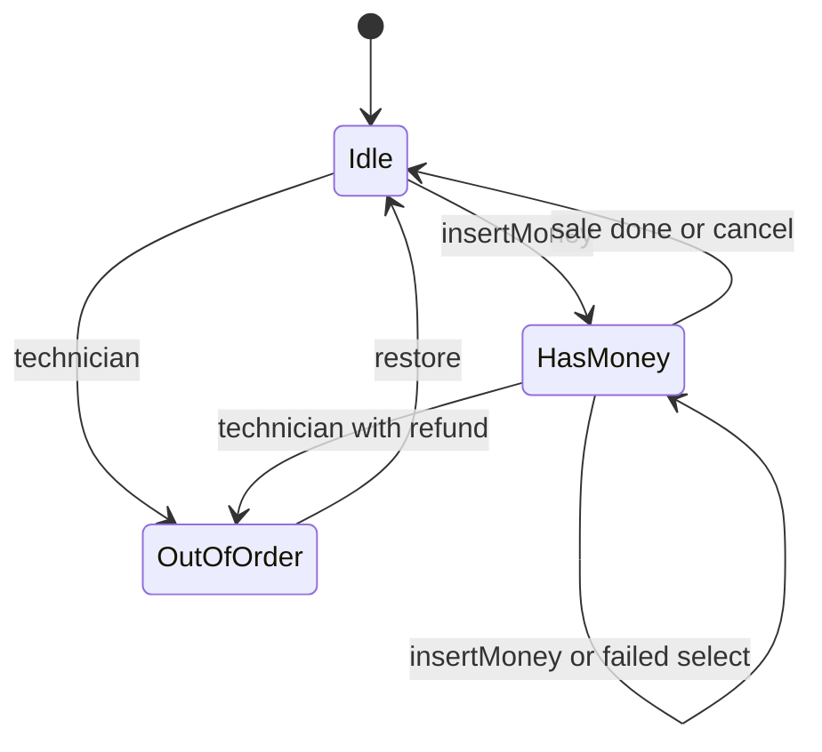
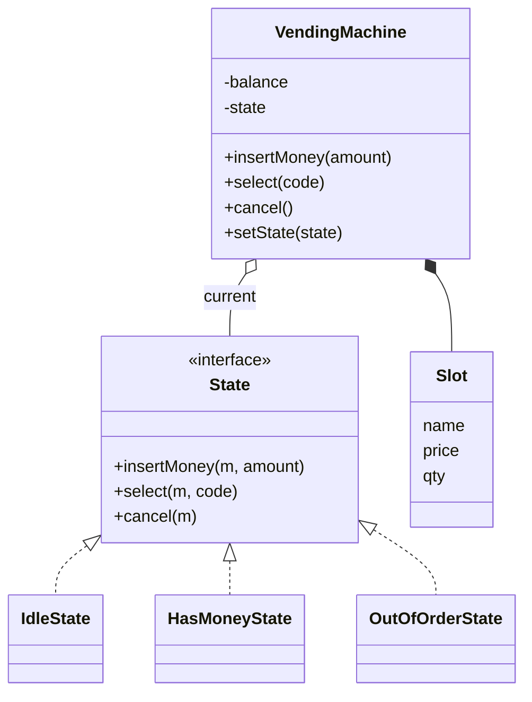

## Requirements

Clarify, then fix the scope:

- The machine has **slots**, each with a code (`A1`), a product, a price and a quantity.
- A customer inserts money, selects a slot, and receives the product and change.
- The customer may cancel before selecting and gets all money back.
- A technician can put the machine out of order. While out of order, it accepts no money.
- Money is whole rupees in coins of 10, 5, 2 and 1.

Out of scope: card payments, the machine's own coin stock, restocking screens, hardware.

## Why the State pattern

The behaviour of the machine depends on what it is doing. The same action, "select A1", means different things:

| Current state | `select(A1)` should |
|---|---|
| Idle (no money) | Ask for money first |
| HasMoney | Check stock and balance, then sell |
| OutOfOrder | Refuse |

The naive code is one class with a `state` variable and an `if / else if` chain in every method. Adding a state means editing every method. The **State pattern** puts each state's behaviour in its own class behind one interface. The machine, called the **context**, holds the current state and forwards each action to it. A state class also decides the next state.



## Entities



:::key
The machine has no `if (state == ...)`. It calls `state.select(...)`. Polymorphism does the branching, and each new state is a new class.
:::

## Code

The states are stateless, so the machine creates one of each and reuses it. Lines indented in the output are the machine's replies. `coins` makes change greedily: take the largest coin that fits. That is optimal for 10, 5, 2, 1, but not for every coin system.

```java
import java.util.*;

class Slot {
    final String name;
    final int price;
    int qty;
    Slot(String name, int price, int qty) { this.name = name; this.price = price; this.qty = qty; }
}

interface State {
    String name();
    void insertMoney(VendingMachine m, int amount);
    void select(VendingMachine m, String code);
    void cancel(VendingMachine m);
}

class IdleState implements State {
    public String name() { return "Idle"; }
    public void insertMoney(VendingMachine m, int amount) {
        m.addBalance(amount);
        m.say("balance " + m.balance());
        m.setState(m.hasMoney);
    }
    public void select(VendingMachine m, String code) { m.say("insert money first"); }
    public void cancel(VendingMachine m) { m.say("nothing to cancel"); }
}

class HasMoneyState implements State {
    public String name() { return "HasMoney"; }
    public void insertMoney(VendingMachine m, int amount) {
        m.addBalance(amount);
        m.say("balance " + m.balance());
    }
    public void select(VendingMachine m, String code) {
        Slot s = m.slot(code);
        if (s == null) { m.say("unknown code " + code); return; }
        if (s.qty == 0) { m.say(s.name + " is sold out"); return; }
        if (m.balance() < s.price) { m.say("need " + (s.price - m.balance()) + " more"); return; }
        m.dispense(s);
        m.setState(m.idle);
    }
    public void cancel(VendingMachine m) {
        m.refundAll();
        m.setState(m.idle);
    }
}

class OutOfOrderState implements State {
    public String name() { return "OutOfOrder"; }
    public void insertMoney(VendingMachine m, int amount) { m.say("out of order, rejected " + amount); }
    public void select(VendingMachine m, String code) { m.say("out of order"); }
    public void cancel(VendingMachine m) { m.say("out of order"); }
}

class VendingMachine {
    final State idle = new IdleState();
    final State hasMoney = new HasMoneyState();
    final State outOfOrder = new OutOfOrderState();
    private State state = idle;
    private final Map<String, Slot> slots = new TreeMap<>();
    private int balance = 0;

    void addSlot(String code, String name, int price, int qty) { slots.put(code, new Slot(name, price, qty)); }

    // customer actions: forwarded to the current state
    void insertMoney(int amount) { state.insertMoney(this, amount); }
    void select(String code) { state.select(this, code); }
    void cancel() { state.cancel(this); }

    // technician action
    void setOutOfOrder(boolean on) {
        if (on) {
            if (balance > 0) refundAll();
            setState(outOfOrder);
            say("machine out of order");
        } else if (state == outOfOrder) {
            setState(idle);
            say("back in service");
        }
    }

    // helpers used by the states
    void setState(State s) { state = s; }
    String stateName() { return state.name(); }
    int balance() { return balance; }
    void addBalance(int amount) { balance += amount; }
    Slot slot(String code) { return slots.get(code); }
    void say(String msg) { System.out.println("  " + msg); }

    void dispense(Slot s) {
        s.qty--;
        balance -= s.price;
        say("dispensed " + s.name);
        if (balance > 0) say("change " + balance + " [" + coins(balance) + "]");
        balance = 0;
    }

    void refundAll() {
        say("refund " + balance + " [" + coins(balance) + "]");
        balance = 0;
    }

    String stock() {
        StringJoiner j = new StringJoiner(" ");
        slots.forEach((code, s) -> j.add(code + "=" + s.qty));
        return j.toString();
    }

    static String coins(int amount) {
        StringJoiner j = new StringJoiner("+");
        for (int d : new int[] {10, 5, 2, 1})
            while (amount >= d) { j.add(String.valueOf(d)); amount -= d; }
        return j.toString();
    }
}

public class Main {
    public static void main(String[] args) {
        VendingMachine m = new VendingMachine();
        m.addSlot("A1", "Chips", 20, 1);
        m.addSlot("A2", "Soda", 35, 2);

        System.out.println("> select A1");   m.select("A1");
        System.out.println("> insert 10");   m.insertMoney(10);
        System.out.println("> select A1");   m.select("A1");
        System.out.println("> insert 20");   m.insertMoney(20);
        System.out.println("> select A1");   m.select("A1");
        System.out.println("> insert 50");   m.insertMoney(50);
        System.out.println("> select A1");   m.select("A1");
        System.out.println("> select Z9");   m.select("Z9");
        System.out.println("> select A2");   m.select("A2");
        System.out.println("> insert 5");    m.insertMoney(5);
        System.out.println("> service on"); m.setOutOfOrder(true);
        System.out.println("> insert 10");   m.insertMoney(10);
        System.out.println("> select A2");   m.select("A2");
        System.out.println("> service off"); m.setOutOfOrder(false);
        System.out.println("> select A2");   m.select("A2");
        System.out.println("state: " + m.stateName() + ", stock: " + m.stock());
    }
}
```
```cpp
#include <iostream>
#include <map>
#include <string>
#include <utility>

class VendingMachine;

class State {
public:
    virtual ~State() = default;
    virtual std::string name() const = 0;
    virtual void insertMoney(VendingMachine& m, int amount) = 0;
    virtual void select(VendingMachine& m, const std::string& code) = 0;
    virtual void cancel(VendingMachine& m) = 0;
};

class IdleState : public State {
public:
    std::string name() const override { return "Idle"; }
    void insertMoney(VendingMachine& m, int amount) override;
    void select(VendingMachine& m, const std::string& code) override;
    void cancel(VendingMachine& m) override;
};

class HasMoneyState : public State {
public:
    std::string name() const override { return "HasMoney"; }
    void insertMoney(VendingMachine& m, int amount) override;
    void select(VendingMachine& m, const std::string& code) override;
    void cancel(VendingMachine& m) override;
};

class OutOfOrderState : public State {
public:
    std::string name() const override { return "OutOfOrder"; }
    void insertMoney(VendingMachine& m, int amount) override;
    void select(VendingMachine& m, const std::string& code) override;
    void cancel(VendingMachine& m) override;
};

struct Slot {
    std::string name;
    int price;
    int qty;
};

std::string coins(int amount) {
    std::string out;
    for (int d : {10, 5, 2, 1})
        while (amount >= d) {
            if (!out.empty()) out += "+";
            out += std::to_string(d);
            amount -= d;
        }
    return out;
}

class VendingMachine {
public:
    VendingMachine() = default;
    VendingMachine(const VendingMachine&) = delete;
    VendingMachine& operator=(const VendingMachine&) = delete;

    void addSlot(const std::string& code, std::string name, int price, int qty) {
        slots_[code] = Slot{std::move(name), price, qty};
    }

    // customer actions: forwarded to the current state
    void insertMoney(int amount) { state_->insertMoney(*this, amount); }
    void select(const std::string& code) { state_->select(*this, code); }
    void cancel() { state_->cancel(*this); }

    // technician action
    void setOutOfOrder(bool on) {
        if (on) {
            if (balance_ > 0) refundAll();
            setState(outOfOrder_);
            say("machine out of order");
        } else if (state_ == &outOfOrder_) {
            setState(idle_);
            say("back in service");
        }
    }

    // helpers used by the states
    State& idle() { return idle_; }
    State& hasMoney() { return hasMoney_; }
    State& outOfOrder() { return outOfOrder_; }
    void setState(State& s) { state_ = &s; }
    std::string stateName() const { return state_->name(); }
    int balance() const { return balance_; }
    void addBalance(int amount) { balance_ += amount; }
    Slot* slot(const std::string& code) {
        auto it = slots_.find(code);
        return it == slots_.end() ? nullptr : &it->second;
    }
    void say(const std::string& msg) const { std::cout << "  " << msg << "\n"; }

    void dispense(Slot& s) {
        --s.qty;
        balance_ -= s.price;
        say("dispensed " + s.name);
        if (balance_ > 0) say("change " + std::to_string(balance_) + " [" + coins(balance_) + "]");
        balance_ = 0;
    }

    void refundAll() {
        say("refund " + std::to_string(balance_) + " [" + coins(balance_) + "]");
        balance_ = 0;
    }

    std::string stock() const {
        std::string out;
        for (const auto& [code, s] : slots_) {
            if (!out.empty()) out += " ";
            out += code + "=" + std::to_string(s.qty);
        }
        return out;
    }

private:
    IdleState idle_;
    HasMoneyState hasMoney_;
    OutOfOrderState outOfOrder_;
    State* state_ = &idle_;
    std::map<std::string, Slot> slots_;
    int balance_ = 0;
};

void IdleState::insertMoney(VendingMachine& m, int amount) {
    m.addBalance(amount);
    m.say("balance " + std::to_string(m.balance()));
    m.setState(m.hasMoney());
}
void IdleState::select(VendingMachine& m, const std::string&) { m.say("insert money first"); }
void IdleState::cancel(VendingMachine& m) { m.say("nothing to cancel"); }

void HasMoneyState::insertMoney(VendingMachine& m, int amount) {
    m.addBalance(amount);
    m.say("balance " + std::to_string(m.balance()));
}
void HasMoneyState::select(VendingMachine& m, const std::string& code) {
    Slot* s = m.slot(code);
    if (s == nullptr) { m.say("unknown code " + code); return; }
    if (s->qty == 0) { m.say(s->name + " is sold out"); return; }
    if (m.balance() < s->price) { m.say("need " + std::to_string(s->price - m.balance()) + " more"); return; }
    m.dispense(*s);
    m.setState(m.idle());
}
void HasMoneyState::cancel(VendingMachine& m) {
    m.refundAll();
    m.setState(m.idle());
}

void OutOfOrderState::insertMoney(VendingMachine& m, int amount) {
    m.say("out of order, rejected " + std::to_string(amount));
}
void OutOfOrderState::select(VendingMachine& m, const std::string&) { m.say("out of order"); }
void OutOfOrderState::cancel(VendingMachine& m) { m.say("out of order"); }

int main() {
    VendingMachine m;
    m.addSlot("A1", "Chips", 20, 1);
    m.addSlot("A2", "Soda", 35, 2);

    std::cout << "> select A1\n";   m.select("A1");
    std::cout << "> insert 10\n";   m.insertMoney(10);
    std::cout << "> select A1\n";   m.select("A1");
    std::cout << "> insert 20\n";   m.insertMoney(20);
    std::cout << "> select A1\n";   m.select("A1");
    std::cout << "> insert 50\n";   m.insertMoney(50);
    std::cout << "> select A1\n";   m.select("A1");
    std::cout << "> select Z9\n";   m.select("Z9");
    std::cout << "> select A2\n";   m.select("A2");
    std::cout << "> insert 5\n";    m.insertMoney(5);
    std::cout << "> service on\n";  m.setOutOfOrder(true);
    std::cout << "> insert 10\n";   m.insertMoney(10);
    std::cout << "> select A2\n";   m.select("A2");
    std::cout << "> service off\n"; m.setOutOfOrder(false);
    std::cout << "> select A2\n";   m.select("A2");
    std::cout << "state: " << m.stateName() << ", stock: " << m.stock() << "\n";
}
```
```output
> select A1
  insert money first
> insert 10
  balance 10
> select A1
  need 10 more
> insert 20
  balance 30
> select A1
  dispensed Chips
  change 10 [10]
> insert 50
  balance 50
> select A1
  Chips is sold out
> select Z9
  unknown code Z9
> select A2
  dispensed Soda
  change 15 [10+5]
> insert 5
  balance 5
> service on
  refund 5 [5]
  machine out of order
> insert 10
  out of order, rejected 10
> select A2
  out of order
> service off
  back in service
> select A2
  insert money first
state: Idle, stock: A1=0 A2=1
```

Compile the C++ with `g++ -std=c++17 -pthread`.

Notice that a failed `select` in `HasMoney` leaves the state alone, and the customer keeps the balance. Only a completed sale or a cancel returns to `Idle`.

```predict
lang: java
code: |
  int amount = 17;
  StringJoiner j = new StringJoiner("+");
  for (int d : new int[] {10, 5, 2, 1})
      while (amount >= d) { j.add(String.valueOf(d)); amount -= d; }
  System.out.println(j);
output: 10+5+2
why: The loop takes 10 (7 left), then 5 (2 left), then skips 5 and takes 2 (0 left).
```

Put the checks of `HasMoneyState.select` in order:

```order
prompt: Arrange the body of HasMoneyState.select().
lang: java
code: |
  public void select(VendingMachine m, String code) {
      Slot s = m.slot(code);
      if (s == null) { m.say("unknown code " + code); return; }
      if (s.qty == 0) { m.say(s.name + " is sold out"); return; }
      if (m.balance() < s.price) { m.say("need " + (s.price - m.balance()) + " more"); return; }
      m.dispense(s);
      m.setState(m.idle);
  }
distractors:
  - "        m.setState(m.outOfOrder);"
why: Each check is a guard that returns early, leaving the machine in HasMoney. Only when every guard passes do we dispense and move to Idle. The slot must be looked up before its fields can be checked.
```

```blanks
prompt: Complete the transition in IdleState.
lang: java
code: |
  public void insertMoney(VendingMachine m, int amount) {
      m.addBalance(amount);
      m.say("balance " + m.balance());
      m.[[setState]](m.[[hasMoney]]);
  }
why: The state itself decides the next state. After money arrives, the machine moves from Idle to HasMoney.
```

## Extensibility

| Change request | What changes |
|---|---|
| A Dispensing state | One new state class and the transitions into it. `VendingMachine` stays |
| Card payments | A `Payment` interface. States call `payment.collect(amount)` |
| Exact-change check | A coin stock in the machine and one more guard in `HasMoneyState.select` |
| Restock mode | A new `AdminState`, entered through a technician-only method |
| Logging every transition | Log inside `setState`, one place |

```quiz
q: A new "Maintenance" state is added. What is the smallest correct change?
options:
  - Add a `MAINTENANCE` constant and an `else if` in `insertMoney`, `select` and `cancel`
  - Add a `MaintenanceState` class and transition into it; the machine and other states stay
  - Subclass `VendingMachine` as `MaintenanceMachine`
answer: 1
why: "The state pattern makes a new state a new class. The if-chain version forces edits in every method, which is exactly the risk the pattern removes."
```

:::truth
The pattern has a cost: more classes for a small machine. With two states and two actions, an enum and a switch is easier to read. Reach for State when states have several actions each, or when you expect new ones.
:::

## Interview tips

- Draw the state diagram first. Interviewers often ask for it, and it doubles as your test plan.
- Name the pattern: "context holds the current state; states handle events and pick the next state".
- Decide who owns transitions. Here the states do, so the machine stays free of branching.
- In C++, avoid destroying the current state while one of its methods runs. Here the states live inside the machine for the whole run.
- Mention the greedy change limitation and the need for a coin stock.

```cards
- q: What is the State pattern?
  a: Each state is a class behind one interface. The context forwards every action to its current state, and the state decides the next one.
- q: What problem does it remove?
  a: Long if-else or switch chains on a state variable in every method. A new state would otherwise touch all of them.
- q: Who triggers a transition?
  a: The current state object, by calling setState on the context.
- q: Why do the states here live inside the machine?
  a: They hold no data, so one instance each is enough. It also avoids deleting a state while its own method is running.
- q: When is State overkill?
  a: With very few states and actions, where an enum and a switch is simpler to read.
- q: Is greedy change-making always optimal?
  a: No. It is optimal for coin sets like 10, 5, 2, 1 but can fail for others, such as 1, 3, 4 when making 6.
```

## Notes

:::notes
- State pattern: a State interface, one class per state, and a context that delegates to the current state.
- Here: IdleState, HasMoneyState, OutOfOrderState, with VendingMachine as the context.
- States own their transitions via setState, so the machine has no state branching.
- A failed select keeps the machine in HasMoney; a sale or a cancel returns it to Idle.
- Money is stored as integers; change uses the largest coin first, which is optimal for 10, 5, 2, 1.
- A technician action can move the machine from any state to OutOfOrder, with a refund.
- New states and payment methods plug in without editing the existing states.
- For tiny machines an enum plus switch is fine; use State when states multiply.
:::
