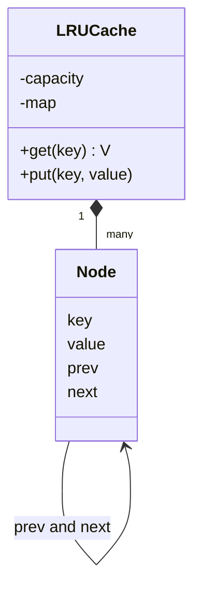

## Requirements

A **cache** keeps recent results close so the next request is fast. It has a fixed size, so something must be thrown out when it is full. **LRU (Least Recently Used)** throws out the entry that was used longest ago.

- `get(key)` returns the value, or a miss, and marks the entry as most recently used.
- `put(key, value)` inserts or updates, and marks the entry as most recently used.
- When the cache is full, `put` of a new key evicts the least recently used entry.
- Both operations must run in $O(1)$ time.
- Safe to call from several threads.

## Why two structures

| Need | Structure alone | Problem |
|---|---|---|
| Find a key fast | Hash map | No notion of order |
| Know the oldest entry | Linked list in use order | Finding a key takes $O(n)$ |
| Move an entry to the front | Array | Shifting costs $O(n)$ |

Combine them. The **hash map** goes from key to list node in $O(1)$. A **doubly linked list** keeps entries in use order: most recent at the front, least recent at the back. With the node already in hand, unlinking it and relinking it at the front is $O(1)$, because a doubly linked node knows both neighbours.



Two **sentinel** nodes (dummy head and tail that hold no data) remove all the null checks at the ends of the list. Watch the cache work:

```viz
algo: lru-cache
input:
  capacity: 3
  ops: ["put a 1", "put b 2", "put c 3", "get a", "put d 4", "get b", "get c"]
```

```quiz
q: Why must the list be doubly linked?
options:
  - So the list can be walked in both directions for printing
  - To unlink a node in O(1) you must reach its previous node, and a singly linked node has no pointer back
  - Doubly linked lists use less memory
answer: 1
why: "Removing a node means setting prev.next to next.next. With a singly linked list you would have to search from the head to find prev, which is O(n)."
```

## Code

The Java version builds the list by hand. The C++ version uses `std::list`, whose `splice` moves a node inside the list in $O(1)$, and keeps an iterator in the map. An optional eviction callback lets a caller observe evictions, for example to log them. Every method takes the lock, because even `get` changes the list.

```java
import java.util.*;
import java.util.function.Consumer;

class LRUCache<K, V> {
    private static final class Node<K, V> {
        final K key;
        V value;
        Node<K, V> prev, next;
        Node(K key, V value) { this.key = key; this.value = value; }
    }

    private final int capacity;
    private final Consumer<K> onEvict;
    private final Map<K, Node<K, V>> map = new HashMap<>();
    private final Node<K, V> head = new Node<>(null, null);   // sentinel on the most recent side
    private final Node<K, V> tail = new Node<>(null, null);   // sentinel on the least recent side
    private int hits = 0, misses = 0;

    LRUCache(int capacity, Consumer<K> onEvict) {
        if (capacity <= 0) throw new IllegalArgumentException("capacity must be positive");
        this.capacity = capacity;
        this.onEvict = onEvict;
        head.next = tail;
        tail.prev = head;
    }

    private void unlink(Node<K, V> n) {
        n.prev.next = n.next;
        n.next.prev = n.prev;
    }

    private void addFirst(Node<K, V> n) {
        n.next = head.next;
        n.prev = head;
        head.next.prev = n;
        head.next = n;
    }

    synchronized V get(K key) {
        Node<K, V> n = map.get(key);
        if (n == null) { misses++; return null; }
        hits++;
        unlink(n);
        addFirst(n);
        return n.value;
    }

    synchronized void put(K key, V value) {
        Node<K, V> n = map.get(key);
        if (n != null) {
            n.value = value;
            unlink(n);
            addFirst(n);
            return;
        }
        if (map.size() == capacity) {
            Node<K, V> lru = tail.prev;
            unlink(lru);
            map.remove(lru.key);
            if (onEvict != null) onEvict.accept(lru.key);
        }
        n = new Node<>(key, value);
        map.put(key, n);
        addFirst(n);
    }

    synchronized String order() {
        StringJoiner j = new StringJoiner(" ");
        for (Node<K, V> n = head.next; n != tail; n = n.next) j.add(String.valueOf(n.key));
        return j.toString();
    }

    synchronized String stats() { return "hits=" + hits + " misses=" + misses; }
}

public class Main {
    static void put(LRUCache<String, Integer> c, String k, int v) {
        System.out.println("put " + k + " " + v);
        c.put(k, v);
    }

    static void get(LRUCache<String, Integer> c, String k) {
        Integer v = c.get(k);
        System.out.println("get " + k + " -> " + (v == null ? "miss" : v));
    }

    public static void main(String[] args) {
        LRUCache<String, Integer> c = new LRUCache<>(3, k -> System.out.println("  evict " + k));
        put(c, "a", 1);
        put(c, "b", 2);
        put(c, "c", 3);
        get(c, "a");
        put(c, "d", 4);
        get(c, "b");
        get(c, "c");
        put(c, "a", 10);
        put(c, "e", 5);
        get(c, "d");
        System.out.println("order (most recent first): " + c.order());
        System.out.println(c.stats());
    }
}
```
```cpp
#include <cstddef>
#include <functional>
#include <iostream>
#include <list>
#include <mutex>
#include <optional>
#include <stdexcept>
#include <string>
#include <unordered_map>
#include <utility>
#include <vector>

template <class K, class V>
class LRUCache {
public:
    using EvictFn = std::function<void(const K&)>;

    explicit LRUCache(std::size_t capacity, EvictFn onEvict = nullptr)
        : capacity_(capacity), onEvict_(std::move(onEvict)) {
        if (capacity_ == 0) throw std::invalid_argument("capacity must be positive");
    }

    std::optional<V> get(const K& key) {
        std::lock_guard<std::mutex> lock(mu_);
        auto it = index_.find(key);
        if (it == index_.end()) { ++misses_; return std::nullopt; }
        ++hits_;
        items_.splice(items_.begin(), items_, it->second);   // move the node to the front in O(1)
        return it->second->second;
    }

    void put(const K& key, V value) {
        std::lock_guard<std::mutex> lock(mu_);
        auto it = index_.find(key);
        if (it != index_.end()) {
            it->second->second = std::move(value);
            items_.splice(items_.begin(), items_, it->second);
            return;
        }
        if (items_.size() == capacity_) {
            K victim = items_.back().first;      // copy the key before erasing the node
            index_.erase(victim);
            items_.pop_back();
            if (onEvict_) onEvict_(victim);
        }
        items_.emplace_front(key, std::move(value));
        index_[key] = items_.begin();
    }

    std::string order() const {
        std::lock_guard<std::mutex> lock(mu_);
        std::string out;
        for (const auto& kv : items_) {
            if (!out.empty()) out += " ";
            out += kv.first;
        }
        return out;
    }

    std::string stats() const {
        std::lock_guard<std::mutex> lock(mu_);
        return "hits=" + std::to_string(hits_) + " misses=" + std::to_string(misses_);
    }

private:
    std::size_t capacity_;
    EvictFn onEvict_;
    std::list<std::pair<K, V>> items_;   // front = most recent, back = least recent
    std::unordered_map<K, typename std::list<std::pair<K, V>>::iterator> index_;
    int hits_ = 0, misses_ = 0;
    mutable std::mutex mu_;
};

void put(LRUCache<std::string, int>& c, const std::string& k, int v) {
    std::cout << "put " << k << " " << v << "\n";
    c.put(k, v);
}

void get(LRUCache<std::string, int>& c, const std::string& k) {
    auto v = c.get(k);
    std::cout << "get " << k << " -> ";
    if (v) std::cout << *v << "\n";
    else std::cout << "miss\n";
}

int main() {
    LRUCache<std::string, int> c(3, [](const std::string& k) { std::cout << "  evict " << k << "\n"; });
    put(c, "a", 1);
    put(c, "b", 2);
    put(c, "c", 3);
    get(c, "a");
    put(c, "d", 4);
    get(c, "b");
    get(c, "c");
    put(c, "a", 10);
    put(c, "e", 5);
    get(c, "d");
    std::cout << "order (most recent first): " << c.order() << "\n";
    std::cout << c.stats() << "\n";
}
```
```output
put a 1
put b 2
put c 3
get a -> 1
put d 4
  evict b
get b -> miss
get c -> 3
put a 10
put e 5
  evict d
get d -> miss
order (most recent first): e a c
hits=2 misses=2
```

Compile the C++ with `g++ -std=c++17 -pthread`.

Java can do the same job in a few lines, because `LinkedHashMap` keeps entries in access order and has a hook to drop the eldest:

```java
class LruMap<K, V> extends LinkedHashMap<K, V> {
    private final int capacity;
    LruMap(int capacity) { super(16, 0.75f, true); this.capacity = capacity; }   // true = access order
    @Override protected boolean removeEldestEntry(Map.Entry<K, V> eldest) { return size() > capacity; }
}
```

:::truth
Interviewers who ask for an LRU cache almost always forbid `LinkedHashMap`, because the question is whether you can build it. Use it in real Java code. It is not thread-safe on its own, so wrap it with `Collections.synchronizedMap` or guard it yourself.
:::

## Check your understanding

```predict
lang: java
code: |
  LRUCache<String, Integer> c = new LRUCache<>(2, null);
  c.put("a", 1);
  c.put("b", 2);
  c.get("a");
  c.put("c", 3);
  System.out.println(c.get("a") + " " + c.get("b"));
output: 1 null
why: After get(a), the order is a, b with b least recent. Putting c evicts b. So a is still there and b is a miss.
```

```order
prompt: Arrange the body of get().
lang: java
code: |
  synchronized V get(K key) {
      Node<K, V> n = map.get(key);
      if (n == null) { misses++; return null; }
      hits++;
      unlink(n);
      addFirst(n);
      return n.value;
  }
distractors:
  - "    map.remove(key);"
why: Look up the node, return early on a miss, then move the node to the front. A hit is a use, so it changes the order. That is why even get needs the lock.
```

## Extensibility

| Change request | What changes |
|---|---|
| TTL per entry | Store an expiry time in `Node`; `get` treats an expired node as a miss and unlinks it. Pass a clock in |
| FIFO instead of LRU | Do not move the node on `get`. Only `put` of a new key adds at the front |
| LFU (Least Frequently Used) | A different structure: count per key and buckets by count |
| Observe evictions | Already there: the callback. This is the Observer pattern in its smallest form |
| Higher concurrency | Several independent caches picked by key hash. LRU order becomes per shard, not global |

Interview tips:

- Start from the access pattern, then the two structures. Say the complexity out loud.
- Mention the sentinels and why they remove special cases.
- Know why `get` is a write: it reorders the list.
- Offer `LinkedHashMap` in one sentence, then build it by hand.

```cards
- q: Which two structures make an O(1) LRU cache?
  a: A hash map from key to node, and a doubly linked list ordered by recency.
- q: Why does get() need exclusive access in a multi-threaded cache?
  a: A hit moves the node to the front, so it modifies the list. A plain read lock is not enough.
- q: What do sentinel nodes do?
  a: They are dummy head and tail nodes that remove null checks when inserting or unlinking at the ends.
- q: What does std::list::splice give you in C++?
  a: It moves a node within or between lists in O(1) without copying, and iterators to it stay valid.
- q: How does LinkedHashMap become an LRU cache?
  a: Construct it with access order set to true, and override removeEldestEntry to return true when size exceeds capacity.
```

## Notes

:::notes
- LRU cache: get and put in O(1), evict the least recently used entry when full.
- Hash map finds the node; a doubly linked list keeps recency order, most recent at the front.
- Use sentinel head and tail nodes to avoid null checks.
- get on a hit and put on an existing key both move the node to the front.
- Put on a new key at capacity: unlink the tail node, remove its key from the map, then insert.
- get mutates the list, so a thread-safe cache needs one exclusive lock, or sharding by key.
- C++: std::list plus unordered_map of iterators, with splice to move nodes.
- Java shortcut: LinkedHashMap with access order and removeEldestEntry; often not allowed in interviews.
:::
