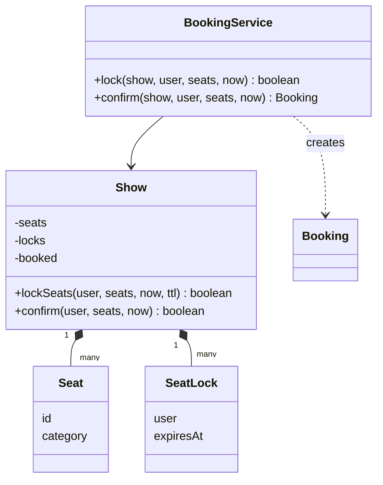
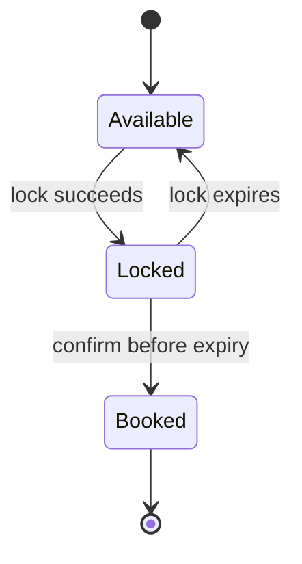

## Requirements

Clarify, then fix the scope. The interesting part of this problem is not browsing movies but **two people wanting the same seat at the same moment**.

- A **show** is one screening of a movie. It has a seat layout; seats have a category and a price.
- A user selects seats. The system **locks** them for a short time, say five minutes, while the user pays.
- If payment completes in time, the seats become **booked**. If not, the lock expires and others can take them.
- Selecting several seats is **all or nothing**: either the user gets every seat or none.
- Two users must never end up holding the same seat.

Out of scope: search, theatres and cities, payment itself, refunds, notifications.

## Entities

| Concept | Becomes |
|---|---|
| Seat (id, category) | `Seat` record; `SeatCategory` enum carries the price |
| A screening | `Show`, which owns the seat state |
| A temporary hold | `SeatLock` (user, expiry time) |
| A confirmed purchase | `Booking` record |
| The use cases | `BookingService`: lock, then confirm |

A full model also has `Movie`, `Theatre` and `Screen`. We leave them out of the code because `Show` can hold a movie name and a layout, and they add no new ideas.



A seat moves through three states. Expiry is not an event someone triggers; it is a time comparison.



## The hard part: concurrency

Locking looks like "check that the seat is free, then mark it locked". That is a **check-then-act** race: two threads can both pass the check before either writes. The check and the write must be one atomic step.

| Approach | Idea | Cost |
|---|---|---|
| One lock per show | `synchronized` on the show; lock all seats in one critical section | Simple and correct; shows are independent, so contention stays low |
| One lock per seat | Take seat locks in a fixed order, for example sorted by id | More parallel; ordering is required, or two users locking A1,A2 and A2,A1 deadlock |
| Database conditional update | `UPDATE ... WHERE status = 'AVAILABLE'` and check the row count | Works across many servers; the database is the arbiter |
| Redis `SET key value NX EX` | Set only if absent, with expiry | Fast shared locks with built-in TTL |

We use one lock per show. All-or-nothing falls out naturally: check every seat first, and write only if all pass.

:::key
Expiry is checked lazily. A lock stores `expiresAt`, and a seat counts as locked only while `expiresAt > now`. No timer thread is needed for correctness, and nothing can be stale.
:::

## Code

Time is a number of seconds passed in by the caller, so the demo is repeatable. Money is a `long` in whole rupees. The lock lifetime is 300 seconds. The last part races eight threads for one seat and counts the winners.

```java
import java.util.*;
import java.util.concurrent.atomic.AtomicInteger;

enum SeatCategory {
    REGULAR(200), PREMIUM(350);
    final long price;
    SeatCategory(long price) { this.price = price; }
}

enum SeatStatus { AVAILABLE, LOCKED, BOOKED }

record Seat(String id, SeatCategory category) {}
record SeatLock(String user, long expiresAt) {}
record Booking(int id, String user, String showId, List<String> seatIds, long amount) {}

class Show {
    final String id;
    final String movie;
    private final Map<String, Seat> seats = new TreeMap<>();
    private final Set<String> booked = new HashSet<>();
    private final Map<String, SeatLock> locks = new HashMap<>();

    Show(String id, String movie, List<Seat> layout) {
        this.id = id;
        this.movie = movie;
        for (Seat s : layout) seats.put(s.id(), s);
    }

    private SeatStatus status(String seatId, long now) {   // callers hold the lock
        if (!seats.containsKey(seatId)) throw new IllegalArgumentException("no such seat " + seatId);
        if (booked.contains(seatId)) return SeatStatus.BOOKED;
        SeatLock lock = locks.get(seatId);
        return lock != null && lock.expiresAt() > now ? SeatStatus.LOCKED : SeatStatus.AVAILABLE;
    }

    synchronized boolean lockSeats(String user, List<String> ids, long now, long ttl) {
        for (String id : ids)
            if (status(id, now) != SeatStatus.AVAILABLE) return false;   // check all first
        for (String id : ids) locks.put(id, new SeatLock(user, now + ttl));
        return true;
    }

    synchronized boolean confirm(String user, List<String> ids, long now) {
        for (String id : ids) {
            SeatLock l = locks.get(id);
            if (booked.contains(id) || l == null || !l.user().equals(user) || l.expiresAt() <= now) return false;
        }
        for (String id : ids) {
            locks.remove(id);
            booked.add(id);
        }
        return true;
    }

    synchronized String seatMap(long now) {
        StringJoiner j = new StringJoiner(" ");
        for (String id : seats.keySet()) j.add(id + "=" + status(id, now));
        return j.toString();
    }

    long price(List<String> ids) {
        long sum = 0;
        for (String id : ids) sum += seats.get(id).category().price;
        return sum;
    }
}

class BookingService {
    private final AtomicInteger nextId = new AtomicInteger(1);
    private final long lockTtl;

    BookingService(long lockTtl) { this.lockTtl = lockTtl; }

    boolean lock(Show show, String user, List<String> seatIds, long now) {
        return show.lockSeats(user, seatIds, now, lockTtl);
    }

    // payment happens between lock() and confirm(); the lock lifetime covers it
    Optional<Booking> confirm(Show show, String user, List<String> seatIds, long now) {
        if (!show.confirm(user, seatIds, now)) return Optional.empty();
        return Optional.of(new Booking(nextId.getAndIncrement(), user, show.id, seatIds, show.price(seatIds)));
    }
}

public class Main {
    static void lock(BookingService svc, Show show, String user, long now, String... seats) {
        List<String> ids = List.of(seats);
        System.out.println("t=" + now + " " + user + " locks " + String.join(",", ids)
            + " -> " + svc.lock(show, user, ids, now));
    }

    static void confirm(BookingService svc, Show show, String user, long now, String... seats) {
        List<String> ids = List.of(seats);
        Optional<Booking> b = svc.confirm(show, user, ids, now);
        System.out.println("t=" + now + " " + user + " confirms " + String.join(",", ids) + " -> "
            + (b.isPresent() ? "booking " + b.get().id() + ", amount " + b.get().amount()
                             : "lock missing or expired"));
    }

    public static void main(String[] args) throws Exception {
        BookingService svc = new BookingService(300);
        Show show = new Show("S1", "Dune", List.of(
            new Seat("A1", SeatCategory.REGULAR), new Seat("A2", SeatCategory.REGULAR),
            new Seat("B1", SeatCategory.PREMIUM), new Seat("B2", SeatCategory.PREMIUM)));

        lock(svc, show, "asha", 0, "A1", "A2");
        lock(svc, show, "ravi", 10, "A2", "B1");
        lock(svc, show, "ravi", 10, "B1", "B2");
        confirm(svc, show, "asha", 100, "A1", "A2");
        confirm(svc, show, "ravi", 400, "B1", "B2");
        lock(svc, show, "ravi", 400, "B1");
        System.out.println("seats at t=400: " + show.seatMap(400));

        Show late = new Show("S2", "Late show", List.of(new Seat("A1", SeatCategory.REGULAR)));
        AtomicInteger winners = new AtomicInteger();
        List<Thread> threads = new ArrayList<>();
        for (int i = 0; i < 8; i++) {
            String user = "u" + i;
            Thread t = new Thread(() -> { if (svc.lock(late, user, List.of("A1"), 0)) winners.incrementAndGet(); });
            threads.add(t);
            t.start();
        }
        for (Thread t : threads) t.join();
        System.out.println("race for one seat: " + winners.get() + " winner out of 8 threads");
    }
}
```
```cpp
#include <atomic>
#include <iostream>
#include <map>
#include <mutex>
#include <optional>
#include <set>
#include <stdexcept>
#include <string>
#include <thread>
#include <utility>
#include <vector>

enum class SeatCategory { Regular, Premium };
enum class SeatStatus { Available, Locked, Booked };

long priceOf(SeatCategory c) { return c == SeatCategory::Regular ? 200 : 350; }

const char* name(SeatStatus s) {
    switch (s) {
        case SeatStatus::Available: return "AVAILABLE";
        case SeatStatus::Locked: return "LOCKED";
        default: return "BOOKED";
    }
}

struct Seat { std::string id; SeatCategory category; };
struct SeatLock { std::string user; long expiresAt; };
struct Booking { int id; std::string user; std::string showId; std::vector<std::string> seatIds; long amount; };

std::string join(const std::vector<std::string>& v, const std::string& sep) {
    std::string out;
    for (const auto& s : v) out += (out.empty() ? "" : sep) + s;
    return out;
}

class Show {
public:
    Show(std::string id, std::string movie, const std::vector<Seat>& layout)
        : id_(std::move(id)), movie_(std::move(movie)) {
        for (const auto& s : layout) seats_.emplace(s.id, s);
    }

    const std::string& id() const { return id_; }
    const std::string& movie() const { return movie_; }

    bool lockSeats(const std::string& user, const std::vector<std::string>& ids, long now, long ttl) {
        std::lock_guard<std::mutex> lock(mu_);
        for (const auto& id : ids)
            if (status(id, now) != SeatStatus::Available) return false;   // check all first
        for (const auto& id : ids) locks_[id] = SeatLock{user, now + ttl};
        return true;
    }

    bool confirm(const std::string& user, const std::vector<std::string>& ids, long now) {
        std::lock_guard<std::mutex> lock(mu_);
        for (const auto& id : ids) {
            auto it = locks_.find(id);
            if (booked_.count(id) || it == locks_.end() || it->second.user != user || it->second.expiresAt <= now)
                return false;
        }
        for (const auto& id : ids) {
            locks_.erase(id);
            booked_.insert(id);
        }
        return true;
    }

    std::string seatMap(long now) const {
        std::lock_guard<std::mutex> lock(mu_);
        std::string out;
        for (const auto& kv : seats_) out += (out.empty() ? "" : " ") + kv.first + "=" + name(status(kv.first, now));
        return out;
    }

    long price(const std::vector<std::string>& ids) const {
        long sum = 0;
        for (const auto& id : ids) sum += priceOf(seats_.at(id).category);
        return sum;
    }

private:
    SeatStatus status(const std::string& id, long now) const {   // callers hold the lock
        if (!seats_.count(id)) throw std::invalid_argument("no such seat " + id);
        if (booked_.count(id)) return SeatStatus::Booked;
        auto it = locks_.find(id);
        return it != locks_.end() && it->second.expiresAt > now ? SeatStatus::Locked : SeatStatus::Available;
    }

    std::string id_, movie_;
    std::map<std::string, Seat> seats_;
    std::set<std::string> booked_;
    std::map<std::string, SeatLock> locks_;
    mutable std::mutex mu_;
};

class BookingService {
public:
    explicit BookingService(long lockTtl) : lockTtl_(lockTtl) {}

    bool lock(Show& show, const std::string& user, const std::vector<std::string>& ids, long now) {
        return show.lockSeats(user, ids, now, lockTtl_);
    }

    // payment happens between lock() and confirm(); the lock lifetime covers it
    std::optional<Booking> confirm(Show& show, const std::string& user, const std::vector<std::string>& ids, long now) {
        if (!show.confirm(user, ids, now)) return std::nullopt;
        return Booking{nextId_++, user, show.id(), ids, show.price(ids)};
    }

private:
    std::atomic<int> nextId_{1};
    long lockTtl_;
};

void lockAndPrint(BookingService& svc, Show& show, const std::string& user, long now,
                  const std::vector<std::string>& ids) {
    bool ok = svc.lock(show, user, ids, now);
    std::cout << "t=" << now << " " << user << " locks " << join(ids, ",") << " -> " << (ok ? "true" : "false") << "\n";
}

void confirmAndPrint(BookingService& svc, Show& show, const std::string& user, long now,
                     const std::vector<std::string>& ids) {
    auto b = svc.confirm(show, user, ids, now);
    std::cout << "t=" << now << " " << user << " confirms " << join(ids, ",") << " -> ";
    if (b) std::cout << "booking " << b->id << ", amount " << b->amount << "\n";
    else std::cout << "lock missing or expired\n";
}

int main() {
    BookingService svc(300);
    Show show("S1", "Dune", {{"A1", SeatCategory::Regular}, {"A2", SeatCategory::Regular},
                             {"B1", SeatCategory::Premium}, {"B2", SeatCategory::Premium}});

    lockAndPrint(svc, show, "asha", 0, {"A1", "A2"});
    lockAndPrint(svc, show, "ravi", 10, {"A2", "B1"});
    lockAndPrint(svc, show, "ravi", 10, {"B1", "B2"});
    confirmAndPrint(svc, show, "asha", 100, {"A1", "A2"});
    confirmAndPrint(svc, show, "ravi", 400, {"B1", "B2"});
    lockAndPrint(svc, show, "ravi", 400, {"B1"});
    std::cout << "seats at t=400: " << show.seatMap(400) << "\n";

    Show late("S2", "Late show", {{"A1", SeatCategory::Regular}});
    std::atomic<int> winners{0};
    std::vector<std::thread> threads;
    for (int i = 0; i < 8; ++i) {
        threads.emplace_back([&svc, &late, &winners, i] {
            if (svc.lock(late, "u" + std::to_string(i), {"A1"}, 0)) ++winners;
        });
    }
    for (auto& t : threads) t.join();
    std::cout << "race for one seat: " << winners.load() << " winner out of 8 threads\n";
}
```
```output
t=0 asha locks A1,A2 -> true
t=10 ravi locks A2,B1 -> false
t=10 ravi locks B1,B2 -> true
t=100 asha confirms A1,A2 -> booking 1, amount 400
t=400 ravi confirms B1,B2 -> lock missing or expired
t=400 ravi locks B1 -> true
seats at t=400: A1=BOOKED A2=BOOKED B1=LOCKED B2=AVAILABLE
race for one seat: 1 winner out of 8 threads
```

Compile the C++ with `g++ -std=c++17 -pthread`.

Follow the trace. Ravi's first request failed because A2 was held, and B1 stayed free, so his second request for B1 and B2 worked. His lock expired at second 310, so the confirm at 400 failed, but B1 could be locked again, and B2 was free for anyone.

## Check your understanding

```predict
lang: java
code: |
  long expiresAt = 310, now = 310;
  String status = expiresAt > now ? "LOCKED" : "AVAILABLE";
  System.out.println(status);
output: AVAILABLE
why: A lock is valid only while expiresAt is strictly greater than now. At the exact expiry second the seat is already available, and confirm uses the same rule, so the two methods agree.
```

```order
prompt: Arrange lockSeats so that it is all or nothing.
lang: java
code: |
  synchronized boolean lockSeats(String user, List<String> ids, long now, long ttl) {
      for (String id : ids) {
          if (status(id, now) != SeatStatus.AVAILABLE) return false;
      }
      for (String id : ids) locks.put(id, new SeatLock(user, now + ttl));
      return true;
  }
distractors:
  - "        locks.put(id, new SeatLock(user, now + ttl));"
why: All checks run before any write. If the write sat inside the first loop, a failure on the second seat would leave the first seat locked for a user who got nothing.
```

```quiz
q: Why is `synchronized` on the whole `lockSeats` method needed, instead of only on the `locks.put` call?
options:
  - Because put is not thread-safe on a HashMap
  - Because the check and the write together must be atomic, otherwise two threads can both pass the check
  - Because synchronized makes the method faster
answer: 1
why: "Locking only the write still leaves a gap between check and write. The race is in the sequence, so the whole sequence sits in one critical section."
```

:::truth
This in-memory design is correct only on one server. With several application servers, each has its own memory, so the lock must live in shared storage: a database row with a conditional update, or Redis. The class design stays the same; `Show.lockSeats` becomes a call to that store.
:::

## Extensibility and interview tips

| Change request | What changes |
|---|---|
| Release a lock early | A `release(user, ids)` that removes only locks owned by `user` |
| Dynamic pricing | A `PricingPolicy` interface; `Show.price` calls it |
| Many app servers | Move seat state to a database or Redis; keep the same service API |
| Notify on booking | Observer: `BookingService` publishes a `Booked` event |
| Payment failure | Call release, or just let the lock expire |

- Open with the race condition. It shows you saw the real problem.
- Say "all or nothing" and show the check-then-write structure.
- Explain lazy expiry against a sweeper; offer the sweeper as a cleanup, not a correctness need.
- Give the distributed answer in two sentences, and do not build it unless asked.

```cards
- q: What is a check-then-act race?
  a: Two threads both pass a check, then both act on it. The check and the action must be one atomic step.
- q: Why lock seats before payment?
  a: The user needs time to pay without losing the seat, and others must not pay for the same seat meanwhile.
- q: How does a lock expire without a timer thread?
  a: Store expiresAt. A seat is locked only while expiresAt is greater than now, so expiry is just a comparison.
- q: Why make multi-seat selection all or nothing?
  a: A partial hold leaves the user paying for seats they did not choose, and blocks seats nobody will buy.
- q: How do you avoid deadlock with per-seat locks?
  a: Always acquire the locks in one fixed global order, such as sorted by seat id.
```

## Notes

:::notes
- Core problem: two users, one seat. Lock first, confirm after payment, expire if unpaid.
- Seat states: Available, Locked (with owner and expiry), Booked.
- Check and write must be atomic. One lock per show makes multi-seat requests all or nothing.
- Lazy expiry: a lock counts only while expiresAt is greater than now. A sweeper is optional cleanup.
- confirm succeeds only if every seat is locked by this user and not expired.
- Per-seat locks give more parallelism but need a fixed acquisition order to avoid deadlock.
- Many servers need shared state: database conditional update or Redis SET NX EX.
- Pricing, release and notifications are small additions behind new methods or interfaces.
:::
