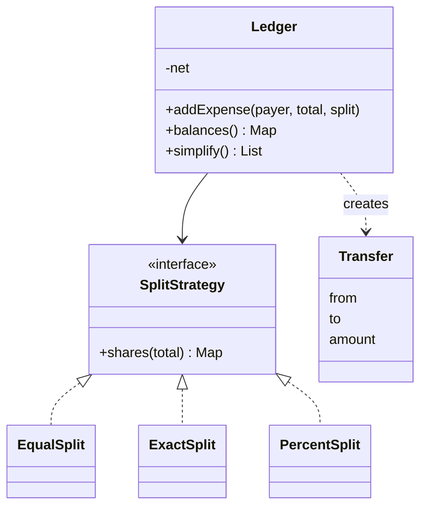

## Requirements

Clarify, then fix the scope:

- Users share **expenses** in a group. One person pays; the cost is split among some members.
- Three split types: **equal**, **exact** (stated amounts) and **percent**.
- The app can show each person's balance: how much they are owed or owe.
- **Simplify debts**: reduce the number of payments needed to settle everyone.
- Amounts must never drift by a fraction of a paisa.

Out of scope: login, several currencies, multiple payers, notifications, storage.

## Entities

| Concept | Becomes |
|---|---|
| User | A string id, to keep the code short |
| How a bill is divided | `SplitStrategy` interface with `EqualSplit`, `ExactSplit`, `PercentSplit` |
| Who owes what in total | `Ledger`, which keeps one **net balance** per user |
| A settling payment | `Transfer` record: from, to, amount |

A **net balance** is what a person is owed minus what they owe. Positive means others owe them; negative means they owe others. Net balances always add up to zero.



## Money and remainders

Never use floating point for money. `0.1 + 0.2` is not exactly `0.3` in binary, and errors add up. Store **paise** (hundredths of a rupee) in a `long`.

Equal splits create a **remainder**. 100.00 split three ways is 3333 paise each with 1 left over. Give the extra paise to the first people in a fixed order, so the shares always add back to the total.

```predict
lang: java
code: |
  long total = 10000;
  int n = 3;
  System.out.println(total / n + " " + total % n);
output: 3333 1
why: Integer division gives 3333 paise per person and the remainder is 1 paise. The first person pays 3334, the others 3333, and 3334 + 3333 + 3333 is exactly 10000.
```

```quiz
q: Why does the ledger store a net balance per user instead of a record of "A owes B" for every expense?
options:
  - Net balances use less memory only
  - They sum all expenses into one number per person, so balances are O(n) to read and simplification starts from them directly
  - Pairwise records cannot be stored in a map
answer: 1
why: "Each expense changes only the payer and the participants. One number per person is the minimum needed to settle everyone, and it is exactly the input the simplifier uses."
```

## Simplifying debts

Take the net balances. Positive people are **creditors**, negative people are **debtors**. Repeat:

1. Take the largest creditor and the largest debtor (a max-heap each).
2. The debtor pays the smaller of the two amounts to the creditor.
3. Put back whoever still has a remainder.

Each round settles at least one person, so the result has at most `k - 1` payments for `k` people with a nonzero balance. Step through the demo's final balances (paise, in order Asha, Ben, Chitra, Dev):

```steps
title: Greedy settlement on net balances
view: array
frames:
  - arr: [55000, -48334, 11667, -18333]
    highlight: {0: compare, 1: compare}
    note: Asha is the largest creditor and Ben the largest debtor. Ben pays Asha 48334.
  - arr: [6666, 0, 11667, -18333]
    highlight: {1: done, 2: compare, 3: compare}
    note: Ben is settled. Now Chitra (11667) is the largest creditor and Dev (-18333) the largest debtor. Dev pays Chitra 11667.
  - arr: [6666, 0, 0, -6666]
    highlight: {0: compare, 3: compare, 1: done, 2: done}
    note: Chitra is settled. Asha is owed 6666 and Dev owes 6666. Dev pays Asha 6666.
  - arr: [0, 0, 0, 0]
    highlight: {0: done, 1: done, 2: done, 3: done}
    note: Everyone is at zero after three payments.
```

:::truth
Greedy is simple and always valid, but it is not always minimal. The true minimum number of payments equals the number of nonzero people minus the most groups you can split them into where each group sums to zero. Finding that is NP-hard (no known fast algorithm for large inputs). For a friends group, greedy is the right answer; say so, and stop.
:::

## Code

All amounts are paise. The demo includes a bad exact split that is rejected without changing any balance. Heaps break ties by name, so the output is stable.

```java
import java.util.*;

final class Money {
    static String fmt(long p) {
        long a = Math.abs(p);
        return (p < 0 ? "-" : "") + a / 100 + "." + String.format("%02d", a % 100);
    }
    static String signed(long p) { return (p >= 0 ? "+" : "") + fmt(p); }
}

interface SplitStrategy {
    Map<String, Long> shares(long total);   // user -> amount owed
}

class EqualSplit implements SplitStrategy {
    private final List<String> users;
    EqualSplit(List<String> users) {
        this.users = new ArrayList<>(users);
        Collections.sort(this.users);
    }
    public Map<String, Long> shares(long total) {
        Map<String, Long> out = new TreeMap<>();
        long base = total / users.size(), extra = total % users.size();
        for (int i = 0; i < users.size(); i++) out.put(users.get(i), base + (i < extra ? 1 : 0));
        return out;
    }
}

class ExactSplit implements SplitStrategy {
    private final Map<String, Long> amounts;
    ExactSplit(Map<String, Long> amounts) { this.amounts = new TreeMap<>(amounts); }
    public Map<String, Long> shares(long total) {
        long sum = 0;
        for (long a : amounts.values()) sum += a;
        if (sum != total)
            throw new IllegalArgumentException("exact shares add up to " + Money.fmt(sum) + ", expected " + Money.fmt(total));
        return amounts;
    }
}

class PercentSplit implements SplitStrategy {
    private final Map<String, Integer> percents;
    PercentSplit(Map<String, Integer> percents) { this.percents = new TreeMap<>(percents); }
    public Map<String, Long> shares(long total) {
        int sum = 0;
        for (int p : percents.values()) sum += p;
        if (sum != 100) throw new IllegalArgumentException("percentages add up to " + sum + ", expected 100");
        Map<String, Long> out = new TreeMap<>();
        long assigned = 0;
        for (Map.Entry<String, Integer> e : percents.entrySet()) {
            long share = total * e.getValue() / 100;
            out.put(e.getKey(), share);
            assigned += share;
        }
        long left = total - assigned;                  // rounding leftovers go to the first names
        for (String u : out.keySet()) {
            if (left == 0) break;
            out.merge(u, 1L, Long::sum);
            left--;
        }
        return out;
    }
}

record Transfer(String from, String to, long amount) {}
record Balance(String user, long amount) {}

class Ledger {
    private final Map<String, Long> net = new TreeMap<>();   // positive: is owed, negative: owes
    private int rawDebts = 0;

    void addExpense(String payer, long total, SplitStrategy split) {
        Map<String, Long> shares = split.shares(total);      // may throw before anything changes
        net.merge(payer, total, Long::sum);
        for (Map.Entry<String, Long> e : shares.entrySet()) {
            net.merge(e.getKey(), -e.getValue(), Long::sum);
            if (!e.getKey().equals(payer)) rawDebts++;
        }
    }

    Map<String, Long> balances() { return Collections.unmodifiableMap(net); }
    int rawDebts() { return rawDebts; }

    List<Transfer> simplify() {
        Comparator<Balance> largestFirst = (a, b) ->
            a.amount() != b.amount() ? Long.compare(b.amount(), a.amount()) : a.user().compareTo(b.user());
        PriorityQueue<Balance> creditors = new PriorityQueue<>(largestFirst);
        PriorityQueue<Balance> debtors = new PriorityQueue<>(largestFirst);
        for (Map.Entry<String, Long> e : net.entrySet()) {
            if (e.getValue() > 0) creditors.add(new Balance(e.getKey(), e.getValue()));
            else if (e.getValue() < 0) debtors.add(new Balance(e.getKey(), -e.getValue()));
        }
        List<Transfer> out = new ArrayList<>();
        while (!creditors.isEmpty() && !debtors.isEmpty()) {
            Balance c = creditors.poll(), d = debtors.poll();
            long amt = Math.min(c.amount(), d.amount());
            out.add(new Transfer(d.user(), c.user(), amt));
            if (c.amount() > amt) creditors.add(new Balance(c.user(), c.amount() - amt));
            if (d.amount() > amt) debtors.add(new Balance(d.user(), d.amount() - amt));
        }
        return out;
    }
}

public class Main {
    static void add(Ledger ledger, String desc, String payer, long total, SplitStrategy split) {
        try {
            ledger.addExpense(payer, total, split);
            System.out.println("added " + desc + " " + Money.fmt(total) + " paid by " + payer);
        } catch (IllegalArgumentException e) {
            System.out.println("rejected " + desc + ": " + e.getMessage());
        }
    }

    public static void main(String[] args) {
        Ledger ledger = new Ledger();
        add(ledger, "dinner", "Asha", 100000, new EqualSplit(List.of("Asha", "Ben", "Chitra", "Dev")));
        add(ledger, "taxi", "Ben", 10000, new EqualSplit(List.of("Ben", "Chitra", "Dev")));
        add(ledger, "hotel-bad", "Chitra", 60000,
            new ExactSplit(Map.of("Asha", 15000L, "Ben", 25000L, "Chitra", 19000L)));
        add(ledger, "hotel", "Chitra", 60000,
            new ExactSplit(Map.of("Asha", 15000L, "Ben", 25000L, "Chitra", 20000L)));
        add(ledger, "snacks", "Dev", 20000, new PercentSplit(Map.of("Asha", 25, "Ben", 25, "Dev", 50)));

        StringJoiner line = new StringJoiner(", ");
        ledger.balances().forEach((user, amount) -> line.add(user + " " + Money.signed(amount)));
        System.out.println("balances: " + line);

        List<Transfer> plan = ledger.simplify();
        for (Transfer t : plan) System.out.println(t.from() + " pays " + t.to() + " " + Money.fmt(t.amount()));
        System.out.println(plan.size() + " payments instead of " + ledger.rawDebts() + " raw debts");
    }
}
```
```cpp
#include <algorithm>
#include <cstdlib>
#include <iostream>
#include <map>
#include <queue>
#include <stdexcept>
#include <string>
#include <utility>
#include <vector>

using Shares = std::map<std::string, long>;

std::string fmt(long p) {
    long a = std::labs(p);
    std::string cents = std::to_string(a % 100);
    if (cents.size() < 2) cents = "0" + cents;
    return std::string(p < 0 ? "-" : "") + std::to_string(a / 100) + "." + cents;
}

std::string signedFmt(long p) { return std::string(p >= 0 ? "+" : "") + fmt(p); }

class SplitStrategy {
public:
    virtual ~SplitStrategy() = default;
    virtual Shares shares(long total) const = 0;   // user -> amount owed
};

class EqualSplit : public SplitStrategy {
public:
    explicit EqualSplit(std::vector<std::string> users) : users_(std::move(users)) {
        std::sort(users_.begin(), users_.end());
    }
    Shares shares(long total) const override {
        Shares out;
        long n = static_cast<long>(users_.size());
        long base = total / n, extra = total % n;
        for (long i = 0; i < n; ++i) out[users_[i]] = base + (i < extra ? 1 : 0);
        return out;
    }
private:
    std::vector<std::string> users_;
};

class ExactSplit : public SplitStrategy {
public:
    explicit ExactSplit(Shares amounts) : amounts_(std::move(amounts)) {}
    Shares shares(long total) const override {
        long sum = 0;
        for (const auto& kv : amounts_) sum += kv.second;
        if (sum != total)
            throw std::invalid_argument("exact shares add up to " + fmt(sum) + ", expected " + fmt(total));
        return amounts_;
    }
private:
    Shares amounts_;
};

class PercentSplit : public SplitStrategy {
public:
    explicit PercentSplit(std::map<std::string, int> percents) : percents_(std::move(percents)) {}
    Shares shares(long total) const override {
        int sum = 0;
        for (const auto& kv : percents_) sum += kv.second;
        if (sum != 100) throw std::invalid_argument("percentages add up to " + std::to_string(sum) + ", expected 100");
        Shares out;
        long assigned = 0;
        for (const auto& kv : percents_) {
            long share = total * kv.second / 100;
            out[kv.first] = share;
            assigned += share;
        }
        long left = total - assigned;                  // rounding leftovers go to the first names
        for (auto& kv : out) {
            if (left == 0) break;
            kv.second += 1;
            --left;
        }
        return out;
    }
private:
    std::map<std::string, int> percents_;
};

struct Transfer { std::string from, to; long amount; };
struct Balance { std::string user; long amount; };

struct LargestFirst {
    bool operator()(const Balance& a, const Balance& b) const {   // true when a has lower priority
        return a.amount != b.amount ? a.amount < b.amount : a.user > b.user;
    }
};
using Heap = std::priority_queue<Balance, std::vector<Balance>, LargestFirst>;

class Ledger {
public:
    void addExpense(const std::string& payer, long total, const SplitStrategy& split) {
        Shares shares = split.shares(total);           // may throw before anything changes
        net_[payer] += total;
        for (const auto& kv : shares) {
            net_[kv.first] -= kv.second;
            if (kv.first != payer) ++rawDebts_;
        }
    }

    const std::map<std::string, long>& balances() const { return net_; }
    int rawDebts() const { return rawDebts_; }

    std::vector<Transfer> simplify() const {
        Heap creditors, debtors;
        for (const auto& kv : net_) {
            if (kv.second > 0) creditors.push({kv.first, kv.second});
            else if (kv.second < 0) debtors.push({kv.first, -kv.second});
        }
        std::vector<Transfer> out;
        while (!creditors.empty() && !debtors.empty()) {
            Balance c = creditors.top(); creditors.pop();
            Balance d = debtors.top(); debtors.pop();
            long amt = std::min(c.amount, d.amount);
            out.push_back({d.user, c.user, amt});
            if (c.amount > amt) creditors.push({c.user, c.amount - amt});
            if (d.amount > amt) debtors.push({d.user, d.amount - amt});
        }
        return out;
    }

private:
    std::map<std::string, long> net_;   // positive: is owed, negative: owes
    int rawDebts_ = 0;
};

void add(Ledger& ledger, const std::string& desc, const std::string& payer, long total, const SplitStrategy& split) {
    try {
        ledger.addExpense(payer, total, split);
        std::cout << "added " << desc << " " << fmt(total) << " paid by " << payer << "\n";
    } catch (const std::invalid_argument& e) {
        std::cout << "rejected " << desc << ": " << e.what() << "\n";
    }
}

int main() {
    Ledger ledger;
    add(ledger, "dinner", "Asha", 100000, EqualSplit({"Asha", "Ben", "Chitra", "Dev"}));
    add(ledger, "taxi", "Ben", 10000, EqualSplit({"Ben", "Chitra", "Dev"}));
    add(ledger, "hotel-bad", "Chitra", 60000, ExactSplit({{"Asha", 15000}, {"Ben", 25000}, {"Chitra", 19000}}));
    add(ledger, "hotel", "Chitra", 60000, ExactSplit({{"Asha", 15000}, {"Ben", 25000}, {"Chitra", 20000}}));
    add(ledger, "snacks", "Dev", 20000, PercentSplit({{"Asha", 25}, {"Ben", 25}, {"Dev", 50}}));

    std::string line;
    for (const auto& kv : ledger.balances()) {
        if (!line.empty()) line += ", ";
        line += kv.first + " " + signedFmt(kv.second);
    }
    std::cout << "balances: " << line << "\n";

    auto plan = ledger.simplify();
    for (const auto& t : plan) std::cout << t.from << " pays " << t.to << " " << fmt(t.amount) << "\n";
    std::cout << plan.size() << " payments instead of " << ledger.rawDebts() << " raw debts\n";
}
```
```output
added dinner 1000.00 paid by Asha
added taxi 100.00 paid by Ben
rejected hotel-bad: exact shares add up to 590.00, expected 600.00
added hotel 600.00 paid by Chitra
added snacks 200.00 paid by Dev
balances: Asha +550.00, Ben -483.34, Chitra +116.67, Dev -183.33
Ben pays Asha 483.34
Dev pays Chitra 116.67
Dev pays Asha 66.66
3 payments instead of 9 raw debts
```

Compile the C++ with `g++ -std=c++17 -pthread`.

Put the settlement loop in order:

```order
prompt: Arrange the body of the simplify loop.
lang: java
code: |
  while (!creditors.isEmpty() && !debtors.isEmpty()) {
      Balance c = creditors.poll(), d = debtors.poll();
      long amt = Math.min(c.amount(), d.amount());
      out.add(new Transfer(d.user(), c.user(), amt));
      if (c.amount() > amt) creditors.add(new Balance(c.user(), c.amount() - amt));
      if (d.amount() > amt) debtors.add(new Balance(d.user(), d.amount() - amt));
  }
distractors:
  - "    long amt = Math.max(c.amount(), d.amount());"
why: The payment is the smaller of the two amounts, because it cannot exceed what the debtor owes or what the creditor is owed. Whoever has some left goes back in the heap.
```

## Extensibility

| Change request | What changes |
|---|---|
| Split by shares or weights | New `SplitStrategy`; nothing else |
| Delete or edit an expense | Keep the `Expense` records. Reverse the old effect, then apply the new one |
| Settle up | Record a `Transfer`: payer's net goes up, receiver's goes down |
| Several payers | `addExpense` takes a map of payer to amount |
| Several groups | One `Ledger` per group, owned by a `Group` class |

- Mention the strategies first: split types are the part that varies.
- Show you chose integer money and a fixed order for remainders without being asked.
- State the guarantee of greedy simplification and its limit in one sentence each.
- Validate before mutating, as `addExpense` does: compute the shares, which may throw, and only then change the balances.

```cards
- q: Why store money as an integer count of paise?
  a: Binary floating point cannot represent most decimal fractions exactly, so errors accumulate. Integers are exact.
- q: How are remainders handled in an equal split?
  a: Divide to get a base share, then give one extra paisa to the first few people in a fixed order so the shares sum to the total.
- q: What is a net balance?
  a: Total owed to a person minus total they owe. Positive is a creditor, negative a debtor, and all balances sum to zero.
- q: How does greedy debt simplification work?
  a: Repeatedly match the largest creditor with the largest debtor, settle the smaller amount, and return the remainder to its heap.
- q: Is greedy simplification optimal?
  a: Not always. It yields at most k minus 1 payments, but the true minimum is NP-hard to find.
```

## Notes

:::notes
- Entities: SplitStrategy (Equal, Exact, Percent), Ledger with net balances, Transfer.
- Money is a long in the smallest unit. Floating point drifts.
- Equal split: base share plus one extra paisa for the first few users in a fixed order.
- Validate a split (sum equals total, percents equal 100) before changing any balance.
- Net balance = owed to you minus you owe; all balances sum to zero.
- Simplify: max-heap of creditors and of debtors, pay the smaller amount, push back remainders.
- Greedy gives at most k - 1 payments; the true minimum is NP-hard, so greedy is the pragmatic answer.
- New split types, settle-up and edits plug in without restructuring the ledger.
:::
