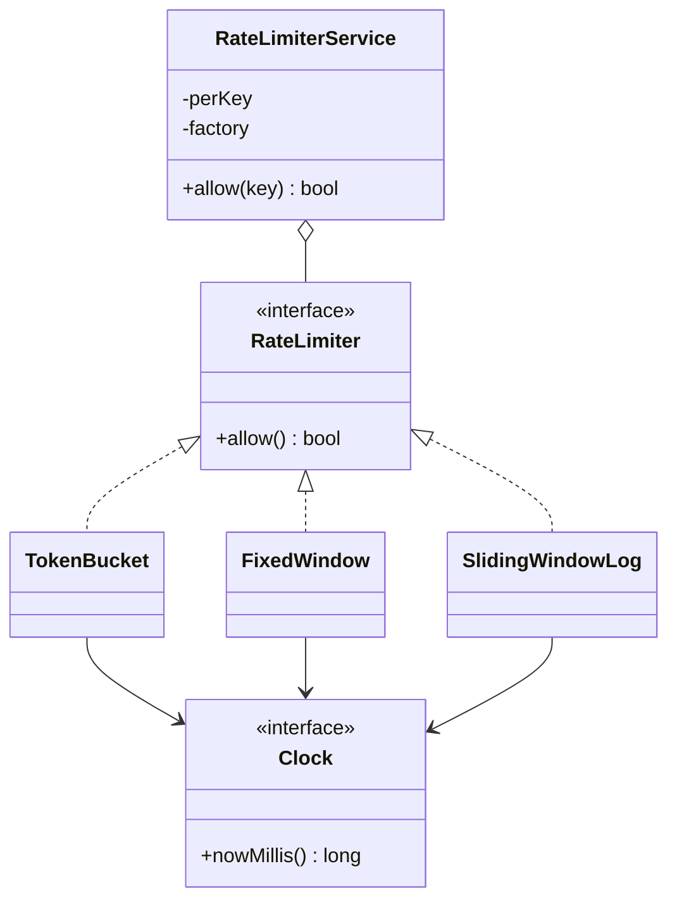

## Requirements

A **rate limiter** decides whether a request may go ahead or must be refused because the caller has sent too many. It protects a service from overload, abuse and one noisy client.

- `allow(key)` answers yes or no for one client, identified by a key such as a user id or an IP address.
- Each key has its own independent budget.
- The algorithm is swappable: token bucket, fixed window, sliding window log.
- Safe to call from many threads.
- Time comes from an injected clock, so tests do not need to sleep.

Out of scope for this lesson: sharing counters between several servers (see the truth box below).

## Entities

| Entity | Responsibility |
|---|---|
| `RateLimiter` | Interface with one method, `allow()`. State for one key |
| `TokenBucket`, `FixedWindow`, `SlidingWindowLog` | The algorithms. Each is a strategy |
| `RateLimiterService` | Map from key to limiter. Creates a limiter on the first request |
| `Clock` | Source of "now". A manual clock makes tests exact |



The service does not know which algorithm it runs. It receives a **factory** (a function that builds a new limiter) and calls it once per new key. That is the Strategy pattern: the algorithm sits behind an interface.

## The algorithms

| Algorithm | State per key | Bursts | Weakness |
|---|---|---|---|
| Token bucket | Token count and last-refill time | Allowed up to the capacity | Needs a floating-point or scaled count |
| Fixed window | One counter and the window number | Up to 2x the limit across a boundary | The boundary burst |
| Sliding window log | Timestamp of every recent request | Never above the limit | Memory grows with the limit |

- **Token bucket:** a bucket holds up to `capacity` tokens and refills at a steady rate. A request takes one token. If the bucket is empty, the request is refused. Idle clients build up credit, so short bursts pass.
- **Fixed window:** count requests in each calendar window (for example each second). The counter resets when a new window starts.
- **Sliding window log:** keep the time of each accepted request, drop those older than the window, and allow only if fewer than `limit` remain.

Step through a bucket with capacity 3 that refills one token per second:

```viz
algo: token-bucket
input:
  capacity: 3
  refillPerSec: 1
  requests: [0, 0.2, 0.4, 0.6, 1.5, 2.1, 2.2, 4, 4.1, 4.2]
```

```quiz
q: A fixed window allows 100 requests per minute. A client sends 100 requests at 00:59 and 100 more at 01:00. What happens?
options:
  - The second batch is refused, because the client already used its minute
  - All 200 pass within about a second, because the counter resets at 01:00
  - Only 50 of the second batch pass
answer: 1
why: "The windows are 00:00-00:59 and 01:00-01:59. The counter resets at the boundary, so the client gets 200 requests through in roughly one second. A sliding window or a token bucket does not have this gap."
```

## Code

Refill in the token bucket is lazy. There is no timer thread. On each call it works out how many tokens have accrued since the last call. Every limiter guards its own state with a lock, and the service guards only the map, so two different keys never wait for each other. The demo runs on a manual clock, so the output is exact.

```java
import java.util.*;
import java.util.concurrent.ConcurrentHashMap;
import java.util.function.Supplier;

interface Clock {
    long nowMillis();
}

class ManualClock implements Clock {
    private long now = 0;
    public long nowMillis() { return now; }
    void set(long millis) { now = millis; }
}

interface RateLimiter {
    boolean allow();
}

class TokenBucket implements RateLimiter {
    private final double capacity;
    private final double refillPerSec;
    private final Clock clock;
    private double tokens;
    private long lastMillis;

    TokenBucket(double capacity, double refillPerSec, Clock clock) {
        this.capacity = capacity;
        this.refillPerSec = refillPerSec;
        this.clock = clock;
        this.tokens = capacity;                 // start full
        this.lastMillis = clock.nowMillis();
    }

    public synchronized boolean allow() {
        long now = clock.nowMillis();
        tokens = Math.min(capacity, tokens + (now - lastMillis) * refillPerSec / 1000.0);
        lastMillis = now;
        if (tokens >= 1) {
            tokens -= 1;
            return true;
        }
        return false;
    }
}

class FixedWindow implements RateLimiter {
    private final int limit;
    private final long windowMs;
    private final Clock clock;
    private long currentWindow = -1;
    private int count = 0;

    FixedWindow(int limit, long windowMs, Clock clock) {
        this.limit = limit;
        this.windowMs = windowMs;
        this.clock = clock;
    }

    public synchronized boolean allow() {
        long window = clock.nowMillis() / windowMs;
        if (window != currentWindow) {          // a new window starts: the counter resets
            currentWindow = window;
            count = 0;
        }
        if (count < limit) {
            count++;
            return true;
        }
        return false;
    }
}

class SlidingWindowLog implements RateLimiter {
    private final int limit;
    private final long windowMs;
    private final Clock clock;
    private final Deque<Long> stamps = new ArrayDeque<>();

    SlidingWindowLog(int limit, long windowMs, Clock clock) {
        this.limit = limit;
        this.windowMs = windowMs;
        this.clock = clock;
    }

    public synchronized boolean allow() {
        long now = clock.nowMillis();
        while (!stamps.isEmpty() && stamps.peekFirst() <= now - windowMs) {
            stamps.pollFirst();                 // forget requests that left the window
        }
        if (stamps.size() < limit) {
            stamps.addLast(now);
            return true;
        }
        return false;
    }
}

class RateLimiterService {
    private final Map<String, RateLimiter> perKey = new ConcurrentHashMap<>();
    private final Supplier<RateLimiter> factory;

    RateLimiterService(Supplier<RateLimiter> factory) {
        this.factory = factory;
    }

    boolean allow(String key) {
        return perKey.computeIfAbsent(key, k -> factory.get()).allow();
    }
}

public class Main {
    static void hit(RateLimiterService s, ManualClock c, long t, String key) {
        c.set(t);
        System.out.println("t=" + t + " " + key + " " + (s.allow(key) ? "allow" : "deny"));
    }

    public static void main(String[] args) {
        ManualClock clock = new ManualClock();

        System.out.println("-- token bucket: capacity 3, 1 token per second");
        RateLimiterService bucket = new RateLimiterService(() -> new TokenBucket(3, 1, clock));
        for (int i = 0; i < 4; i++) hit(bucket, clock, 0, "alice");
        hit(bucket, clock, 1500, "alice");
        hit(bucket, clock, 1500, "alice");
        hit(bucket, clock, 2000, "alice");

        System.out.println("-- fixed window: 2 per second, requests around the boundary");
        RateLimiterService fixed = new RateLimiterService(() -> new FixedWindow(2, 1000, clock));
        for (long t : new long[]{900, 900, 1000, 1000, 1000}) hit(fixed, clock, t, "alice");

        System.out.println("-- sliding window log: same limit, same requests");
        RateLimiterService log = new RateLimiterService(() -> new SlidingWindowLog(2, 1000, clock));
        for (long t : new long[]{900, 900, 1000, 1000, 1900}) hit(log, clock, t, "alice");

        System.out.println("-- one limiter per key");
        RateLimiterService perUser = new RateLimiterService(() -> new TokenBucket(1, 1, clock));
        hit(perUser, clock, 0, "alice");
        hit(perUser, clock, 0, "alice");
        hit(perUser, clock, 0, "bob");
    }
}
```
```cpp
#include <algorithm>
#include <deque>
#include <functional>
#include <iostream>
#include <memory>
#include <mutex>
#include <string>
#include <unordered_map>
#include <vector>

class Clock {
public:
    virtual ~Clock() = default;
    virtual long long nowMillis() const = 0;
};

class ManualClock : public Clock {
public:
    long long nowMillis() const override { return now_; }
    void set(long long millis) { now_ = millis; }

private:
    long long now_ = 0;
};

class RateLimiter {
public:
    virtual ~RateLimiter() = default;
    virtual bool allow() = 0;
};

class TokenBucket : public RateLimiter {
public:
    TokenBucket(double capacity, double refillPerSec, const Clock& clock)
        : capacity_(capacity), refillPerSec_(refillPerSec), clock_(clock),
          tokens_(capacity), lastMillis_(clock.nowMillis()) {}   // start full

    bool allow() override {
        std::lock_guard<std::mutex> lock(mu_);
        long long now = clock_.nowMillis();
        tokens_ = std::min(capacity_, tokens_ + (now - lastMillis_) * refillPerSec_ / 1000.0);
        lastMillis_ = now;
        if (tokens_ >= 1) {
            tokens_ -= 1;
            return true;
        }
        return false;
    }

private:
    double capacity_;
    double refillPerSec_;
    const Clock& clock_;
    double tokens_;
    long long lastMillis_;
    std::mutex mu_;
};

class FixedWindow : public RateLimiter {
public:
    FixedWindow(int limit, long long windowMs, const Clock& clock)
        : limit_(limit), windowMs_(windowMs), clock_(clock) {}

    bool allow() override {
        std::lock_guard<std::mutex> lock(mu_);
        long long window = clock_.nowMillis() / windowMs_;
        if (window != currentWindow_) {        // a new window starts: the counter resets
            currentWindow_ = window;
            count_ = 0;
        }
        if (count_ < limit_) {
            ++count_;
            return true;
        }
        return false;
    }

private:
    int limit_;
    long long windowMs_;
    const Clock& clock_;
    long long currentWindow_ = -1;
    int count_ = 0;
    std::mutex mu_;
};

class SlidingWindowLog : public RateLimiter {
public:
    SlidingWindowLog(std::size_t limit, long long windowMs, const Clock& clock)
        : limit_(limit), windowMs_(windowMs), clock_(clock) {}

    bool allow() override {
        std::lock_guard<std::mutex> lock(mu_);
        long long now = clock_.nowMillis();
        while (!stamps_.empty() && stamps_.front() <= now - windowMs_) {
            stamps_.pop_front();               // forget requests that left the window
        }
        if (stamps_.size() < limit_) {
            stamps_.push_back(now);
            return true;
        }
        return false;
    }

private:
    std::size_t limit_;
    long long windowMs_;
    const Clock& clock_;
    std::deque<long long> stamps_;
    std::mutex mu_;
};

class RateLimiterService {
public:
    using Factory = std::function<std::unique_ptr<RateLimiter>()>;

    explicit RateLimiterService(Factory factory) : factory_(std::move(factory)) {}

    bool allow(const std::string& key) {
        RateLimiter* limiter = nullptr;
        {
            std::lock_guard<std::mutex> lock(mu_);   // protects the map only
            auto& slot = perKey_[key];
            if (!slot) slot = factory_();
            limiter = slot.get();                    // entries are never erased, so the pointer stays valid
        }
        return limiter->allow();                     // each limiter has its own lock
    }

private:
    Factory factory_;
    std::unordered_map<std::string, std::unique_ptr<RateLimiter>> perKey_;
    std::mutex mu_;
};

void hit(RateLimiterService& s, ManualClock& c, long long t, const std::string& key) {
    c.set(t);
    std::cout << "t=" << t << " " << key << " " << (s.allow(key) ? "allow" : "deny") << "\n";
}

int main() {
    ManualClock clock;

    std::cout << "-- token bucket: capacity 3, 1 token per second\n";
    RateLimiterService bucket([&clock] { return std::make_unique<TokenBucket>(3, 1, clock); });
    for (int i = 0; i < 4; ++i) hit(bucket, clock, 0, "alice");
    hit(bucket, clock, 1500, "alice");
    hit(bucket, clock, 1500, "alice");
    hit(bucket, clock, 2000, "alice");

    std::cout << "-- fixed window: 2 per second, requests around the boundary\n";
    RateLimiterService fixed([&clock] { return std::make_unique<FixedWindow>(2, 1000, clock); });
    for (long long t : std::vector<long long>{900, 900, 1000, 1000, 1000}) hit(fixed, clock, t, "alice");

    std::cout << "-- sliding window log: same limit, same requests\n";
    RateLimiterService log([&clock] { return std::make_unique<SlidingWindowLog>(2, 1000, clock); });
    for (long long t : std::vector<long long>{900, 900, 1000, 1000, 1900}) hit(log, clock, t, "alice");

    std::cout << "-- one limiter per key\n";
    RateLimiterService perUser([&clock] { return std::make_unique<TokenBucket>(1, 1, clock); });
    hit(perUser, clock, 0, "alice");
    hit(perUser, clock, 0, "alice");
    hit(perUser, clock, 0, "bob");
}
```
```output
-- token bucket: capacity 3, 1 token per second
t=0 alice allow
t=0 alice allow
t=0 alice allow
t=0 alice deny
t=1500 alice allow
t=1500 alice deny
t=2000 alice allow
-- fixed window: 2 per second, requests around the boundary
t=900 alice allow
t=900 alice allow
t=1000 alice allow
t=1000 alice allow
t=1000 alice deny
-- sliding window log: same limit, same requests
t=900 alice allow
t=900 alice allow
t=1000 alice deny
t=1000 alice deny
t=1900 alice allow
-- one limiter per key
t=0 alice allow
t=0 alice deny
t=0 bob allow
```

Compile the C++ with `g++ -std=c++17 -pthread`.

Read the middle two blocks of output together. The fixed window lets four requests through in 100 ms around the boundary at 1000. The sliding log, given the same requests, refuses the two at 1000 and accepts again only once the old ones have aged out.

:::warn
Do not read the clock twice inside `allow()`. If the refill uses one reading and the timestamp update uses another, tokens can be counted twice or lost. Read it once into a local variable.
:::

## Check your understanding

```predict
lang: java
code: |
  ManualClock clock = new ManualClock();
  TokenBucket b = new TokenBucket(2, 1, clock);   // capacity 2, 1 token per second
  StringBuilder sb = new StringBuilder();
  for (long t : new long[]{0, 0, 0, 500, 1000}) {
      clock.set(t);
      sb.append(b.allow()).append(' ');
  }
  System.out.println(sb.toString().trim());
output: true true false false true
why: The bucket starts full, so the first two pass and the third finds it empty. At 500 ms only 0.5 tokens have accrued, which is below 1. At 1000 ms the count reaches 1.0, so the request passes.
```

```order
prompt: Arrange the body of the sliding window log's allow().
lang: java
code: |
  public synchronized boolean allow() {
      long now = clock.nowMillis();
      while (!stamps.isEmpty() && stamps.peekFirst() <= now - windowMs) {
          stamps.pollFirst();
      }
      if (stamps.size() < limit) {
          stamps.addLast(now);
          return true;
      }
      return false;
  }
distractors:
  - "    stamps.addLast(now);"
why: First forget timestamps that left the window, then compare the count with the limit. Only an accepted request is recorded. Recording a refused one would punish a client for being refused.
```

## Extensibility

| Change request | What changes |
|---|---|
| New algorithm | One new class implementing `RateLimiter`. The service is untouched |
| Different limits per tier | The factory takes the key or tier and builds a differently configured limiter |
| Retry-after in the response | `allow()` returns a small result object holding the decision and the wait time |
| Idle keys pile up | Track last-used time and remove old entries on a schedule. Remove carefully if a request is in flight |
| Several servers | Move the state to a shared store (see below) |

:::truth
Real systems usually run several servers, so a limiter in one process's memory only limits that process. The common answer is to keep the counters in Redis (an in-memory data store) and run the check-and-update as one atomic Lua script. That adds a network call to every request and a failure mode: decide what happens when the store is down, "fail open" (allow) or "fail closed" (deny). In an LLD round, say this in two sentences and keep the single-process design.
:::

Interview tips:

- Ask first: per user, per IP or per API? What should a refused caller get back?
- Name the algorithm trade-off in one line before coding: bursts versus memory versus boundary behaviour.
- Inject the clock. Tests that call `sleep` are slow and flaky.
- Point out the lock scope: per limiter for the decision, one short lock for the map.

```cards
- q: How does a token bucket allow bursts yet limit the average rate?
  a: Idle time fills the bucket up to its capacity, so a burst can spend the saved tokens. Over a long period, spending cannot exceed the refill rate.
- q: What is the fixed window boundary problem?
  a: A client can use the full limit at the end of one window and again at the start of the next, sending up to twice the limit in a short span.
- q: Why does the token bucket refill lazily?
  a: It computes accrued tokens from the elapsed time on each call. No timer thread is needed and an idle key costs nothing.
- q: Why inject a Clock into the limiter?
  a: Tests can move time forward by hand, so they are fast and deterministic.
- q: Why one lock per limiter instead of one lock for the whole service?
  a: Requests for different keys do not contend. The service lock covers only the quick map lookup or insert.
```

## Notes

:::notes
- Rate limiter: allow(key) returns yes or no; each key has an independent budget.
- Put the algorithm behind a RateLimiter interface (Strategy); the service holds a map key -> limiter and a factory.
- Token bucket: refill lazily from elapsed time, cap at capacity, spend one token per request. Allows bursts.
- Fixed window: one counter per window; cheap but allows up to 2x the limit across a boundary.
- Sliding window log: store timestamps, drop old ones, compare count with limit; exact but memory grows with the limit.
- Inject a Clock so tests are deterministic; never sleep in tests.
- Lock per limiter for the decision, one short lock for the map; read the clock once per call.
- Across servers the state moves to a shared store such as Redis, with an atomic check-and-update and a fail-open or fail-closed choice.
:::
