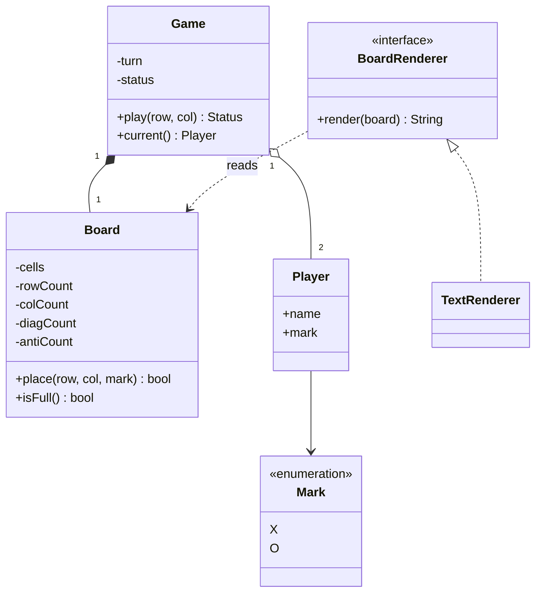

## Requirements

Tic-tac-toe looks tiny, which is why interviewers use it: there is little to hide behind. Ask first, then fix the scope.

Questions worth asking:

- Is the board always 3x3, or any size N x N? (Design for N, it costs almost nothing.)
- How many players? (Two, taking turns, marks X and O.)
- What wins? (N of the same mark in one row, one column or one of the two diagonals.)
- What happens on an invalid move? (Reject it and let the same player try again.)
- Is there a UI? (Out of scope. We need a way to show the board, not a window.)

Scope for this lesson:

- Board of size N x N, two players, alternating turns.
- A move is a row and a column, counted from 0.
- The game ends in a win or a draw (board full, nobody won).
- Moves on a taken cell, off the board, or after the game ended are rejected.

Out of scope: network play, an AI opponent, undo, a graphical UI.

## Entities

| Noun or verb | Becomes |
|---|---|
| Mark (X or O) | `Mark` enum |
| Player (name, mark) | `Player`, an immutable record or struct |
| Board (cells, size) | `Board`, which owns the cells and the counters |
| Game (turns, result) | `Game`, which owns the players, whose turn it is and the `Status` |
| Result | `Status` enum: in progress, won, draw |
| Bad move | `InvalidMoveException` |
| Showing the board | `BoardRenderer` interface, so printing stays out of the rules |

The split to remember: `Board` knows cells and lines, `Game` knows turns and results. The board never asks whose turn it is, and the game never looks inside a row.



## The winning check

The obvious check, after every move, scans the row, the column and (if the cell lies on one) the diagonals. That is $O(N)$ work per move. For 3x3 this is perfectly fine, and you should say so.

The better answer keeps a **counter** (an integer that is changed a little on every move) for every line and every player:

- `rowCount[mark][r]`: how many cells of `mark` are in row `r`.
- `colCount[mark][c]`: the same for columns.
- `diagCount[mark]`: cells of `mark` on the main diagonal (where `row == col`).
- `antiCount[mark]`: cells of `mark` on the anti-diagonal (where `row + col == N - 1`).

A move at `(r, c)` adds one to its row counter and its column counter, and also to a diagonal counter if the cell lies on that diagonal. If any counter it touched now equals N, that line is full of one mark, so the player won. That is a few additions and comparisons, so the check is $O(1)$ per move. Memory grows to $O(N)$ for the counters, which is small next to the $N^2$ cells.

:::key
A line is won only when all N cells belong to one player. So counting marks per line is enough. You never need to look at the cells again.
:::

Watch the counters change over a short game. The board is 3x3 and the counters shown belong to X.

```steps
title: Counters for X while a row fills up (3x3)
view: grid
frames:
  - grid: [["X", "", ""], ["", "", ""], ["", "", ""]]
    highlight: {"0,0": active}
    vars: {X rows: "1 0 0", X cols: "1 0 0", X diag: 1, X anti: 0}
    note: X plays (0,0). It is on row 0, column 0 and the main diagonal, so those three counters become 1.
  - grid: [["X", "", ""], ["", "O", ""], ["", "", ""]]
    highlight: {"1,1": compare}
    vars: {X rows: "1 0 0", X cols: "1 0 0", X diag: 1, X anti: 0}
    note: O plays the centre. Only O's counters change; X's stay as they were.
  - grid: [["X", "X", ""], ["", "O", ""], ["", "", ""]]
    highlight: {"0,0": done, "0,1": active}
    vars: {X rows: "2 0 0", X cols: "1 1 0", X diag: 1, X anti: 0}
    note: X plays (0,1). Row 0 now counts 2. Column 1 starts at 1. This cell is on neither diagonal.
  - grid: [["X", "X", ""], ["", "O", ""], ["", "", "O"]]
    highlight: {"2,2": compare}
    vars: {X rows: "2 0 0", X cols: "1 1 0", X diag: 1, X anti: 0}
    note: O plays (2,2). O now has two on the main diagonal, but X's (0,0) is not O's, so nothing completes.
  - grid: [["X", "X", "X"], ["", "O", ""], ["", "", "O"]]
    highlight: {"0,0": match, "0,1": match, "0,2": match}
    vars: {X rows: "3 0 0", X cols: "1 1 1", X diag: 1, X anti: 1}
    note: X plays (0,2). The row 0 counter reaches 3, which equals N, so X wins. Only this move's counters were looked at.
```

```quiz
q: A move at (r, c) on a 5x5 board. Which counters can this move change?
options:
  - Every row and every column counter, because the board changed
  - Only the counters of row r and column c, plus a diagonal counter if the cell is on that diagonal
  - Only the counter of the diagonal that contains (r, c)
answer: 1
why: "A cell belongs to exactly one row, one column, and at most two diagonals. Only those lines can become full because of this move, so only their counters are touched."
```

:::warn
Do not use `if (...) ... else if (...)` for the counter updates. A cell on the main diagonal is also in a row and a column, and the centre of an odd board is on both diagonals. Every counter that applies must be updated, even after one of them already hit N.
:::

## Key flows

A turn, from the caller's point of view:

1. `Game.play(r, c)` first checks the game is still in progress.
2. It asks `Board.place` to put the current player's mark there. The board rejects off-board and taken cells by throwing `InvalidMoveException`, and it does so before changing anything, so a rejected move changes no state.
3. `place` returns `true` if the move completed a line. Then the status becomes `WON` and the winner is stored.
4. Otherwise, if the board is full, the status becomes `DRAW`.
5. Otherwise the turn passes to the other player.

Note that a rejected move does not pass the turn. The same player tries again.

## Code

The demo plays three games: a 3x3 win with two rejected moves and one move after the game ended, a 3x3 draw, and a 4x4 column win. That shows the same code handling different N. Only the first game prints every move.

```java
import java.util.*;

enum Mark { X, O }
enum Status { IN_PROGRESS, WON, DRAW }

record Player(String name, Mark mark) {}

class InvalidMoveException extends RuntimeException {
    InvalidMoveException(String message) { super(message); }
}

class Board {
    private final int n;
    private final Mark[][] cells;
    // counts[mark][line]: how many cells of that mark sit on each row, column or diagonal
    private final int[][] rowCount, colCount;
    private final int[] diagCount, antiCount;
    private int filled;

    Board(int n) {
        this.n = n;
        cells = new Mark[n][n];
        int marks = Mark.values().length;
        rowCount = new int[marks][n];
        colCount = new int[marks][n];
        diagCount = new int[marks];
        antiCount = new int[marks];
    }

    int size() { return n; }
    Mark at(int r, int c) { return cells[r][c]; }
    boolean isFull() { return filled == n * n; }

    /** Places the mark and returns true if this move completes a line. O(1). */
    boolean place(int r, int c, Mark m) {
        if (r < 0 || r >= n || c < 0 || c >= n) throw new InvalidMoveException("(" + r + "," + c + ") is off the board");
        if (cells[r][c] != null) throw new InvalidMoveException("(" + r + "," + c + ") is taken");
        cells[r][c] = m;
        filled++;
        int k = m.ordinal();
        boolean win = ++rowCount[k][r] == n;
        if (++colCount[k][c] == n) win = true;
        if (r == c && ++diagCount[k] == n) win = true;
        if (r + c == n - 1 && ++antiCount[k] == n) win = true;
        return win;
    }
}

interface BoardRenderer { String render(Board b); }

class TextRenderer implements BoardRenderer {
    public String render(Board b) {
        StringBuilder sb = new StringBuilder();
        for (int r = 0; r < b.size(); r++) {
            for (int c = 0; c < b.size(); c++) {
                Mark m = b.at(r, c);
                sb.append(m == null ? '.' : m.name().charAt(0));
            }
            if (r < b.size() - 1) sb.append('\n');
        }
        return sb.toString();
    }
}

class Game {
    private final Board board;
    private final List<Player> players;
    private int turn;
    private Status status = Status.IN_PROGRESS;
    private Player winner;

    Game(int n, Player first, Player second) {
        board = new Board(n);
        players = List.of(first, second);
    }

    Board board() { return board; }
    Status status() { return status; }
    Player winner() { return winner; }
    Player current() { return players.get(turn); }

    Status play(int r, int c) {
        if (status != Status.IN_PROGRESS) throw new InvalidMoveException("game is over");
        Player p = current();
        if (board.place(r, c, p.mark())) {
            status = Status.WON;
            winner = p;
        } else if (board.isFull()) {
            status = Status.DRAW;
        } else {
            turn = (turn + 1) % players.size();
        }
        return status;
    }
}

public class Main {
    static void move(Game g, int r, int c, boolean verbose) {
        String who = g.current().name() + " (" + g.current().mark() + ")";
        try {
            Status s = g.play(r, c);
            if (verbose || s != Status.IN_PROGRESS) System.out.println(who + " -> (" + r + "," + c + "): " + s);
        } catch (InvalidMoveException e) {
            System.out.println(who + " -> (" + r + "," + c + "): rejected, " + e.getMessage());
        }
    }

    static void play(int n, int[][] moves, String title, boolean verbose) {
        System.out.println("== " + title + " ==");
        Game g = new Game(n, new Player("Asha", Mark.X), new Player("Ravi", Mark.O));
        for (int[] m : moves) move(g, m[0], m[1], verbose);
        System.out.println(new TextRenderer().render(g.board()));
        System.out.println(g.winner() == null ? "winner: none" : "winner: " + g.winner().name());
    }

    public static void main(String[] args) {
        play(3, new int[][]{{0, 0}, {1, 1}, {0, 1}, {0, 0}, {3, 3}, {2, 2}, {0, 2}, {2, 0}}, "3x3 row win", true);
        play(3, new int[][]{{0, 0}, {0, 1}, {0, 2}, {1, 1}, {1, 0}, {1, 2}, {2, 1}, {2, 0}, {2, 2}}, "3x3 draw", false);
        play(4, new int[][]{{0, 0}, {0, 1}, {1, 0}, {1, 1}, {2, 0}, {2, 1}, {3, 0}}, "4x4 column win", false);
    }
}
```
```cpp
#include <iostream>
#include <memory>
#include <optional>
#include <stdexcept>
#include <string>
#include <vector>

enum class Mark { X, O };
enum class Status { InProgress, Won, Draw };

std::string markName(Mark m) { return m == Mark::X ? "X" : "O"; }

std::string statusName(Status s) {
    switch (s) {
        case Status::InProgress: return "IN_PROGRESS";
        case Status::Won: return "WON";
        default: return "DRAW";
    }
}

struct Player {
    std::string name;
    Mark mark;
};

class InvalidMoveException : public std::runtime_error {
public:
    explicit InvalidMoveException(const std::string& message) : std::runtime_error(message) {}
};

class Board {
public:
    explicit Board(int n)
        : n_(n), cells_(n, std::vector<std::optional<Mark>>(n)),
          rowCount_(2, std::vector<int>(n, 0)), colCount_(2, std::vector<int>(n, 0)),
          diagCount_(2, 0), antiCount_(2, 0) {}

    int size() const { return n_; }
    std::optional<Mark> at(int r, int c) const { return cells_[r][c]; }
    bool isFull() const { return filled_ == n_ * n_; }

    // Places the mark and returns true if this move completes a line. O(1).
    bool place(int r, int c, Mark m) {
        std::string where = "(" + std::to_string(r) + "," + std::to_string(c) + ")";
        if (r < 0 || r >= n_ || c < 0 || c >= n_) throw InvalidMoveException(where + " is off the board");
        if (cells_[r][c].has_value()) throw InvalidMoveException(where + " is taken");
        cells_[r][c] = m;
        ++filled_;
        int k = static_cast<int>(m);
        bool win = ++rowCount_[k][r] == n_;
        if (++colCount_[k][c] == n_) win = true;
        if (r == c && ++diagCount_[k] == n_) win = true;
        if (r + c == n_ - 1 && ++antiCount_[k] == n_) win = true;
        return win;
    }

private:
    int n_;
    std::vector<std::vector<std::optional<Mark>>> cells_;
    // count[mark][line]: how many cells of that mark sit on each row, column or diagonal
    std::vector<std::vector<int>> rowCount_, colCount_;
    std::vector<int> diagCount_, antiCount_;
    int filled_ = 0;
};

class BoardRenderer {
public:
    virtual ~BoardRenderer() = default;
    virtual std::string render(const Board& b) const = 0;
};

class TextRenderer : public BoardRenderer {
public:
    std::string render(const Board& b) const override {
        std::string out;
        for (int r = 0; r < b.size(); ++r) {
            for (int c = 0; c < b.size(); ++c) {
                auto m = b.at(r, c);
                out += m ? markName(*m) : ".";
            }
            if (r < b.size() - 1) out += '\n';
        }
        return out;
    }
};

class Game {
public:
    Game(int n, Player first, Player second) : board_(n), players_{std::move(first), std::move(second)} {}

    const Board& board() const { return board_; }
    Status status() const { return status_; }
    const Player* winner() const { return winner_ ? &*winner_ : nullptr; }
    const Player& current() const { return players_[turn_]; }

    Status play(int r, int c) {
        if (status_ != Status::InProgress) throw InvalidMoveException("game is over");
        const Player& p = current();
        if (board_.place(r, c, p.mark)) {
            status_ = Status::Won;
            winner_ = p;
        } else if (board_.isFull()) {
            status_ = Status::Draw;
        } else {
            turn_ = (turn_ + 1) % players_.size();
        }
        return status_;
    }

private:
    Board board_;
    std::vector<Player> players_;
    std::size_t turn_ = 0;
    Status status_ = Status::InProgress;
    std::optional<Player> winner_;
};

void move(Game& g, int r, int c, bool verbose) {
    std::string who = g.current().name + " (" + markName(g.current().mark) + ")";
    std::string at = " -> (" + std::to_string(r) + "," + std::to_string(c) + "): ";
    try {
        Status s = g.play(r, c);
        if (verbose || s != Status::InProgress) std::cout << who << at << statusName(s) << "\n";
    } catch (const InvalidMoveException& e) {
        std::cout << who << at << "rejected, " << e.what() << "\n";
    }
}

void play(int n, const std::vector<std::pair<int, int>>& moves, const std::string& title, bool verbose) {
    std::cout << "== " << title << " ==\n";
    Game g(n, Player{"Asha", Mark::X}, Player{"Ravi", Mark::O});
    for (const auto& m : moves) move(g, m.first, m.second, verbose);
    std::unique_ptr<BoardRenderer> renderer = std::make_unique<TextRenderer>();
    std::cout << renderer->render(g.board()) << "\n";
    std::cout << (g.winner() ? "winner: " + g.winner()->name : std::string("winner: none")) << "\n";
}

int main() {
    play(3, {{0, 0}, {1, 1}, {0, 1}, {0, 0}, {3, 3}, {2, 2}, {0, 2}, {2, 0}}, "3x3 row win", true);
    play(3, {{0, 0}, {0, 1}, {0, 2}, {1, 1}, {1, 0}, {1, 2}, {2, 1}, {2, 0}, {2, 2}}, "3x3 draw", false);
    play(4, {{0, 0}, {0, 1}, {1, 0}, {1, 1}, {2, 0}, {2, 1}, {3, 0}}, "4x4 column win", false);
}
```
```output
== 3x3 row win ==
Asha (X) -> (0,0): IN_PROGRESS
Ravi (O) -> (1,1): IN_PROGRESS
Asha (X) -> (0,1): IN_PROGRESS
Ravi (O) -> (0,0): rejected, (0,0) is taken
Ravi (O) -> (3,3): rejected, (3,3) is off the board
Ravi (O) -> (2,2): IN_PROGRESS
Asha (X) -> (0,2): WON
Asha (X) -> (2,0): rejected, game is over
XXX
.O.
..O
winner: Asha
== 3x3 draw ==
Asha (X) -> (2,2): DRAW
XOX
XOO
OXX
winner: none
== 4x4 column win ==
Asha (X) -> (3,0): WON
XO..
XO..
XO..
X...
winner: Asha
```

Compile the C++ with `g++ -std=c++17`.

Check your understanding of the counters:

```predict
lang: java
code: |
  int n = 3;
  int[] rowCount = new int[n];
  int[] colCount = new int[n];
  int[][] moves = {{1, 0}, {1, 1}, {2, 1}, {1, 2}};   // all by the same player
  boolean win = false;
  for (int[] m : moves) {
      if (++rowCount[m[0]] == n) win = true;
      if (++colCount[m[1]] == n) win = true;
  }
  System.out.println(win + " " + rowCount[1] + " " + colCount[1]);
output: true 3 2
why: Row 1 receives three moves (1,0), (1,1), (1,2), so its counter reaches 3 and equals n. Column 1 receives (1,1) and (2,1), so it ends at 2.
```

Put the core of `place` in order:

```order
prompt: Arrange the body of Board.place (after the bounds and taken-cell checks).
lang: java
code: |
  cells[r][c] = m;
  filled++;
  int k = m.ordinal();
  boolean win = ++rowCount[k][r] == n;
  if (++colCount[k][c] == n) win = true;
  if (r == c && ++diagCount[k] == n) win = true;
  if (r + c == n - 1 && ++antiCount[k] == n) win = true;
  return win;
distractors:
  - "    if (r == c || r + c == n - 1) win = true;"
why: The mark is stored first, then the counters for that mark are bumped, then the result is returned. A cell does not win just because it sits on a diagonal; its counter must reach n.
```

## Patterns and design decisions

- **Separate board and game.** `Board` is a data structure with a rule about lines. `Game` is a state machine with three states: in progress, won, draw. Each can change without the other.
- **Renderer as an interface.** Printing is a view concern. With `BoardRenderer`, a web view or a coloured terminal view is a new class, and `Board` is untouched. This is the same idea as Strategy: the part that varies sits behind an interface.
- **Validate before mutating.** `place` throws before it writes anything. If it threw halfway, the counters and the cells would disagree.
- **Exceptions for bad moves, status for outcomes.** Winning or drawing is normal, so it is a return value. A move on a taken cell is a caller mistake, so it is an exception.
- **Counters indexed by mark.** Using `mark.ordinal()` as an index keeps one set of arrays for both players with no branching.

:::truth
Tic-tac-toe barely needs design patterns. Forcing State, Observer and Factory into it would make the answer worse. Say that a small problem gets a small design, and show where the patterns would go if the rules grew.
:::

## Extensibility

| Change request | What changes |
|---|---|
| Bigger board | Nothing: `n` is a constructor argument |
| Undo last move | Keep a move stack; clear the cell, decrement the same counters, restore the turn and status |
| k in a row on a large board | Counters no longer work: a line of k can start anywhere. After each move, scan outward from the new cell in 4 directions, up to $k - 1$ cells each way |
| Computer player | New `Player` behaviour behind an interface such as `MoveStrategy`; `Game` asks it for the next move |
| More than two players | Size the counter arrays by the number of marks; the rule is unchanged |
| Show moves live | Observer: `Game` notifies listeners after each move |

```quiz
q: You must support "5 in a row wins" on a 15x15 board. Why do per-row and per-column counters fail here?
options:
  - They use too much memory on a 15x15 board
  - A winning line is only part of a row, so a row counter of 5 does not mean the 5 cells are next to each other
  - Counters cannot be decremented
answer: 1
why: "Five marks anywhere in a 15-cell row do not win unless they are consecutive. You need to look at the neighbours of the new cell along each direction instead."
```

## Interview tips

- Say the brute-force check first, then improve it. Showing the progression is worth more than starting at the answer.
- Keep rules in `Board` and `Game`, and say that the UI is separate.
- State the complexity out loud: $O(1)$ time per move, $O(N)$ extra space.
- Test the corners: centre of an odd board (on both diagonals), a draw, a move after the game ends.
- If asked about threads, say a single game is turn-based and needs no locking. A server running many games needs one lock per game, not one for all.

```cards
- q: How does the O(1) winning check work?
  a: Keep a counter per row, column and diagonal for each player. A move bumps only the lines it sits on. If any of them reaches N, that player has a full line.
- q: Which counters does a move at (r, c) touch?
  a: Row r, column c, the main diagonal if r == c, and the anti-diagonal if r + c == N - 1.
- q: Why validate before changing state in place()?
  a: A rejected move must leave cells and counters unchanged. Throwing halfway would make them disagree.
- q: Why does the counter trick fail for k in a row on a larger board?
  a: A winning line is a consecutive stretch inside a row, not the whole row, so a count of k does not prove the cells are adjacent.
- q: Where should printing the board live?
  a: Behind a renderer interface, outside Board and Game, so the rules do not depend on the UI.
```

## Notes

:::notes
- Entities: Mark, Player, Board, Game, Status, plus a BoardRenderer interface. Board knows cells and lines; Game knows turns and results.
- Brute-force check scans row, column and diagonals: O(N) per move. Counters make it O(1) per move with O(N) extra memory.
- Counters: rowCount[mark][r], colCount[mark][c], diagCount[mark] (r == c), antiCount[mark] (r + c == N - 1). Win when a touched counter equals N.
- Update every counter that applies; do not use else-if, because the centre of an odd board is on both diagonals.
- Validate before mutating, so a rejected move leaves the state untouched. A rejected move does not pass the turn.
- Bad move is an exception; win and draw are normal outcomes, returned as Status.
- Counters work for "full line of N". For k in a row on a bigger board, scan outward from the last move instead.
- Small problem, small design: do not force patterns where a clean split of classes is enough.
:::
