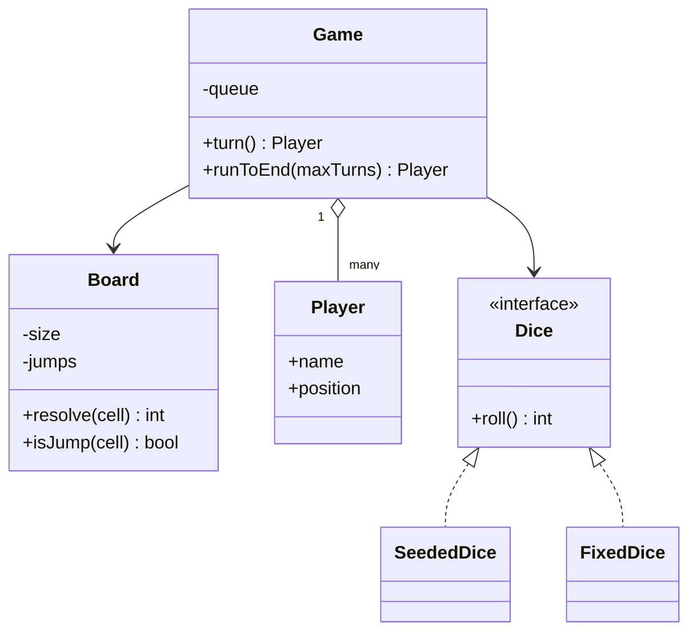
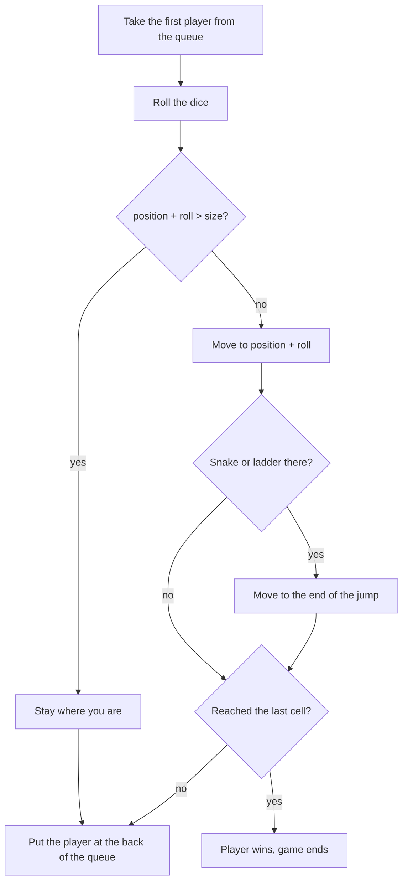

## Requirements

Snake and ladder is a good machine-coding round problem because the rules are simple and the design choices are visible. Ask before you code.

Clarifying questions:

- How big is the board? (Usually 100 cells, numbered 1 to 100. Make it a parameter.)
- How many players, and in what order? (Two or more, fixed order.)
- How many dice and how many faces? (One die, six faces, but design for change.)
- What happens if a roll goes past the last cell? (Common rule: the player stays where they are. Ask.)
- Does a 6 give an extra turn? (Common house rule. Treat it as an extension.)
- Can a ladder end on a snake head, or two jumps share a cell? (No: reject such boards.)

Scope for this lesson:

- A board of `size` cells with a map of snakes and ladders.
- Players start off the board at position 0 and move in turn order.
- The first player to land exactly on the last cell wins.
- A roll that would overshoot is ignored.
- The dice is replaceable, so the game can be tested.

Out of scope: a UI, money, multiple winners (ranking), saving a game.

## Entities

| Noun or verb | Becomes |
|---|---|
| Board (size, snakes, ladders) | `Board`, which holds one `jumps` map and validates it |
| Snake and ladder | Both are "if you land here, you move there", so one map entry each |
| Player (name, position) | `Player` |
| Dice | `Dice` interface, with `SeededDice` and `FixedDice` |
| Players waiting for a turn | A queue (`Deque`) of players |
| Play a turn, play to the end | Methods on `Game` |

A snake and a ladder differ only in direction: a snake goes down (head to tail), a ladder goes up (foot to top). Many first designs create `Snake` and `Ladder` classes with the same two fields and no different behaviour. A single map from start cell to end cell is smaller, and you can still tell them apart by comparing the two numbers. Create two classes only if they start to behave differently, for example a snake with a "bite" animation.



## Key flows

One turn, as the code runs it:



Why a queue: the order is "take the front player, play, go to the back". A `Deque` (double-ended queue, which can add or remove at either end) does exactly this in $O(1)$. An index that wraps around (`turn = (turn + 1) % n`) also works, but the queue makes it easy to remove a finished player later, for example to keep playing for second place.

:::key
One lookup, `resolve(cell)`, handles both snakes and ladders. After a move, the game does not ask "is this a snake or a ladder?". It asks the board where the cell leads, and the board answers with the same cell if there is no jump.
:::

## Board validation

A board is only meaningful if the jumps make sense. The constructor checks:

- Every snake goes down and every ladder goes up. A "snake" that goes up is a ladder with a wrong label.
- No jump starts on cell 1 or on the last cell. Starting on the last cell would let the winning cell move you, so nobody could win.
- No two jumps start on the same cell.
- No jump ends on the start of another jump. This is a **chain**, and chains can build loops: a ladder up to a snake head that leads back to the ladder foot would trap a player forever.

Rejecting a bad board in the constructor means the game never has to defend against it. Bad data fails once, early and with a clear message.

```quiz
q: Why does the constructor reject a ladder whose top is the head of a snake?
options:
  - It would make the board too hard
  - The player would move twice in one turn, and a snake and ladder pair could loop forever
  - The map cannot hold two entries
answer: 1
why: "`resolve` looks up a cell once. A chain either gives a surprising result (only the first jump applies) or, in a bad board, a loop. Rejecting chains keeps one roll equal to at most one jump."
```

## The dice as a strategy

`Dice` is an interface with one method, `roll()`. This is the Strategy pattern: the part that varies sits behind an interface and the game just calls it.

- **Real play.** A dice backed by the language's random generator (not shown).
- **`SeededDice`.** Random-looking numbers that are the same on every run, because the generator starts from a fixed seed. The seed is the starting value of the generator.
- **`FixedDice`.** Returns a scripted list of numbers. It is the tool for tests: you can force the exact roll that triggers a snake, a ladder or an overshoot.

:::note
Why not `java.util.Random` and `std::mt19937`? Both are fine, but they produce different numbers for the same seed, and this lesson shows the same output in both languages. So `SeededDice` uses a tiny **linear congruential generator** (LCG, a formula of the form `next = (a * state + c) mod m`) with the classic constants from the old C `rand()`. Do not use an LCG for anything that needs real randomness.
:::

## Code

The demo has three parts: a board with a chain that is rejected, a scripted game that shows a ladder, a snake, an overshoot and a win, and a full game with seeded dice that prints only the result.

```java
import java.util.*;

interface Dice { int roll(); }

/** Tiny linear congruential generator, so Java and C++ roll the same numbers. */
class SeededDice implements Dice {
    private long state;
    private final int faces;
    SeededDice(long seed, int faces) { this.state = seed; this.faces = faces; }
    public int roll() {
        state = (state * 1103515245L + 12345L) % 2147483648L;
        return (int) ((state >> 16) % faces) + 1;
    }
}

class FixedDice implements Dice {
    private final int[] values;
    private int next;
    FixedDice(int... values) { this.values = values; }
    public int roll() { return values[next++ % values.length]; }
}

class Board {
    private final int size;
    private final Map<Integer, Integer> jumps = new HashMap<>();   // snake head -> tail, ladder foot -> top

    Board(int size, Map<Integer, Integer> snakes, Map<Integer, Integer> ladders) {
        this.size = size;
        for (var e : snakes.entrySet()) add(e.getKey(), e.getValue(), true);
        for (var e : ladders.entrySet()) add(e.getKey(), e.getValue(), false);
        for (int end : jumps.values())
            if (jumps.containsKey(end)) throw new IllegalArgumentException("jumps chain at " + end);
    }

    private void add(int from, int to, boolean snake) {
        if (from <= 1 || from >= size || to < 1 || to > size)
            throw new IllegalArgumentException("bad cell in " + from + "->" + to);
        if (snake != (to < from)) throw new IllegalArgumentException(from + "->" + to + " goes the wrong way");
        if (jumps.put(from, to) != null) throw new IllegalArgumentException("two jumps start at " + from);
    }

    int size() { return size; }
    boolean isJump(int cell) { return jumps.containsKey(cell); }
    int resolve(int cell) { return jumps.getOrDefault(cell, cell); }
}

class Player {
    final String name;
    int position;   // 0 means "not on the board yet"
    Player(String name) { this.name = name; }
}

class Game {
    private final Board board;
    private final Dice dice;
    private final boolean verbose;
    private final Deque<Player> queue = new ArrayDeque<>();
    private int turns;

    Game(Board board, Dice dice, List<Player> players, boolean verbose) {
        this.board = board;
        this.dice = dice;
        this.verbose = verbose;
        queue.addAll(players);
    }

    int turns() { return turns; }

    /** Plays one turn, returns the winner or null. */
    Player turn() {
        Player p = queue.pollFirst();
        turns++;
        int roll = dice.roll();
        int target = p.position + roll;
        StringBuilder log = new StringBuilder(p.name + " rolls " + roll + ": " + p.position);
        if (target > board.size()) {
            log.append(" stays (needs exact roll to finish)");
        } else {
            p.position = board.resolve(target);
            log.append(" -> ").append(target);
            if (board.isJump(target))
                log.append(p.position < target ? " snake, down to " : " ladder, up to ").append(p.position);
        }
        if (verbose) System.out.println(log);
        if (p.position == board.size()) return p;
        queue.addLast(p);
        return null;
    }

    Player runToEnd(int maxTurns) {
        for (int i = 0; i < maxTurns; i++) {
            Player w = turn();
            if (w != null) return w;
        }
        return null;
    }
}

public class Main {
    static Board smallBoard() {
        return new Board(30, Map.of(15, 6, 22, 11, 27, 7), Map.of(3, 12, 8, 18, 20, 26));
    }

    public static void main(String[] args) {
        try {
            new Board(30, Map.of(12, 4), Map.of(3, 12));
        } catch (IllegalArgumentException e) {
            System.out.println("invalid board: " + e.getMessage());
        }

        System.out.println("-- scripted dice --");
        Game scripted = new Game(smallBoard(), new FixedDice(3, 4, 3, 6, 2, 6, 2, 5, 6, 1, 4),
                                 List.of(new Player("Asha"), new Player("Ravi")), true);
        Player first = scripted.runToEnd(11);
        System.out.println("winner: " + first.name + " after " + scripted.turns() + " turns");

        System.out.println("-- seeded dice --");
        Game game = new Game(smallBoard(), new SeededDice(42, 6),
                             List.of(new Player("Asha"), new Player("Ravi")), false);
        Player winner = game.runToEnd(200);
        System.out.println(winner == null ? "no winner" : "winner: " + winner.name + " after " + game.turns() + " turns");
    }
}
```
```cpp
#include <cstdint>
#include <deque>
#include <iostream>
#include <map>
#include <memory>
#include <stdexcept>
#include <string>
#include <utility>
#include <vector>

class Dice {
public:
    virtual ~Dice() = default;
    virtual int roll() = 0;
};

// Tiny linear congruential generator, so Java and C++ roll the same numbers.
class SeededDice : public Dice {
public:
    SeededDice(std::uint64_t seed, int faces) : state_(seed), faces_(faces) {}
    int roll() override {
        state_ = (state_ * 1103515245ULL + 12345ULL) % 2147483648ULL;
        return static_cast<int>((state_ >> 16) % faces_) + 1;
    }
private:
    std::uint64_t state_;
    int faces_;
};

class FixedDice : public Dice {
public:
    explicit FixedDice(std::vector<int> values) : values_(std::move(values)) {}
    int roll() override { return values_[next_++ % values_.size()]; }
private:
    std::vector<int> values_;
    std::size_t next_ = 0;
};

class Board {
public:
    Board(int size, const std::map<int, int>& snakes, const std::map<int, int>& ladders) : size_(size) {
        for (const auto& [from, to] : snakes) add(from, to, true);
        for (const auto& [from, to] : ladders) add(from, to, false);
        for (const auto& [from, to] : jumps_)
            if (jumps_.count(to)) throw std::invalid_argument("jumps chain at " + std::to_string(to));
    }

    int size() const { return size_; }
    bool isJump(int cell) const { return jumps_.count(cell) > 0; }
    int resolve(int cell) const {
        auto it = jumps_.find(cell);
        return it == jumps_.end() ? cell : it->second;
    }

private:
    void add(int from, int to, bool snake) {
        if (from <= 1 || from >= size_ || to < 1 || to > size_)
            throw std::invalid_argument("bad cell in " + std::to_string(from) + "->" + std::to_string(to));
        if (snake != (to < from))
            throw std::invalid_argument(std::to_string(from) + "->" + std::to_string(to) + " goes the wrong way");
        if (!jumps_.emplace(from, to).second)
            throw std::invalid_argument("two jumps start at " + std::to_string(from));
    }

    int size_;
    std::map<int, int> jumps_;   // snake head -> tail, ladder foot -> top
};

struct Player {
    std::string name;
    int position = 0;   // 0 means "not on the board yet"
};

class Game {
public:
    Game(Board board, std::unique_ptr<Dice> dice, const std::vector<std::string>& names, bool verbose)
        : board_(std::move(board)), dice_(std::move(dice)), verbose_(verbose) {
        for (const auto& n : names) players_.push_back(std::make_shared<Player>(Player{n}));
        for (const auto& p : players_) queue_.push_back(p);
    }

    int turns() const { return turns_; }

    // Plays one turn, returns the winner or nullptr.
    std::shared_ptr<Player> turn() {
        auto p = queue_.front();
        queue_.pop_front();
        ++turns_;
        int roll = dice_->roll();
        int target = p->position + roll;
        std::string log = p->name + " rolls " + std::to_string(roll) + ": " + std::to_string(p->position);
        if (target > board_.size()) {
            log += " stays (needs exact roll to finish)";
        } else {
            p->position = board_.resolve(target);
            log += " -> " + std::to_string(target);
            if (board_.isJump(target))
                log += std::string(p->position < target ? " snake, down to " : " ladder, up to ") +
                       std::to_string(p->position);
        }
        if (verbose_) std::cout << log << "\n";
        if (p->position == board_.size()) return p;
        queue_.push_back(p);
        return nullptr;
    }

    std::shared_ptr<Player> runToEnd(int maxTurns) {
        for (int i = 0; i < maxTurns; ++i)
            if (auto w = turn()) return w;
        return nullptr;
    }

private:
    Board board_;
    std::unique_ptr<Dice> dice_;
    bool verbose_;
    std::vector<std::shared_ptr<Player>> players_;
    std::deque<std::shared_ptr<Player>> queue_;
    int turns_ = 0;
};

Board smallBoard() {
    return Board(30, {{15, 6}, {22, 11}, {27, 7}}, {{3, 12}, {8, 18}, {20, 26}});
}

int main() {
    try {
        Board bad(30, {{12, 4}}, {{3, 12}});
    } catch (const std::invalid_argument& e) {
        std::cout << "invalid board: " << e.what() << "\n";
    }

    std::cout << "-- scripted dice --\n";
    Game scripted(smallBoard(), std::make_unique<FixedDice>(std::vector<int>{3, 4, 3, 6, 2, 6, 2, 5, 6, 1, 4}),
                  {"Asha", "Ravi"}, true);
    auto first = scripted.runToEnd(11);
    std::cout << "winner: " << first->name << " after " << scripted.turns() << " turns\n";

    std::cout << "-- seeded dice --\n";
    Game game(smallBoard(), std::make_unique<SeededDice>(42, 6), {"Asha", "Ravi"}, false);
    auto winner = game.runToEnd(200);
    if (winner) std::cout << "winner: " << winner->name << " after " << game.turns() << " turns\n";
    else std::cout << "no winner\n";
}
```
```output
invalid board: jumps chain at 12
-- scripted dice --
Asha rolls 3: 0 -> 3 ladder, up to 12
Ravi rolls 4: 0 -> 4
Asha rolls 3: 12 -> 15 snake, down to 6
Ravi rolls 6: 4 -> 10
Asha rolls 2: 6 -> 8 ladder, up to 18
Ravi rolls 6: 10 -> 16
Asha rolls 2: 18 -> 20 ladder, up to 26
Ravi rolls 5: 16 -> 21
Asha rolls 6: 26 stays (needs exact roll to finish)
Ravi rolls 1: 21 -> 22 snake, down to 11
Asha rolls 4: 26 -> 30
winner: Asha after 11 turns
-- seeded dice --
winner: Ravi after 30 turns
```

Compile the C++ with `g++ -std=c++17`.

In the scripted game, Asha ends at 26 on a 30 cell board and rolls a 6. Check the rule yourself:

```predict
lang: java
code: |
  int size = 30, position = 26, roll = 6;
  int target = position + roll;
  if (target > size) System.out.println("stays at " + position);
  else System.out.println("moves to " + target);
  position = 26; roll = 4;
  target = position + roll;
  if (target > size) System.out.println("stays at " + position);
  else System.out.println("moves to " + target);
output: |
  stays at 26
  moves to 30
why: 26 + 6 is 32, past the last cell, so the roll is ignored. 26 + 4 is exactly 30, the last cell, so the player lands there and wins.
```

Put the middle of `Game.turn` in order:

```order
prompt: Arrange the core of Game.turn.
lang: java
code: |
  Player p = queue.pollFirst();
  int roll = dice.roll();
  int target = p.position + roll;
  if (target <= board.size()) p.position = board.resolve(target);
  if (p.position == board.size()) return p;
  queue.addLast(p);
  return null;
distractors:
  - "    p.position = board.resolve(p.position + roll);"
why: Take the player, roll, work out the target, apply it only if it does not overshoot, resolve any jump, then either finish or send the player to the back. Resolving first would move the player past the last cell, which is exactly the move the rule forbids.
```

## Patterns and design decisions

- **Strategy for the dice.** The one part that must be replaceable, because tests need exact rolls.
- **Queue for turn order.** The queue is the state of "who plays next"; there is no separate turn counter to keep in sync.
- **Validation in the `Board` constructor.** The board is immutable after construction, so one check is enough.
- **`Game.turn` returns the winner or null.** The loop and any UI can decide what to do with that. The game does not print rules text itself; in the demo, a `verbose` flag turns the log on, which is a shortcut for a lesson, not a design to copy. In production code you would pass in a listener (Observer).
- **Position 0 means "off the board".** A player enters with the first roll. If your interviewer wants "needs a 1 to enter" or similar, it becomes a rule in `turn`.

:::truth
The seeded game takes 30 turns on a board of only 30 cells, because the snake on cell 27 sits right in front of the finish and the exact finish rule rejects many rolls. Short boards with an exact finish can run long. Pick the seed, size and snakes of a demo by running it, not by guessing.
:::

## Extensibility

| Change request | What changes |
|---|---|
| Extra turn on a 6 | A rule in `turn`: if `roll == 6` and the player did not win, put them at the front of the queue instead of the back |
| Two dice | New `Dice` that sums two inner dice (Composite or Decorator style); `Game` is untouched |
| Bounce back on overshoot | Change the overshoot branch in `turn`; if rules vary a lot, extract a `FinishRule` interface |
| Skipped turn after a snake | A flag on `Player` that `turn` checks and clears |
| Ranking (second, third place) | Do not stop at the first winner; remove finished players from the queue and record their finishing order |
| Different board sizes | Pass `size` and the jump maps; nothing else changes |

## Interview tips

- State the data model in one sentence: "a snake and a ladder are the same thing, a jump from one cell to another".
- Put the dice behind an interface early and say why: testability.
- Mention board validation before the interviewer asks about loops.
- Write `turn()` before `runToEnd()`. A single turn is the unit that is easy to test and easy to extend.
- If asked about concurrency: players take turns, so one game needs no locking. A server hosting many games needs one lock (or one actor) per game.

```cards
- q: Why model snakes and ladders as one map?
  a: Both are "land here, move there". Direction (down or up) is the only difference, and it can be read from the two numbers.
- q: What invalid boards should the constructor reject?
  a: Snakes that go up, ladders that go down, a jump on the first or last cell, two jumps from one cell, and chains where one jump ends on another's start.
- q: Why is Dice an interface?
  a: So tests can use scripted rolls (FixedDice) and demos can use repeatable rolls (SeededDice). Real play uses a random-backed implementation.
- q: Why a queue for the players?
  a: Turn order is take the front, play, go to the back. A Deque does this in O(1) and makes removing a finished player easy.
- q: What does the game do when a roll overshoots the last cell?
  a: The player stays put and the turn passes. It is a rule you must ask about, because other houses bounce back.
```

## Notes

:::notes
- Entities: Board (size + jumps map), Player, Dice (interface), Game (queue of players). Snakes and ladders are one map: start cell to end cell.
- resolve(cell) returns the end of the jump, or the same cell if there is none. One lookup handles both snakes and ladders.
- Validate the board once in the constructor: right direction, no jump on first or last cell, no duplicate starts, no chains or loops.
- Dice is the Strategy: real random for play, FixedDice for tests, SeededDice for repeatable demos.
- Players live in a Deque: poll the front, play, add to the back. The winner is simply not added back.
- Overshoot rule: if position + roll > size, stay. Ask the interviewer, because bounce-back is also common.
- Extra turn on 6, two dice, ranking and skipped turns each touch one place and leave the rest alone.
- Do not use an LCG for real randomness; here it exists only so Java and C++ print identical output.
:::
