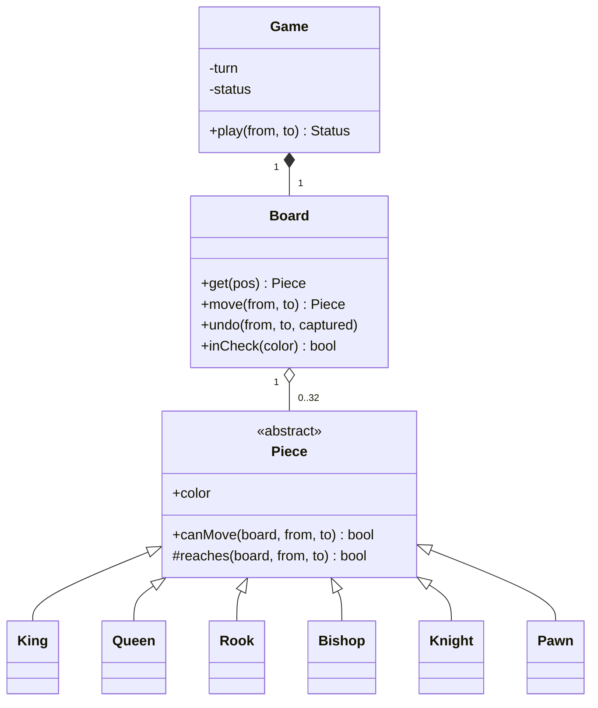

## Requirements

Chess is large, so the first job in the interview is to cut it down. Say the cuts out loud.

Clarifying questions:

- Two human players on one screen, or a network game? (One process, two players taking turns.)
- Do we need every rule? (No. See the scope below.)
- Do we need a computer opponent or a clock? (No.)
- How are moves entered? (As two squares in algebraic form, like `e2` to `e4`.)

Scope for this lesson:

- 8x8 board with the standard starting position.
- Six piece types, each with its own movement rule.
- White moves first; players alternate.
- A move is legal if the piece can reach the target and the move does not leave the mover's own king in **check** (the king is attacked and could be captured next move).
- After each move report the state: ongoing, check, **checkmate** (in check with no legal move) or **stalemate** (not in check but no legal move, a draw).

Out of scope, and worth mentioning as extensions: castling, en passant, pawn promotion, draw by repetition or the fifty move rule, a clock, and move notation like `Nf3`.

## Entities

| Noun or verb | Becomes |
|---|---|
| Colour (white, black) | `Color` enum with `opposite()` |
| Square | `Pos` (row, column), an immutable value |
| Piece | Abstract `Piece`, with `King`, `Queen`, `Rook`, `Bishop`, `Knight`, `Pawn` |
| Board | `Board`: an 8x8 grid, move and undo, check detection, rendering |
| Whose turn, game result | `Game` with `Color turn` and a `Status` |
| Move that cannot be played | `IllegalMoveException` |

Responsibilities split by what each class can know:

- A **piece** knows its own geometry: where it may go on an otherwise empty or occupied board.
- The **board** knows where everything is, and can ask: is this king attacked?
- The **game** knows the rules that involve turns: whose piece it is, and whether a move exposes your own king.



## Polymorphic move validation

The core idea: `Game` must never contain `if (piece is a Knight) ... else if (piece is a Rook) ...`. Each piece answers the question itself. That is **polymorphism**: the caller uses the base type, and the right subclass method runs.

`Piece.canMove` is a **template method**: a method in the base class that fixes the order of steps and lets subclasses fill in one of them.

1. The target must differ from the start square.
2. The target must not hold a piece of your own colour.
3. Then call the abstract `reaches`, which each subclass implements.

Steps 1 and 2 are the same for every piece, so they live once, in the base class. Only the geometry differs.

| Piece | `reaches` is true when |
|---|---|
| King | The target is one step away in any direction |
| Rook | Same row or column, and the squares in between are empty |
| Bishop | Same diagonal, and the squares in between are empty |
| Queen | Rook rule or bishop rule |
| Knight | The move is 1 and 2 squares, in either order. Nothing blocks it (it jumps) |
| Pawn | One step forward onto an empty square; two steps from the start row if both squares are empty; one step diagonally forward only to capture |

A small helper, `pathClear`, walks from the start towards the target one square at a time and fails on the first occupied square. Rook, bishop and queen share it. For a line, the step is the **sign** of the difference in each direction (+1, 0 or -1), which `signum` gives.

```quiz
q: Which of these moves, written as (rows, columns) from the start square, are legal knight moves?
options:
  - (1, 2)
  - (2, 2)
  - (2, 1)
  - (0, 2)
answer: [0, 2]
why: "A knight moves 2 in one direction and 1 in the other. The product of the two distances is 2 for (1,2) and (2,1) only. (2,2) is a bishop-like diagonal and (0,2) is a rook-like line."
```

:::key
Piece geometry and board state are separate questions. `reaches` answers "can this piece get there?" using the board only to look for blockers. Whether the move is wise, such as leaving your king under attack, is `Game`'s question.
:::

## Check, checkmate and stalemate

A move is **legal** when two things hold: the piece can reach the target, and afterwards the mover's own king is not attacked.

To test the second part without writing a separate attack generator, use **try, look, undo**:

1. Make the move on the board and remember what was captured.
2. Ask `board.inCheck(mover)`.
3. Undo the move, restoring the captured piece.

`inCheck(side)` finds that side's king, then asks every enemy piece: `canMove(board, itsSquare, kingSquare)`. If any can, the king is attacked. It is the same method used for ordinary moves, so there is one definition of "a piece can reach a square".

After a legal move, the opponent's state follows from two facts: is their king in check, and do they have any legal move? `hasLegalMove` tries every piece on every target square with the same test.

| In check | Has a legal move | Status |
|---|---|---|
| No | Yes | ONGOING |
| Yes | Yes | CHECK |
| Yes | No | CHECKMATE |
| No | No | STALEMATE |

:::warn
Using `canMove` as an attack test works for a king because the king's square holds a piece. A pawn attacks diagonally only onto a piece, so asking "does a pawn attack this empty square?" gives the wrong answer. Castling needs exactly that question (are the squares the king crosses attacked?), so you will need a separate `attacks(square)` method when you add it.
:::

:::truth
Try, look, undo is simple and correct, not fast. `hasLegalMove` tries up to 64 targets for each of up to 16 pieces and each try scans the board for the king. That is fine for a two-player game and far too slow for a chess engine, which uses bitboards (a 64 bit number per piece kind) and incremental attack tables. Say that if asked.
:::

## Key flows

`Game.play(from, to)` in order:

1. If the game already ended in checkmate or stalemate, reject.
2. Parse the two squares. Bad text such as `z9` is rejected.
3. There must be a piece on `from`, and it must belong to the player whose turn it is.
4. `piece.canMove` must be true (geometry and blockers).
5. The move must not expose the mover's own king (try, look, undo).
6. Commit the move, switch the turn and compute the new status.

Every failed step throws `IllegalMoveException` before any change is committed, so the board never ends up half-updated, and the turn does not change.

## Code

Rows are numbered from 0 for rank 1 (white's back rank), columns from 0 for file `a`. The demo plays a short game to show a check and two rejected moves, and then scholar's mate (a four move checkmate) with a rejected move after the game ended. White pieces print in upper case, black in lower case. The code is longer than the other case studies because every piece is a class; in a real interview you would write the interface, one or two pieces and describe the rest.

```java
import java.util.*;

enum Color {
    WHITE, BLACK;
    Color opposite() { return this == WHITE ? BLACK : WHITE; }
}

enum Status { ONGOING, CHECK, CHECKMATE, STALEMATE }

record Pos(int row, int col) {   // row 0 = rank 1, col 0 = file a
    static Pos parse(String s) {
        if (s.length() != 2 || s.charAt(0) < 'a' || s.charAt(0) > 'h' || s.charAt(1) < '1' || s.charAt(1) > '8')
            throw new IllegalMoveException("bad square " + s);
        return new Pos(s.charAt(1) - '1', s.charAt(0) - 'a');
    }
    public String toString() { return "" + (char) ('a' + col) + (row + 1); }
}

class IllegalMoveException extends RuntimeException {
    IllegalMoveException(String message) { super(message); }
}

abstract class Piece {
    final Color color;
    final char symbol;   // upper case; the board prints black pieces in lower case
    Piece(Color color, char symbol) { this.color = color; this.symbol = symbol; }
    /** Piece-specific geometry. The target is already known to be empty or an enemy. */
    protected abstract boolean reaches(Board b, Pos from, Pos to);

    final boolean canMove(Board b, Pos from, Pos to) {
        if (from.equals(to)) return false;
        Piece target = b.get(to);
        if (target != null && target.color == color) return false;
        return reaches(b, from, to);
    }

    protected static boolean straight(Pos f, Pos t) { return f.row() == t.row() || f.col() == t.col(); }
    protected static boolean diagonal(Pos f, Pos t) { return Math.abs(t.row() - f.row()) == Math.abs(t.col() - f.col()); }

    /** True if every square strictly between from and to is empty (straight or diagonal lines only). */
    protected static boolean pathClear(Board b, Pos from, Pos to) {
        int dr = Integer.signum(to.row() - from.row()), dc = Integer.signum(to.col() - from.col());
        for (int r = from.row() + dr, c = from.col() + dc; r != to.row() || c != to.col(); r += dr, c += dc)
            if (b.get(new Pos(r, c)) != null) return false;
        return true;
    }
}

class King extends Piece {
    King(Color c) { super(c, 'K'); }
    protected boolean reaches(Board b, Pos f, Pos t) {
        return Math.max(Math.abs(t.row() - f.row()), Math.abs(t.col() - f.col())) == 1;
    }
}

class Rook extends Piece {
    Rook(Color c) { super(c, 'R'); }
    protected boolean reaches(Board b, Pos f, Pos t) {
        return straight(f, t) && pathClear(b, f, t);
    }
}

class Bishop extends Piece {
    Bishop(Color c) { super(c, 'B'); }
    protected boolean reaches(Board b, Pos f, Pos t) {
        return diagonal(f, t) && pathClear(b, f, t);
    }
}

class Queen extends Piece {
    Queen(Color c) { super(c, 'Q'); }
    protected boolean reaches(Board b, Pos f, Pos t) {
        return (straight(f, t) || diagonal(f, t)) && pathClear(b, f, t);
    }
}

class Knight extends Piece {
    Knight(Color c) { super(c, 'N'); }
    protected boolean reaches(Board b, Pos f, Pos t) {
        int dr = Math.abs(t.row() - f.row()), dc = Math.abs(t.col() - f.col());
        return dr * dc == 2;   // (1,2) or (2,1); jumps over everything
    }
}

class Pawn extends Piece {
    Pawn(Color c) { super(c, 'P'); }
    protected boolean reaches(Board b, Pos f, Pos t) {
        int dir = color == Color.WHITE ? 1 : -1, startRow = color == Color.WHITE ? 1 : 6;
        int dr = t.row() - f.row(), dc = Math.abs(t.col() - f.col());
        boolean empty = b.get(t) == null;
        if (dc == 0 && empty) {
            if (dr == dir) return true;
            return dr == 2 * dir && f.row() == startRow && b.get(new Pos(f.row() + dir, f.col())) == null;
        }
        return dc == 1 && dr == dir && !empty;   // diagonal step only to capture
    }
}

class Board {
    private final Piece[][] grid = new Piece[8][8];

    Board() {
        for (Color c : Color.values()) {
            int back = c == Color.WHITE ? 0 : 7, front = c == Color.WHITE ? 1 : 6;
            Piece[] row = {new Rook(c), new Knight(c), new Bishop(c), new Queen(c),
                           new King(c), new Bishop(c), new Knight(c), new Rook(c)};
            for (int col = 0; col < 8; col++) {
                grid[back][col] = row[col];
                grid[front][col] = new Pawn(c);
            }
        }
    }

    Piece get(Pos p) { return grid[p.row()][p.col()]; }

    Piece move(Pos from, Pos to) {   // returns the captured piece, if any
        Piece captured = get(to);
        grid[to.row()][to.col()] = get(from);
        grid[from.row()][from.col()] = null;
        return captured;
    }

    void undo(Pos from, Pos to, Piece captured) {
        grid[from.row()][from.col()] = get(to);
        grid[to.row()][to.col()] = captured;
    }

    boolean inCheck(Color side) {
        Pos king = null;
        for (int r = 0; r < 8; r++)
            for (int c = 0; c < 8; c++)
                if (grid[r][c] instanceof King && grid[r][c].color == side) king = new Pos(r, c);
        for (int r = 0; r < 8; r++)
            for (int c = 0; c < 8; c++) {
                Piece p = grid[r][c];
                if (p != null && p.color != side && p.canMove(this, new Pos(r, c), king)) return true;
            }
        return false;
    }

    String render() {
        StringBuilder sb = new StringBuilder();
        for (int r = 7; r >= 0; r--) {
            for (int c = 0; c < 8; c++) {
                Piece p = grid[r][c];
                sb.append(p == null ? '.' : p.color == Color.WHITE ? p.symbol : Character.toLowerCase(p.symbol));
            }
            if (r > 0) sb.append('\n');
        }
        return sb.toString();
    }
}

class Game {
    private final Board board = new Board();
    private Color turn = Color.WHITE;
    private Status status = Status.ONGOING;

    Board board() { return board; }
    Color turn() { return turn; }

    private boolean exposesKing(Pos from, Pos to) {   // try the move, look, take it back
        Piece captured = board.move(from, to);
        boolean bad = board.inCheck(turn);
        board.undo(from, to, captured);
        return bad;
    }

    private boolean hasLegalMove(Color side) {
        for (int fr = 0; fr < 8; fr++)
            for (int fc = 0; fc < 8; fc++) {
                Pos from = new Pos(fr, fc);
                Piece p = board.get(from);
                if (p == null || p.color != side) continue;
                for (int tr = 0; tr < 8; tr++)
                    for (int tc = 0; tc < 8; tc++) {
                        Pos to = new Pos(tr, tc);
                        if (p.canMove(board, from, to) && !exposesKing(from, to)) return true;
                    }
            }
        return false;
    }

    Status play(String fromSquare, String toSquare) {
        if (status == Status.CHECKMATE || status == Status.STALEMATE) throw new IllegalMoveException("game is over");
        Pos from = Pos.parse(fromSquare), to = Pos.parse(toSquare);
        Piece p = board.get(from);
        if (p == null || p.color != turn) throw new IllegalMoveException("no " + turn + " piece on " + from);
        if (!p.canMove(board, from, to)) throw new IllegalMoveException(p.symbol + " cannot go " + from + "-" + to);
        if (exposesKing(from, to)) throw new IllegalMoveException("move leaves the " + turn + " king in check");
        board.move(from, to);
        turn = turn.opposite();
        boolean check = board.inCheck(turn), canMove = hasLegalMove(turn);
        status = check ? (canMove ? Status.CHECK : Status.CHECKMATE) : (canMove ? Status.ONGOING : Status.STALEMATE);
        return status;
    }
}

public class Main {
    static void play(Game g, String from, String to) {
        String head = g.turn() + " " + from + "-" + to + ": ";
        try {
            System.out.println(head + g.play(from, to));
        } catch (IllegalMoveException e) {
            System.out.println(head + "rejected, " + e.getMessage());
        }
    }

    public static void main(String[] args) {
        System.out.println("-- game 1: a check and a rejected move --");
        Game g1 = new Game();
        String[][] first = {{"e2", "e4"}, {"d7", "d6"}, {"f1", "b5"}, {"h7", "h6"}, {"c7", "c6"}, {"a1", "a3"}};
        for (String[] m : first) play(g1, m[0], m[1]);

        System.out.println("-- game 2: scholar's mate --");
        Game g2 = new Game();
        String[][] mate = {{"e2", "e4"}, {"e7", "e5"}, {"f1", "c4"}, {"b8", "c6"}, {"d1", "h5"}, {"g8", "f6"},
                           {"h5", "f7"}, {"e8", "e7"}};
        for (String[] m : mate) play(g2, m[0], m[1]);
        System.out.println(g2.board().render());
    }
}
```
```cpp
#include <algorithm>
#include <array>
#include <cctype>
#include <cstdlib>
#include <iostream>
#include <memory>
#include <stdexcept>
#include <string>
#include <vector>

enum class Color { White, Black };
enum class Status { Ongoing, Check, Checkmate, Stalemate };

Color opposite(Color c) { return c == Color::White ? Color::Black : Color::White; }
std::string colorName(Color c) { return c == Color::White ? "WHITE" : "BLACK"; }

std::string statusName(Status s) {
    switch (s) {
        case Status::Ongoing: return "ONGOING";
        case Status::Check: return "CHECK";
        case Status::Checkmate: return "CHECKMATE";
        default: return "STALEMATE";
    }
}

class IllegalMoveException : public std::runtime_error {
public:
    explicit IllegalMoveException(const std::string& m) : std::runtime_error(m) {}
};

struct Pos {   // row 0 = rank 1, col 0 = file a
    int row, col;
    bool operator==(const Pos& o) const { return row == o.row && col == o.col; }
    static Pos parse(const std::string& s) {
        if (s.size() != 2 || s[0] < 'a' || s[0] > 'h' || s[1] < '1' || s[1] > '8')
            throw IllegalMoveException("bad square " + s);
        return Pos{s[1] - '1', s[0] - 'a'};
    }
    std::string str() const { return std::string(1, static_cast<char>('a' + col)) + std::to_string(row + 1); }
};

class Board;

class Piece {
public:
    Piece(Color color, char symbol) : color_(color), symbol_(symbol) {}
    virtual ~Piece() = default;
    Color color() const { return color_; }
    char symbol() const { return symbol_; }   // upper case; the board prints black pieces in lower case

    bool canMove(const Board& b, Pos from, Pos to) const;

protected:
    // Piece-specific geometry. The target is already known to be empty or an enemy.
    virtual bool reaches(const Board& b, Pos from, Pos to) const = 0;
    static bool straight(Pos f, Pos t) { return f.row == t.row || f.col == t.col; }
    static bool diagonal(Pos f, Pos t) { return std::abs(t.row - f.row) == std::abs(t.col - f.col); }
    static bool pathClear(const Board& b, Pos from, Pos to);   // squares strictly between are empty

private:
    Color color_;
    char symbol_;
};

class Board {
public:
    using Cell = std::shared_ptr<Piece>;

    Board();
    Cell get(Pos p) const { return grid_[p.row][p.col]; }

    Cell move(Pos from, Pos to) {   // returns the captured piece, if any
        Cell captured = get(to);
        grid_[to.row][to.col] = get(from);
        grid_[from.row][from.col] = nullptr;
        return captured;
    }
    void undo(Pos from, Pos to, Cell captured) {
        grid_[from.row][from.col] = get(to);
        grid_[to.row][to.col] = captured;
    }

    bool inCheck(Color side) const {
        Pos king{0, 0};
        for (int r = 0; r < 8; ++r)
            for (int c = 0; c < 8; ++c)
                if (grid_[r][c] && grid_[r][c]->symbol() == 'K' && grid_[r][c]->color() == side) king = Pos{r, c};
        for (int r = 0; r < 8; ++r)
            for (int c = 0; c < 8; ++c) {
                const Cell& p = grid_[r][c];
                if (p && p->color() != side && p->canMove(*this, Pos{r, c}, king)) return true;
            }
        return false;
    }

    std::string render() const {
        std::string out;
        for (int r = 7; r >= 0; --r) {
            for (int c = 0; c < 8; ++c) {
                const Cell& p = grid_[r][c];
                out += !p ? '.' : p->color() == Color::White ? p->symbol()
                                                             : static_cast<char>(std::tolower(p->symbol()));
            }
            if (r > 0) out += '\n';
        }
        return out;
    }

private:
    std::array<std::array<Cell, 8>, 8> grid_;
};

bool Piece::canMove(const Board& b, Pos from, Pos to) const {
    if (from == to) return false;
    Board::Cell target = b.get(to);
    if (target && target->color() == color_) return false;
    return reaches(b, from, to);
}

bool Piece::pathClear(const Board& b, Pos from, Pos to) {
    int dr = (to.row > from.row) - (to.row < from.row), dc = (to.col > from.col) - (to.col < from.col);
    for (int r = from.row + dr, c = from.col + dc; r != to.row || c != to.col; r += dr, c += dc)
        if (b.get(Pos{r, c})) return false;
    return true;
}

class King : public Piece {
public:
    explicit King(Color c) : Piece(c, 'K') {}
protected:
    bool reaches(const Board&, Pos f, Pos t) const override {
        return std::max(std::abs(t.row - f.row), std::abs(t.col - f.col)) == 1;
    }
};

class Rook : public Piece {
public:
    explicit Rook(Color c) : Piece(c, 'R') {}
protected:
    bool reaches(const Board& b, Pos f, Pos t) const override { return straight(f, t) && pathClear(b, f, t); }
};

class Bishop : public Piece {
public:
    explicit Bishop(Color c) : Piece(c, 'B') {}
protected:
    bool reaches(const Board& b, Pos f, Pos t) const override { return diagonal(f, t) && pathClear(b, f, t); }
};

class Queen : public Piece {
public:
    explicit Queen(Color c) : Piece(c, 'Q') {}
protected:
    bool reaches(const Board& b, Pos f, Pos t) const override {
        return (straight(f, t) || diagonal(f, t)) && pathClear(b, f, t);
    }
};

class Knight : public Piece {
public:
    explicit Knight(Color c) : Piece(c, 'N') {}
protected:
    bool reaches(const Board&, Pos f, Pos t) const override {
        return std::abs(t.row - f.row) * std::abs(t.col - f.col) == 2;   // (1,2) or (2,1); jumps over everything
    }
};

class Pawn : public Piece {
public:
    explicit Pawn(Color c) : Piece(c, 'P') {}
protected:
    bool reaches(const Board& b, Pos f, Pos t) const override {
        int dir = color() == Color::White ? 1 : -1, startRow = color() == Color::White ? 1 : 6;
        int dr = t.row - f.row, dc = std::abs(t.col - f.col);
        bool empty = !b.get(t);
        if (dc == 0 && empty) {
            if (dr == dir) return true;
            return dr == 2 * dir && f.row == startRow && !b.get(Pos{f.row + dir, f.col});
        }
        return dc == 1 && dr == dir && !empty;   // diagonal step only to capture
    }
};

Board::Board() {
    for (Color c : {Color::White, Color::Black}) {
        int back = c == Color::White ? 0 : 7, front = c == Color::White ? 1 : 6;
        std::array<Cell, 8> row = {std::make_shared<Rook>(c), std::make_shared<Knight>(c),
                                   std::make_shared<Bishop>(c), std::make_shared<Queen>(c),
                                   std::make_shared<King>(c), std::make_shared<Bishop>(c),
                                   std::make_shared<Knight>(c), std::make_shared<Rook>(c)};
        for (int col = 0; col < 8; ++col) {
            grid_[back][col] = row[col];
            grid_[front][col] = std::make_shared<Pawn>(c);
        }
    }
}

class Game {
public:
    const Board& board() const { return board_; }
    Color turn() const { return turn_; }

    Status play(const std::string& fromSquare, const std::string& toSquare) {
        if (status_ == Status::Checkmate || status_ == Status::Stalemate) throw IllegalMoveException("game is over");
        Pos from = Pos::parse(fromSquare), to = Pos::parse(toSquare);
        Board::Cell p = board_.get(from);
        if (!p || p->color() != turn_) throw IllegalMoveException("no " + colorName(turn_) + " piece on " + from.str());
        if (!p->canMove(board_, from, to))
            throw IllegalMoveException(std::string(1, p->symbol()) + " cannot go " + from.str() + "-" + to.str());
        if (exposesKing(from, to)) throw IllegalMoveException("move leaves the " + colorName(turn_) + " king in check");
        board_.move(from, to);
        turn_ = opposite(turn_);
        bool check = board_.inCheck(turn_), canMove = hasLegalMove(turn_);
        status_ = check ? (canMove ? Status::Check : Status::Checkmate) : (canMove ? Status::Ongoing : Status::Stalemate);
        return status_;
    }

private:
    bool exposesKing(Pos from, Pos to) {   // try the move, look, take it back
        Board::Cell captured = board_.move(from, to);
        bool bad = board_.inCheck(turn_);
        board_.undo(from, to, captured);
        return bad;
    }

    bool hasLegalMove(Color side) {
        for (int fr = 0; fr < 8; ++fr)
            for (int fc = 0; fc < 8; ++fc) {
                Pos from{fr, fc};
                Board::Cell p = board_.get(from);
                if (!p || p->color() != side) continue;
                for (int tr = 0; tr < 8; ++tr)
                    for (int tc = 0; tc < 8; ++tc) {
                        Pos to{tr, tc};
                        if (p->canMove(board_, from, to) && !exposesKing(from, to)) return true;
                    }
            }
        return false;
    }

    Board board_;
    Color turn_ = Color::White;
    Status status_ = Status::Ongoing;
};

void play(Game& g, const std::string& from, const std::string& to) {
    std::cout << colorName(g.turn()) << " " << from << "-" << to << ": ";
    try {
        std::cout << statusName(g.play(from, to)) << "\n";
    } catch (const IllegalMoveException& e) {
        std::cout << "rejected, " << e.what() << "\n";
    }
}

int main() {
    using Moves = std::vector<std::pair<std::string, std::string>>;
    std::cout << "-- game 1: a check and a rejected move --\n";
    Game g1;
    for (const auto& m : Moves{{"e2", "e4"}, {"d7", "d6"}, {"f1", "b5"}, {"h7", "h6"}, {"c7", "c6"}, {"a1", "a3"}})
        play(g1, m.first, m.second);

    std::cout << "-- game 2: scholar's mate --\n";
    Game g2;
    for (const auto& m : Moves{{"e2", "e4"}, {"e7", "e5"}, {"f1", "c4"}, {"b8", "c6"}, {"d1", "h5"}, {"g8", "f6"},
                               {"h5", "f7"}, {"e8", "e7"}})
        play(g2, m.first, m.second);
    std::cout << g2.board().render() << "\n";
}
```
```output
-- game 1: a check and a rejected move --
WHITE e2-e4: ONGOING
BLACK d7-d6: ONGOING
WHITE f1-b5: CHECK
BLACK h7-h6: rejected, move leaves the BLACK king in check
BLACK c7-c6: ONGOING
WHITE a1-a3: rejected, R cannot go a1-a3
-- game 2: scholar's mate --
WHITE e2-e4: ONGOING
BLACK e7-e5: ONGOING
WHITE f1-c4: ONGOING
BLACK b8-c6: ONGOING
WHITE d1-h5: ONGOING
BLACK g8-f6: ONGOING
WHITE h5-f7: CHECKMATE
BLACK e8-e7: rejected, game is over
r.bqkb.r
pppp.Qpp
..n..n..
....p...
..B.P...
........
PPPP.PPP
RNB.K.NR
```

Compile the C++ with `g++ -std=c++17`.

What does the square parser compute for `e4`? Rows and columns both start at 0.

```predict
lang: java
code: |
  String s = "e4";
  int col = s.charAt(0) - 'a';
  int row = s.charAt(1) - '1';
  System.out.println(row + " " + col);
output: 3 4
why: "Column is the letter's distance from 'a', so e gives 4. Row is the digit's distance from '1', so 4 gives 3. Both counts start at 0, which is why the board is indexed this way."
```

```order
prompt: Arrange the steps of Game.play after the piece has passed the geometry check.
lang: java
code: |
  if (exposesKing(from, to)) throw new IllegalMoveException("move leaves the " + turn + " king in check");
  board.move(from, to);
  turn = turn.opposite();
  boolean check = board.inCheck(turn), canMove = hasLegalMove(turn);
  status = check ? (canMove ? Status.CHECK : Status.CHECKMATE) : (canMove ? Status.ONGOING : Status.STALEMATE);
  return status;
distractors:
  - "    turn = turn.opposite();   // before exposesKing"
why: The exposure test must use the mover's colour, so the turn switches only after the move is committed. The new status is about the opponent, who is now the player to move.
```

## Patterns and design decisions

- **Polymorphism over type checks.** Adding a seventh piece type (a fairy chess piece) is a new subclass, not an edit of `Game`.
- **Template Method in `canMove`.** Shared rules live once in the base class. The subclass supplies only `reaches`. Marking `canMove` as `final` in Java (non-virtual in C++) stops a subclass from forgetting the own-colour check.
- **Immutable pieces.** A piece holds only its colour and symbol. Position is the board's job. A piece that stores its own position can disagree with the board.
- **Value type for squares.** `Pos` is a small immutable record or struct, safe to copy and compare.
- **Try, look, undo.** No duplicate attack logic. One definition of movement is used for moves, for check and for legal-move search.
- **Pawn start row from colour.** Without a `hasMoved` flag, a pawn is "unmoved" if it stands on its start row. That is exact for pawns, which never move backwards. Castling cannot be done this way, because a rook may leave and return.

## Extensibility

| Change request | What changes |
|---|---|
| Castling | Add `hasMoved` to king and rook (so pieces are no longer fully immutable), a `Game` rule for the two-square king move, and an `attacks(square)` method for the squares crossed |
| En passant | `Game` stores the last move; a pawn capture onto that "skipped" square is allowed for one turn, and removes the pawn beside it |
| Promotion | When a pawn lands on the last rank, ask for a piece kind and replace the pawn with a new piece on the board |
| Undo and history | Command pattern: each entry stores `from`, `to`, the captured piece and any extra state; undo calls `board.undo` |
| Draw by repetition or fifty moves | Keep a history of positions or a counter in `Game`; `Board` is unchanged |
| Computer opponent | A `MoveChooser` interface that lists legal moves and picks one; `hasLegalMove` becomes `legalMoves` |

:::note
Castling, en passant and promotion are left out deliberately. Each needs a little extra state (`hasMoved`, the last move, a piece choice), so each is a good follow-up question: the interviewer wants to see where that state lives.
:::

## Interview tips

- Draw the hierarchy first: `Piece` and six subclasses, `Board`, `Game`. Then write `Piece`, `Knight` and `Rook` fully and say the rest follow the same shape.
- Name the template method pattern and explain the shared checks.
- Separate "can this piece reach the square" from "is the move legal". Most weak answers mix them.
- Explain check detection as try, look, undo, then name the cost honestly.
- Test with famous short games (scholar's mate) and one pinned piece: a piece that may not move because it shields its king.

```cards
- q: Why is canMove a template method?
  a: Every piece shares two checks (target differs, target is not your own piece). The base class does them once, then calls the abstract reaches that each piece implements.
- q: How does the pawn differ from other pieces in reaches?
  a: It moves forward onto empty squares only, may take two steps from its start row, and captures one step diagonally forward only onto an enemy piece.
- q: How do you check that a move does not expose your own king?
  a: Try it on the board, ask whether your king is attacked, then undo it. Reject the move if the king is attacked.
- q: When is it checkmate, and when stalemate?
  a: Both mean the player to move has no legal move. If their king is in check it is checkmate; if not, it is stalemate, a draw.
- q: Why does castling need more than canMove?
  a: It needs to know whether the king and rook have moved before, and whether the squares the king crosses are attacked. Neither is visible from a single piece's geometry.
```

## Notes

:::notes
- Entities: Color, Pos, abstract Piece (King, Queen, Rook, Bishop, Knight, Pawn), Board, Game, Status. Pieces know geometry, Board knows positions, Game knows turns and legality.
- Piece.canMove is a template method: target differs, target not own colour, then abstract reaches per piece type.
- Sliding pieces (rook, bishop, queen) also need pathClear: every square between start and target is empty. The knight jumps; its test is |dr| * |dc| == 2.
- Pawn: forward onto empty, two steps from the start row if both squares are empty, diagonal one step only to capture.
- Legal move = piece can reach the target AND own king is not attacked afterwards. Test with try, look, undo.
- inCheck(side): does any enemy piece canMove onto my king's square?
- Status after a move: in check and no legal move = checkmate; not in check and no legal move = stalemate.
- Scope cuts to name: castling, en passant, promotion, draws. Each needs a little more state (hasMoved, last move, piece choice).
- Try, look, undo is clear but slow; real engines use bitboards and attack tables.
:::
